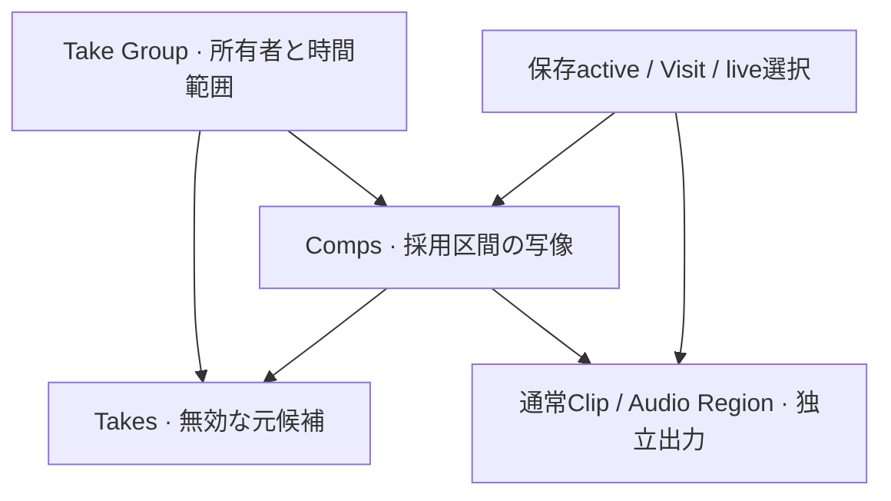

# OSTF 5.1.0 — 全網羅マニュアル

**2026年11月25日・正式な書面仕様。** この一冊に現在の規定、制作フロー、継承する音楽規則、関連ファミリー、移行とサンプルをまとめます。項目の全列挙は[全網羅リファレンス](PARAMETER_REFERENCE.ja.md)を参照してください。

## 読み進め方

Coreのみを使う実装はScore・時間・トラック・MIDI・歌詞から始め、必要に応じてテイクや制作情報を追加します。テイクを使わない曲にtakeGroupsは必須ではありません。セッション画面では構成を扱いやすい単位にし、ファイル上では任意Tick範囲を使います。

1. 現行5.1総合仕様とテイク・コンピングの意味を読む。
2. 楽曲Coreの構造は継承マニュアルと全項目リファレンスで確認する。
3. Audio/Mixerが必要ならProduction、共同演奏ならDistributed、素材の一括輸送ならPackage、Plugin/AI連携ならPlugin Contextを選ぶ。
4. 規定の保存結果と元候補を両方保持し、未対応機能は保持または損失報告する。
5. 例題を対応機能の説明として読む。動作試験の合格記録として扱わない。

## データモデル

同じ時間範囲に複数のテイク候補を置き、採用区間をCompとして別に保存します。候補を切り刻む必要はありません。再生用の通常Clip/Audio Regionは独立したIDで実体化し、保存上のactiveCompと一致させます。構成名や小節・コードは編集の単位で、規格の基準座標はsource-global Tickです。



同じ元素材を参照する連続区間はMIDI境界処理の前にまとめます。Audioクロスフェードは明示窓と出力に保存し、読み込み側で二重に処理しません。表示上のレーン、色、ボタンは各アプリが選べます。

## 継承資料と現在の効力

末尾の折りたたみ付録には採択済み4.3の原文を収録します。そこにあるDraft番号、未承認欄、旧リリース条件は歴史資料です。5.1策定は一括承認済みで、動作検証を条件にしません。本文の現在版規定が優先し、音楽上の変更を明示しない部分は継承します。


---

## 1. SPECIFICATION

# Open Song Timeline Format 5.1.0 — 正式仕様

**リリース：v5.1.0 · 2026年11月25日 · Take & Comp**

本書はOSTF 5.1.0の統合済み書面仕様である。正式版5.0の楽曲・プロジェクトモデルを継承し、任意の非破壊MIDI／Audio Take Group、Comp採用写像、保存済み出力、有限Visitごとの選択、ライブ起動時の選択方針を追加する。英語版は`SPECIFICATION.md`であり、両言語版は同じ現行要件を規定する。「必須」「禁止」「推奨」「任意」はそれぞれMUST、MUST NOT、SHOULD、MAYを意味する。

## 1. 提供形式・対象範囲・規範の優先順位

ファイル形式は引き続き**OSTF TEXT**（`.ostf`、BOMなしUTF-8のJSON Score）と**OSTF PROJECT**（`.ostfp`、ZIPコンテナー）の2種類とする。Production SessionとDistributed Sessionは独立した版を持つ任意のJSON文書ファミリーである。Plugin Context ExchangeはHostとPlugin間の論理メッセージ契約であり、第三の必須拡張子やリアルタイムプラグインAPIを新設しない。

策定者が正式採択した4.3.0の楽曲文法、5.0のファミリー別意味規則、明示的に変更していない必須項目を継承する。Score 5.1は正確な版識別子を変更して任意の`takeGroups`を追加し、Production 0.4は任意の`audioTakeGroups`とScore 5.1への結合を追加する。テイクを使わない文書に、これらのフィールドを要求しない。型、必須性、構造分岐、列挙値、数値境界は版別Schemaが規定し、参照・時間・所有者・動作上の意味条件は本書と現行ファミリー別仕様が規定する。現行の明示的な変更は、名指ししたファミリー・版・事項に限って継承規則に優先する。例題は規範を変更しない。

採択済み4.3の原本は`../adopted-4.3/`に元のバイト列のまま保持する。これらの履歴資料に残るDraft表記、過去の承認条件、旧ナビゲーションは出典履歴であり、5.1のリリース状態や条件ではない。全網羅マニュアルとパラメーターリファレンスは継承項目と現行追加項目を扱う。未知の意味を推測せず、未対応データはlossless保存で保持するか保存を拒否する。文書内の参照だけで外部データの取得・実行は許可されない。

### 現行文書の正確な識別値

| ファミリー | 正確な識別 | 構造の正本 | 現行の意味規則 |
|---|---|---|---|
| Score | `format:"OSTF"`、`version:"5.1.0"` | [Core Schema](../schema/ostf-5.1.0.schema.json) | 本書、[全網羅マニュアル](COMPLETE_MANUAL.ja.md)、採択済み4.3 Score規則 |
| Production | `profile:"OSTF-Production-Session"`、`profileVersion:"0.4.0"`、`score.formatVersion:"5.1.0"` | [Production Schema](../schema/ostf-production-session-0.4.schema.json) | [Production Session 0.4](PRODUCTION_SESSION_0_4.ja.md)、採択済みProduction 0.2と継承した5.0増補 |
| Distributed | `profile:"OSTF-Distributed-Session-0.4"`、`recordType:"snapshot"`または`"event"` | [Distributed Schema](../schema/ostf-distributed-session-0.4.schema.json) | [Distributed Session 0.4](DISTRIBUTED_SESSION_0_4_SPECIFICATION.ja.md) |
| Project manifest | `packageFormat:"OSTFP"`、`packageVersion:"1.1.0"` | [Manifest Schema](../schema/ostf-package-manifest-1.1.schema.json) | [Package仕様](PACKAGE_SPECIFICATION.ja.md) |
| Plugin Context | `protocol:"OSTF-Plugin-Context"`、`protocolVersion:"1.1.0"` | [Plugin Schema](../schema/ostf-plugin-context-1.1.schema.json) | [Plugin交換プロトコル](PLUGIN_EXCHANGE_PROTOCOL.ja.md) |

旧Scoreと関連文書は、それぞれの正確な元バージョンで有効である。5.1対応を理由に4.3や5.0文書の版を付け替えない。5.0対応も5.1識別子の受理を意味しない。

## 2. 継承する正本と不変原則

1. ScoreのSHA-256は、再シリアライズや正規化したJSONではなく、**元のUTF-8バイト列そのもの**から計算する。空白だけの変更でも旧ハッシュは失効する。パッケージ作成時にScore、Production／Distributed文書、Assetの内容バイトを書き換えてはならない。結合は既存のパッケージルート基準パスと正確な識別情報に従う。
2. CoreのHarmony、Lyrics、Notes、Directions、Voice、Resource、音楽的意図は既存の権威を保つ。構成名、レーン順、色は識別や再生内容を決めない。
3. CoreのMIDI CCによるVolume／Expression／Effect制御と、ProductionミキサーのGain／Pan／Sendは別の正本である。Productionの非循環チャンネル・Send・Sidechainグラフ、型付きAutomation、非実行のプラグイン状態モデルを維持する。JSONだけでプラグインを起動したり音響的同一性を保証したりしない。
4. 有限Performance Planは明示的に選択する素材の投影である。元のNoteを書き換えず、第二の正本タイムラインを作らない。既存のfixed／open／silent、役割上書き、連続するsource接続、ハードカット、sourceテンポの規則を維持する。
5. Distributed Sessionは協調状態と演奏句の提案・確定を自身の領域に記録する。`phraseCommitted`だけでScore、Take選択、録音素材は変わらず、実際に音が出た証明にもならない。ルート`scoreSha256`が元のScoreバイト列を固定する。
6. Plugin Contextは読み取り用の部分ビュー、または未信頼の編集提案である。Hostのみが原Snapshot・安定ID・権限に基づき全変更を一括適用し、完全な新状態の保存成功後に`applied`を返す。部分Contextを完全なScoreとして保存してはならない。
7. 実装は対応する正確なファミリー・版・能力を宣言する。「OSTF対応」という総称だけで全任意機能への対応を表してはならない。

## 3. 時間・範囲・包含関係

Take Group、Comp Region、Audio transitionは、既存ScoreのPPQと**source-global Tick**座標を使う。Groupは`startTick >= 0`、`durationTicks > 0`を持ち、範囲は半開区間`[startTick, startTick + durationTicks)`である。これらの構造で使うTickの保存値と、終端・オフセット・加算等の結果は、`0..9007199254740991`内の正確な整数でなければならない。正の長さをゼロに潰さず、オーバーフローを丸めたり折り返したりせず診断する。

Core Clipは従来の`start`と`duration`、NoteとMIDI EventはClip内の相対開始値を維持する。Comp範囲と比較する前に実際のClip開始位置を加算する。Production Audio Assetの座標はデコード後フレームである。source Tick、展開後Performance Tick、Session Clock、Audio Frame、画面上の小節番号を混同しない。

任意の`sectionId`は、Groupと範囲が重なる実在Sectionへの編集上の関連付けである。同一境界を強制せず、Section内相対時間を新たな保存座標にしない。全曲・構成・フレーズ・小節・コード・拍より細かい範囲を同じ区間表現で扱う。あるHostはSectionをセッションクリップとして表示し、別のHostはアレンジメントとして表示できる。クリップ格子、レーン配置、起動UIは固定しない。

Section名、テンポ、拍子、小節番号の変更で保存Tickを暗黙に移動しない。明示的な移動、PPQ変換、タイムライン編集では、関連素材・範囲・出力・参照を一括更新する。テンポ変更は`native` Audioの時間関係を変えるため、出力と再結合への影響を判断する。構成名が一致するだけでは古い出力の整合性を証明しない。Tickから秒への変換は、有限Planの再進入時を含め、適用されるsourceテンポ区間をすべて積分する。

## 4. Take Groupと保持する候補素材

Coreの`takeGroups[]`は一つの実在`trackId`に属する。Productionの`audioTakeGroups[]`は一つの実在`channelId`に属し、Channel種別は`track`または`audioTrack`に限る。Bus／Masterには属せない。同一ファミリー・同一所有者のGroup範囲は重複不可。MIDIとProduction Audioは独立領域であり、同時に演奏する既存の記述は引き続き可能である。

Groupは一つ以上の`takes[]`を持つ。MIDI Takeの`clipIds`は所有Track上の既存Clipを一つ以上参照する。Audio Takeの`audioRegionIds`は所有Channel上の既存Audio Regionを一つ以上参照する。各候補の区間はGroup内に収まる。候補ごとに開始位置や長さが異なってよく、部分的な差し替えTakeがGroup全体を覆う必要はない。同一Take内の候補区間は重複不可で、MIDIの複音はClip内に記述する。異なるTake間の区間は重複できる。

候補Clip／Audio Regionは一つのTakeにのみ所属し、別Groupの素材やComp出力を兼ねてはならない。同じTakeを複数Compから選ぶ場合、元候補データを複製する必要はない。Audio Regionは既存Asset規則に従い同じ音声Assetを参照できる。Coreの`clipChoices`は維持するが、Take Groupが管理する候補・出力Clipを同時に対象にしてはならない。既存のID名前空間・参照の一意性は維持する。

候補MIDI Clipは必ず`enabled:false`、候補Audio Regionは必ず`mute:true`を保存する。これは通常再生の抑制であり、削除ではない。元のNote、Note単位のenabled、MIDI Event、歌唱データ、フレーム選択、gain、fadeを保持する。Takeを選ぶことで候補そのものを通常出力に変えない。明示的なHostの試聴は別系統で可能だが、通常再生の選択を矛盾した状態で保存してはならない。

Groupの再生範囲に、同一所有者・同一領域の無関係なClip／Audio Regionを重ねてはならない。Groupへ組み入れる前に、Writerが分割または明示的な整理を行う。Group外素材のイベントがGroup内へ意図せず漏れないようにする。音源の残響・リリース等DSPテイルの挙動を、これらの音楽的区間規則で新たに定義するものではない。

### 候補のメタデータ

`kind`は、同じ意図に対する別演奏の`take`、同じ範囲の内容変奏の`variation`、別の演奏候補の`alternative`とする。選択の仕組みは共通である。これらの分類はHarmony、歌詞本文、曲構成の書換えを許可しない。その変更には既存の該当構造や別Revisionを用いる。同時に鳴らすダブル／Layerは独立したパートとして扱い、競合Takeの選択とは区別する。

`origin`は人間、AI、外部取り込み、派生、不明等の任意の出自を記録する。Prompt、モデル名、URI、遠隔Participant／ProposalのIDは非実行のメタデータである。`parentTakeId`は同一Group内の別Takeに解決し、親参照は循環不可。`ratings`は`[0,1]`の情報的評価であり、自動採用命令ではない。`laneOrder`は表示順のヒントに限る。メタデータから認証、実行、ネットワーク、Assetアクセスの権限は生じない。

## 5. Compと完全な採用写像

`comps[]`の各項目は、一つの完成した保存済み採用結果である。`compRegions[]`は`startTick`の昇順とし、Group全体を隙間・重複なく分割する。各区間の長さは正。隣接境界のTickは半開区間規則により後続区間に属する。

| 区間種別 | 必須の意味 | 禁止する推測 |
|---|---|---|
| `source` | `takeId`と`clipId`または`audioRegionId`がそのTakeの候補に解決し、採用区間全体が候補内にある | 暗黙の移動、ループ、伸縮、素材置換、別Takeからの補完 |
| `silence` | 明示的な無音であり、Take／候補の参照を持たない | 素材欠落を無音指定と同一視すること |

候補と採用区間のsource Tickは一致する。採用は保持した元素材への参照であり、破壊的な切断ではない。部分Takeがない範囲を暗黙に埋めず、Compが別Takeまたは無音を明示する。

`activeCompId`は必須で、Group内CompのIDまたは`null`である。nullは通常の保存状態でGroupを無音にする。`comps`が空の場合は`activeCompId:null`とし、Visit選択も存在するならすべてnull、liveSelectionはfixed／manualのみとする。一つのTakeをそのまま採用する場合もCompで表現し、競合する`activeTakeId`は設けない。Group IDはファミリー内で一意、Take ID・Comp ID・Comp Region IDはそれぞれGroup内の名前空間で一意とする。§12の歴史的IDを除き、現行の参照はすべて解決しなければならない。

## 6. 実体化出力・保存フラグ・原子性

Comp写像を**編集上の正本**とする。`outputClipIds`／`outputAudioRegionIds`が参照する独立IDの通常Clip／Audio Regionを**再生上の正本**とする。非採用Compを含むすべてのCompは、現在の写像に対応した実体化済み出力を持つ。Readerが毎回リアルタイムにNoteや音声を生成する必要はない。出力は同じ所有者に属し、Group内に収まる。候補IDと出力IDは別であり、異なるCompや`clipChoices`で出力IDを共有しない。

完全無音Compの出力配列は空とし、`noteLinks`／`transitions`も非空にしない。source区間が一つでもあるCompは一つ以上の出力を持つ。採用したMIDI sourceに音符がない場合は、出力欠落ではなく`notes:[]`の出力Clipで表現する。同一MIDI Comp内の出力Clip区間は重複不可。出力Clipの区間自体は無音区間をまたげるが、音符のゲートと採用素材は無音指定を守る。必要なリリース／状態イベントで無音への移行を実現できる。Audio出力の重複は§8の遷移窓に限る。候補と非採用出力は保持する。

通常再生用の保存状態は次のとおり固定する。

| 管理対象 | MIDIの`enabled` | Audioの`mute` |
|---|---|---|
| 候補素材 | `false` | `true` |
| `activeCompId`の出力 | `true` | `false` |
| その他のComp出力、またはactiveがnullの場合の全出力 | `false` | `true` |

これらのフラグは**保存済み既定選択**を表す。選択上の標準例外は§9の明示的な有限Visit／ライブ選択であり、保存フラグを書き換えずに選択Comp出力の再生対象判定だけを差し替える。候補素材を有効化する例外ではない。Core Track／Noteのenabled、Production Channel／Automationのmute、ルーティング、既存のPart実現規則は別の権威として維持する。

5.1では、管理対象である候補または出力Audio Regionに対するRegion単位Automationを禁止する。Channel Automationを使うか、Comp出力へ明示的に編集・レンダーする。特に、保存候補や非採用出力をAutomationでunmuteしてはならない。Group管理外のAudio Regionは従来のAutomation能力を保つ。

Writerは、写像、候補編集、影響する全実体化出力、ID、参照、保存フラグを一つの整合したトランザクションとして保存する。写像や素材を編集した後、古い出力を黙って受理してはならない。出力欠落、所有者違い、参照不明、フラグ矛盾、内容不整合は診断し、その編集／保存を拒否する。明示的なHostの修復は新たな整合Revisionを作れるが、Readerが無断で推測修復しない。写像と出力の音楽的対応はSchema形状だけでは証明できず、DSPのbit単位同一性も主張しない。

## 7. MIDIと歌唱の境界

MIDI Compでは`noteBoundary`を必須とする。

| 値 | 出力の実体化規則 |
|---|---|
| `truncate` | 採用source区間内に絶対開始位置を持つ元Noteのみ採用し、ゲートをその区間末で切る。区間より前に開始したNoteの残りから新しい発音を作らない。 |
| `retrigger` | 区間開始時に持続している元Noteも採用し、区間開始で新たに発音させ、ゲートを区間との共通部分に限定する。 |
| `authored` | 明示的に調整された実体化出力の境界／フレージングを実際の演奏とする。採用元の由来と明示的無音は維持する。 |

同じ候補を参照する連続した採用区間は、この処理前に論理的に結合する。単なる区間細分化で発音回数を増やさない。元の開始はClip内相対値から換算し、Note単位の無効状態を維持する。出力Noteには独立IDを与える。任意の`noteLinks`で元Noteと出力NoteのIDを対応付け、対象候補／出力集合内に解決する。一対多・多対一は可能だが、同一組の重複は禁止する。

これは**Compを作成するときの規則**であり、有限Planによる切断規則を置き換えない。固定Visitは、その後で実体化出力に既存のsource開始位置／ハードカット規則を適用する。作成時に`retrigger`を使用したという理由だけで、Visit進入時に新たな発音を合成してはならない。進入位置での発音が必要なら、そのsource位置に明示的な出力Noteがあるか、別の実体化済みPerformance renditionに記述する必要がある。

WriterはCC、サステイン、Program Change、Pitch Bend、MPE／Channel状態、Note参照データ、音素タイミング、歌唱曲線、歌詞alignmentを出力内で整合させる。非採用素材の制御ストリームを通常再生へ漏らしてはならない。必要な初期化／リリースは既存の対応構造で実体化し、表現できなければ制約を報告し、表現可能な結果が得られるまで編集を受理しない。共有MIDIバス上の無関係なパートを変える一括resetを行わない。外部音源の未規定な初期状態は、Take選択だけでは移植可能にならない。

候補Clip内の歌唱データを保持し、出力の参照は新しい出力IDへ更新する。選択で歌詞本文の正本を書き換えず、一部Noteしか残らないalignmentを完全な歌詞発声とみなさない。境界を作成できない実装も、保存出力の再生と追加データの保持はできるが、Comp編集能力を宣言しない。

## 8. Audioの実体化・切出位置・遷移

Audio Compは`outputMode:"regions"`または`"rendered"`を必須とする。`regions`は通常の出力Region記述で採用素材を表す。`rendered`は別の事前レンダー済み`audioSource` Assetを出力Regionから参照する。レンダーはChannelのDevice／Mixer処理前とし、焼き込んだChannel処理を二重適用しない。元Assetは保持する。

従来のFrame条件は必須である。`sourceStartFrame >= 0`、`sourceFrameCount > 0`、両者の和がデコード後Asset `frameCount`を超えず、`fadeInTicks + fadeOutTicks <= durationTicks`とする。切出しでは元候補のsource位置を保持する。

- source Tick `R`で始まるnative候補のTick `t`における理想Frame位置は、`sourceStartFrame + sampleRateHz × T(R,t)`である。`T`はsourceテンポ区間をすべて積分した秒数。選択Frameを使い切った後は無音であり、Comp区間やVisitの先頭でループ／巻戻ししない。
- source長`L`のfit候補の理想Frame位置は、`sourceStartFrame + sourceFrameCount × (t-R)/L`である。短く切った出力でも、`pitchPolicy`を含む元の選択位置・速度関係を保持する。短い区間に元の全Frame窓をそのまま割り当てると誤った伸縮になる。
- 採用範囲で元候補のgainと元Region内fadeの意味を保持する。切断で旧fadeを自動的に最初からやり直さない。必要な包絡、切出し、遷移を既存Region項目で表せない場合、Writerはrendered出力を使うか、その編集能力に対応しないことを明示する。端数Frameの丸め、再標本化／伸縮アルゴリズムはHost依存であり、交換結果に影響する近似は報告する。

任意の`transitions[]`は、明示的に作成したクロスフェードを記述する。`atTick`は異なる候補を採る隣接source区間の境界である。半開区間の窓`[startTick,startTick+durationTicks)`はその境界を**厳密に内包**し、Group内に収まり、窓全体について両候補に実際の素材ハンドルが存在しなければならない。遷移窓は互いに重複せず、別のsource／silence境界をまたがない。明示的無音を跨いで遷移させない。

`curve`は`linear`、`equalPower`、`customRendered`とする。`regions`は線形振幅遷移だけに対応し、出力Regionの一致した重複窓と既存のfadeIn／fadeOut値を明示する。既存包絡との組合せを表現できない場合はrenderedを使う。重複窓内の正規化位置を`u`とすると、追加するlinear重みは`1-u`と`u`である。equalPowerは`cos(pi*u/2)`と`sin(pi*u/2)`を意図する追加重みとしてrenderedを必須とする。customRenderedもrenderedを必須とし、保存音声Assetが再生の正本である。gain、素材相関、DSP、Frame丸めによって結果の音は影響を受ける。

遷移メタデータは編集内容を記録するものであり、実体化済みfadeやレンダー済み音声に再適用してはならない。遷移指定のない境界はハードカットで、自動スムージングを暗黙に足さない。muteされた二つの元Takeの保持だけでは、レンダー済みクロスフェードを提供したことにならない。

## 9. 有限Visitと自由なライブセッション起動

### 9.1 明示的な有限Visit選択

`visitSelections[]`はGroup内で`(performancePlanId, visitId)`の組をComp IDまたはnullへ対応付ける。組は一意で、実在する有限Plan／Visitに解決し、そのVisitが実際に選ぶsource区間の集合とGroupが交差する必要がある。不連続Visitを最小開始から最大終端まで埋まった一つの範囲とみなさない。nullは明示的な無音であり、上書き指定の省略とは異なる。

通常の選択解決は次の順序とする。

1. 有限Visitでは完全に一致する`visitSelections`があればそれを採用し、なければ保存済み`activeCompId`を使う。自由なliveSelectionで有限Planの決定を置き換えない。
2. Groupとの交差範囲では他Compの出力を抑制し、選択Compの実体化出力だけを再生対象にする。上書きするのは保存済み既定選択を表す管理対象出力の`enabled`／`mute`だけである。候補は引き続き無効で、保存フラグを書き換えない。
3. Core MIDIにはTrack／Noteのenabledと既存Visit Partの実現方式を適用する。Compを選んでも`silent`、`open`、`unspecified`は固定再生にならず、`fixed`だけが保存された音楽出力を再生する。openパートは別途明示的に対応した仕組みで実現できる。
4. 実際の各source区間との交差部分だけに素材を投影する。選択後に既存の連続source接続／ハードカット、source状態、Automation、Tempoの規則を適用する。Visit境界で元Audio Frameやfade位置を最初からやり直さない。

**Productionの独立性を維持する。** Production Audio Regionは、ChannelがCore Trackを参照していても、Core固定Noteの実現方式とは独立する。従ってAudio Compの選択と通常Audio出力は、そのCore Trackの`enabled`や`realization:"silent"`／`"open"`だけでは自動抑制されない。Production Channel／Regionの適格性、mute、routingに従う。上記の選択上書きは管理対象Audio出力の選択集合を差し替え、Visitのsource区間に投影する。特定VisitでAudio Take Groupを無音にするにはnull／完全無音Compを明示的に選ぶか、適切なProduction muteを使用する。これは旧5.1差分にあったAudio候補とCore Part実現方式の曖昧な連動説明を解消する規定である。

保存済み5.1再生に対応していてもVisit選択に未対応のHostは、機能未対応を明示した上で保存既定結果を保持・再生できる。異なる選択を含むPlanを同等に再現したと主張してはならない。

### 9.2 自由なライブ起動

任意の`liveSelection`は、解決済み有限Plan Visitとは別の、Hostの自由なセッションモード起動時の方針である。

| mode | 選択 |
|---|---|
| `fixed` | 保存済み`activeCompId` |
| `manual` | Host／利用者が明示的に選んだGroup内Compまたは無音。未決定なら保存済み選択 |
| `cycle` | 初回は候補一覧の先頭、以後は記載順に循環 |
| `random` | 候補を等確率で選択 |
| `weighted` | 非負のweightに比例して選択。総weightは正 |

cycle／random／weightedでは、実在する異なるComp IDの非空候補一覧を必須とする。weightedでは全候補のweightが必須で、他modeではweightを禁止する。fixed／manualには候補一覧を付けない。動的候補内の無音は名前を持つ完全無音Compで表現できる。候補やメタデータが自動起動を命令するものではない。

確定した起動は§9.1と同じ出力選択上書きを使い、`activeCompId`を書き換えない。未確定または未対応の場合は保存済みactive Compへ戻し、Hostは動的機能未対応を報告する。選択は起動時に確定する。量子化、クリップ途中の切替、無期限ループ、セッションTransport、複数TrackのScene同時制御、乱数seed永続化はHostの方針であり、新しい標準フィールドにはしない。繰返し起動のために元Clipを複製したり無限Visit配列を保存したりしない。

有限の演奏結果を交換する場合は、有限Planと`visitSelections`に明示的な決定を記録する。未記録のランダム／手動選択の再現性は保証しない。Hostは複数Trackの選択を一つのトランザクションで確定できるが、ラベルや同じTake番号だけから規格共通のSceneやTrack間対応を推測しない。

## 10. 分散・AI・Plugin連携

Distributed Session 0.4は従来のSnapshot／Event文法、Clockモデル、権限規則を維持し、Score 5.1の正確な元バイト列・文書／Revision・有限Planに結合する。採用した遠隔演奏句をTakeへ取り込む処理は、候補と整合した出力を作るHostの明示的Score編集である。遠隔CommitだけではCompを選択・変更しない。新Score Revisionで、既存の変更不可な確定EventやScore pinを遡って置き換えない。新たなネットワーク実行器、自動Comp同期、ロボット駆動権限は追加しない。

Plugin Context 1.1はScore 5.1の識別を追加する。この組合せに限り、認可された編集pathにGroup自体の`/takeGroups/{index}`、その子孫の`/takeGroups/{index}/...`、Group追加用の`/takeGroups/-`を加える。旧Scoreへの結合は従来の編集可能rootを維持する。`/takeGroups`配列全体の置換／作成は、このプロトコルの編集対象ではない。配列がない場合はHostが先に明示的なRevisionとして初期化・保存し、新Score SHAに対するContextを発行し直す。

root配列への追加では、`containerId`をpinされたScoreの実際の`document.id`に解決し、Envelopeに一致する`score.documentId`を含め、`newEntityId`を追加Groupの`value.id`と一致させる。Scoreに文書IDがない場合、Hostがその編集Contextを発行する前にIDを設定する。入れ子編集は既存の安定owner／entity ID規則を維持する。提案はTake Group、影響するTrack Clip、全Comp出力、保存選択フラグを原子的に整合させる。写像やactive IDだけを変えて出力フラグを矛盾させる提案は不正。参照不明、古いSnapshot、未認可pathは拒否し、プロトコル版だけでアクセス権は得られない。

Core Plugin Contextの権限はProduction Audio Comp編集を許可しない。Hostは別途認可されたProduction編集経路を実装できるが、Productionの結合とトランザクション条件を維持する。出自Prompt、評価、モデル名、遠隔IDは情報であり、実行命令ではない。

## 11. Package・移行・保持

OSTFP 1.1は5.0のZIP配置、mimetype、安全なpath、manifest、正確なバイトSHA、Asset／Binding規則を維持する。許可する対応版を次のとおり固定する。

| 同梱Score | Production | Distributed |
|---|---|---|
| 4.3.0 | 0.2.0 | `OSTF-Distributed-Session-0.2` |
| 5.0.0 | 0.3.0 | `OSTF-Distributed-Session-0.3` |
| 5.1.0 | 0.4.0 | `OSTF-Distributed-Session-0.4` |

任意ファミリーは省略できるが、同梱する場合はScoreの行に一致させる。Package 1.0は元の受理バージョンを維持する。Package 1.1によって旧Scoreの識別を消去・再解釈しない。Audio Takeの素材は既存の`productionAsset` bindingを使う。lossless Packageには、可聴出力だけでなく、管理対象の元候補・非採用素材と必要な全Assetを含める。解決不能な外部素材は明示し、無断ダウンロードや代替置換をしない。

5.0から5.1への移行は、明示的なRevision／変換操作である。テイクなしScoreは音楽データを保持できるが、版のバイトが変わるため新SHAと明示的な関連文書／Package再結合が必要になる。該当する文書／Revision ID、Productionのsource Tick意味、新しいPlugin Contextを整合させる。過去のDistributed Eventを無断でrepinせず、継承したSession移行規則に従う。

5.1から5.0への移行は、**保存済みactive出力を取り出す明示的な変換**である。採用された通常出力と音楽データを維持し、新しいTake Group構造を取り除き、規定の移行に従って関連文書／Package／Protocolの識別を変換する。別の採用写像、メタデータ、履歴、Visit／live決定の損失を報告する。元候補や非採用出力を残す場合はdisabled／mutedのままとする。削除する場合は残る参照、歌詞alignment、Asset bindingを修復する。非破壊編集を残すには元5.1プロジェクトを保持する。

単純なdowngradeではVisitごとに異なる選択は保持できない。確定した有限演奏を保持するには、適切な別出力ID、Tempo／状態規則、損失報告を持つ新しいArrangement／RenditionへHostが明示的に実体化する。元Scoreを無断でflatten／版変更しない。5.0のみ対応のReaderが5.1 Scoreを直接受理する義務はない。

## 12. 情報的な選択履歴

任意の`takeSelectionHistory[]`は保存された選択履歴である。`sequence`はGroup内で厳密に増加する非負の安全整数、`compId`はその時点の採用IDまたはnullとする。`actorId`、`recordedAt`、`reason`は任意。削除済みCompの歴史的IDを残してよいが、現行再生の参照解決に使ってはならない。履歴は`activeCompId`、`visitSelections`、明示的ライブ起動を上書きせず、完全なイベントログも必須としない。再現可能な有限演奏は有限Plan選択で記録し、不完全な履歴から推測しない。

## 13. 能力宣言とリリース範囲

能力は段階的な必須レベルではなく、独立に宣言する。`score-5.1-read`、`score-5.1-write`、`take-preserve`、`midi-comp-edit`、`audio-comp-edit`、`visit-selection`、`live-selection`、`distributed-0.4`、`plugin-context-1.1`、`package-1.1`を用いる。アプリはTakeレーン表示やComp編集を備えなくても保存済み再生とデータ保持に対応できる。lossless Writerは、管理する未対応標準データ／Assetを保持するか、破壊的上書きを拒否して損失を説明する。

意味上の適合には所有者と範囲の包含、参照解決、Group／Compの一意性、全域分割、候補と出力の有効状態、境界状態、版の正確な結合、原子的更新を含む。JSON Schemaだけではこれらの義務、同一レンダリング、プラグイン利用可能性、ネットワーク時間精度を証明できない。ユーザーインターフェースは各実装が決める。

**本書面仕様は策定者の一括承認に基づく正式リリース仕様である。動作検証、独立パーサー、DAW、DSP、プラグイン、実機、WANでの実行試験はリリース条件に含めず、実施済みとも主張しない。** 仕様リリースは、リポジトリ／Tagの公開作業や実装アプリの認証とは別である。保存された旧Draftの文言から追加の個別承認・実機試験条件を導入しない。

完全な項目宣言と作成手順は、[パラメーターリファレンス](PARAMETER_REFERENCE.ja.md)、[全網羅マニュアル](COMPLETE_MANUAL.ja.md)、[移行表](MIGRATION_MATRIX.ja.md)、[適合性](CONFORMANCE.ja.md)、[セキュリティ](SECURITY.ja.md)、現行ファミリー別仕様、採択済み原本を併せて参照する。


---

## 2. OSTF_STUDIO_IMPLEMENTATION

# OSTF Studio — 5.1実装ガイド

本書はアプリ実装上の推奨設計です。標準の時間・保存・採用規則は`SPECIFICATION.ja.md`が正本です。OSTF Studioの実装完了や動作確認を示すものではありません。

## 構成×トラックのセッション画面

行をSection、列をTrackとする構成単位のクリップ表示を維持できます。セルは既存の素材とTake Group/Compへのビューであり、規格にUIセルやAbleton固有オブジェクトを追加しません。通常はSectionと同じ範囲のGroupを1つ作り、必要なら小節・コード・フレーズ・任意Tick範囲のGroupを扱います。

Section内の相対表示位置は`sourceTick - section.start`です。保存上はsource-global Tickを維持します。同じSectionの再訪は素材を複製せず、有限Performance PlanのVisitやホスト内の起動Instanceで区別します。SectionをまたぐGroupは一つのIDを保ったまま、UIで範囲を投影します。

## 推奨する基本操作

| ユーザー操作 | 保存する内容 |
|---|---|
| 録音/AI生成 | 新しい候補Clip/RegionとTake。候補は無効/mute |
| テイク全体を採用 | そのTakeの範囲＋明示無音からなるCompと別出力 |
| 小節やコード単位の採用 | UIで区切ったsource-global Tick区間をcompRegionsへ |
| コンピング | 完全な非重複区間mapと実体化済み出力を同時更新 |
| Compの切替 | activeCompIdと旧/新出力の選択用flagsを一括保存 |
| ライブ中だけ変更 | 再生時の選択overlay。保存activeCompは維持 |
| 曲として確定 | 有限Plan/visitSelectionsと対応Comp出力を保存 |
| 旧形式へ書出し | 保存active出力を通常素材として投影、損失報告 |

## ライブ起動

ホストは起動量子化、ループ長、複数トラックの同時切替、停止、試聴、UI状態を扱います。標準liveSelectionのcycleは最初の起動を先頭候補から始め、randomは一様、weightedは明示した正の総重みに比例します。固定再現が必要な演奏は最終選択を有限Visitに記録します。無限ループを無限Visit列で保存しません。

Visitまたはliveで選ばれたCompは、保存上の選択用enabled/muteと独立した再生overlayで鳴らします。候補素材を通常再生に混ぜません。Core MIDIのsilent/openと独立したProduction Audioの扱いは維持し、両方を止める操作ではチャンネル制御等を明示します。

## 境界と編集

MIDIのtruncate/retrigger/authoredはComp出力作成時の選択であり、Visitの途中再入に勝手なNote Onを付加する指示ではありません。サステイン・CC・MPE・歌詞/音素の対応を出力側で整えます。オーディオは元素材の位相とframe区間を維持し、表せない複合fadeやequalPowerはチャンネル処理前にレンダーします。

クリップの色、レーンの高さ、波形表示、キーバインド、構成ボタン、画面上の並びは各実装が決めます。表示用に別の必須時間体系を作らず、ホスト拡張を使う場合も標準の意味を変更しません。


---

## 3. PRODUCTION_SESSION_0_4

# OSTF 5 Production Session 0.4 — 相互運用意味規則（5.1.0）

> **0.4の継承関係：** 5.0のProduction 0.3の全規則を継承し、Score 5.1への固定、任意の`audioTakeGroups`、安全整数の時間・Frame制約を追加します。元の0.3 Schemaは別ファイルのまま保持します。音声コンピングの規定は本書末尾および`SPECIFICATION.ja.md`が優先します。

**Production 0.4はバイト照合済の採択4.3 Production 0.2を継承する5.1用規範です。正式な継承原文は `adopted-4.3/docs/PRODUCTION_SESSION_PROFILE.ja.md` に収録しています。** 構造の正本は`schema/ostf-production-session-0.4.schema.json`、宣言可能なProfileは`profile:"OSTF-Production-Session"`、`profileVersion:"0.4.0"`です。`score.formatVersion`は`5.1.0`固定。各実装はCore Score原文のUTF-8バイト列のSHA-256を照合する必要があります。未知のScore版、旧Profileとの不一致を自動変換してはなりません。

## 1. チャンネル・音源・接続の参照

* `channels[].id`、`devices[].id`、`assets[].id`、`audioRegions[].id`、`automation[].id`、全チャンネルを横断した`channels[].sends[].id`、`sidechainConnections[].id`はそれぞれの名前空間で一意。IDは表示名で代用しません。
* `master` Channelはちょうど1件。`track` Channelだけが実在Core Trackに対応し`trackId`を持つ。`audioTrack`はCore Trackを増やさず、`bus/master`はTrack参照を持ちません。Core Trackが複数Channelから参照される場合、意図的な重複出力として誤って扱わず、実装が必要な多重マッピング規則を提供しない限り拒否します。
* それぞれの`deviceIds[]`は同一Profileに存在するDeviceを処理順に列挙します。1 Deviceを2 Channelで所有させない。`instrument`はCore Track Channelの最初のSlotに最大1個、Bus/MasterはInstrumentを含まない。未知のPlugin識別子・状態は参照として保持します。
* 非Master Channelの`outputChannelId`は他Channelに解決しなければなりません。`send.targetChannelId`はBusに、`sidechain.targetDeviceId`は別Channelに属するEffectに解決しなければなりません。`sourceChannelId`はMasterにできません。Sidechain `(targetDeviceId,targetPortId)`は同じProfileで二重に定義しない。
* Output、Send、Sidechainで作られたChannel依存の有向グラフは循環禁止。Source→Destinationを辺とし、SidechainではTarget Deviceの所有ChannelをDestinationとします。存在しない参照や循環を無音で補正せず、明確に拒否・診断します。

## 2. 素材・Audio Regionの一致

* `stateAssetId`は`purpose:"pluginState"`のAssetだけを参照する。`audioRegions[].sourceAssetId`は`purpose:"audioSource"`のAssetだけを参照する。用途違いは拒否します。URIは自動ダウンロードやインストール権限ではありません。
* `sourceStartFrame >= 0`、`sourceFrameCount > 0`、`sourceStartFrame + sourceFrameCount <= asset.frameCount`。`fadeInTicks + fadeOutTicks <= durationTicks`。`startTick`はScore元のグローバルTickです。
* `native`は指定された音声Frameを元のTempo Mapの実時間で再生し、勝手にループ・伸縮しない。`fit`はRegion時間と指定Frame区間の等比例関係を意図し、音高の扱いを`pitchPolicy:preserve|followRate`に明示する。アルゴリズムの違いは音響一致を保証しません。
* 音声Regionは`track`または`audioTrack` Channelに置く。Bus/Master上のAudio Regionは不正。重なりは加算であり、自動Crossfade、正規化、補完サンプルの挿入を行わない。

## 3. Automationの正本・値域・競合

* 全`automation[].points`は非負の**元Score Tick**の厳密昇順で、同Tick重複禁止。複数Visitが同じ元区間を通る場合、元座標の自動化をそれぞれ再適用します。
* 同じ`(target.kind,参照ID,parameter/parameterId)`へ複数Laneを宣言しない。サポートされないLaneを他のパラメータへ暗黙変換しません。
* Boolean対象は`channel.mute`、`send.enabled`、`audioRegion.mute`、`deviceControl.enabled/bypass`のみ。`valueType:boolean`と`interpolation:step`を必須にし、`points[].value`はBooleanです。**Boolean Pointは`atTick`と`value`の両方が必須です。**
* `channel.gainDb/send.gainDb/audioRegion.gainDb`は数値dB、`channel.pan`は-1..1、`device.parameterId`は原則0..1の正規化数値。`deviceControl`は内部VSTパラメータではありません。値域外や異なる型を暗黙に丸めず、診断します。
* 同じ時刻の異種Laneの効果とMIDI CC間の処理順は明示された責務だけに限る。MIDI CC7/10/11/91/93をMixer Gain/Pan/Sendと同じ正本として合成・上書きしません。
* 初回Point前はChannel/Device静的値、最終Point後は最後のPoint値を保持。`step`は直前値、`linear`は対象の数値領域で線形補間します。1つの対象について異なるLaneが競合したら曖昧なlast-writer-winsを採用しません。

## 4. 情報損失と受け渡し

* Score編集で元バイトSHAが変わった場合、Productionの旧`score.sha256`をそのまま引用しません。ユーザーが明示的にProductionを新Scoreへ再関連付けするか、旧Profileを歴史資料として保持します。Plugin Contextの`ack`だけで制作環境のSHAを更新しません。
* `.ostfp`内に素材が存在しても、Pluginプログラム・License・Voicebankが利用可能だと保証しません。未対応Hostは識別子・順序・State記述子と実際に受領したBytesを可能な限り保持するか、損失範囲を示して破壊的保存を拒否します。
* 本規格はDAW/プラグインの演奏・DSPアルゴリズム、複雑なWarp、Surround、並列Rack、物理I/Oの同一性を標準化しません。

**公開版の規範範囲**：上記はProduction 0.4の正式な意味規則です。参照整合、音楽時間、循環禁止等はJSON Schema単独で検証できないため、実装が別途評価します。実装・DSP・DAWでの可聴互換性はこの文書の保証対象ではありません。

## Automation Target の型と値域（規範）

Production Session 0.4は、0.3で導入済みの数値AutomationにBooleanを許さない型・値域制約を継承します。既存5.0・4.3のSchemaは変更しません。

| `target.kind` | `parameter` | `valueType` | `points[].value` | 補足 |
|---|---|---|---|---|
| `channel` | `gainDb` | `number` | -120～+24 dB | チャンネルの音声Gain。MIDI CC7と独立 |
| `channel` | `pan` | `number` | -1～+1 | 音声Pan。MIDI CC10と独立 |
| `channel` | `mute` | `boolean` | `true` / `false` | `interpolation:step`のみ |
| `send` | `gainDb` | `number` | -120～+24 dB | 対象Sendの音声Gain |
| `send` | `enabled` | `boolean` | `true` / `false` | `interpolation:step`のみ |
| `audioRegion` | `gainDb` | `number` | -120～+24 dB | Region段階の音声Gain |
| `audioRegion` | `mute` | `boolean` | `true` / `false` | `interpolation:step`のみ |
| `deviceControl` | `enabled`、`bypass` | `boolean` | `true` / `false` | Plugin内部Parameterではない |
| `device` | `parameterId` | `number` | 0～1 | 正規化された不透明Parameter値、実パラメータの尺度はホスト依存 |

**必須意味規則：** 各Laneは`points[]`を1件以上持ち、`atTick`を元ScoreのGlobal Tickで**厳密昇順・重複なし**に並べる。Scopeは元ScoreのTickであり、Performance PlanのVisitが再訪する場合も元位置のAutomationを再適用する。複数の同じ`target.kind`+ID+Parameterがある場合、配列後勝ちにせず不正とする。数値には`step`と`linear`を許し、Booleanには`step`のみ。最初のPoint以前は各静的Channel/Send/Device/Region値、最後のPoint以降は最後のPoint値とする。未存在ID、未対応Parameter、型・値域外を黙って補正せず、保存拒否またはLoss報告を行う。

**構造上の保証範囲：** 0.4 Schemaではターゲットごとの型・値域まで確認できる。ただし参照先IDの存在・重複Lane・時刻の昇順・音声グラフの循環禁止をJSON Schema 2020-12の単一文書構造ルールのみで完結させたとは主張しない。実機の音質・再生・プラグイン相互運用は動作検証は実施していません。

**サンプル：** `EXAMPLES_GUIDE.ja.md` のProduction例を参照してください。数値対象にBooleanを与える値は不正です。


### 正式4.3原本継承の注意

正式採択4.3 Production0.2 Schemaの14 `$defs`全てを再採用した。`channel.name`、`plugin.name`（必須）、`plugin.namespace`、`asset.purpose=renderedAudio`、`asset.byteLength`、`hostExtension.namespace`のパターン等は正式0.2の原義のまま保持する。以前の未公開案にあった`assets[].sizeBytes`という便宜項目は**ProductionではなくPackage Manifest内のsizeBytes**としてのみ使用する。0.3で導入されたAutomation型制約を継承し、0.4ではScore 5.1へのpinとaudioTakeGroupsを追加。詳細は`PROVENANCE.md`参照。


## Audio Take / Comp — 0.4

`audioTakeGroups[]` は同一track/audioTrackチャンネルの元Score Tick範囲を管理します。候補Audio Regionは常に`mute:true`。Compは完全な区間分割と、独立した`outputAudioRegionIds`を持ち、保存時はactiveCompだけを非muteにします。管理対象RegionへのRegion単位Automationは禁止し、チャンネルAutomationを使用します。複数グループは同一チャンネル内で重複できません。

`regions`出力は元素材の位相・gain・fadeを保持します。native切出しは元のTempo Map全区間からフレーム位置を求め、fitは元Regionの比率を維持します。線形クロスフェードは宣言した遷移窓と実体化したRegion/fadeに対応させます。非線形遷移、複合fade等をRegionで正確に表せない場合は`rendered`出力を用い、別audioSourceを同梱します。DSP同一性は規定しません。チャンネル処理はレンダー後に一度だけ適用します。

Visit選択は保存中のactiveCompを変更しない再生時選択です。選択Compの出力に付いた選択用muteだけを上書きし、候補素材は鳴らしません。チャンネルmute等は維持します。従来どおりProduction AudioはCoreの`realized:silent/open`と独立し、Core partのsilentはAudioを暗黙に停止しません。同期停止が必要ならProductionチャンネルの明示的なmute等を使います。Visitによる範囲切断はCompの実体化後に適用します。

全ての参照、区間、選択と出力の整合を一回の制作編集として保存します。全体のテイク規則、クロスフェード条件、移行は`SPECIFICATION.ja.md`を参照してください。


---

## 4. DISTRIBUTED_SESSION_0_4_SPECIFICATION

# OSTF 5.1.0 — Distributed Session 0.4 正式規範仕様

**この版は2026-11-16正式採択4.3 Distributed Session0.2（SHA照合済）を元にした5.1版。** 規範Schema: `schema/ostf-distributed-session-0.4.schema.json`。Core/Production/Plugin Contextとは別のJSON文書。通信・WAN同期・音源・ロボットの実行権限を与えない。

## 文書識別・原本へのピン

`profile:"OSTF-Distributed-Session-0.4"`と`recordType:"snapshot"|"event"`を両文書で使用する。`profileVersion`やネストした`score`は**使用しない**。`sessionId`、`documentId`、`revisionId`、`performancePlanId`、`scoreSha256`（元Score5のraw UTF-8バイトSHA-256、64桁小文字）は共通必須。PlanはScore5の既存かつ有限な`performancePlans[]`を参照する。参照の同一性は外部に現物Scoreが存在してはじめて確認できる。

## Snapshot

`sessionStatus: prepared|playing|stopped`、`stateRevision`非負整数、`authorityParticipantId`、1件以上の`participants[]`が必須。各Participantは`participantId`, `kind:human|softwareAgent|physicalRobot`, `assignedTrackIds[]`を必須とする。`playing`には`position`必須、`prepared/stopped`では任意。`committedPhrases[]`、`commitmentWindow`は任意であり、既存の意味を継承。

`commitmentWindow`は`startPerformanceTick`と`endPerformanceTick`の半開区間で、`start<end`。窓を与える場合はplayingで`position`と`committedPhrases`が必須であり、**窓と交差する確定フレーズが全て含まれるという宣言**になる。不完全な窓に暗黙の`coverage:partial`を付けることは認めない。窓を省略して部分抜粋を保持できる。

## Event

`eventId`, `issuerParticipantId`, `baseStateRevision`, `effectivePerformanceTick`, `kind`, `payload`が必須。7種類：`phraseProposed`, `phraseCommitted`, `turnRequested`, `cueIssued`, `performanceObserved`, `participantStatus`, `sessionStateChanged`。`phraseCommitted`と`sessionStateChanged`では`resultStateRevision`が必須であり、受理時に必ず`base+1`。それ以外はこのフィールド禁止。イベント重複の冪等性、StateRevision競合・順序・権限は採択版0.2の意味を継承。

`phrase`は`representation:"midi1Notes"`, `durationTicks>0`, `notes[]`（pitch 0..127, velocity 1..127）の構造。確定フレーズは`commitEventId`で識別し、CoreのNotesへの自動編集や実DSP/ロボット制御ではない。

`sessionStateChanged.payload.changeKind`は`sessionStarted`, `visitChanged`, `assignmentChanged`, `sessionStopped`の4種類。時計Anchor (`position`: performancePlanId/visitId/sourceTick/performanceTick/clockDomainId/epochUtc/uncertaintyMs) は開始・Visit移動で必須。Assignment変更ではTrack集合のみ。Stopped後の同一Session再開は定義せず、別Sessionが必要。

## Score 5と旧0.2の分離

同名の意味を持つフィールドでも、正式0.2はScore 4.3専用、0.3はScore 5.0専用、0.4はScore 5.1専用。Scoreを改訂した時は新Sessionを明示的に作る。単に`profile`だけ差し替えたり、過去Eventの権限・参加者・clockを自動引き継いだりしない。Schema構造の妥当性は実ネットワーク・機材動作の証明ではない。

**過去の未公開草案からの修正履歴**：旧ネスト`score`、`participant.id`、`phrase.encoding`、`committedPhrase.eventId`、`commitmentWindow.coverage`を正式0.2由来のwireフィールドへ修正。旧草案例は新Schemaに対応した新しいExampleへ書き直した。


## 5.1のテイクとの接続

0.3はScore 5.0、0.4はScore 5.1に固定します。既存の7イベント種別とSnapshot/Event構造を継承し、新しいネットワーク操作は追加しません。phraseCommittedの受理だけではScore、takeGroups、activeCompIdは変わりません。ホストが許可した取込み操作で候補素材を作り、originにsessionId/proposalId/commitEventIdを記録できます。これらは出自情報であり権限ではありません。新Scoreへ履歴Eventを自動的に付け替えません。


---

## 5. PACKAGE_SPECIFICATION

# OSTF Project Package 1.1 — OSTF 5.1用正式規範仕様（5.1.0）

## 1. 目的とファイル表現

OSTF TEXT（`.ostf`）は従来どおり独立したUTF-8 JSONの楽曲Scoreです。OSTF PROJECT（`.ostfp`）は、正本Scoreを**必ず1件**、制作／分散Session JSONや実体Assetを任意で同梱する**ZIP輸送形式**です。Scoreと制作情報の正本を混合しません。Project Directoryは同じ論理構造を持つ**展開・編集中のフォルダ表現**であり、第3の交換用拡張子ではありません。単なるPack/Unpackで元のScore等のバイト列を書き換えてはいけません。

## 2. ZIP構造と識別子

1. ZIP最初のメンバーは`mimetype`、圧縮方式`Stored`、内容はASCIIの`application/vnd.ostf-project+zip`**完全一致**（BOM・改行・空白なし）を必須とします。このメディアタイプは**提案上の未登録値**であり、IANA登録済みとは表記しません。
2. 2番目は暗号化されていないUTF-8 JSONの`manifest.json`です。構造は`schema/ostf-package-manifest-1.1.schema.json`に従います。
3. 残りはManifestで宣言したScore1件、任意のJSONとBinaryです。ZIPの`Stored`/`Deflate`およびZIP64を認めます。空ディレクトリエントリを必須とはせず、実体素材には数えません。暗号化されたZIPや実行可能ファイルのインストールを規格化しません。
4. 各パスはNFC正規化済みPOSIX相対パスです。絶対／ドライブパス、バックスラッシュ、`.`/`..`、制御文字、ルート脱出、予約名との衝突を禁止します。大文字小文字同一視による衝突も拒否します。Symlinkなどを使った展開先の迂回は拒否します。

受信アプリはZIPを信頼できない入力として扱い、重複名、Zip Slip、圧縮爆弾、巨大展開、パス衝突、Symlink経由の脱出や不完全保存を防ぎます。同梱`tools/ostfp.py`は独自上限を持つ参考試作であり、セキュリティ認証済み実装や共通上限値ではありません。

## 3. Manifestと原本SHA

必須キーは`packageFormat:"OSTFP"`、`packageVersion:"1.1.0"`、`projectId`、`title`、`score`、`documents[]`、`assets[]`、`bindings[]`です。

- `score`：`path`, `format:"OSTF"`, `version:"4.3.0"|"5.0.0"|"5.1.0"`, `sha256`。正本は必ず1件です。
- `documents[]`：`id/role/path/family/version/sha256`、任意`required`。各JSONは独立した正確な版で識別します。
- `assets[]`：`id/path/purpose/sha256/mediaType/sizeBytes`、任意の権利表示。`sizeBytes`は実体のバイト数です。
- `externalAssets[]`、`metadata`、`extensions`：任意・非権威の補助データです。

ハッシュはZIP圧縮後のバイトや整形JSONではなく、**各ファイルの非圧縮・元バイトSHA-256**です。Manifest自身は自己ハッシュしません。`mimetype`と`manifest.json`以外の全実体をScore、documents、assetsのいずれか**ちょうど一つ**に記載します。未記載・二重宣言・実体欠損は不正です。補助JSONを第2の正本Scoreにしてはいけません。

## 4. ScoreとProfileの組合せ

| Score | Production | Distributed | Manifest内のfamily/version |
|---|---|---|---|
| OSTF 4.3.0 | Production 0.2.0（任意） | Distributed 0.2（任意） | Production `OSTF-Production-Session` / `0.2.0`、Distributed `OSTF-Distributed-Session-0.2` / `0.2` |
| OSTF 5.0.0 | Production 0.3.0（任意） | Distributed 0.3（任意） | Production `OSTF-Production-Session` / `0.3.0`、Distributed `OSTF-Distributed-Session-0.3` / `0.3` |
| OSTF 5.1.0 | Production 0.4.0 | Distributed 0.4 | `OSTF-Production-Session` / `0.4.0`; `OSTF-Distributed-Session-0.4` / `0.4` |

Productionの本文は`profile`、`profileVersion`、`score.formatVersion`、`score.sha256`を実際のScoreと一致させます。任意の`score.documentId/revisionId`もScoreのDocument識別子と一致させます。Distributedの本文では`profile`、`recordType:"snapshot"|"event"`と、正しいScore/Plan参照を確認します。**Distributed 0.3/0.4にはネストした`score`オブジェクトも`profileVersion`も存在せず、ルートの`scoreSha256`、`documentId`、`revisionId`、`performancePlanId`を照合します。** これらは正本の実バイトSHA、Document、Revision、有限のPerformance Planに対応します。旧Distributed 0.2も採択された旧規範に従って照合します。旧SessionのVersionだけ置き換えて再利用してはいけません。

`documents[].role:"supplement"|"metadata"`はCore／Profileの正本権限を生みません。Plugin Contextメッセージを補助資料として保存しても編集実行権限にはなりません。

## 5. AssetのBinding

`bindings[]`は`(documentPath,resourceKind,resourceId)`から同梱された1件の`assets[].id`への対応です。`coreResource`は**正本Score**の`resources[].id`、`productionAsset`は**指定Production文書**の`assets[].id`（Plugin Stateを含む）に解決します。パスは参照文書の場所ではなく**Project Root基準**です。曖昧な重複Binding、存在しないID、実体SHAの矛盾、用途／MIMEの不一致を拒否します。**同梱のために元JSONのURIやScoreを変更しません。** Bindingの正本は本節です。

`externalAssets[]`は非同梱参照であり、HTTPSの自動取得・ファイル読取権限を与えません。参照があっても音声素材、プラグイン本体、ライセンス、実音再現が確保されたとは主張できません。

## 6. Project Directory・保存・部分Export

Project Directoryは`mimetype`と`manifest.json`、Manifestで宣言した実体を、`.ostfp`と同じルート相対パスで保持します。Pack/Unpackは元のScore/Profile/Assetバイトを保持します。ZIPメタデータ・圧縮結果のSHAまで同一にする必要はありません。保存では一時領域で全実体とManifestを構築して一貫した世代を公開することを推奨しますが、複数ファイルのOSレベル原子的保存は保証しません。Scoreを変更したら別ProfileのSHAを暗黙更新せず、明示的な再関連付け／新Sessionが必要です。Scoreだけの`.ostfp`は合法ですが、制作情報・音声実体を受領したのに省略した場合は「プロジェクト全体が無損失」と表現せずLossを報告します。`MIGRATION_MATRIX.ja.md`を参照してください。

## 7. 保証しない事項

構造Schema合格、参照意味の成立、元バイトの一致、ZIPの安全処理、DAW・プラグイン実機互換性は別の機能です。`.ostfp`は実行ファイル／音源インストーラー、認証済み遠隔Session、著作権許諾、音響レンダリング保証ではありません。実装は`CONFORMANCE.ja.md`で機能別の対応範囲を宣言します。

## テイク素材の保持

Manifest 1.1は4.3/5.0/5.1をそれぞれ正確な版のまま収納します。旧Manifest 1.0は5.1を受理しません。Production 0.4はネストした`score.sha256`と任意の`score.documentId/revisionId`、Distributed 0.4はルートの`scoreSha256`・`documentId`・`revisionId`・`performancePlanId`を使用します。無損失のOSTFP出力では未採用テイクの音声実体と、各Compの実体化済み出力も保持します。Comp対応を理由に素材を勝手に間引きません。採用結果のみのExportは明示的な部分Exportです。


---

## 6. PLUGIN_EXCHANGE_PROTOCOL

# OSTF Plugin Context Exchange 1.1 — 正式規範仕様（5.1.0）

## 1. 論理契約とホストの責任

本仕様は**JSONメッセージの論理契約**です。第三のOSTFファイル拡張子、VST3/AU/CLAP/Max for LiveのSDK、音響DSP、リアルタイムAPI、書込権限ではありません。`schema/ostf-plugin-context-1.1.schema.json`が`protocol:"OSTF-Plugin-Context"`、`protocolVersion:"1.1.0"`、一意な`messageId`、`operation`、`score`、`scope`、任意`transport`、操作別`payload`を定義します。

`score.format:"OSTF"`、`score.version:"4.3.0"|"5.0.0"|"5.1.0"`、`score.sha256`は実際のScore元UTF-8**バイト列**を識別します。任意の`documentId/revisionId`も原本と一致させます。Protocolが1.1であるという理由だけでScoreを5.0として処理しません。Score、Production、Distributedのいずれもメッセージ単体に正本更新権限を与えません。通信経路、認証、Pluginライフサイクルはホスト側の仕様です。

## 2. 範囲と時間座標

`scope.startTick/durationTicks`はScore PPQの半開区間`[startTick,startTick+durationTicks)`で、任意の`trackIds/sectionIds`は表示対象の絞り込みです。**編集権限ではありません。** `transport.positionTick`は`transport.hostPpq`によるホスト位置であり、`transport.scorePpq`のScore位置ではありません。Tempo/Meter、ループ、Seek、再生位置の不連続はホストAdapterが処理します。到着JSONからサンプル精度の発音・権限を推測してはいけません。

## 3. `context`（読取専用）

`payload:{"partial":true,"data":{...}}`は**部分投影**であり、完全な`.ostf`ではありません。任意の`unavailableFields[]`で未提供部分を示せます。提供されなかったHarmony、Tracks、Lyrics等を空欄と解釈したり、欠損値を補って正本として保存したりしてはいけません。実際のScore保存には別のホスト許可操作が必要です。

## 4. `editProposal`（原子的な編集提案）

`proposalId`、`baseSha256`、`mode:"atomic"`、1件以上の`changes[]`、任意`baseRevisionId`を持ちます。`baseSha256`は`score.sha256`および現行Scoreの実バイトSHAと一致し、Revisionは独立に照合します。同一`proposalId`／同一**パース済JSONツリー**の再送は冪等、同一ID／異なる内容は競合として拒否します。提案は**書込権限ではありません**。

各`change`は`op:"add"|"replace"|"remove"`と、ルート置換ではないRFC 6901絶対JSON Pointerの`path`を持ちます。`~0`/`~1`を正しく復号します。`add`は`containerId/newEntityId/value`を必須とし、配列末尾への`/-`追加または未存在オブジェクトキーへの追加に限定します。新エンティティのIDは`newEntityId`と一致させます。`replace`は`targetId/expected/value`、`remove`は`targetId/expected`を必須とし、元SnapshotのJSON値を**型も含め厳密一致**で比較します。PointerとStable IDは同じ対象を指さなければなりません。従来の編集対象は`/timeline`、`/harmony`、`/tracks`、`/lyrics`の配下で、5.1の追加対象は第8節で定めます。実際の編集許可範囲は別のホスト側権限判断によります。`/format`、`/version`、`/ppq`、`/document`、拡張定義等はこのプロトコルで更新できません。

すべてのPointer、期待値、IDを**共通の変更前Score Snapshot**に対して解決します。親子の重複編集、配列添字の不明瞭なシフト、既存キー上書き、ID重複、Scope違反を拒否します。変更前を基準に検査した後、提案の順番でコピーへ全変更を反映します。一つでも失敗すれば**全件拒否**し、部分適用や最後の値優先を使いません。

## 5. Host Applyと永続保存`ack`

ホストは外部の認証・権限、Score版・元SHA・任意Revision、Scope、Stable ID、JSON Pointerと`expected`を照合し、新しい**完全な**Scoreを構造Schemaと参照意味の双方で確認して、許可された保存操作として原子的にCommitします。**実際に保存成功した後に限り**`ack.payload.status:"applied"`と保存された新バイトの`effectiveScoreSha256`、任意の`appliedRevisionId`を送れます。`ack.payload.inReplyTo`は元の`messageId`で、`proposalId`ではありません。

`status:"received"`は受信しただけ、`status:"rejected"`は未適用です。この2状態では`effectiveScoreSha256`と`appliedRevisionId`を**両方禁止**します。拒否時にCoreを変更してはいけません。Core編集が成功してもProductionやDistributedのScore参照を勝手に更新しません。Productionは明示的に再関連付け、DistributedはScore／Plan／Revisionに変更があるとき新Sessionの開始が必要です。

## 6. `diagnostic`とLoss

診断には`invalid`、`unsupported`、`stale`、`scopeViolation`、`permissionDenied`、`conflict`、`informationLoss`、`internalError`を使い、対象Pointerを必要に応じて記録します。診断メッセージは実行命令ではありません。未知の情報を黙って破棄せず、未対応や損失を報告します。編集提案の拒否は保存の損失とは別物です。

## 7. 第三者の適合宣言と非対象

VST3/AU/CLAPの音源、MIDI生成、エフェクト、AI、Max for Live等は、Context読取のみ・提案送信のみで対応を宣言でき、OSTFP作成やProductionの実装は不要です。Hostは別にApply対応を宣言できます。`CONFORMANCE.ja.md`の機能別・版別・操作別で対応範囲を記述します。Pluginバイナリ仕様、DAWのTransport API、パラメーター動作、実音・DSP、ライセンス／DRM、ロボット制御は規格化しません。


## 8. Score 5.1のTake Group編集

Protocol 1.1かつ`score.version:"5.1.0"`の場合に限り、既存4ルートに加えて`/takeGroups/`配下を編集提案できます。`/takeGroups`全配列そのものの追加・置換・削除はできません。Score 4.3/5.0にこのルートの権限は生じません。

初めてグループを追加する場合、ホストが事前に`takeGroups:[]`と`document.id`を通常のScore編集で準備し、新しい実バイトSHAのContextを提示します。その後`/takeGroups/-`へのaddを提案し、`containerId`を`Score.document.id`、envelopeの`score.documentId`も同値とします。追加Groupの`id`と`newEntityId`は一致させます。配列要素のさらに内側への追加では従来どおり最も近い所有エンティティをcontainerとします。

Comp切替は既存Group全体と関連する旧/新出力Clip全体のreplaceを一つのatomic proposalにまとめることを推奨します。全expectedは共通の変更前Snapshotから取得します。候補クリップ、所有者、出力、activeComp、全参照、Scopeが一括して整合することをHostが確認します。部分Contextに無い内容を空として補いません。scope外の関連出力を変える必要があれば、適切な範囲のContextを取得し直します。

Audio CompはProduction編集であり、Core Plugin Contextの`/takeGroups`追加により暗黙に許可されません。`origin.prompt`やratingsは命令・認可・自動選択ではありません。


---

## 7. MIGRATION_MATRIX

# OSTF 5.1.0 — 移行・互換性・情報損失

| Score | Production | Distributed | Manifest | Plugin Context |
|---|---|---|---|---|
| 4.3.0 | 0.2.0 | 0.2 | 1.0.0 / 1.1.0 | 1.0.0 / 1.1.0 |
| 5.0.0 | 0.3.0 | 0.3 | 1.0.0 / 1.1.0 | 1.0.0 / 1.1.0 |
| 5.1.0 | 0.4.0 | 0.4 | 1.1.0 | 1.1.0 |

## 1. 版を変えずに扱う

5.0を読み込むときは5.0のSchemaと意味規則で扱います。5.1のテイクを追加しない保存では原版の保持が可能です。OSTFPへ収納するだけでScoreを再整形・改版しません。5.1の直接読込みを5.0専用Readerに期待しません。

## 2. 5.0 → 5.1

1. 正確な5.0文書の元バイト、Document ID/Revision、素材と関連Profileを保持します。
2. 新版への保存を明示し、Scoreのversionを5.1.0にします。takeGroupsは不要なら省略可能。構成・コード・MIDI・歌詞・演奏意図は保持します。
3. テイクを導入する場合、元Clip/Regionを候補にし、独立した出力ID・Comp map・採用状態を同じ保存で作成します。候補のenabled/muteのみ変更する操作を「テイク切替」としません。
4. 新しいScoreの実バイトSHAを計算し、Productionを0.4へ明示的に再関連付けします。参照先・時間・Frameの安全整数範囲を確認します。旧Profileのpinを書き換えるだけの操作は行いません。
5. Distributedは旧履歴を保持し、5.1用の新Sessionを別のsessionId、実際の権限・時計・Planで作成します。過去Eventを新Scoreへ書き換えません。
6. Manifest 1.1を、実際の新Score・Profile・AssetバイトとSHA/size/bindingから再構築します。

4.3からは採択版の意味規則を維持して同様に明示移行できます。Production 0.2のAutomationは0.3以降の型・値域制約を満たす必要があります。

## 3. 5.1 → 5.0の採用結果Export

保存されたactiveCompの通常Clip/Audio Regionを残し、Core takeGroupsとProduction audioTakeGroupsを取り除きます。nullは当該範囲の無音を維持します。候補を残す場合は無効/muteのまま、削除する場合は関連するノート・歌詞・素材等の参照を全て修復します。未採用Comp出力の扱いも明示します。

Scoreは5.0.0、Productionは0.3.0へ新規出力し、全pin・manifestを新バイトに合わせます。動的選択、別Comp、評価、出自、選択履歴、visitSelectionsは失われるため元5.1を保存し、損失範囲を報告します。Visitごとの選択も残すには演奏タイムラインへの別の実体化が必要で、単純なversion変更では再現しません。音声レンダーを残す場合も使用素材と明示的なbindingsを維持します。

## 4. 損失の表示

| 入力と操作 | 言えること |
|---|---|
| Scoreだけを受領しScoreを保存 | 受領したScore範囲の保持 |
| Score+Production+音声を受領しScoreだけ出力 | プロジェクトの部分Export |
| URI/SHA記述子のみ受領 | 記述子の保持。音声実体の保持とは別 |
| 音声/Plugin Stateバイトあり、実装なし | 元バイトの保持。音色再現は未確認 |
| take mapを理解しないWriter | 元構造・候補・出力を保持、または無損失保存を拒否 |
| 不整合・古いpin | 対象IDと原因を報告。推測で更新しない |

Loss Reportには操作、実際に受け取った文書/実体、出力版、対象ID/Pointer、omitted/approximated/unavailable/unsupported/unresolved/stale_binding、保存結果を示します。これは推奨語彙であり、新規の必須ファイル形式ではありません。


---

## 8. CONFORMANCE

# OSTF 5.1.0 — 機能別適合宣言

機能は独立して宣言します。レベル1〜5のような必須階層は設けません。各能力に文書ファミリー・正確な版・read/write/edit等の操作を添えます。

| Capability | 範囲 |
|---|---|
| `score-read/write` | 正確なScore版・Core意味・未知情報の保持 |
| `take-preserve` | 候補・Comp map・出力・選択・付属データの一貫保持 |
| `midi-comp-edit` | MIDI候補/採用区間/独立出力と境界・MIDI状態の実体化 |
| `audio-comp-edit` | Audio候補・Frame・位相・transition/出力/素材保持 |
| `visit-selection` | 有限Plan/Visitの範囲と再生overlay |
| `live-selection` | 起動時のfixed/manual/cycle/random/weightedと未対応報告 |
| `production-read/write` | 対応版・Score pin・Channel/Device/Audio/Automationの宣言範囲 |
| `distributed-read/authority` | 別Sessionのpin・状態・Eventと外部権限 |
| `project-read/write` | OSTFP版・目録・元SHA・size・path・binding |
| `plugin-context-consume` | 部分ビューを完全Scoreと誤認しない |
| `plugin-edit-propose/apply` | 原子的提案と永続保存後ACK、外部認可 |
| `loss-report` | 受領範囲と実際の保持/損失の明示 |

テイク編集に未対応の5.1 Readerは保存済み通常出力を再生できますが、Visit/liveの動的選択を再現したとは表示しません。5.0専用Readerでは明示的な5.0 Exportが必要です。MIDI対応はAudio対応を、データ保持は意味理解を、Schema適合は音響/DSP互換性を意味しません。

規定上の参照・区間・音楽的対応を検査する責任と、実際の動作試験の実施状態は別です。本リリースは承認済み書面仕様であり、実機・DAW・独立実装の動作検証は行っていません。


---

## 9. SECURITY

# OSTF 5.1.0 — セキュリティと権限境界（日本語）

OSTFは**データ規格**であり、JSON・ZIP内のURI、プラグイン識別子、遠隔セッションイベントがファイル操作・ネットワーク取得・コード実行・ロボット駆動を許可することはありません。権限はソフトウェア側で管理します。

## OSTFPと展開処理

- ZIP先頭は無圧縮の`mimetype`、2番目は`manifest.json`とし、ファイルの実バイトSHA-256を照合します。
- 絶対パス、`../`、`.`、空のパスセグメント、バックスラッシュ、制御文字、NFC違反、大文字小文字を無視した重複、シンボリックリンク・パス脱出を拒否します。
- 未登録メンバー・重複JSONキー・巨大な展開結果・ZIPボムを拒否するため、実装ごとに明示的なサイズ・階層・件数制限を設定します。
- ステージング先に安全に展開し、全メンバーを確認してから、権限のある最終保存先へ原子的に反映します。
- ProfileのURIは取得の依頼ではありません。Assetが入っていても他者の著作権・利用許諾を保証しません。

## Plugin Context

プラグインからの`editProposal`は**未信頼データ**です。全変更を同一のScore Snapshot、SHA-256、Revision、安定ID、JSON Pointerで照合し、競合時は全件拒否します。`received`は保存成功を意味せず、Hostが実際に新しい原本バイトを保存して初めて`applied`を返せます。プラグイン状態のバイナリは実行コードとして扱いません。

## Distributed Session

EventIdやStateRevisionはデータの整合用で、参加者本人の認証・編集の権限・物理動作の安全性は確立しません。ネットワーク送受信、音声処理、リアルタイム同期とロボット制御は別のソフトが責任を負います。

## 非保証

提案MIME `application/vnd.ostf-project+zip`はIANA登録を主張しません。Schemaの`$id` URLはアクセス保証ではありません。付属ツールによる構造確認は外部DAW／VST3／AU／CLAP／Max for Live等の実機動作試験、セキュリティ監査、音質一致、権利監査の代わりになりません。


## テイクの取扱い

候補素材と非採用出力は保存された無効状態を維持し、取込み時に試聴を自動開始しません。Comp非対応Writerは候補・出力・追加情報をそのまま保持するか、無損失保存を拒否して損失を報告します。参照先不明、選択矛盾、管理対象Regionへの競合Automationを推測で補修しません。


---

## 10. FORMAT_REGISTRY

# OSTF 5.1.0 — 形式と版の登録表

正確な文書内識別子でSchemaを選びます。拡張子や表示名から版を推定しません。5.0・4.3のSchemaは原本を保持し、現行Schemaで旧文書を勝手に再ラベルしません。

| Family | Version | Exact identity | Schema |
|---|---|---|---|
| Score | 5.1.0 | `format=OSTF; version=5.1.0` | [ostf-5.1.0.schema.json](../schema/ostf-5.1.0.schema.json) |
| Production | 0.4.0 | `profile=OSTF-Production-Session; profileVersion=0.4.0` | [ostf-production-session-0.4.schema.json](../schema/ostf-production-session-0.4.schema.json) |
| Distributed | 0.4 | `profile=OSTF-Distributed-Session-0.4; recordType=snapshot/event` | [ostf-distributed-session-0.4.schema.json](../schema/ostf-distributed-session-0.4.schema.json) |
| Manifest | 1.1.0 | `packageFormat=OSTFP; packageVersion=1.1.0` | [ostf-package-manifest-1.1.schema.json](../schema/ostf-package-manifest-1.1.schema.json) |
| Plugin Context | 1.1.0 | `protocol=OSTF-Plugin-Context; protocolVersion=1.1.0` | [ostf-plugin-context-1.1.schema.json](../schema/ostf-plugin-context-1.1.schema.json) |
| Score | 5.0.0 | `format=OSTF; version=5.0.0` | [ostf-5.0.0.schema.json](../schema/ostf-5.0.0.schema.json) |
| Production | 0.3.0 | `profile=OSTF-Production-Session; profileVersion=0.3.0` | [ostf-production-session-0.3.schema.json](../schema/ostf-production-session-0.3.schema.json) |
| Distributed | 0.3 | `profile=OSTF-Distributed-Session-0.3` | [ostf-distributed-session-0.3.schema.json](../schema/ostf-distributed-session-0.3.schema.json) |
| Manifest | 1.0.0 | `packageFormat=OSTFP; packageVersion=1.0.0` | [ostf-package-manifest-1.0.schema.json](../schema/ostf-package-manifest-1.0.schema.json) |
| Plugin Context | 1.0.0 | `protocol=OSTF-Plugin-Context; protocolVersion=1.0.0` | [ostf-plugin-context-1.0.schema.json](../schema/ostf-plugin-context-1.0.schema.json) |
| Score | 4.3.0 | `format=OSTF; version=4.3.0` | [ostf-4.3.0.schema.json](../adopted-4.3/schema/ostf-4.3.0.schema.json) |
| Production | 0.2.0 | `profile=OSTF-Production-Session; profileVersion=0.2.0` | [ostf-production-session-0.2.schema.json](../adopted-4.3/schema/ostf-production-session-0.2.schema.json) |
| Distributed | 0.2 | `profile=OSTF-Distributed-Session-0.2` | [ostf-distributed-session-0.2.schema.json](../adopted-4.3/schema/ostf-distributed-session-0.2.schema.json) |

## 組合せ

| Score | Production | Distributed | Manifest | Plugin Context |
|---|---|---|---|---|
| 4.3.0 | 0.2.0 | 0.2 | 1.0.0 / 1.1.0 | 1.0.0 / 1.1.0 |
| 5.0.0 | 0.3.0 | 0.3 | 1.0.0 / 1.1.0 | 1.0.0 / 1.1.0 |
| 5.1.0 | 0.4.0 | 0.4 | 1.1.0 | 1.1.0 |

Production/Distributed/Pluginは任意であり、Coreだけの実装に必須ではありません。Distributedの`documents[].version`は`0.2`/`0.3`/`0.4`、Productionは`0.2.0`/`0.3.0`/`0.4.0`です。DistributedにprofileVersionやネストしたscoreを足しません。

`.ostf`はBOMなしUTF-8 JSON、`.ostfp`はmimetypeを先頭Stored、manifest.jsonを2番目に置くZIPです。`application/vnd.ostf-project+zip`は未登録の提案値。Schemaの$idは識別子でありWeb配信を意味しません。Score/AssetのSHAは元バイトのSHA-256です。


---

## 11. EXAMPLES_GUIDE

# OSTF 5.1.0 — 全サンプルガイド

36ファイル：独立`.ostf` 22件、`.ostfp` 6件、Production 2件、Distributed 3件、Plugin 3件。サンプルは機能テーマを網羅する説明用データです。すべての許容値や全入力組合せの網羅試験ではありません。元5.0の25 Scoreのテーマは統合・収納先を下表で追跡できます。

| ファイル | 内容 | 継承元 |
|---|---|---|
| [01-prepared.json](../examples/distributed/01-prepared.json) | AABA Scoreのprepared Snapshot | 01-prepared.json, 22-pinned-session-aaba.ostf |
| [02-phrase-proposed.json](../examples/distributed/02-phrase-proposed.json) | openのピアノ区間へのフレーズ提案（Scoreは自動変更しない） | 04-phrase-proposed.json, 22-pinned-session-aaba.ostf |
| [03-playing-committed.json](../examples/distributed/03-playing-committed.json) | playing Snapshot・確定フレーズ・元/演奏時間座標 | 06-playing-committed.json, 22-pinned-session-aaba.ostf |
| [01-score-only.ostfp](../examples/ostfp/01-score-only.ostfp) | 最小5.1 Scoreを収納 | 01-score-only.ostfp |
| [02-legacy-4.3-compatible.ostfp](../examples/ostfp/02-legacy-4.3-compatible.ostfp) | 4.3原バイトをManifest 1.1へ収納 | 06-legacy-4.3-compatible.ostfp |
| [03-inert-plugin-state.ostfp](../examples/ostfp/03-inert-plugin-state.ostfp) | Plugin提案適用後の完全Score実体・Production pin・架空の無効Plugin State | 04-inert-plugin-state.ostfp |
| [04-combined-production-distributed.ostfp](../examples/ostfp/04-combined-production-distributed.ostfp) | AABA Score＋制作/分散0.4＋音声素材＋正確なバイトpin | 11-combined-production-distributed.ostfp, 22-pinned-session-aaba.ostf |
| [05-audio-linear-comp.ostfp](../examples/ostfp/05-audio-linear-comp.ostfp) | 元WAV2本・linearクロスフェード・不採用hard-cut Comp | 5.1 new |
| [06-audio-rendered-comp.ostfp](../examples/ostfp/06-audio-rendered-comp.ostfp) | 元WAV2本＋equalPowerの事前レンダー出力、二重fadeなし | 5.1 new |
| [01-context.json](../examples/plugin/01-context.json) | 26-midi-compの読取専用部分Context | 5.1 new |
| [02-edit-proposal.json](../examples/plugin/02-edit-proposal.json) | 共通SnapshotからGroupと2出力を一括replace | 5.1 new |
| [03-applied-with-new-score.json](../examples/plugin/03-applied-with-new-score.json) | 実際の例示新Score SHAを指すapplied ACK（ホスト実行実績ではない） | 5.1 new |
| [01-production-04.json](../examples/production/01-production-04.json) | 制作0.4の素材参照と独立ミキサー | 01-production-03.json |
| [02-typed-automation-04.json](../examples/production/02-typed-automation-04.json) | Boolean/数値の型付きAutomation・Device/Send/Region制御 | 03-boolean-and-device-automation-03.json |
| [01-minimal.ostf](../examples/score/01-minimal.ostf) | 必須項目だけの最小Score | 01-minimal.ostf |
| [02-guitar-solo.ostf](../examples/score/02-guitar-solo.ostf) | ギターソロと演奏指示 | 02-guitar-solo.ostf |
| [03-jazz-comping.ostf](../examples/score/03-jazz-comping.ostf) | ジャズ和声・伴奏意図（録音コンピングとは別の用語） | 03-jazz-comping.ostf |
| [04-aaba-performance-plan.ostf](../examples/score/04-aaba-performance-plan.ostf) | AABA構成と有限Visit | 04-aaba-performance-plan.ostf |
| [06-scat.ostf](../examples/score/06-scat.ostf) | スキャット・非言語歌唱 | 06-scat.ostf |
| [07-vocal-alternatives.ostf](../examples/score/07-vocal-alternatives.ostf) | 歌詞候補とR&Bのopen歌唱Part | 07-vocal-alternatives.ostf, 05-rnb-vocal-open.ostf |
| [09-techno-variation.ostf](../examples/score/09-techno-variation.ostf) | テクノの反復・変奏意図 | 09-techno-variation.ostf |
| [10-physical-robot-requirements.ostf](../examples/score/10-physical-robot-requirements.ostf) | 物理演奏要件をデータとして記述 | 10-physical-robot-requirements.ostf |
| [11-harmony-plus-phrasing.ostf](../examples/score/11-harmony-plus-phrasing.ostf) | 和声・調性・フレージング | 11-harmony-plus-phrasing.ostf |
| [13-fixed-notes-and-directions.ostf](../examples/score/13-fixed-notes-and-directions.ostf) | 固定ノートと任意の演奏指示 | 13-fixed-notes-and-directions.ostf |
| [14-tempo-map-reentry.ostf](../examples/score/14-tempo-map-reentry.ostf) | Tempo Map再入・明示sourceRangeとラベル | 14-tempo-map-reentry.ostf, 23-range-visit-and-label.ostf |
| [15-vocal-response-phrasing.ostf](../examples/score/15-vocal-response-phrasing.ostf) | ゴスペル応答・音素・歌唱曲線・Visit境界 | 15-vocal-response-phrasing.ostf, 08-gospel-response.ostf |
| [16-inherited-comprehensive-core.ostf](../examples/score/16-inherited-comprehensive-core.ostf) | MIDI・素材・Voice・出自・clipChoices・多言語・生成の総合例 | 16-inherited-comprehensive-core.ostf |
| [17-fixed-note-source-cut.ostf](../examples/score/17-fixed-note-source-cut.ostf) | 元範囲のカット・隣接区間・繰り返しノートと確率 | 17-fixed-note-source-cut.ostf, 25-source-note-repeated-visits.ostf |
| [18-visit-role-override.ostf](../examples/score/18-visit-role-override.ostf) | Visitごとのrealizationと演奏役割 | 18-visit-role-override.ostf |
| [20-phrasing-with-motif-reference.ostf](../examples/score/20-phrasing-with-motif-reference.ostf) | モチーフ参照とフレージング | 20-phrasing-with-motif-reference.ostf |
| [21-visit-and-range-intersection.ostf](../examples/score/21-visit-and-range-intersection.ostf) | Visit単独とVisit＋時間範囲の応答スコープ | 21-visit-and-range-intersection.ostf, 12-visit-scoped-response.ostf |
| [24-intra-track-voices-response.ostf](../examples/score/24-intra-track-voices-response.ostf) | 同時Voiceと同一Track内のコール＆レスポンス | 24-intra-track-voices-response.ostf, 19-concurrent-voice-directions.ostf |
| [26-midi-comp.ostf](../examples/score/26-midi-comp.ostf) | 部分Take・小節/コード区間・複数Comp・評価・出自・Visit・weighted選択 | delta/examples/01-midi-comp.ostf |
| [27-silence-and-null.ostf](../examples/score/27-silence-and-null.ostf) | 全無音Comp・null選択・一部無音・元候補保持・履歴 | 5.1 new |
| [28-midi-boundaries.ostf](../examples/score/28-midi-boundaries.ostf) | truncate/retrigger/authored・持続音・サステインとCC状態・cycle | 5.1 new |
| [29-live-selection-policies.ostf](../examples/score/29-live-selection-policies.ostf) | fixed/manual/cycle/random/weighted全5方式・0のweight | 5.1 new |


## 関連付け

Production/Distributed単独JSONは`04-combined-production-distributed.ostfp`内のScore原バイトに固定されています。Plugin提案の基準は`26-midi-comp.ostf`、ACKの新SHAは`03-inert-plugin-state.ostfp`内の`score/song.ostf`です。ACKは仕様説明用に作成した対応例であり、実際のPlugin実行を示しません。分散例は独立した状態・イベントの例であり、完全な再生用イベントログではありません。

Audio例05/06は今回作成した短い16-bit PCMの合成素材を使用します。外部アーティストの録音は使っていません。候補WAVと採用結果を共に保持し、runtime・再生検証は行っていません。

## 5.0の25 Scoreテーマの移行先

| 5.0 source | 5.1 destination |
|---|---|
| `01-minimal.ostf` | [01-minimal.ostf](../examples/score/01-minimal.ostf) |
| `02-guitar-solo.ostf` | [02-guitar-solo.ostf](../examples/score/02-guitar-solo.ostf) |
| `03-jazz-comping.ostf` | [03-jazz-comping.ostf](../examples/score/03-jazz-comping.ostf) |
| `04-aaba-performance-plan.ostf` | [04-aaba-performance-plan.ostf](../examples/score/04-aaba-performance-plan.ostf) |
| `05-rnb-vocal-open.ostf` | [07-vocal-alternatives.ostf](../examples/score/07-vocal-alternatives.ostf) |
| `06-scat.ostf` | [06-scat.ostf](../examples/score/06-scat.ostf) |
| `07-vocal-alternatives.ostf` | [07-vocal-alternatives.ostf](../examples/score/07-vocal-alternatives.ostf) |
| `08-gospel-response.ostf` | [15-vocal-response-phrasing.ostf](../examples/score/15-vocal-response-phrasing.ostf) |
| `09-techno-variation.ostf` | [09-techno-variation.ostf](../examples/score/09-techno-variation.ostf) |
| `10-physical-robot-requirements.ostf` | [10-physical-robot-requirements.ostf](../examples/score/10-physical-robot-requirements.ostf) |
| `11-harmony-plus-phrasing.ostf` | [11-harmony-plus-phrasing.ostf](../examples/score/11-harmony-plus-phrasing.ostf) |
| `12-visit-scoped-response.ostf` | [21-visit-and-range-intersection.ostf](../examples/score/21-visit-and-range-intersection.ostf) |
| `13-fixed-notes-and-directions.ostf` | [13-fixed-notes-and-directions.ostf](../examples/score/13-fixed-notes-and-directions.ostf) |
| `14-tempo-map-reentry.ostf` | [14-tempo-map-reentry.ostf](../examples/score/14-tempo-map-reentry.ostf) |
| `15-vocal-response-phrasing.ostf` | [15-vocal-response-phrasing.ostf](../examples/score/15-vocal-response-phrasing.ostf) |
| `16-inherited-comprehensive-core.ostf` | [16-inherited-comprehensive-core.ostf](../examples/score/16-inherited-comprehensive-core.ostf) |
| `17-fixed-note-source-cut.ostf` | [17-fixed-note-source-cut.ostf](../examples/score/17-fixed-note-source-cut.ostf) |
| `18-visit-role-override.ostf` | [18-visit-role-override.ostf](../examples/score/18-visit-role-override.ostf) |
| `19-concurrent-voice-directions.ostf` | [24-intra-track-voices-response.ostf](../examples/score/24-intra-track-voices-response.ostf) |
| `20-phrasing-with-motif-reference.ostf` | [20-phrasing-with-motif-reference.ostf](../examples/score/20-phrasing-with-motif-reference.ostf) |
| `21-visit-and-range-intersection.ostf` | [21-visit-and-range-intersection.ostf](../examples/score/21-visit-and-range-intersection.ostf) |
| `22-pinned-session-aaba.ostf` | [01-prepared.json](../examples/distributed/01-prepared.json) |
| `22-pinned-session-aaba.ostf` | [02-phrase-proposed.json](../examples/distributed/02-phrase-proposed.json) |
| `22-pinned-session-aaba.ostf` | [03-playing-committed.json](../examples/distributed/03-playing-committed.json) |
| `22-pinned-session-aaba.ostf` | [04-combined-production-distributed.ostfp](../examples/ostfp/04-combined-production-distributed.ostfp) |
| `23-range-visit-and-label.ostf` | [14-tempo-map-reentry.ostf](../examples/score/14-tempo-map-reentry.ostf) |
| `24-intra-track-voices-response.ostf` | [24-intra-track-voices-response.ostf](../examples/score/24-intra-track-voices-response.ostf) |
| `25-source-note-repeated-visits.ostf` | [17-fixed-note-source-cut.ostf](../examples/score/17-fixed-note-source-cut.ostf) |

## 保持方式と具体的な対応項目

完全な音楽ツリーの版移行と、機能テーマを別例へまとめた場合は区別します。次表のfield evidenceと変更内容は作成記録の原文です。旧例のバイト同一コピーという意味ではありません。

| Source | Destination/member | Retention | Field evidence / deliberate changes |
|---|---|---|---|
| `01-minimal.ostf` | [01-minimal.ostf](../examples/score/01-minimal.ostf)  | complete_score_migrated | Whole inherited musical tree retained; see changes for deliberate additions. Root version and demonstration title updated. |
| `02-guitar-solo.ostf` | [02-guitar-solo.ostf](../examples/score/02-guitar-solo.ostf)  | complete_score_migrated | Whole inherited musical tree retained; see changes for deliberate additions. Only root version changes from 5.0.0 to 5.1.0. |
| `03-jazz-comping.ostf` | [03-jazz-comping.ostf](../examples/score/03-jazz-comping.ostf)  | complete_score_migrated | Whole inherited musical tree retained; see changes for deliberate additions. Only root version changes from 5.0.0 to 5.1.0. |
| `04-aaba-performance-plan.ostf` | [04-aaba-performance-plan.ostf](../examples/score/04-aaba-performance-plan.ostf)  | complete_score_migrated | Whole inherited musical tree retained; see changes for deliberate additions. Only root version changes from 5.0.0 to 5.1.0. |
| `05-rnb-vocal-open.ostf` | [07-vocal-alternatives.ostf](../examples/score/07-vocal-alternatives.ostf)  | entities_merged | /tracks/1/id = lead; /tracks/1/directions/0/id = open-vocal-direction; /tracks/1/directions/0/parameters: voiceId=voice-lead, textPolicy=open, melodyPolicy=open, vocalizationKind=lexical; /lyrics/documents/1/id = doc-lead; /lyrics/voices/1: id=voice-lead, trackId=lead, documentId=doc-lead Original lead Track, its open lexical vocalFreedom, lyric document and voice are appended. Direction ID is renamed to open-vocal-direction to avoid an ID collision. The old separate song title is not retained as a second Score. |
| `06-scat.ostf` | [06-scat.ostf](../examples/score/06-scat.ostf)  | complete_score_migrated | Whole inherited musical tree retained; see changes for deliberate additions. Only root version changes from 5.0.0 to 5.1.0. |
| `07-vocal-alternatives.ostf` | [07-vocal-alternatives.ostf](../examples/score/07-vocal-alternatives.ostf)  | complete_score_migrated | Whole inherited musical tree retained; see changes for deliberate additions. Root version/title updated; old example 05 open-vocal entities are appended. |
| `08-gospel-response.ostf` | [15-vocal-response-phrasing.ostf](../examples/score/15-vocal-response-phrasing.ostf)  | theme_equivalent | /tracks/0/id = lead; /tracks/1/id = choir; /lyrics/voices: vlead->lead/lead-words with role=lead; vchoir->choir/choir-words with role=response; /ensembleInteractions/0: actorTrackId=choir, partnerTrackId=lead, actorVoiceId=vchoir, partnerVoiceId=vlead, relation=respondTo, start=0, duration=15360 The separate minimal empty-track Score is not copied. Its lead/choir voice relationship and respondTo interaction are demonstrated by the richer existing vocal example. The interaction duration is that richer example's 15360 ticks, not old 08's 30720 ticks. |
| `09-techno-variation.ostf` | [09-techno-variation.ostf](../examples/score/09-techno-variation.ostf)  | complete_score_migrated | Whole inherited musical tree retained; see changes for deliberate additions. Only root version changes from 5.0.0 to 5.1.0. |
| `10-physical-robot-requirements.ostf` | [10-physical-robot-requirements.ostf](../examples/score/10-physical-robot-requirements.ostf)  | complete_score_migrated | Whole inherited musical tree retained; see changes for deliberate additions. Only root version changes from 5.0.0 to 5.1.0. |
| `11-harmony-plus-phrasing.ostf` | [11-harmony-plus-phrasing.ostf](../examples/score/11-harmony-plus-phrasing.ostf)  | complete_score_migrated | Whole inherited musical tree retained; see changes for deliberate additions. Only root version changes from 5.0.0 to 5.1.0. |
| `12-visit-scoped-response.ostf` | [21-visit-and-range-intersection.ostf](../examples/score/21-visit-and-range-intersection.ostf)  | interaction_merged | /ensembleInteractions/1/id = whole-visit-response; /ensembleInteractions/1: actorTrackId=piano, partnerTrackId=sax, relation=respondTo; /ensembleInteractions/1/scope: performancePlanId=plan1, visitId=visit-head; start/duration are absent; /ensembleInteractions/0 keeps visit-solo plus start=30720 and duration=30720 for comparison The Visit-only response object is added as whole-visit-response and assigned to visit-head, so it does not duplicate the existing visit-solo/range interaction. The shared Plan, two Visits and piano/sax Tracks already exist in 21. This is an equivalent scope example, not an unchanged copy of the old solo-Visit decision. |
| `13-fixed-notes-and-directions.ostf` | [13-fixed-notes-and-directions.ostf](../examples/score/13-fixed-notes-and-directions.ostf)  | complete_score_migrated | Whole inherited musical tree retained; see changes for deliberate additions. Only root version changes from 5.0.0 to 5.1.0. |
| `14-tempo-map-reentry.ostf` | [14-tempo-map-reentry.ostf](../examples/score/14-tempo-map-reentry.ostf)  | complete_score_migrated | Whole inherited musical tree retained; see changes for deliberate additions. Root version updated; old example 23 sourceRange Visit is appended. |
| `15-vocal-response-phrasing.ostf` | [15-vocal-response-phrasing.ostf](../examples/score/15-vocal-response-phrasing.ostf)  | complete_score_migrated | Whole inherited musical tree retained; see changes for deliberate additions. Only root version changes from 5.0.0 to 5.1.0. |
| `16-inherited-comprehensive-core.ostf` | [16-inherited-comprehensive-core.ostf](../examples/score/16-inherited-comprehensive-core.ostf)  | complete_score_migrated | Whole inherited musical tree retained; see changes for deliberate additions. Only root version changes from 5.0.0 to 5.1.0. |
| `17-fixed-note-source-cut.ostf` | [17-fixed-note-source-cut.ostf](../examples/score/17-fixed-note-source-cut.ostf)  | complete_score_migrated | Whole inherited musical tree retained; see changes for deliberate additions. Root version updated; a source Note with old example 25 probability/deviation is added. |
| `18-visit-role-override.ostf` | [18-visit-role-override.ostf](../examples/score/18-visit-role-override.ostf)  | complete_score_migrated | Whole inherited musical tree retained; see changes for deliberate additions. Only root version changes from 5.0.0 to 5.1.0. |
| `19-concurrent-voice-directions.ostf` | [24-intra-track-voices-response.ostf](../examples/score/24-intra-track-voices-response.ostf)  | theme_equivalent_with_text_transfer | /tracks/0/id = vocal-group; /tracks/0/directions/0 and /tracks/0/directions/1 both start=0 and duration=3840, with voiceId=vlead and vchoir respectively; /tracks/0/directions/0/label = Lead vocal flexibility; /tracks/0/directions/0/instruction = Sing with gentle ornaments; text remains fixed.; /lyrics/voices/0/trackId and /lyrics/voices/1/trackId = vocal-group One Track with two simultaneous voice-specific directions is demonstrated by 24. The old first-direction label/instruction is transferred. Old 19's two fixed/ornamentable voice policies are not retained as a separate rendition: 24 deliberately uses fixed/ornamentable lead and open/nonLexical response. |
| `20-phrasing-with-motif-reference.ostf` | [20-phrasing-with-motif-reference.ostf](../examples/score/20-phrasing-with-motif-reference.ostf)  | complete_score_migrated | Whole inherited musical tree retained; see changes for deliberate additions. Only root version changes from 5.0.0 to 5.1.0. |
| `21-visit-and-range-intersection.ostf` | [21-visit-and-range-intersection.ostf](../examples/score/21-visit-and-range-intersection.ostf)  | complete_score_migrated | Whole inherited musical tree retained; see changes for deliberate additions. Root version updated; a Visit-only response derived from old example 12 is added for the head Visit. |
| `22-pinned-session-aaba.ostf` | [04-combined-production-distributed.ostfp](../examples/ostfp/04-combined-production-distributed.ostfp) score/song.ostf | complete_score_inside_package_migrated | /timeline/sections: A1,A2,B,A3 each duration=30720; /tracks: sax,piano,bass,drums; /performancePlans/0: id=form, visits=head/piano-chorus/sax-chorus/head-out; /document/id = doc-remote-aaba-43; /document/revisionId = r2-51; manifest.score.sha256 and sessions/production.json score.sha256 and sessions/distributed.json scoreSha256 identify the same uncompressed Score bytes The full AABA musical tree is enclosed as the one authoritative Score. Version becomes 5.1.0, title identifies the new 0.4 example, and revision becomes r2-51. A new Distributed session and Production companion are pinned to its exact new bytes; historical session records are not repinned in place. |
| `23-range-visit-and-label.ostf` | [14-tempo-map-reentry.ostf](../examples/score/14-tempo-map-reentry.ostf)  | visit_merged | /performancePlans/0/visits/2/id = range-selected; /performancePlans/0/visits/2/ordinal = 2; /performancePlans/0/visits/2/label = Only the second authored Section; /performancePlans/0/visits/2/sourceRange: start=7680, duration=3840; sourceSectionIds absent The sourceRange Visit and its label are copied into the existing tempo-reentry Plan as ordinal 2. The old one-Visit Plan title and separate Score title are not duplicated. |
| `24-intra-track-voices-response.ostf` | [24-intra-track-voices-response.ostf](../examples/score/24-intra-track-voices-response.ostf)  | complete_score_migrated | Whole inherited musical tree retained; see changes for deliberate additions. Root version updated; old example 19 label/instruction is copied to the first concurrent voice direction. |
| `25-source-note-repeated-visits.ostf` | [17-fixed-note-source-cut.ostf](../examples/score/17-fixed-note-source-cut.ostf)  | note_semantics_merged | /tracks/0/clips/0/notes/6/id = probabilistic-repeated-source; /tracks/0/clips/0/notes/6: start=960, duration=1440, pitch=64, velocity=90, probability=0.5, velocityDeviation=-8; /performancePlans/0/defaultRealization = fixed; /performancePlans/0/visits/0 and /performancePlans/0/visits/1 both include section-one The note values are reproduced under a fresh source Note ID on the existing long-source clip. Both existing Visits select section-one, so the same stored source Note can have two performance occurrences. Old Track/Clip/Plan names and the old silent default are not copied; the retained Plan explicitly uses fixed realization. |


## 継承する音楽Core・制作・分散の全文


<details>
<summary>Inherited complete musical manual</summary>

> **Current document edition: Draft 0.69 (unratified).** Older Draft headings and snapshot notes are retained as history. D01–D05 remain pending.

> **Historical editorial snapshot: Draft 0.59 (unratified).** Existing headings referring to earlier Drafts describe cumulative editorial proposals, not competing active document versions. The exact versioned Schemas remain unchanged; the single current release gate is RELEASE_READINESS.md (historical reference: `RELEASE_READINESS.md`). Publisher acceptance D01–D05 is still pending; runtime/independent tests are excluded, not passed.

## Draft 0.33 — Integration checklist: choose the operation first

Before implementing a third-party OSTF workflow, choose one operation: read, preview, Score write, Production Profile rebind, Distributed event accept, partial/export, or publication. For each identify (1) exact input family/version, (2) canonical owner, (3) supplied bytes vs descriptors, (4) what may change, (5) what must remain unchanged and (6) explicit outcome/loss disclosure. Refer to `CONFORMANCE.md` Draft 0.33 for a compact decision matrix. This editorial guidance does not authorize plugins, web calls, physical robots, or automatic generation. All historical 4.2 Core manual text remains inherited.

---

# OSTF 4.3.0 — Complete Implementation Manual (Development Draft)

## Draft 0.44 — Rule ID disambiguation (D01/D04 PENDING)

`SEMANTIC_RULES.md` previously used the identifiers S13 and S14 twice, once
for Distributed Session semantics and again for later Core music semantics.
To prevent incompatible implementations, the earlier S13 and S14 remain
**Session-only**, and the later fixed continuous-join and fixed vocal/lyric
rules are uniquely identified as **S22** and **S23**. S21 remains the
source-tempo Session rule. Rule numbers are documentary cross-references,
not JSON fields or a priority order. See the canonical ID table and the
published corrections in `PUBLISHER_RELEASE_DECISIONS.md`.
Publisher adoption and English/Japanese editorial review are still required;
no Schema, 4.2 inherited field, runtime claim or license changes are made.

**Status: Draft 0.43 editorial edition. All six JSON Schemas remain byte-identical to Draft 0.42; the existing Score example 15 is newly expanded with inherited 4.2 vocal data. This manual covers candidate portable song, distributed session and production data semantics; publication and independent/runtime certification remain unapproved.**

## I. Overall approach

OSTF is a UTF-8 JSON document with `.ostf` extension, not an AI model, DAW project file, web service or robot controller. It is musical meaning, musical structure, authored notes, lyrics, and optional intent. Its core source authorities remain the inherited 4.2 fields. New optional 4.3 fields can be absent from any simple composition.

A conformant 4.3-aware implementation SHOULD parse and validate with the exact matching version schema, build a document-wide ID index, resolve Sections/Tracks/Notes/Lyric Voices, then resolve new 4.3 Directions, Interactions and Plans. This order prevents accidental name-based references and unintended auto-generation.

## Draft 0.43 — Interpreting an existing vocal source in a finite Plan

See `examples/15-vocal-response-phrasing.ostf` and `NOTE_AND_MIDI_CUT_SEMANTICS.md` Draft 0.43. Before Plan expansion, resolve source Voice→Track/Document, source Lyric Unit/Alignment→Note and per-Clip VocalPerformance links. Then evaluate the selected Note attacks and surviving gates per finite Visit. Preserve source IDs across repeated Visits; a partially selected multi-Note lyric Alignment is not complete vocal delivery. A phoneme, expressive curve or technique that extends beyond a hard-cut gate needs explicit omission/approximation reporting in any materialized export. Source-contiguous joins do not create new vocal attacks, units or synthesized syllables. This rule does not replace the frozen inherited 4.2 manual excerpt below. D01/D04 acceptance remains pending.

## II. 4.3 quick guide

### Phrasing

Use `tracks[].directions[]` with `type:"phrasing"` and nested `parameters`. Provide an explicit `adherence` plus at least one other property. See `examples/02-guitar-solo.ostf`. Onsets are counted as *simultaneous-onset groups* per quarter note, not per polyphonic voice.

### Vocal Freedom

Use `type:"vocalFreedom"`, `parameters.voiceId`, `textPolicy`, `melodyPolicy`, `adherence`. The voice must be explicitly declared in `lyrics.voices[]`; a melody Track name alone is not a voice. When `alternatives`, supply two or more candidate phrase sequences from the Voice's Lyric Document. This does not edit source alignment. See examples `05`–`08`.

### Ensemble Interactions

Use `ensembleInteractions[]` with directed actor/partner Track IDs. Include a source range, specific Plan/Visit scope, or both. Voice IDs further disambiguate vocal parts. `respondTo` is abstract musical coupling; there is no required AI or response-generation algorithm. See examples `03`, `08` and `12`.

### Performance Plan

Use `performancePlans[]` for opt-in finite replay forms such as a jazz head + piano solo + sax solo + head. Each Visit selects a source Section sequence or source range and explicitly assigns `fixed/open/silent` for relevant Tracks. Sections retain source musical times; Visits derive performance time by concatenation. No source notes are rewritten on load. For visits that use the same Section with different role/free part states, use visit-specific `parts` rather than replicating Harmony and Section objects. See example `04`.

### Performance Requirements

Use `tracks[].performanceRequirements` when part-specific musical requirements need portable expression. `requiredPolyphony`, `requiredPitchRange`, `requiredArticulations`, and `peakOnsetGroupsPerQuarter` do not authorize a physical machine. An external runtime maps these against performer capabilities.

## III. Distributed remote session companion

Use the current separate `schema/ostf-distributed-session-0.2.schema.json` (Profile 0.1 is archived draft history) to represent participants, version-pinned OSTF documents, expanded Visit Position, clock identity/uncertainty, and musical events. This is *data exchange semantics*. Network transport, authentication, real-time buffering, audio generation and robot safety are independent host responsibilities. See `docs/SESSION_PROFILE.md`.

## IV. Safety and preservation

Music instruction text and session payloads are untrusted data, never executable commands. Unsupported optional data must be preserved in non-lossy writes. When downgrading, report precise lost 4.3 fields; never silently drop Phrasing/Plan/Voice details. When an application materializes open material to Notes, this is an explicit authoring/editing operation, not read-time normalization.

## V. Reference and full inherited technical material

The following inherited OSTF 4.2 manual is retained as a **separately marked reference** so a developer can look up all 4.2 Core structures. It is not silently rewritten or relabeled as 4.3 normative text; if an inherited rule conflicts with a new rule specifically defined in `docs/SPECIFICATION.md`, the explicit 4.3 addition governs only the new field. The inherited manual bytes were separately authenticated to the published official 4.2 SHA256 on 2026-11-13.

---

## Draft 0.23 — 4.3 links for the frozen 4.2 manual excerpt

The **inherited 4.2 manual reproduced below is intentionally unmodified**, including its now-unresolvable *historical* intra-repository links. The packaged 4.2 Schema and source-reconciliation records remain pinned. For this 4.3 development package, use these **navigation substitutes**, not silent rewrites of the authoritative 4.2 source:

| Link in the frozen 4.2 excerpt | Useful local 4.3-package destination | Scope caution |
| --- | --- | --- |
| `MIGRATION.md` | 4.2 → 4.3 migration (historical reference: `MIGRATION_4.2_TO_4.3.md`) | 4.3 migration guidance, not the original 4.2 file |
| `../examples/04-basic-vocal.ostf` | Inherited comprehensive Core example (historical reference: `../examples/16-inherited-comprehensive-core.ostf`) | Includes a concrete Voice/Alignment example; **not** the archived 4.2 Basic Vocal example |
| `PARAMETER_COVERAGE.md` | 4.3 new-field witness matrix (historical reference: `NEW_FIELDS_COVERAGE.md`) and [complete reference](../adopted-4.3/docs/PARAMETER_REFERENCE.md) | The witness matrix covers **new 4.3 fields only**; a full inherited-4.2 example-by-field witness map is **not packaged** |

These redirects repair implementer navigation without claiming that the 4.2 original examples or complete per-field evidence were included under different filenames. Source links to `SPECIFICATION.md` inside the frozen 4.2 section mean the **official 4.2 specification**, not the candidate 4.3 specification in this same package. This is an editorial correction only; it changes no Score or Session/Profile data formats.

---

# Inherited baseline reference — official OSTF 4.2.0 complete manual (verbatim; published hash verified)

> **Navigation note:** Relative links inside the verbatim inherited 4.2 manual were written for the 4.2 repository. In particular, its references to `docs/SPECIFICATION.md` refer to the **official 4.2 normative specification**, not the new 4.3 prose immediately adjacent in this package. Refer to <https://github.com/yoh-nak/Open-Song-Timeline-Format-4.2/blob/main/docs/SPECIFICATION.md> for the inherited normative text. The 4.2 inherited manual is preserved without rewording so its source checksum remains auditable.

# OSTF 4.2.0 — Complete Implementation Manual

Open Song Timeline Format (OSTF) 4.2.0 is an open, DAW-independent JSON interchange format for structured songs, harmony, arrangement, lyrics, MIDI-ready performance data, and track-level semantic performance directions.

This manual is the implementation-oriented guide for reading, writing, validating, preserving, editing, merging, migrating, playing, and generating with OSTF 4.2.0. For exact field names, requiredness, numeric bounds, enums, and object shapes, use [`PARAMETER_REFERENCE.md`](../adopted-4.3/docs/PARAMETER_REFERENCE.md). For normative Track Direction semantics and version rules, use [`SPECIFICATION.md`](../adopted-4.3/docs/SPECIFICATION.md). The structural authority is `../schema/ostf-4.2.0.schema.json` (historical reference: `../schema/ostf-4.2.0.schema.json`).

## Part I — Foundation

## 1. What OSTF 4.2 is

OSTF is a structured-song interchange format. It preserves song metadata, harmony, arrangement, lyrics, MIDI-ready performance and semantic Track Directions without becoming a DAW project. Version 4.2 preserves all 4.1 Core fields and adds optional phonetics, voice profiles and per-clip vocal performance metadata. None of those additions is mandatory for instrumental music. AI or humans can author the format directly; no dedicated Max for Live device is required.

## 2. What OSTF 4.1 is not

OSTF is not a plug-in preset format, audio-session archive, device-state container, operating-system MIDI-port map, or replacement for a DAW project. Physical ports, USB device names, DAW routing graphs, plug-in binary state, audio routing, SysEx, MIDI clock/MTC/MMC, and MIDI 2.0 UMP are outside Core 4.1.

Applications may keep those details in host-local state. They should not invent portable Core fields for host-only information.

## 3. File format and extension

OSTF 4.2 files are UTF-8 JSON documents with the `.ostf` extension. The root declares `format: "OSTF"` and `version: "4.2.0"`. Do not emit comments, trailing commas, duplicate properties, non-finite numbers or unpaired Unicode surrogates. Unicode display text is preserved. A reader may accept a UTF-8 BOM, but writers should emit plain UTF-8.

## 4. Required root objects

Every 4.1 document contains ten required root fields: `format`, `version`, `ppq`, `song`, `timeline`, `harmony`, `tracks`, `soundSlots`, `lyrics`, and `resources`.

Other Core objects such as `contributors`, `drumKits`, `document`, `relativePhrases`, `generation`, `presentation`, `phraseLibrary`, `clipChoices`, `localization`, `provenance`, and document-level `midi` are optional.

## 5. Structural authority and semantic authority

The JSON Schema defines structural validity: object shape, required fields, enum members, numeric ranges, and most local constraints. The specification and this manual define semantic rules that cannot be expressed cleanly in JSON Schema, such as reference resolution, ownership, overlap rules, migration behavior, and safe preservation.

A document can pass JSON Schema and still be semantically invalid if its references or cross-object relationships are inconsistent.

## 6. Version handling

Select semantics by the declared version. A 4.1-only reader must not assume a 4.2.0 document is 4.1.0. A reader that explicitly supports 4.2 may perform compatibility playback while preserving optional unsupported data. A valid 4.1 document can be migrated by changing only the root version; no vocal metadata is inferred. Never silently relabel data just to pass a schema.

## 7. PPQ and global musical time

`ppq` is the number of ticks per quarter note. OSTF stores musical timeline positions as integer ticks. Time is not stored as seconds and is not fundamentally stored as bar numbers.

All absolute timeline objects—including Sections, Tempo changes, Meter changes, Key changes, Chords, Harmony Scale contexts, Clips, and Track Directions—share the same document PPQ.

## 8. Half-open time ranges

Timed ranges use the half-open convention `[start, start + duration)`. Two objects may meet exactly at a boundary without overlapping.

This rule is especially important for same-type Track Directions and timed Harmony Scale contexts.

## 9. Absolute versus local time

Timeline-level objects use absolute document ticks. Clips have an absolute `start`, while Note and MIDI-event `start` values are stored inside the Clip and may be signed. This allows pickups and pre-roll material relative to a Clip.

An implementation should not convert between local and absolute positions without preserving exact tick values.

## 10. IDs

Core IDs are stable document-local identifiers. They are not display names. IDs should remain stable when the same logical object is moved or edited, and new IDs should be created when an independent copy is created.

Never resolve references by array index, visible name, localized label, or inferred musical role.

## 11. Global Core ID uniqueness

Core object IDs participate in a shared document namespace unless the specification explicitly says otherwise. A Note ID must not collide with a Track ID, Chord ID, Direction ID, or other Core ID.

Reference objects reuse IDs but do not create new identity. Validators must distinguish references from object declarations.

## 12. References

Generic Core references use `{ "type": ..., "id": ... }`. The type vocabulary includes Sections, Tracks, Clips, Notes, Chords, Scales, Sound Slots, Drum Kits, lyric objects, Resources, metadata objects, MIDI Buses, MIDI Events, Lyric Voices, and 4.1 Track Directions.

References must resolve by ID to an object of the declared type.

## 13. Unknown data and preservation

A non-lossy editor must preserve supported Core data that it does not actively edit. Unknown vendor Direction data and legacy extension payloads must not disappear merely because an application cannot interpret them.

If safe preservation is impossible, the application should refuse destructive overwrite or clearly offer an explicitly lossy export.

## 14. Authority boundaries

OSTF deliberately separates several kinds of truth. Harmony describes musical harmonic context. Notes and MIDI Events describe concrete stored performance. Track Directions describe how a Track should be performed, interpreted, or generated. Generation records process/history/intention. Presentation describes non-musical display metadata.

Do not store the same concept in several competing locations.

## Part II — Song, Timeline, Key, Scale, Harmony

## 15. Song metadata

`song.title` is the only required Song field. Optional fields include subtitle, description, alternate titles, credits, genres, key, song-level scale, languages, primary lyric document, moods, rights, and multiple melody-track declarations.

Original authored text is authoritative. Localization adds display translations without replacing source text.

## 16. Alternate titles

Alternate titles have stable IDs and title text. Array position is not identity. Use them for established alternate names, not UI-transient aliases.

## 17. Genres

Genres are song-local open tags with stable IDs and authored names. OSTF does not impose one genre taxonomy. An optional external URI may point to an external vocabulary but is never auto-dereferenced or authoritative over the local label.

## 18. Moods

Moods are authored descriptive tags. They are not generation presets, probabilities, or automatic emotional analysis results. They may also carry an optional external vocabulary URI.

## 19. Languages

`song.languages` records relevant language tags for the work. It does not replace language fields on lyric documents and does not imply that every textual field has been translated.

## 20. Contributors and credits

`contributors[]` defines stable song-local identities. `song.credits[]` assigns roles to those contributors. One contributor can receive multiple credit roles without duplicating identity records.

Credit `role` is an open semantic token. `label` can provide display wording when needed.

## 21. Rights

`song.rights` is an authored rights statement. OSTF never infers ownership, permission, copyright status, or license validity. `rightsHolderIds` reference Contributor IDs.

The existence of a license URI is descriptive data, not a guarantee that the license applies correctly.

## 22. Timeline

`timeline` contains Sections, Tempo changes, Meter changes, optional Key changes, optional total duration, and optional bar origin. These objects share the global PPQ timebase.

A Reader should build the timeline before interpreting time-dependent Harmony, Clips, or Directions.

## 23. Sections

Sections have stable IDs, names, starts, and positive durations. `role` is an open authored role such as `intro`, `verse`, `chorus`, `bridge`, or a custom term.

Sections may overlap if an application intentionally models nested or alternative structure, unless a higher-level workflow imposes stricter rules.

## 24. Tempo changes

Tempo changes are step changes at absolute ticks and store BPM as a positive numeric value. The first event is normally at tick zero, although the schema does not use Tempo changes to encode ramps.

Tempo changes do not rewrite musical tick positions.

## 25. Meter changes

Meter changes store numerator, denominator, and optional beat grouping. `beatGroups` is useful for meters such as 7/8 grouped 2+2+3.

Meter describes metrical interpretation; it does not change the PPQ unit.

## 26. Bar origin

`timeline.barOrigin` allows display systems to choose a bar-count origin without changing stored positions. It is metadata for bar numbering, not a second timing coordinate system.

## 27. Key

A Key can be `tonal`, `atonal`, or `unspecified`. Tonal Keys require a spelled tonic and mode string. Atonal and unspecified Keys do not carry tonic/mode.

Mode strings are open. Applications must preserve unknown modes rather than silently rewriting them to major or minor.

## 28. Initial Key and Key changes

The initial Key belongs at `song.key`. Changes after tick zero belong in `timeline.keyChanges[]`. Key changes use positive ticks so tick zero does not have two competing authorities.

A Key change persists until another Key change or the end of the document.

## 29. Song-level Scale

`song.scale` is an explicit song-level scale definition with stable ID, tonic, and pitch-class intervals relative to the tonic. It is distinct from the Key object and distinct from timed Harmony Scale contexts.

The interval set includes 0 and uses unique pitch classes 0–11.

## 30. Chords

Harmony Chords have ID, start, duration, and label. A Writer may store only the label, or may also provide structured root, intervals, bass, and voicing.

When `root` or `intervals` is used, both are required together. The label remains authored text and should not be regenerated unnecessarily.

## 31. Chord intervals

Chord intervals may extend beyond one octave, allowing explicit tensions. Interval 0 must be present in structured interval lists.

Applications should not flatten all chord semantics to a fixed transposition of pitch classes if the authored chord spelling or label carries meaningful information.

## 32. Slash bass

`bass` stores the authored chord bass pitch class independently from root. A slash bass is harmony information, not automatically a concrete bass-line Note.

## 33. Chord voicing

A Chord may carry a `voicing` snapshot of MIDI-style pitches and optional velocities. Voicing is descriptive harmonic realization, not a Track Clip and not an automatic playback sequence.

Concrete arrangement notes still belong in Tracks.

## 34. Timed Harmony Scale contexts

`harmony.scales[]` stores timed harmonic or analytical scale contexts. These objects may overlap only when the intended analytical model can tolerate ambiguity; array order never defines precedence.

They are not automatic performance instructions. OSTF 4.1 Track Directions can reference them explicitly when a generator should follow them.

## 35. Scale targets

A timed Scale may explicitly target a Section, Track, Clip, Chord, or Note by ID. The target narrows its analytical context; it does not make that Scale a Track Direction.

## 36. Harmonic authority versus improvisation authority

A scale that describes the harmony and a scale chosen as an improvisational pitch vocabulary can differ. For example, a song may remain in A minor while a Guitar Direction requests A-minor pentatonic only for an interlude.

Do not overwrite Harmony merely to express a performance strategy.

## Part III — Tracks, Clips, Notes, Sound Slots, Drums

## 37. Tracks

Tracks have stable ID, name, Clips, and optional role, Instrument, enabled state, Track type, preferred view, Sound Source, Drum Kit, MIDI interpretation, localized names, and 4.1 Directions.

A Track is a logical musical lane, not a DAW mixer channel.

## 38. Track roles

`track.role` is the authored default role for the whole Track. The vocabulary is open. OSTF 4.1 `playingRole` Directions can temporarily override its interpretation for a range.

## 39. Track types

`trackType` is `melodic`, `drum`, or `mixed`. It is a structural/editorial hint. A melodic Track cannot declare `drumKitId`.

## 40. Preferred view

`preferredView` can request `auto`, `pianoRoll`, or `drumGrid`. It is a display preference, not musical authority.

## 41. Instrument

`instrument.name` is required when an Instrument object is present. Optional family and localized names support display and classification without defining a standardized instrument ontology.

4.1 adds optional `playablePitchRange` as an authored pitch capability.

## 42. Sound Source

`soundSource` is an informational rendering class or opaque destination hint. It can be unassigned, GM1, external MIDI, plug-in, or host managed.

It does not bind a physical port, load a plug-in, or carry plug-in state.

## 43. Clips

Clips have stable ID, absolute start, positive duration, concrete Notes, and optional MIDI Events. Note and event starts are local to the Clip.

Moving a Clip should normally preserve its internal local timing.

## 44. Notes

A Note addresses either a pitch or a Sound Slot ID, never both. Pitch Notes use MIDI-style 0–127 pitch numbers. Sound-slot Notes address logical percussion targets.

Notes are the authoritative stored Note events. Note On/Off messages are not duplicated into `midiEvents[]`.

## 45. Note velocity

`velocity` is optional and uses 1–127. Absence means unspecified, not automatically 100 or 127. Applications may use a playback default but must not write back an invented value unless the user chooses it.

## 46. Release velocity

`releaseVelocity` stores optional Note-Off velocity 0–127. It is distinct from Note-On velocity.

## 47. Enabled state

`enabled:false` preserves a Note but suppresses scheduling/playback. It is not the same as deleting the Note and is not the same as `probability:0`.

## 48. Probability

`probability` is 0.0–1.0. Omission means full probability. OSTF does not standardize a shared random-number sequence, so deterministic interchange requires materializing the chosen result as concrete Notes.

## 49. Velocity deviation

`velocityDeviation` describes an optional relative variation endpoint and requires `velocity`. The resulting velocity must remain in 1–127.

## 50. Pitch role

Pitch Notes may declare `pitchRole:"musical"` or `pitchRole:"fixedTrigger"`. Fixed triggers represent exact MIDI keys such as keyswitches and should not be transposed or treated as musical-pitch evidence.

Sound-slot Notes do not use `pitchRole`.

## 51. Sound Slots

Sound Slots are stable logical percussion targets. Equal names or MIDI mappings do not merge different slot IDs.

A Slot may carry a legacy MIDI-note hint, an explicit MIDI mapping, localized names, and an open role.

## 52. MIDI mapping for Sound Slots

`midiMapping.standard` is `gm1` or `custom`. GM1 percussion mappings are constrained to GM percussion key range. Custom mappings use any MIDI 1.0 note 0–127.

Mapping is an external output mapping, not the slot's identity.

## 53. Drum Kits

A Drum Kit is a named ordered list of global Sound Slot IDs. It does not define samples, plug-in presets, choke groups, or kit-local remapping.

Track `drumKitId` references one Drum Kit.

## Part IV — Lyrics, Melody Relationships, Resources, Localization

## 54. Lyrics model

Lyrics are separated into Documents, Phrases, Units, Alignments, and optional Voices. This separation allows text to be shared across several melody/vocal tracks without duplicating the authored lyric document.

## 55. Lyric Documents

A Lyric Document has stable ID and optional title/language. It is the textual document identity used by Phrases and Lyric Voices.

## 56. Lyric Phrases

Phrases reference a Lyric Document and store text plus optional pronunciation and optional timed range. Timing is optional; text identity does not depend on timing.

## 57. Lyric Units

Units subdivide a Phrase and may also carry pronunciation and optional timing. Applications may choose word-, syllable-, mora-, or other unit granularity according to the authored data.

## 58. Lyric Alignments

Alignments connect one or more Lyric Unit IDs to one or more concrete Note IDs. Alignment does not copy Note timing into lyric text and does not replace the Notes.

## 59. Multiple Melody Tracks

`song.melodyTrackIds` explicitly identifies multiple melody Tracks. `primaryMelodyTrackId` may identify one primary melody without implying that other melody Tracks are secondary or disposable.

Names such as “Lead Vocal” are not substitutes for explicit IDs.

## 60. Lyric Voices

A Lyric Voice explicitly relates one Track to one Lyric Document and may declare an open role such as lead, harmony, backing, unison, double, counter, adlib, or response.

Several Voices may reference the same Lyric Document.

## 61. Voice-specific alignment

`lyricAlignment.voiceId` makes an alignment specific to one Lyric Voice. When present, aligned Units should belong to that Voice's document and aligned Notes should belong to that Voice's Track.

## 62. Primary lyric document

`song.primaryLyricDocumentId` is an explicit preferred lyric-document reference. It does not delete or hide other lyric documents.

## 63. Resources

Resources point to external audio, MIDI, text, or other files using URI strings. Optional SHA-256 may identify exact bytes.

A Resource URI is data. Readers should not automatically fetch or execute external resources without the application's normal security and permission model.

## 64. Localized names

Several Core objects support `localizedNames` directly for simple display-name translation. The original source name remains authoritative.

Language-tag dictionaries must preserve independently authored translations.

## 65. Standard Localization object

The root `localization` object supports structured translation entries for approved textual fields on stable Core targets. It uses explicit targets and dependency status.

Localization must not target arbitrary musical values or rewrite source metadata.

## 66. Legacy extensions

`extensions` exists for preserved third-party or older compatibility payloads. Standard first-party Core information should not be hidden only in extensions.

Unknown extensions should be preserved if an editor claims non-lossy round-trip behavior.

## Part V — Derived and Advanced Core

## 67. Status and dependencies

Several advanced Core objects use `status` plus `dependencies`. Status is `current`, `stale`, or `unverified`. Dependencies can apply to the whole document, no dependency, or explicit object references.

Applications should not pretend stale derived information is current after editing its dependencies.

## 68. Relative Phrases

`relativePhrases` records relationships between concrete Notes and chord-tone or scale-degree contexts. It does not replace concrete pitch Notes.

A relative assignment identifies the concrete Note, basis, context ID, anchor pitch, index, and chromatic offset.

## 69. Generation

`generation` records generation process/history/intention. A Generation Process stores generator identity, input references, output references, protected Notes, optional target range, and optional intent.

Loading a file never re-runs generation automatically.

## 70. Generation Intent

Generation Intent may describe genre names, mood names, groove intent, prompt text, and seed. These are descriptive process metadata and do not overwrite `song.genres`, `song.moods`, or concrete Notes.

Prompt text is untrusted document content and is not permission to execute external actions.

## 71. Groove Intent

Groove Intent can describe a name or a long/short subdivision weighting with `unitTicks`. It is an intent record, not a playback transformation that must be re-applied to already stored Notes.

## 72. Presentation

`presentation` stores optional role definitions, Section-role assignments, and appearance colors. Presentation never changes musical semantics.

An editor may ignore colors while preserving them.

## 73. Role definitions and role colors

Role Definitions create stable custom presentation roles. Appearance can color generic roles, custom role IDs, or specific target objects.

Color uses six-digit hexadecimal RGB text.

## 74. Phrase Library

Phrase Library stores reusable templates and materialized instances. Template Notes are not played by themselves. Concrete Track Notes remain playback authority.

## 75. Phrase templates

A Phrase Template has ID, duration, and template-local source Notes. Source Notes can carry the same note-state properties as concrete Notes but remain template content.

## 76. Phrase instances

A Phrase Instance links a Template to a concrete Clip, repeat count, transpose amount, and Note mapping. Velocity and note-state linkage modes define how explicit refresh operations treat those values.

Loading a document does not refresh or regenerate an instance automatically.

## 77. Clip Choices

`clipChoices` groups alternative Clip candidates and records a selected candidate or `null`. Candidate identity is stable; selection is not inferred from which Clips happen to be enabled.

## 78. Document identity

The optional `document` object records an opaque document ID, revision ID, parent revisions, and creator/modifier software. It supports revision lineage without imposing a network service.

## 79. Provenance

Provenance records non-executable historical assertions such as create, import, conversion, edit, transpose, merge, and generation actions. Provenance is not a composer credit and does not prove authorship.

## 80. Transpose provenance

A transpose Provenance Record may store semitone count and before/after Key snapshots. `semitones` is only legal for the transpose action.

## Part VI — MIDI Performance Layer

## 81. MIDI principle

OSTF stores Notes as Notes and stores controller/program/pitch/pressure streams separately as MIDI Events. It is not a JSON serialization of raw MIDI Note On/Off messages.

## 82. Logical MIDI Buses

Document-level `midi.buses[]` defines portable logical MIDI destinations. Each Bus has its own channel namespace.

A Bus is not a physical OS port or DAW destination. The Host maps a logical Bus to its own environment.

## 83. MIDI channels

MIDI channels are 1–16 in OSTF user-facing numeric form. Program numbers remain wire-style 0–127 as defined by the Schema; applications that display 1–128 must convert explicitly.

## 84. Track MIDI modes

A Track MIDI object uses `singleChannel`, `multiChannel`, or `mpe` mode. Single-channel mode requires one channel. Multi-channel mode leaves channel assignment to Notes/Events. MPE mode requires an MPE zone declaration.

## 85. Control Change

Control Change Events store controller number, value, optional channel, optional order, and optional per-note target where permitted. They remain separate from Notes.

## 86. Bank Select

Bank Select uses standard CC 0 and CC 32 Events. OSTF does not create a separate Bank event type. Applications should preserve same-tick ordering with Program Change when order matters.

## 87. Program Change

Program Change stores program 0–127. A UI showing programs 1–128 must convert to and from the wire value explicitly rather than writing the display value directly.

## 88. Pitch Bend

Pitch Bend stores the full 14-bit value. Do not collapse it to 7-bit or convert it to arbitrary floating-point normalization in the file.

## 89. Channel Pressure

Channel Pressure stores one pressure value for a MIDI channel. In MPE it may also be associated semantically with a targeted Note according to the authored event/channel relationship.

## 90. Polyphonic Key Pressure

Poly Pressure stores channel, pitch, and pressure value and may identify a target Note. It is distinct from Channel Pressure.

## 91. Channel Mode

Channel Mode messages use the standard MIDI controller-number/value representation with event type `channelMode`.

## 92. Same-tick order

MIDI Events may carry signed `order` values to provide deterministic ordering when several Events share a start tick. Array order is not a substitute for explicit order when wire-order semantics matter.

## 93. MPE zones

MPE settings declare a lower or upper zone plus member-channel count. Lower-zone master is channel 1 and upper-zone master is channel 16; member channels are derived contiguously.

## 94. MPE Notes

In an MPE Track, member-channel Notes store their actual MIDI channel. MPE does not require a separate MPE Note type.

## 95. Per-note MPE expression

Pitch Bend, CC, or Pressure events may use `targetNoteId` as defined by the 4.0 performance model. Targeted events should resolve to a concrete Note in the appropriate musical context.

Do not invent MPE-only duplicate event types.

## 96. Multiple MIDI buses

The same MIDI channel number may appear independently on different logical Buses. `(bus, channel)` is the relevant routing context, not channel alone.

## Part VII — OSTF 4.1 Track Directions

## 97. Why Track Directions exist

MIDI can store concrete performance control but is poor at storing higher-level semantic instructions such as “improvise with A-minor pentatonic for this interlude” or “act as the soloist for these four bars.” Track Directions provide a typed Core location for those instructions.

They are semantic instructions, not a second MIDI stream.

## 98. One timeline, not a Track-specific timeline

`tracks[].directions[]` does not create another clock or independent Track timeline. Every Direction is positioned on the same global OSTF timebase.

Range Standard Directions use `start` and `duration`. Vendor Directions may also be point-timed with `at`.

## 99. Standard Direction types

OSTF 4.1 standardizes three range Direction types: `improvisation`, `playingRole`, and `pitchRange`. `vendor` is the controlled extension mechanism.

The 4.1 vocabulary is intentionally small so instrument-specific technique taxonomies can mature before becoming Core.

## 100. Improvisation Direction

`improvisation` defines pitch-vocabulary guidance for generation or interpretation. It does not change Song Key, Chords, or Harmony Scale contexts.

It requires a `pitchSource` and explicit `adherence` policy.

## 101. `effectiveKeyScale`

This pitch source derives a canonical pitch collection from the effective Key and Key changes. 4.1 defines mappings for major, minor, dorian, phrygian, lydian, mixolydian, and locrian.

Atonal, unspecified, and unknown mode strings remain unresolved rather than being guessed.

## 102. `songScale`

This source uses explicit `song.scale`. It is invalid semantically if the Song has no explicit Scale. A Writer must not invent one just to satisfy the Direction.

## 103. `harmonyScales`

This source references authored `harmony.scales` IDs and is intended for chord-scale or jazz-style operation. The referenced Scale objects keep their own timing authority.

Referenced scale contexts must not overlap each other inside the same Improvisation Direction range, and array order is never precedence.

## 104. `explicitScale`

This source embeds a Direction-local pitch collection. It is the standard solution for a temporary pentatonic or blues vocabulary that should not become a Harmony assertion.

For example, an A-minor song can give only the Guitar an A-minor-pentatonic `explicitScale` during an eight-bar solo.

## 105. `adherence`

`strict` means generated pitches should stay within the chosen pitch vocabulary. `preferred` makes that vocabulary primary while allowing intentional passing tones, approaches, ornaments, or other outside notes.

No implicit default is defined; the Writer must state the intended policy.

## 106. Playing Role Direction

`playingRole` temporarily changes Track role interpretation for a range. A Guitar whose default role is accompaniment can become `solo` during an interlude and automatically return to the Track default after the range ends.

The role string is open and must be preserved even if unknown.

## 107. Pitch Range Direction

`pitchRange` constrains or prefers a temporary register with `lowPitch`, `highPitch`, and explicit `constraint` (`strict` or `preferred`). It is an instruction to a generator or performer-aware system, not a new Note range inside existing concrete Notes.

## 108. Instrument playable pitch range

`instrument.playablePitchRange` declares a non-timed authored capability. It can distinguish, for example, a 5-string Bass that reaches Low B from a more limited instrument setup.

A timed `pitchRange` Direction must stay inside a declared playable range.

## 109. Why tuning/fret/string models are not Core 4.1

Playable pitch capability is broadly interoperable; exact string count, tuning, fret geometry, fingering, and technique taxonomies are much more instrument- and application-specific. 4.1 deliberately leaves them outside Standard Core.

They can be explored with Vendor Directions or future versions.

## 110. Vendor Range Directions

A Vendor Direction uses `type:"vendor"` plus a stable reverse-domain-style namespace, name, optional version, and arbitrary JSON object `data`. Range Vendor Directions use `start` and `duration`.

`org.ostf` and descendants are reserved for OSTF-defined use.

## 111. Vendor Point Directions

Vendor Directions may use a single absolute `at` position instead of a range. This allows experimentation with point concepts such as breath cues or one-shot gestures without prematurely standardizing them.

## 112. Unknown Vendor Directions

Unsupported Vendor Directions may be ignored behaviorally but must be preserved by a non-lossy Writer. Software must not reinterpret a Vendor payload as a Standard Direction merely because names look similar.

## 113. Natural-language instruction

Any Direction may include optional `instruction` text for human or AI-readable nuance. Structured Core parameters remain authoritative if the text conflicts with them.

`instruction` is untrusted document data. It is not executable code, permission for file/network/account actions, or privileged instructions to an AI system.

## 114. Direction overlap

Different Standard Direction types may overlap. Same-type Standard range Directions on one Track must not overlap for `improvisation`, `playingRole`, or `pitchRange`.

4.1 defines no hidden priority, last-wins behavior, or array-order precedence.

## 115. Directions and concrete Notes

Concrete Notes and MIDI Events remain authoritative for deterministic playback. A Direction does not invalidate existing Notes merely because they do not satisfy it.

Generation or regeneration from Directions must be an explicit application/user action, not an automatic consequence of loading the file.

## Part VIII — Reading, Writing, Editing, Merging, Migration

## 116. Reader implementation order

A robust Reader should: parse JSON; verify `format` and `version`; select the matching Schema; validate structure; build the global ID index; resolve references; build Timeline/Harmony; build Tracks/Clips/Notes; resolve Lyrics and advanced Core; then interpret MIDI and Track Directions according to supported capabilities.

Do not derive identities from names before reference resolution.

## 117. Writer principles

A Writer should preserve stable IDs, preserve unsupported optional Core data, avoid inventing omitted values, emit valid references, and use atomic save where practical.

A Writer must not silently normalize open vocabularies into its own preferred terms.

## 118. Safe deletion

Before deleting a Core object, an editor should find all references to it. Deletion may affect Harmony Scale targets, lyric alignments, generation records, presentation objects, phrase instances, clip choices, MIDI targets, or Directions.

Offer a repair plan instead of leaving dangling references.

## 119. Moving Tracks and Clips

Moving a Track does not change absolute timing because Track order is not time. Moving a Clip changes the Clip start while preserving its local Note and MIDI-event starts unless the editing operation explicitly changes them.

Track Directions belong to the Track and use absolute document time, so arrangement edits should move them consistently when the user moves the musical range they describe.

## 120. Section editing

Resizing or moving Sections does not automatically stretch unrelated Notes, Chords, or Directions. An editor must define the user's intended reflow operation explicitly.

Do not infer a global ripple edit merely because one Section duration changed.

## 121. Merge

Merge must operate by stable IDs and explicit conflict rules. Two objects with the same display name are not automatically the same object.

Track merge includes Clips, Notes, MIDI configuration, and Track Directions as part of that Track's authored state.

## 122. Atomic save

For files on disk, a safe Writer should write a complete new file, validate it, and then replace the previous file atomically where the platform supports that operation. This reduces corruption risk.

## 123. 4.0 to 4.1 migration

A valid 4.0 document can become 4.1 without inventing any new data. The minimal migration is an explicit version change after validation.

Do not infer Directions, playable ranges, solo roles, or pentatonic choices from Track names, Notes, Genre, or common practice unless the user explicitly asks for such inference.

## 124. 4.1 to 4.0 downgrade

Downgrade is lossless only when no 4.1-only Core data exists. `tracks[].directions`, `instrument.playablePitchRange`, and references of type `trackDirection` cannot be represented in 4.0 Core.

A lossy exporter must disclose what will be removed and must not silently claim round-trip preservation.

## 125. Compatibility Playback

A 4.1-aware Player may ignore optional Directions that it cannot execute while still playing concrete Note/MIDI content. It should distinguish “unsupported behavior” from “missing data.”

A 4.0-only Player is not automatically a 4.1 Compatibility Player.

## 126. Unknown future versions

A 4.2 implementation must not assume 4.3 or 5.x has unchanged semantics. Refuse unsupported destructive writes or use an explicitly preservation-only mode. Recognition of a future version is not established merely by ignoring unknown keys.

## Part IX — Validation and Conformance

## 127. Structural validation

Use `schema/ostf-4.2.0.schema.json` with JSON Schema Draft 2020-12. Structural validation should happen before semantic reference checks.

The bundled validator performs both stages.

## 128. Semantic validation

Semantic validation includes global ID uniqueness, reference resolution, Track Direction overlap, playable-range relationships, Harmony Scale references, lyric relationships, MIDI Bus references, Phrase Library mappings, Clip Choice references, and other cross-object rules.

A production implementation may add stricter domain checks as long as it does not reject valid Core data merely because the application lacks a feature.

## 129. Reader conformance

A conforming Reader recognizes 4.2 explicitly, uses its structure and semantics, resolves typed references and distinguishes musical authority. Lyrics are not Notes; Directions are not Harmony; vocal pitch is not ordinary MIDI Bend. Unsupported optional behavior may be ignored for playback only if the source data remains preserved.

## 130. Writer conformance

A conforming Writer emits structurally and semantically valid Core data, preserves unsupported information in non-lossy mode, and does not silently invent or discard meaningful fields.

## 131. Compatibility Player conformance

A Compatibility Player explicitly recognizes 4.1 and may skip unsupported Direction execution. It must still preserve those Directions if it saves the document non-lossily.

## 132. Direction-aware generator conformance

A generator should declare which Direction types and pitch-source modes it actually supports. It must not claim `harmonyScales` support if it cannot resolve referenced Scale IDs and timing.

It must not claim `strict` adherence if it knowingly emits outside pitches without another explicit authored rule.

## 133. Validation versus musical quality

Validation proves format correctness, not musical quality. A structurally valid improvisation instruction can still lead to a poor musical phrase. Musical generation quality belongs to the implementing application.

## Part X — Common implementation mistakes

## 134. Do not duplicate Note On/Off into MIDI Events

Notes remain in `notes[]`. MIDI controller/program/pitch/pressure streams remain in `midiEvents[]`.

## 135. Do not store physical ports as MIDI Bus identity

Logical Buses are portable document-local routing identities. Physical/virtual host port assignments are environment state.

## 136. Do not store Program display numbers directly

If a UI displays 1–128, convert explicitly to stored Program 0–127.

## 137. Do not reduce Pitch Bend to 7-bit

Store the specified 14-bit value.

## 138. Do not create MPE-only duplicate event types

Use the existing MIDI Event types plus channel and target-note relationships.

## 139. Do not treat Harmony Scale as a hidden improvisation command

A Harmony Scale describes analytical/harmonic context. Use an `improvisation` Direction when a Track should actively use a pitch vocabulary for generation.

## 140. Do not turn Directions into a second timeline

Directions use the shared OSTF timebase. There is no independent Track clock.

## 141. Do not resolve conflicts by array order

If the specification says an overlap is invalid, report it. Do not silently apply last-wins behavior.

## 142. Do not execute document text

Prompts, Instructions, URIs, identifiers, Vendor data, and Provenance descriptions are document data. They are not application commands or permission to perform external actions.

## 143. Do not discard unsupported 4.2 information on save

Preserve inherited data and optional phonetics, profiles and vocal performances. If preservation is not possible, refuse a non-lossy overwrite or offer an explicitly lossy export with a separate filename.

## Part XI — Practical implementation patterns

## 144. Simple single-channel piano

Use one melodic Track, one or more Clips, pitch Notes, a logical MIDI Bus if routing is relevant, and `singleChannel` MIDI mode. No Direction is required unless a semantic generation/performance instruction is authored.

## 145. Multi-timbral track

Use `multiChannel` Track MIDI mode and explicit Note/Event channels. Do not set a single Track channel in this mode.

## 146. External synth collection

Use multiple logical MIDI Buses or Tracks as needed, with optional `soundSource.kind:"externalMidi"` informational identifiers. Keep physical device mapping in Host state.

## 147. MPE synth

Declare a logical Bus, `mpe` Track mode, MPE zone, member-channel Notes, and ordinary MIDI Events for expression. Use `targetNoteId` where the 4.0 model requires explicit Note association.

## 148. Lead plus harmony vocals

Declare both melody Tracks, define one or more Lyric Documents, define Lyric Voices linking Tracks to Documents, and optionally use voice-specific Alignments.

## 149. Call and response

Separate lead and response Tracks and Lyric Voices. Use open `role` values such as `lead` and `response`; do not infer role from Track names.

## 150. Popular-music solo

Keep the Song Key/Harmony intact. On the solo Track, use `playingRole:"solo"` and an `improvisation` Direction with `explicitScale` or `effectiveKeyScale` for the relevant range.

## 151. Jazz solo

Author timed Harmony Scale contexts and reference them from the soloist's `harmonyScales` pitch source. Keep scale timing in Harmony and solo intent in the Direction.

## 152. Five-string bass

Declare `instrument.playablePitchRange` to include Low B. Add a temporary `pitchRange` Direction only when the arrangement should prefer or require a narrower register.

## 153. Standard vocal breath events and vendor cues

For portable 4.2 breath timing, use `clips[].vocalPerformances[].breathEvents` with an explicitly assigned Voice. A vendor Direction remains available for application-specific cues but must not become a competing authoritative standard breath timeline. Do not automatically migrate historic vendor payloads by guessing their meaning.

## 154. AI-assisted generation

Use structured Direction parameters for interoperable constraints and optional `instruction` for nuance. Keep AI model-specific settings in Vendor data or external application state rather than forcing them into Standard Core.


# Part XII — Complete 4.2 vocal workflow

This part integrates all optional 4.2 semantics into the same manual as the inherited Core. Read it before implementing a singing adapter; melodic roles alone never authorize vocal assignment.

## 1. Purpose

OSTF 4.2 provides a neutral interchange representation, allowing AI or humans to author OSTF directly and separate adapters to translate explicitly assigned vocal content into singing-synthesizer project formats. Examples of *potential* targets include UFDATA, SVP, USTX, VPR/VSQX and CCS. Mentioning a target is **not** a claim of implemented or tested support. OSTF does not provide audio synthesis, vendor voicebanks, proprietary synthesizer APIs or a dedicated vocal Max for Live device.

## 2. OSTF 4.1 Core preservation

- Existing `ppq`, `timeline`, `harmony`, `tracks[]`, `clips[]`, `notes[]`, `midiEvents[]`, `lyrics.*`, and `resources[]` retain their 4.1 structures and meanings.
- Ordinary MIDI performance continues to be represented by `notes[]` and `midiEvents[]`. CC, 14-bit Pitch Bend, channel/poly aftertouch and MPE semantics are not redefined.
- `song.melodyTrackIds`, `primaryMelodyTrackId`, `track.role`, and `trackType="melodic"` **do not** imply a vocal track. Vocal parts can exist in non-melody roles; instrumental melodies remain valid.
- `lyrics.documents`, `phrases` and `units` retain lyric ownership; `lyrics.voices` and `lyrics.alignments` retain vocal assignment and lyric-to-note relationships.
- An otherwise valid OSTF 4.1 document can ordinarily be migrated by changing only `version` to `4.2.0`. New vocal fields MUST NOT be fabricated to satisfy a migration.

## 3. Optional 4.2 fields

```text
lyrics.units[].phonetics[]                   optional
lyrics.voices[].vocalProfile                 optional
tracks[].clips[].vocalPerformances[]         optional
  id, voiceId                                required within each performance
  noteIds[]                                  optional explicit ownership
  phonemeEvents[]                            optional phoneme timing
    order                                    optional same-tick tie breaker
  pitchCurves[]                              optional note-relative cents
  expressionCurves[]                         optional voice/clip or note curves
  techniques[]                               optional vocal intent
  breathEvents[]                             optional breath timing
```

These fields extend existing 4.1 objects and are never required for an instrumental track. Basic explicit voice + alignment can be exported without `vocalPerformances`. Field types, enums, numeric ranges and required properties are specified by the 4.2 Schema and `PARAMETER_REFERENCE.md`.

## 4. Identity, ownership and note authority

1. Each vocal performance references a `lyrics.voices[].id` using `voiceId`. That Voice's `trackId` MUST match the enclosing Track.
2. At most one VocalPerformance per Voice is permitted in the same Clip. A Clip MAY have several different Voices. Existing 4.1 pitch Notes are referenced, never recreated as separate authoritative vocal notes.
3. When `noteIds[]` is supplied, it explicitly identifies existing pitched Notes within the parent Clip. It MUST contain every Note assigned by the same Voice's scoped Alignments in that Clip. Missing Notes, fixed triggers and non-pitched sound slots MUST NOT be referenced.
4. Without `noteIds[]`, use Notes explicitly resolved through `lyrics.alignments[].voiceId`. A melody role MUST NOT be treated as a substitute for assignment.
5. A legacy Alignment without `voiceId` MUST NOT be silently attributed to a specific Voice. Require explicit resolution when necessary.
6. Alignments must reference existing Notes. Voice-scoped Alignments must use pitched Notes on the declared Voice Track. Multiple Voices MAY share a source Note ID, but exporting separate voices may require duplication/splitting with an explicit diagnostic.

## 5. Lyrics and pronunciation

`lyrics.units[].text` is display text; `pronunciation` is authored reading; `phonetics[]` supplies optional phoneme candidates. Neither field silently overwrites another. `phonetics[].alphabet` is one of `ipa`, `xsampa`, `arpabet`, `other`; `other` requires `namespace`, and `symbols[]` is ordered. `preferred:true` is permitted at most once for each alphabet and case-insensitively compared language grouping; different alphabets may each have a preferred entry.

The adapter's source priority is: explicitly timed `phonemeEvents` → target-mappable `phonetics` → `pronunciation` → a documented target dictionary estimate based on display `text`. Estimates MUST NOT silently modify the source. No interchange format guarantees pronunciation equivalence across languages, phoneme dictionaries or voicebanks.

### 5.1 Same-tick phoneme event order

`phonemeEvents[].order` is an optional signed integer that orders events of the same Voice, Clip and start Tick. If any event in such a same-start group supplies `order`, all events in that group MUST supply distinct values. If all omit it, structure remains valid, but their ordering is unresolved: an exporter MUST NOT claim a completely determined phoneme sequence without resolution. `order` does not govern MIDI or acoustic rendering priority.

### 5.2 Many-to-many lyric alignment

- One Unit to one Note: ordinary syllable-to-note association.
- One Unit to several Notes: melisma; do not invent repeated words or continuation symbols without a target-specific, disclosed loss/approximation policy.
- Several Units to one Note: requires explicit sequencing/timing to determine phoneme delivery; otherwise flag ambiguity.
- Several Units to several Notes: a valid representation but ambiguous for automated export until sufficiently disambiguated by alignment and phoneme timing.

`lyrics.alignments` is authoritative. A second, conflicting lyric mapping MUST NOT be invented in VocalPerformance. AI authors SHOULD prefer explicit, single-unit alignments when possible.

## 6. Vocal expression semantics

### 6.1 Vocal pitch

- Each `pitchCurves[].targetNoteId` references an existing pitched Note. `points[].value` is a **cents offset from that Note's base pitch**; `points[].at` is Clip-relative Tick. Interpolation is `step` or `linear`.
- At most one pitch curve exists per Voice/Clip/Note. Points are strictly ordered with no repeated Tick and MUST remain inside that Note's gate.
- A single-point curve defines a constant offset across the Note. With multiple points, values are **unspecified** outside the explicit point interval; do not extrapolate silently.
- For vocal export, an explicitly authored 4.2 pitch curve takes priority over overlapping 4.1 pitch-bend information for the corresponding Note. For ordinary MIDI playback, the **4.1 MIDI stream** remains authoritative. Do not sum curves and bend unconditionally.
- A legato or portamento contour across Note boundaries may exceed this note-scoped representation. Approximate or omit only with transparent loss reporting; do not create another authoritative melody.

### 6.2 Vocal expression curves

- Parameters are `dynamics`, `breathiness`, `tension`, `brightness`, and `voicing`, in abstract `[0, 1]` ranges. Missing is **unspecified**, not 0.5. These are not acoustically equivalent parameters across vendor engines.
- Without `targetNoteId`, the curve applies to the Voice/Clip; a note-scoped curve **replaces**, rather than adds to, the matching Clip-level parameter during its defined interval.
- A single point is a constant for the applicable scope. The interval outside a multi-point curve is unspecified; a note curve may fall back to a defined Clip curve outside its interval. Neither is silently extended.
- Vendor parameter mapping, audible fidelity and range conversions are adapter- and application-specific.

### 6.3 Techniques and breath events

Technique kinds (e.g., `scoop`, `fall`, `vibrato`, `legato`, `whisper`, `growl`, `falsetto`) are performance **intent**, not a replacement for explicit numeric curves. Optional intensity is abstract `[0,1]`. `breathEvents` represent timed `inhale` and `exhale`; rendering remains target-dependent. A technique MUST NOT be applied twice when the concrete curve already embodies it.

## 7. Shared timeline and tick conversion

- All time uses the existing song `ppq`. `clip.start` is song-absolute; Notes and vocal events/curves use Clip-relative Ticks.
- Negative local starts may represent preceding consonants or gestures, but the resulting song-absolute time MUST NOT be negative. Events MUST NOT extend beyond their parent Clip end.
- A target adapter SHOULD quantize absolute start/end positions using the exact rational PPQ ratio, then subtract the mapped end minus mapped start. Do not separately round an original duration and add it to the rounded start.
- The proposed deterministic reference rounding rule for target tick quantization is nearest integer, with exact halfway ties **away from zero**. It is an adapter reference rule and does not override a target format's specified interpretation.
- Positive events that collapse to zero duration, or distinct curve points that collide after quantization, MUST NOT be silently discarded or merged. Preflight must block or require an explicit approximation decision.
- `timeline.tempoChanges` remains authoritative. When converting Tick positions to milliseconds, integrate across every applicable tempo segment; never silently flatten tempo changes.

## 8. Rendering authority and compatibility

1. MIDI playback uses 4.1 `notes[]` and `midiEvents[]`; vocal metadata may be ignored.
2. Vocal export resolves Voice → Track/Clip/Note → Alignment → phonetic timing → pitch/expression → target-specific mapping.
3. Basic vocal data without VocalPerformance is a valid interchange input; a 4.1-to-4.2 version-only migration is valid when Schema and semantics pass.
4. Report exact mapping, approximations, omissions, ambiguity, and unverified features separately. Do not rewrite the source.
5. `unverified` or a successful local file write MUST NOT be described as an application-tested conversion. Application import, re-save and round-trip require independent evidence.
6. A 4.2 Reader MUST NOT silently drop future 4.3+ properties and save the result as if their meaning was preserved.

## 9. Conformance checks and limitations

Readers and writers must check structural validity and the applicable normative semantics: declared IDs, typed references, Voice/Track ownership, note membership, time bounds, curve order, value ranges and phoneme tie order. A reference containing an `id` is not a new ID definition. Export ambiguity is distinct from an invalid Core document. The bundled audit is a static package/field-coverage checker; it does not certify all semantic rules or execute a synthesizer.

## 10. Strict JSON intake

- OSTF 4.2 accepts UTF-8 JSON. Reject duplicate member names, NaN/Infinity, non-finite values, nonzero numeric underflow to zero, malformed UTF-8 and isolated Unicode surrogates before Schema validation. No implicit first-wins or last-wins interpretation.
- On rejection, do not silently repair or write source/converted documents. Reading a UTF-8 BOM MAY be supported solely for legacy input compatibility.
- Schema validity alone never proves complete semantic constraints (Voice/Note ownership, lyric mapping, same-tick order, PPQ conversion fidelity).

## 11. Adapter contracts (outside the Core Schema)

- **Export:** Explicitly resolve Voices from `lyrics.voices`/`lyrics.alignments`; do not infer them from a melodic Track. Disclose lost, approximated, ambiguous, and unsupported notes, phonemes, pitch, expression, voicebank, tempo or meter. Data loss is never implicitly approved.
- **Sidecar:** The opt-in `.vocal-sidecar.json` captures source vocal data and binds source/native/report hashes and original PPQ. It is neither a native synthesizer project nor a replacement for the source OSTF.
- **Edited-native review:** Independently verify source OSTF, baseline native, edited native, export report and sidecar. Display eligible lyric/pitch changes for read-only review; changed Notes, tempo, meter and Voice routing block safe mapping. Native pitch edits are not silently converted into OSTF cents.
- **Lyric-only approval/writeback:** New approval manifests default to `pending`/`false`. Only unambiguous one-Unit-to-one-Note edits with explicit approval may create a **new** OSTF containing changes limited to `lyrics.units[].text` and `lyrics.phrases[].text`. Preserving potentially stale pronunciation/phonetics/vocal performance requires additional explicit acknowledgement. Do not overwrite any existing file.
- SHA256 (SHA-256) is an identity/integrity check, not a signature or proof of authorship. Local adapter tests do not establish synth application interoperability.

Implementation-specific adapter contracts are outside this Core specification.

## 12. Versioning and compatibility

- Version-only migration from valid 4.1 changes `version: "4.1.0"` to `"4.2.0"` without inventing unspecified vocal data.
- Down-conversion to 4.1 when 4.2-only fields exist is lossy and MUST be disclosed. Unknown later-version fields MUST NOT be dropped through an apparently lossless save.
- Core conformance, locally tested adapter output, independently verified application import and acoustically equivalent rendering are **different claims with different evidence**.
- Post-release changes to an existing field's meaning, required status or timebase require a compatibility review. The 4.2.0 Core field definitions and normative semantics are frozen for this release.

For export and preservation boundaries, see Conformance (historical reference: `CONFORMANCE.md`) and Migration (historical reference: `MIGRATION.md`).

## 13. Specification release scope

This is the OSTF 4.2.0 Core specification release. It defines portable data and semantics, not target-application compatibility. Native converters, voicebanks and synthesizer programs are not shipped in this package. No external application test is claimed. See conformance and implementation boundaries (historical reference: `CONFORMANCE.md`).

# Part XIII — Practical authoring, editing and publication

## A. Build a basic document

Start with the ten required root properties. Choose PPQ once, define global Sections and harmonic context, then create Track-owned Clips and Clip-local Notes. Use stable IDs and explicit references. Empty optional collections do not create fabricated musical content. The Basic Vocal example (historical reference: `../examples/04-basic-vocal.ostf`) shows the conventional Voice/Alignment path without requiring detailed vocal curves.

## B. Add an expressive vocal

Create a Lyric Document, Phrase and Units. Create a Voice referring to the actual Track and Document. Associate each Unit with existing Notes through voice-specific Alignments. Add a single VocalPerformance for each Voice/Clip only when authored expression is available. Add note IDs for wordless vocals rather than inventing display lyrics. Phoneme candidate data and timed phoneme events are separate.

For each pitch point use a Clip-local tick and a cents deviation from the targeted Note. A value of 100 means one semitone; it is neither an absolute MIDI note number nor a raw bend word. For expression use an explicit 0..1 value only when authored. A missing value is not a neutral preset.

## C. Editing operations

Moving a Clip updates global `clip.start` but normally preserves local Note and vocal timings. Recheck absolute time for pre-note negative offsets. Moving or deleting a Note must reconcile Voice membership, Alignments, curve targets, phoneme links and technique targets. Moving a vocal Track must preserve the Voice relationship. Splitting a Clip requires splitting or rehoming its vocal events without duplicating authoritative Notes. Update IDs and references together, never by display-name matching.

Changing displayed lyrics does not authorize rewriting pronunciation, phonetics or expression. A non-lossy editor either preserves these independent fields or explicitly requests a regeneration action. Deleting a Unit must not leave dangling phoneme references.

## D. Export decisions

Keep the OSTF source unchanged. Ask the adapter to select explicit Voices, resolve Notes and Alignments, map timing, and report omitted or approximated content. Reject an export that would silently collapse positive-duration events to zero or merge distinct curve points after rounding. Do not infer a commercial voicebank from `voiceDescription`. Shared voice Notes may require target-specific duplication, but that duplication belongs to the export result.

## E. Demo suite and parameter witnesses

See Demo Guide (historical reference: `EXAMPLES_GUIDE.md`) for the technical fixtures and complete mini-arrangements. Parameter Coverage (historical reference: `PARAMETER_COVERAGE.md`) identifies a real example and JSON Pointer for every reachable named field declaration. The count is declaration-location coverage, not exhaustive combinations of enum values, languages, numeric boundaries or external application outcomes.

## F. Read-only local audit

```bash
python -m pip install -r requirements.txt
python tools/audit_release.py
```

This checks strict JSON, declared 4.2 schema structure, example field witnesses, file-count bounds, local Markdown links and checksums. It does not run a DAW, a singing application or an acoustic comparison. It is not a complete semantic validator.

# Part XIII — OSTF 4.3 Draft 0.3 implementation clarifications (retained historical draft section)

> The entire earlier 4.2 manual above remains the inherited 4.2 authoring guidance. This part adds proposed 4.3 meaning; it is not a claim of third-party runtime validation. The complete field list is `PARAMETER_REFERENCE.md` and all new property witnesses are in `NEW_FIELDS_COVERAGE.md`.

## A. Source authority and performance visits

Treat `performancePlans[]` as an opt-in alternate *interpretation* of the song, never as a rewrite of stored Sections/Clips/Notes. A Visit has a stable ID, a finite ordinal and exactly one original source selector (`sourceSectionIds[]` or `sourceRange`). Build expanded performance time by concatenating selected nonoverlapping source segments and computing `performanceTick = expandedSegmentStart + sourceTick - sourceSegmentStart`. Reset Tempo, Meter, Key and Harmony to source state at every cut. Do not treat `performanceTick` as a new authoritative source Note start.

For `fixed` Parts, select Note On attacks only inside the selected half-open source intervals. A selected Note can **sustain across an adjacent source-continuous Section join in the same fixed Visit** without duplicate Note Off/On; gate Notes at authored end or a **hard cut** (gap/jump, new Visit, or realization change), whichever is first. Do not synthesize old attacks when a Note tail overlaps an entry that was not reached continuously. Time-scoped MIDI Events use their source start; previously selected controller events may retain ordinary state across a continuous join but MUST NOT be replayed there. If external MIDI state is unresolved because CC/Program/Bend state was needed before a hard cut, issue an explicit warning; the source does not fully define external instrument initialization. `open` or `silent` Parts do not replay source fixed Notes in that Visit.

## B. Phrasing and vocal freedom

The inherited improvisation Direction controls the pitch vocabulary, the inherited playingRole controls the source role, and inherited pitchRange controls register. New `phrasing` describes segmentation, onset density, contour, development, energy and a Phrase Library motif. An explicit phrase interval is necessary to assess strict numeric phrasing claims: note streams alone do not uniquely imply phrase boundaries. `vocalFreedom` references an explicit Lyric Voice and separates text and melody freedom; selection of lyric alternative Phrases is not a hidden update of Lyric Units/Alignments/Notes.

## C. Ensemble, role precedence and requirements

Interactions are directed by authored Track/Voice IDs; optional `scope` restricts the relation to one Plan/Visit and intersects source range if both are provided. A Visit Part role overrides Track default during that Visit, but a conflicting timed `playingRole` can only be displaced by listing its exact ID under `replacesDirectionIds`. Part `performanceRequirements` describe the *musical demand*, not a specific human/AI/robot capability or permission to actuate.

## D. Companion Session Profile 0.2

This is a separate JSON schema, **not** an OSTF Core field. A session Snapshot pins document/revision and authority/participants, and optionally contains a clock sample and active future committed phrases. Event kinds have typed payloads. Proposed phrases do not advance authoritative revision; `phraseCommitted` and `sessionStateChanged` require an authorized `resultStateRevision = baseStateRevision+1`. Events are idempotent by ID and no last-writer-wins policy is inferred. Session Phrase 0.2 is only a portable simple MIDI1 pitched-note payload; advanced vocal/robotic performance remains out of this Profile and any physical execution is subject to independent controls.

## E. Release and implementation boundary

4.2→4.3 schema conversion can be a version update when the 4.2 source is semantically valid; no new fields are invented. 4.3→4.2 loss must be reported by affected JSON Pointer. Unknown optional data must be preserved in non-lossy mode. The publisher has specifically excluded runtime, physical robot and independent parser verification from the release gate, which must never be represented as passed. Editorial semantic adoption and rights licensing remain independent required approvals.

# Draft 0.4 clarifications — Authoring and Interchange

1. **Two Voices on one Track:** use two existing Lyric Voice IDs, both explicitly named in one same-Track `ensembleInteraction`. Do not invent a separate Track to circumvent the old Draft 0.3 rule. The Voice IDs must be distinct; voice ownership is checked semantically. See `SEMANTIC_RULES.md`.
2. **Repeatable source notes:** `performancePlans` are a view over the same source. A source Note can be encountered twice at different Visit positions but does not obtain two source Note IDs. A Plan renderer derives an occurrence key from the Plan, Visit, source segment and Note; only a separate explicit fixed rendition creates distinct Notes in a new revision. See `SOURCE_OCCURRENCE_IDENTITIES.md`.
3. **Remote snapshot status:** optional companion Session Profile 0.2 now requires `sessionStatus` prepared/playing/stopped, and requires Position when playing. It is not an OSTF Core field. See `SESSION_PROFILE.md`.
4. **Event identity:** on receiving duplicate event IDs, compare parsed JSON content, not raw serialized whitespace. Actual cryptographic authorization and hardware safety are host/transport responsibilities. This is a candidate semantic rule, not a promise that any robot or DAW implements it.

# Draft 0.7 implementation note — immutable Session score and accepted phrase history

The optional Distributed Session Profile 0.2 now has a more explicit **editorial proposal** for cross-record behavior. An application that joins a Session MUST use the same pinned OSTF document/revision and finite Performance Plan as the authority, and MUST NOT silently replace the source when a Web API returns new JSON. The source Plan's `sourceTick` and derived `performanceTick` are stable within one Session. Accepted `phraseCommitted` messages are immutable Session-history records; they are distinct from actual musical output. Duplicate accepted Event-ID retries are no-ops even after a later state Revision; altered same-ID content and genuinely new stale events are rejected. Playing Visit transitions are forward-only in the expanded Tick space. A terminal stop or forward skip does not erase accepted records, but neither proves that those phrases sounded. Track reassignment preserves the accepted Track commitments and is never robotic execution authorization. See `SESSION_STATE_MACHINE.md` (Draft 0.7) and `SESSION_PROFILE.ja.md` for the proposed normative details. These additions are *documentation/semantic work*, not a runtime feature claim; the Core and companion JSON Schemas remain unchanged.

## Draft 0.8 — Profile 0.2 structural correction and truthful history

The separate optional Session Profile 0.2 now structurally prohibits `position` inside `assignmentChanged`, without touching the Core Schema or adding definitions. Session Notes are bounded by the duration of their containing phrase even in a Snapshot without a `commitmentWindow` or in a stopped Snapshot. Immutable historical phrases after a skip or stop do not imply a current performer assignment or audible performance. An idempotent Event retransmission must be authenticated and matched to the pinned Score before replay detection; only then may an identical accepted event bypass a stale Session revision check. See `SESSION_STATE_MACHINE.md` Draft 0.8. This is an editorial candidate, not certified WAN/robot behavior.

## OSTF 4.3 Draft 0.9 — Separate Session source/Plan binding

The Core 4.3 schema and inherited 4.2 musical model remain unchanged. The *unpublished* optional Distributed Session Profile 0.2 now requires `performancePlanId` and `scoreSha256` on Snapshot/Event roots to bind an exact finite score Plan and original score bytes, even when a prepared Snapshot has no musical Position. Any included Position's Plan ID must equal the root. SHA-256 byte pinning is not a canonical JSON hash or security authorization. See `SESSION_STATE_MACHINE.md` § Draft 0.9 and `SESSION_PARAMETER_REFERENCE.md` for complete fields. Do not read these fields into `.ostf` Core or infer runtime/network/robot conformance.

## Draft 0.10 companion Profile authoring note

When authoring a Profile 0.2 `visitChanged`, emit an authoritative new `position` object, not just the destination Visit ID. Use `position.sourceTick` at the start of that Visit source material and `position.performanceTick` equal to the event effective Tick and expanded Visit start. The UTC `epochUtc` is a clock-domain estimate for that Tick; do not infer real WAN/robot readiness. The separate Profile still has 16 `$defs`, and Core 4.3 schema remains unchanged. See SESSION_STATE_MACHINE.md Draft 0.10.

## Draft 0.11 — Session Profile clock and tempo authoring notes

When constructing a separate Profile 0.2 `sessionStarted`, choose one externally established musical `clockDomainId`. Preserve this exact ID on subsequent `visitChanged` positions and `playing` Snapshots; do not silently switch clock domains even when `epochUtc` is re-anchored. Match any authored `position.tempoBpm` to the effective **source** OSTF `timeline.tempoChanges` value at `position.sourceTick`. Prefer omission when no redundant tempo is needed, not an inferred tempo. The `sessionStopped` Event effective Tick reports musical context but does not delay the authoritative stop, control an emergency stop, or assert the last physically sounded Note. See `SESSION_STATE_MACHINE.md` Draft 0.11. This is semantic authoring guidance, not remote playback verification.

## Draft 0.12 — Implementer checklist for distributed musical clock anchors

For `--session --pinned-ostf` readers or adapters, verify that each running Position resolves the source song's effective Tempo at its `sourceTick` before treating `epochUtc` as a usable musical-time anchor. Missing optional `tempoBpm` is not a default; wrong supplied BPM is an inconsistency; absent source Tempo means no authoritative running anchor. For requested future ticks in a Visit, integrate the source's step-Tempo intervals and re-evaluate tempo after each selected source-segment cut. Do not silently assume a constant BPM across arbitrary selected sections or claim that such integration corrects WAN clock skew. Draft 0.12 also enforces at least one participant in a separate Profile 0.2 Snapshot. Neither rule modifies Core 4.3 song documents.

## Draft 0.13 — Third-party music-production applications

The score Core is not a DAW project or a plug-in host. Standalone application developers MAY use the separate Production Session Profile 0.1.0 for serial audio Device chains, Mute/Solo/Mixer controls, Bus/Sends, limited source-tick automation and inert opaque plug-in state asset references. The Profile binds the exact score bytes with SHA-256; the Core score remains unaffected and can be edited or consumed independently. Implementers MUST NOT reinterpret Core `track.enabled`, `midi.buses` or MIDI CC7/10/11/91/93 as audio mixer controls. A missing plug-in must be disclosed as unavailable, retaining its descriptor/state if non-lossy preservation is claimed. See `PRODUCTION_SESSION_PROFILE.md`, `PRODUCTION_COMPATIBILITY.md`, and `PRODUCTION_SESSION_PROFILE.md`.


## Draft 0.16 Production Mixer guidance (separate optional Profile)

For standalone third-party music-production hosts, distinguish the score's Track/Clip source enablement from the Studio Profile Channel mute/Solo and independently authored Production audioRegions. The **still-unratified** `docs/PRODUCTION_SESSION_PROFILE.md` §22 defines portable source eligibility for Solo/SoloSafe and reachable solo buses, send-automation-sensitive source selection and sidechain/mute boundaries without altering Core Note or MIDI state. Static explanatory inspection is available with `python tools/validate_production_profile.py examples/production/03-audio-regions-sidechain-02.json --explain-audition --at-tick 0` (without `--score`, cross-checking the Score content is not claimed). Actual DAW pan law, DSP, plugin licensing, robot/network timing and unknown device state remain host-dependent.

## Draft 0.18 — Third-party Production Profile re-entry guidance

For third-party music production hosts, keep original Score source Tick and expanded Performance Plan Tick distinct. Production Profile 0.2 `audioRegions[].startTick/durationTicks` and `automation[].points[].atTick` always refer to the **original score**. On a repeated Visit, a region does not restart at its own first frame unless the selected source interval itself returns to the Region's original beginning; Region fades do not reset at a Visit boundary. Native-region frame offsets integrate the **original source** tempo from the Region start; this is separate from the expanded performance clock, which skips omitted source ranges. Automation is re-evaluated using source Tick, including a point outside the visited subset when it governs the current state. No stale mixer latch from the previous Visit is retained. For an opaque numeric plug-in parameter lacking a typed static baseline, a pre-first-point value remains unresolved without a capable plug-in-state reader. See `PRODUCTION_SESSION_PROFILE.md` §24 and `PRODUCTION_SESSION_PROFILE.ja.md` §24. These are unpublished semantic proposals and do not establish DAW or DSP implementation compatibility.

## Draft 0.19 — Linking a standalone music-production project with a remote Session

A third-party host that uses both Production Profile and Distributed Session Profile must load an explicit original OSTF Score and verify both raw-score SHA-256 pins and document/revision metadata. Use the remote record's finite Performance Plan to interpret source Visit position, and Production source-Tick semantics to read Automation/Audio Regions; do not infer physical routing from identical `trackId` values. For the bundled examples, an optional data-only association check can be run from the package root:

`python tools/validate_production_profile.py examples/production/03-audio-regions-sidechain-02.json --score examples/22-pinned-session-aaba.ostf --distributed examples/session/03-snapshot-02.json`

This does not launch an audio engine, inspect plugin availability, invoke a network API, generate MIDI or actuate robots; it only checks source-binding claims. See `PRODUCTION_SESSION_PROFILE.md` §25 for rules and limitations.

## Draft 0.20 — Standalone studio import after editing the OSTF Score

A separate Production Profile always remains pinned to the exact score bytes and revision it names. A third-party editor that changes a Score should first create a new authored Score revision; it should not update a studio Profile `score.sha256` and report success. Compare old/new source PPQ, Section IDs/ranges, Tempo/Meter, musical Track IDs and finite Plan Visit projection. In particular a new Tempo map may change `native` Audio Region sample-frame interpretation, and changed source Ticks can affect both Regions and Automation. Preserve opaque plug-in states and Studio-only media independently; avoid silent note, automation or asset edits. Once the author accepts all required mapping and loss decisions, write a separate new Production Profile bound to the new byte digest. Keep existing remote Distributed Sessions pinned to the old source and start a new Session ID for any new revision. The optional `tools/validate_production_profile.py --score OLD.ostf --rebind-target NEW.ostf` produces a conservative read-only report, not a converted JSON or an acoustic/DAW/robot conformance result. The detailed, not-yet-ratified semantics appear in `PRODUCTION_SESSION_PROFILE.md` §26 and its Japanese counterpart.

## Draft 0.21 — Practical third-party import/export preservation workflow

On import, recognize each supplied **versioned file independently** (Core Score, optional Production Profile, optional Distributed Profile), and do not auto-fetch URI assets. Resolve their explicit Score-byte pins only after a caller-authorized source is supplied. Record feature support separately for *parsing*, *opaque data/asset preservation*, *semantic interpretation* and *execution*. Before writing, determine whether the user requested `score-only`, `selected-profile`, or `full supplied bundle`. For a full non-lossy save, retain all supplied companion documents and available opaque Asset bytes, or refuse if unsupported data would disappear. For a deliberate partial/lossy export, disclose affected stable IDs, unavailable bytes, approximations and unsupported execution rather than silently claiming equivalent sound or session state. When editing the Score, issue a new explicit Revision as appropriate and review new Production Profile Score identity/digests/source-Tick mappings; never reuse a pinned Distributed Session ID across changed Score content. This is a data-format authoring workflow, **not** automatic plugin loading, JSON command execution, robotic permission or third-party sound certification. Proposed full contract in Production §27 / `CONFORMANCE.md`.

## Draft 0.22 — Reading source data without mistaking packaging for the interchange format

When a client receives an OSTF `.ostf` file, optional Production/Distributed JSON documents, or separately supplied audio/opaque device-state Assets, it must determine the **exact set of supplied bytes and declared versions** before claiming any lossless project-wide interchange. The six JSON Schemas cover different versioned JSON formats, not an enclosing normative ZIP structure. The development ZIP, its `PACKAGE_MANIFEST.json` and `SHA256SUMS.txt` distribute this specification and examples, and do **not** establish any portable user's Production project container. Follow the relevant Profile's own identity, optional URI and non-lossy preservation rules; never infer existence of a binary Asset from a JSON descriptor alone. Preserve the original Score byte-pin or explicitly rebind after a new Score revision. This does not authorize network fetch, plug-in loading or robot movement, and is proposed Draft text only. See `PRODUCTION_SESSION_PROFILE.md` §28 and `CONFORMANCE.md`.


## Draft 0.40 — Fixed Part source selection and inherited Note state (D01/D04 pending)

A `fixed` Performance Plan Part deterministically selects source Note/MIDI records from its chosen original-score half-open intervals, but its sounding output is not necessarily deterministic. Read `track.enabled`, `clip.enabled`, and `note.enabled` without deleting disabled records. Inherited 4.2 `note.probability` (default 1; a value strictly between zero and one leaves the sounding decision open) and nonzero `velocityDeviation` (an authored variation endpoint, not a standardized probability distribution) remain unchanged; an omitted Note-On `velocity` remains unspecified. The format defines no shared random draw sequence, seed, or per-Visit stochastic sampling rule.

A repeated fixed source Note can have several **derived performance occurrences** while still retaining one authored source Note identity. Consequently, source selection and timing can be fully defined even when actual Note-On or velocity outcomes cannot be reproduced byte-for-byte as MIDI. To claim a deterministic expanded Note/MIDI result, an implementation must author concrete selected Notes and velocities into an explicit new Score revision with distinct occurrence IDs, without silently overwriting the source or claiming missing prior MIDI/Program/controller state was recovered. The new `examples/25-source-note-repeated-visits.ostf` fixture illustrates this inherited Note-state issue; the six versioned Schemas remain unchanged.

## Draft 0.41 — Finite-Visit joins and legato note gates (unratified)

An ordinary **Section boundary is not automatically a Note Off**. When the next Section begins at the previous Section's exact source end and both are selected in order inside the *same* `fixed` Visit, keep a previously selected Note's authored gate through the join (bounded by the eventual hard cut); do not emit a duplicate Note On at the join. A gap or jump in source Tick, a Visit boundary or a switch to `open`/`silent` is a hard cut. At a hard cut, selected voices stop at the boundary; an attack prior to the following selected source interval cannot be reconstructed. Re-evaluate the source Tempo/Key/Meter/Harmony at every segment start; selected MIDI CC/Program/Pitch Bend state may persist only along a continuous selected sequence, never inferred from skipped earlier events. The worked example is `examples/17-fixed-note-source-cut.ostf` and the authoritative candidate event table is in `NOTE_AND_MIDI_CUT_SEMANTICS.md`. The example is illustrative only and the proposal is pending publisher D01/D04 adoption.


## Draft 0.42 — Implementer handoff: selected MIDI event versus Note target

For a finite `fixed` Plan, calculate MIDI Event position from Clip-local event `start` just as Note attacks are projected from Clip-local Note `start`. Before attaching a selected targeted CC/Bend/Pressure Event to an expanded Note, prove that the referenced Note attack was selected in that Visit, survived any intervening hard cuts and has an active gate at the Event Tick. A source-contiguous fixed join does not duplicate the Note or reset its association. If the target is not selected, preserve the original record and request an explicit lossy-MIDI disposition or decline a deterministic export; do not coerce it into a generic un-targeted Channel event. Same-Tick MIDI `order` does not determine all Note On/CC ordering. Implementations can use the optional read-only `tools/validate.py --explain-plan-midi-targets examples/17-fixed-note-source-cut.ostf` as a **local editorial explanation only**. None of this certifies a DAW, MPE, audio DSP or robot.

## Draft 0.45 — Voice/Clip-wide vocal data under finite fixed Plans (S24, UNRATIFIED)

The inherited 4.2 VocalPerformance model also permits **non-note-targeted**
`breathEvents`, `techniques` without `targetNoteId`, `phonemeEvents` without
`noteId`, and `expressionCurves` without `targetNoteId`. These do not become
Note-scoped simply because the same Voice has a Lyric Alignment. For each
finite `fixed` Plan Visit, select a discrete item's original onset from the
Clip-relative time converted to absolute Score Tick; a skipped onset stays
unselected, a contiguous fixed join keeps one ongoing occurrence, and a hard
cut ends any selected ongoing item. An unbound phoneme retains its Unit and
Voice attribution but cannot be claimed as a fully specified Note/phoneme
association. Voice/Clip-wide curves are projected from their *source-time*
interpolation on selected segments, never by extrapolating missing values,
carrying a prior Visit's value, or rewriting 4.2 source points. A single-point
curve is constant over the applicable Clip/Voice scope; multi-point curves are
unspecified outside their authored point span. Existing note-targeted curves
replace overlapping Voice/Clip values where 4.2 defines such replacement;
they are not summed. Neither an audible rendering nor the automatic creation
of new Units/Alignments/Notes is specified. See `SEMANTIC_RULES.md` S24 and
the updated `examples/15-vocal-response-phrasing.ostf`. This is an editorial
D01/D04 proposal only.


</details>


<details>
<summary>Inherited Core normative source</summary>

> **現行採択候補：Draft 0.77（未承認）。** 冒頭の参照解決判定表を現行提案とし、下位の旧Draft番号を持つ節は履歴であって並列の現行規範ではありません。今回の変更は編集上の特定であり、Schemaやシリアライズ形式は変更しません。

# Draft 0.73 — 現行の参照解決判定表（未採択の規範案）

**承認対象：D01。** 以下が現行の採択候補であり、後続のDraft 0.62〜0.72の記述は改訂履歴として保持する。古い判定例を並立する現行規則として扱わない。発行者の採択前に規範として確定したわけではない。Schema・シリアライズ形式は変更しない。

| 優先順 | 条件 | 実装側の診断 |
|---|---|---|
| 1 | ProfileのJSON・必須pin・形式が不正 | `INVALID`（4状態の対象外） |
| 2 | Profileの形式・版が未対応 | `UNSUPPORTED`（4状態の対象外） |
| 3 | 許可範囲が未定義、候補列挙未完了、必要なScore実体を取得不可 | `NOT_EVALUATED`（暫定情報は別途報告、確定4状態を返さない） |
| 4 | 明示的に許可された完全な候補集合にScore実体が0件 | `MISSING`（評価範囲内に限る） |
| 5 | Scoreの実体はあるが、元バイト列のSHA-256がpinと一致しない | `MISMATCH`（評価範囲内に限る） |
| 6 | ハッシュ一致したScoreが構造的に不正または解析不可 | Score形式エラー（`RESOLVED`ではない） |
| 7 | 一致する正常なScore内のTrack/Plan/Visit/range等の必須参照が欠落・重複・不正 | `AMBIGUOUS`＋具体的な診断（`missing_referent`、`nonunique_referent`等） |
| 8 | 元バイト列とハッシュが一致し、必要な参照がすべて一意に解決 | `RESOLVED`（評価範囲内に限る） |

**同一性と権限の境界：** 宣言されたハッシュ対象の元Scoreファイルのバイト列を使用する。Unicode正規化、改行変換、BOM除去、JSONの再シリアライズ、ZIP全体のハッシュによる代替は禁止する。同じバイト列のコピーは同一のバイト同一性を持つ。ファイル名、URI、キャッシュしたハッシュ、音楽上の等価性だけでは同一としない。探索に失敗した候補を黙って除外せず、範囲を狭める場合は新しい評価として明示する。診断名はJSON Schemaに追加するフィールドではない。ハッシュ一致は著作権、信頼性、アクセス権、音響再現、遠隔実行、ロボット安全性を保証しない。編集後の付け替えには明示的承認と新しいpinが必要。

**公開管理：** D01〜D05はすべて未承認。独立パーサー、DAW／プラグイン／DSP、歌唱、WAN／分散実行、フィジカルAI／ロボットの動作検証は公開GO条件から除外し、実施済みとも主張しない。

---

# Draft 0.72 — 編集上の優先順位と採択範囲（未承認）

**採択対象：D01／Core Score 4.3。** 正式採択の対象は、承認記録で特定する本文と既存Schemaに限る。過去Draft 0.62〜0.70の参照判定例は改訂履歴として残し、並立する定義として扱わない。矛盾する参照診断については**現行候補内で**Draft 0.71の「許可された候補集合の列挙・取得が完了してから判定」する規則を優先し、未完了ならJSONに新項目を追加せず外部診断`NOT_EVALUATED`とする。

第三者実装は、(a)未知データの読込・保持、(b)ラウンドトリップ保存、(c)編集、(d)意味解釈、(e)実行を区別する。いずれか一つの対応を他の操作まで拡大して表明しない。ハッシュ一致は分散演奏実施、ミキサーの音響再現、ロボット動作の保証にならない。これらの規範案は**D01が発行者により正式採択された場合のみ**規範効力を持つ。

> **Current proposed editorial precedence: Draft 0.71.** This first section supersedes the Draft 0.70 incomplete-enumeration RESOLVED exception; historical sections below are retained as version history. No publisher adoption is implied.

## Draft 0.71 — 参照判定の探索完了条件（未採択の規範案）

Draft 0.70の「探索が未完了でも追加候補で結果が変わらないと予測できればRESOLVEDにできる」という例外を撤回する。未確認候補に関する予測を検証済みの根拠として扱ってはならない。

1. Profileの構造と対応バージョンを先に確認する。不正・未対応なら参照判定とは別の`INVALID`／`UNSUPPORTED`を報告する。URIやハッシュの存在はScore実体へのアクセス許可にならない。
2. **明示された有限かつアクセスが許可された候補集合**を定義し、その範囲、列挙完了、各候補の実バイト取得とSHA-256計算の有無を記録する。判定は宣言された範囲に限定し、世界中に存在しないと断定しない。
3. 候補列挙が未完了、または必要な候補の元バイトが取得できない場合は、外部診断`NOT_EVALUATED`と取得済みの根拠を示す。ハッシュ一致候補が1つ見つかっても4つの確定状態を報告しない。より狭い集合を明示的に定義し直して再評価してもよいが、除外した候補と探索範囲変更を必ず開示する。
4. 列挙と取得が完了した集合について、候補が0件なら`MISSING`、候補があるが生バイト列のSHA-256一致が0件なら`MISMATCH`、一致したScoreの必須参照が欠落・重複・無効なら`AMBIGUOUS`、一致と全必須参照の一意解決が揃った場合のみ`RESOLVED`とする。
5. 同じScoreバイト列の複数コピーは同一データとして扱う。名称、URL、音楽内容、申告ハッシュだけで一致としない。改訂Scoreへの付け替えには明示的な許可と新ハッシュの指定が必要。参照判定だけで実行・通信・音響・プラグイン・ロボット制御を許可しない。

`NOT_EVALUATED`／`INVALID`／`UNSUPPORTED`／診断補足は報告用で、JSONフィールドやSchema enumの追加ではない。4つの判定名称も新しいシリアライズ項目ではない。この規則はD01・D02・D03の正式採択前の提案で、動作・相互運用検証は未実施である。

---

# Draft 0.69 — Score候補の探索範囲と判定の確実性（未採択）

**R04/R11/R13/R14の提案規範。** 4種類の参照診断は、対象操作について**明示的に提供・許可された候補集合内**で判定する。無関係なローカルフォルダーや遠隔URL、リポジトリを勝手に探索して`MISSING`を`RESOLVED`へ変更してはならない。利用者またはホストが追加の元バイト列を許可した場合は**新たな評価**として再判定する。

- **許可された元バイト列候補が0件：** `MISSING`。あくまで評価対象内で未発見であり、Scoreの世界全体における消失を断定しない。
- **候補が1件以上あるがピンのハッシュと一致しない：** `MISMATCH`。候補がすべて新しいリビジョンでも同じ。旧Scoreが全世界から消えたとは断定しない。
- **ハッシュ一致・Score構造不正：** `RESOLVED`ではなくScore形式エラー。
- **ハッシュ一致・必須参照先が0件または複数件：** `AMBIGUOUS`に詳細`missing_referent`または`nonunique_referent`を付す（JSONに追加するフィールドではない）。
- **必要な参照がすべて一意に確定：** 評価対象内で`RESOLVED`。同じバイト列の複製は単一の同一性として扱う。

キャッシュされたハッシュ、ファイル名、URL、署名付きリンク、索引の一致だけでは、実際のScoreの元バイト列による照合を代替できない。候補の元バイト列を取得できず評価自体が行えなかった場合、操作側で`not_evaluated`/`unknown`等を報告してよいが、これはOSTFの第5の参照状態ではない。確認済みの`MISSING`や`MISMATCH`と偽ってはならない。参照診断はデータの真正性、発音、プラグイン復元、ロボットの実行許可を保証しない。**D01～D03、D05、D04は未承認。**

---

# Draft 0.68 — 参照診断の判定順序と過去の事例表の整合（未採択）

**現行の提案（R04/R11/R13/R14）:** 明示的に許可されたScore候補だけを用い、次の順序で判定する。過去のDraftの表が異なる場合、この節を現行の編集提案とし、過去の記録は履歴として残す。

1. Companionの形式・バージョン・必須ハッシュが不正／未対応なら`INVALID / UNSUPPORTED`。4種類の参照診断には含めない。
2. Scoreの元バイト列の候補が1件もなければ`MISSING`。ファイル名やメタデータの一致は候補とみなさない。
3. 候補が存在するが元バイト列のSHA-256が1件も一致しなければ`MISMATCH`。**新版Scoreだけが存在する場合も同様**。Draft 0.62の旧事例でこの場合を`MISSING`とした記述は現行提案では採用しない。
4. 一致したScoreが解析不能または必須構造違反なら、参照成功とせずScore形式エラーとして報告する。
5. 一致して正常なScoreの必須参照を全件調べる。参照先0件は`AMBIGUOUS`と詳細`missing_referent`、複数件は`AMBIGUOUS`と`nonunique_referent`、矛盾・範囲違反は`AMBIGUOUS`とその詳細を示す。複数の問題があればそれぞれ報告する。
6. 必須参照がすべて一意に解決した場合のみ`RESOLVED`。同じバイト列を持つ複数のパスは1つのScore同一性として数える。

この状態名・詳細は**実装側の診断指針**であり、新しいJSONフィールドやSchema列挙値ではない。認証、演奏実行、無断ネットワーク取得、権利許諾、自動的な再関連付けを許可しない。日本語版と英語版の意味が異なる場合は採択を保留する。D01〜D05は未承認。実機・独立パーサー等の検証は条件外かつ未実施。

---

# Draft 0.67 — 参照診断の意味規則の確定候補（未採択）

**公開前の要判断事項（R04/R11/R13/R14）:** Draft 0.64では、必須のTrack/Plan参照先が「存在しない」ケースを`AMBIGUOUS`と呼んでいます。一方、通常の意味では`AMBIGUOUS`は「候補が複数で一意に定まらない」ことを表します。これは提案文書の解釈上の曖昧さであり、Schemaの欠陥や検証結果ではありません。

**採択推奨:** 新しいJSONフィールドや状態の列挙値は導入せず、既存の4つの人間向け診断分類を維持します。対応するProfileを構造的に確認し、許可された元Scoreの**生バイト列**のSHA-256一致を先に要求します。その後、必須Track/Plan/Visit参照先の件数が**0件**ならサマリーは`AMBIGUOUS`とし、診断詳細で`missing_referent`を示します。**2件以上**なら同じサマリーでも詳細は`nonunique_referent`とします。各必須参照が1件に確定した場合のみ`RESOLVED`です。詳細ラベルは推奨診断名であり、OSTFの新規フィールド・enum値・保存必須データではありません。`MISSING`は元Scoreの正確なバイト列がない場合に限り使用し、Score内部の参照欠落には流用しません。

**参照元の信頼境界:** 呼出元が明示的に提供・許可したScore候補のみ参照できます。ファイル名、URL、タイトル、意味的に等しい再シリアライズ結果は生バイト一致の証拠になりません。外部ネットワークからの無断取得、暗黙の付け替え、根拠のない可逆保存の表明は禁止する方針を採択候補とします。

**審査状況:** D01〜D03による採択・修正・却下が必要です。D04/D05も未承認です。動作・独立パーサー・DAW・WAN・ロボットの検証は対象外で未実施です。

---

# Draft 0.66 — 現行審査基準（未採択）

この節は**現行Draft 0.66の審査基準**です。本文に残る旧Draft番号の追記は経緯を示す資料であり、独立した現行版の規範ではありません。Schema・サンプル・ツールは変更していません。

- **Core 4.3:** `schema/ostf-4.3.0.schema.json`と現行Core仕様書・意味規則。4.3で変更を明記していない部分は4.2を継承します。
- **Distributed Session 0.2:** Versionに対応するSchemaと日英Session仕様書。セッションのイベントや同期状態は、ネットワークサービスの保証やロボット実行の許可ではありません。
- **Production Session 0.2:** Versionに対応するSchemaと日英Production仕様書。ミキサー設定・プラグイン記述・アセット参照は、実際のDSP実行や音声再現を保証しません。
- **権限の優先順位（採択案）:** 構造制約は該当バージョンのSchema、意味制約は該当バージョンの規範仕様を参照します。例示、旧版追記、チェックリストはこれらを上書きできません。Schemaと規範仕様が矛盾した場合は、任意解釈を認めず公開阻害要因として修正します。
- **Score参照:** 先にProfileの形式・Versionを検査し、元Scoreのバイト列のSHA-256一致を確認後、必要な参照を解決します。RESOLVED／MISSING／MISMATCH／AMBIGUOUSは診断用の名称でJSONフィールドではありません。不正形式・未対応版は4状態に含めません。参照先不足の具体的な原因を記録し、暗黙の再関連付けを禁止します。
- **対応表明:** Score／Distributed／Production、Version、読込／編集／保存／保持／実行を区別し、未対応や欠落を表示します。

R01〜R14の一括採択は提案段階です。D01〜D03の発行者承認、D05の権利承認、D04の最終ZIP承認は引き続き未完了です。動作・独立実装・実機検証は公開判定から除外し、実施済みとは表記しません。

---

## Draft 0.64 — 形式検証と参照解決の境界（未採択の規範案）

Draft 0.63の4状態は、**形式上有効かつ認識可能な関連Profile**について、元Scoreの参照が解決するかを表す診断である。JSONフィールドや通信上の状態コード、動作認証ではない。判定順序は次のとおり。

1. **関連Profileを先に形式検証する。** Profile種別と版、規定の位置にある必須SHA-256参照の書式を確認する。未対応版や必須参照の不正は**INVALID / UNSUPPORTED**であり、`MISSING`や`AMBIGUOUS`としない。
2. **利用を許可されたScore候補の元バイト列を列挙する。** 候補がなければ`MISSING`。候補はあるが元バイト列のSHA-256が一致しなければ`MISMATCH`。ファイル名、タイトル、音楽内容が同じJSON再出力によって代用しない。
3. **ハッシュ一致後に必要な参照を解決する。** Profileが要求する識別子・Track・Plan・Visit・範囲・改訂などを確認し、すべて矛盾なく一意に解決した場合のみ`RESOLVED`。一致するハッシュがあっても必須参照が欠落・矛盾・非一意なら、人間向け参照診断として`AMBIGUOUS`とし、根本のエラーを併記する。
4. **暗黙の修復は禁止する。** これらの状態はハッシュ書換え、Score付替え、未知データ削除、保存・演奏成功の認定を許可しない。再関連付けは別の明示的に権限を得た編集であり、確定するまで元のScoreとProfileを保持する。

ハッシュ一致のScoreが解析不能、または必須Core制約に違反する場合は**Score形式検証エラー**を明示し、参照が整合していると装ったり、同名の別Scoreへ自動で変更したりしない。4状態によって前提となる形式エラーを隠さない。この案は真正性・権限・機器安全・分散合意を保証しない。**R04/R11/R13/R14およびD01〜D03は未承認。**

---

> **Historical editorial snapshot: Draft 0.64 (unratified); D01–D05 pending.**


## Draft 0.63 — 関連ProfileとScoreの参照解決を行う判定手順（未採択の規範明確化案）

この手順は、与えられた関連Profileを入手済みのScoreバイト列に対して解釈できるかを判断するものである。JSON Schemaを変更せず、ネットワーク取得や実行をホストへ義務付けない。

1. Profileの版に応じて**必須の参照ハッシュおよび識別子**を読む。Distributed 0.2はルートの`scoreSha256`、Production 0.2は`score.sha256`を使用する。必須ハッシュが欠落・不正、または未対応の版である場合は`MISSING`ではなく、**不正な／未対応のProfile**として4状態の対象外とする。
2. 対象の参照に対し、**明示的に渡された、またはローカルでアクセスが許可されたScoreの元バイト列**のみを候補にする。ファイル名、タイトル、パス、Track名、最新版による推測でハッシュを代替しない。ネットワークから暗黙に取得しない。
3. JSONの再シリアライズ前に、**元のバイト列**のSHA-256を計算する。同じバイト列の複数ファイルは1つのバイト同一性として扱う。ハッシュ一致はこの判定におけるバイト同一性の根拠であり、著作者・真正性の証明ではない。
4. 次の優先順位で判定する。
   - 元Scoreの候補バイト列が全くない：**MISSING**。
   - 一致するバイト同一性が1つあり、Scoreの識別子・改訂、参照Track、および必要なPlan／Visit／範囲が規範Profileに従って解決する：**RESOLVED**。
   - ハッシュ一致の候補はあるが、必須の参照先が欠落・矛盾・一意に特定できない：意味上の参照は**AMBIGUOUS**。ハッシュ一致だけでRESOLVEDとはしない。
   - 候補は存在するが一致するハッシュが1つもない：**MISMATCH**。不一致候補が複数あっても、それだけでAMBIGUOUSにしない。
   - 検査後も相異なるハッシュ一致バイト同一性や矛盾する参照解決が残る：**AMBIGUOUS**。恣意的に1件を選ばない。通常のSHA-256同一性の前提では前者は例外的であり、観測済みと主張しない。
5. 関連Profileの参照が整合していると表明できるのは**RESOLVED**のみである。それ以外ではハッシュや識別子を暗黙に書き換えない。明示的な再関連付けは別の権限付き編集であり、必須参照を見直し、Profileが要求する場合は新しい改訂として保存する。未確定または失敗した場合、旧Profileと旧Scoreを維持する。

この優先順位により、通常のファイル探索における`MISMATCH`と`AMBIGUOUS`の混同を防ぐ。4状態は**人間向けの仕様解釈ラベル**であり、必須のJSON列挙値、標準エラーコード、一般的な信頼モデル、動作検証の結果を意味しない。R04/R11/R13/R14およびD01〜D03の採択待ちである。

---

> **Historical editorial snapshot: Draft 0.62 (unratified).** Companion binding resolution states clarified; D01–D05 pending. Runtime tests excluded, not passed.


## Draft 0.62 — Scoreと関連Profileの参照解決状態（未採択の規範案）

Distributed／Productionの関連Profileを開く際、参照元Scoreのハッシュに対して、**RESOLVED**（元Scoreの正確なバイト列が存在しダイジェスト一致）、**MISSING**（元Scoreの実体が存在しない）、**MISMATCH**（候補は存在するがダイジェスト不一致）、**AMBIGUOUS**（候補または同一性が複数あり意図した参照を特定できない）を区別することを推奨する。表示名・ファイルパス・音楽的に等価な書き出しだけではRESOLVEDと判定しない。同一バイト列の複数コピーは同一のバイト同一性であり、曖昧さには該当しない。

RESOLVED以外の状態で最新Scoreやトラック名から参照を**暗黙に付け替えてはならない**。参照未解決のProfileを読み取り専用表示することはできるが、再関連付けはTrack／Plan／Visit／範囲の参照確認を伴う明示的な操作とする。必要な参照が解決していないセットを完全な無損失保存と主張してはならない。これはR04/R11/R13/R14およびD01–D03向けの**未採択案**であり、新しいJSONフィールド、診断メッセージの標準書式、ネットワーク取得許可、実装の動作検証結果を追加するものではない。

---

## Draft 0.61 — 旧Scoreの保持と障害復旧の境界（提案・未承認）

**依存先の保持：** 旧Scoreの正確なバイト列のハッシュを参照するProfileが整合性を維持できるのは、対応する旧Scoreのバイト列も引き続き取得できる場合に限る。Profileだけの保持では十分ではない。新Scoreと旧Scoreを参照する未変更Profileの組を「新バージョンの整合した一式」と表示してはならない。安全な結果は、(i)旧Scoreと旧Profileを対応付けて保持する、(ii)参照先を確認したうえで選択したProfileを明示的に再関連付けする、(iii)参照未解決・分離状態を報告して無損失の一式と主張しない、のいずれかとする。

**部分的な保存失敗：** 一時ファイルへの出力は、それだけではアトミックなトランザクションではない。クラッシュ、リネーム失敗、権限不足、通信中断などでは、実際に確定したScore/Profileのバイト列と未確定・参照未解決のものを区別し、状態が不明なら成功とみなさない。旧Scoreを黙って破棄せず、未確認のハッシュ更新も行わない。ManifestやUIの表示はアトミックな保存の証明ではない。

**新しいJSONプロパティの追加ではない：** 保存場所、確定処理、バックアップ・復旧画面の詳細は実装責任とする。本節はファイルシステムAPIを定義せず、相互運用上の結果を提案する。DistributedとProduction双方に適用する。R04/R11/R13/R14およびD01〜D03の採択は保留中である。

---

## Draft 0.60 — 楽曲編集後の関連Profileのトランザクション的な再関連付け（未採択案）

楽曲の意味が同じでも、書き出したScoreの**元バイト列**が変われば参照先の同一性は変わります。以下は編集ツール向けの提案手順であり、OSTFの新しいJSON命令やファイルシステムの原子的更新を要求するものではありません。

1. 元Scoreのバイト列とハッシュ、参照元のDistributed／Production Profileを、明示的な新Scoreの書き出しが確定するまで変更せず保持する。参照不明のProfileも個別に記録する。
2. 新Scoreの実際の書き出しバイト列からハッシュを算出する。パース後のオブジェクト、空白の正規化、音楽的同等性、Manifestの値で代用しない。
3. 各Profileを「元Scoreを引き続き参照」「新Scoreへ明示的に再関連付け」「不明・未解決」に分類し、利用者が選んでいないものを暗黙に再関連付けしない。トラック名の一致だけで判断しない。
4. 再関連付けするProfileについて、元の参照ハッシュを確認し、新Score上で参照ID・範囲が解決できることを確認する。解決不能ならProfileを変更せず、具体的な不整合を報告する。イベント、オートメーション、歌唱情報を黙って削除しない。
5. 変更対象は確定まで別の出力先へ書き出す。全ファイル一括成功を約束する実装だけが一括ロールバック責任を負う。OSTF自体はファイル／ZIP／ネットワークの原子的トランザクションを提供しない。
6. 新Scoreのハッシュ、Profileごとの判断、未知データの保持、欠落、Asset不足を報告する。一括処理できない場合は元Profileを元Scoreに紐付けたままScoreだけ出力するか、出力を中止する。未解決の組を無損失・整合済みと表明しない。

Sessionでのイベント確定はScoreの変更承認ではなく、Productionのミキサー設定もScoreのMIDI CCを上書きしません。未知データの保持はその内容の解釈を意味しません。再関連付けはプラグイン／ネットワーク／ロボット実行権限を付与しません。R04/R11/R13/R14およびD01〜D03の**未採択**規範候補であり、JSONフィールドの追加はありません。

---

## Draft 0.56 — 操作別の保持責任と明示的な再関連付け（未採択案）

**読込解析・データ保持・編集・実行・音響再現**は異なる能力です。以下の「しなければならない」はD01〜D03での正式採択を前提とした**規範案**であり、版別JSON Schemaには新しい必須項目を追加しません。

- Scoreの読取専用インポートはSessionイベントを確定せず、Production状態を書き換えません。編集可能範囲だけを「対応」と表明できますが、書出しで未対応情報を削除・変換した場合は欠落を開示します。
- Scoreのバイト単位のハッシュが変化した場合、音楽的に同一でもProfileの関連付けを自動移行しません。明示的な確認と再関連付けが必要です。旧Scoreへの参照を保持する選択もできます。
- Sessionのイベント受理・確定は発音、ロボット動作、オーディオ生成の証拠ではありません。同様にProductionのプラグイン記述子は実行可能なプラグインが存在する証拠ではありません。
- URI・ハッシュ・メタデータが残っていても、実際の外部Assetのバイト列がない場合は欠落として申告します。Mixer/Automationを再現するためにScoreのノート・MIDIイベントを暗黙に改変してはいけません。
- 情報欠落の報告には対象のファミリーとバージョン、操作、影響範囲・外部参照、保持／変換／省略／利用不可の区別を含めることを推奨します。これは**OSTF本体外の報告方式**であり、新規の直列化項目ではありません。

必要なデータを保持も欠落申告もできない場合は「完全互換」を主張せず、対応操作の範囲を限定します。詳細は`CONFORMANCE.md`と`PUBLISHER_RELEASE_DECISIONS.md`のR14を参照してください。

# OSTF 4.3.0 — 楽曲Coreの規範仕様案（Draft 0.55）

> **現行編集版：Draft 0.59（未採択）。** 下記の古いDraft見出しは、累積した策定経緯を示し、現在のJSON版識別子を変更しません。6件の版別Schemaは不変です。公開判定の正本は RELEASE_READINESS.md (historical reference: `RELEASE_READINESS.md`) とし、D01〜D05はすべて承認待ちです。動作・独立実装検証は判定から除外していますが、完了とは扱いません。

## Draft 0.44 — 意味規則IDの重複解消（D01/D04未承認）

従来の`SEMANTIC_RULES.md`ではS13とS14が2つずつ存在し、遠隔Sessionと
Core音楽側の規則を同じ番号で参照していました。本Draftでは先に定義された
**S13=Sessionの状態Revision**、**S14=Session開始・確定範囲**を維持し、
後から追加した**連続fixed区間とhard cutをS22**、**歌詞・歌唱選択をS23**に分離します。
S21は既存のSession音楽テンポ参照として保持します。番号は仕様書の参照IDであり、
優先順位やJSONパラメーターを意味しません。既存4.2の正本・Schemaは変更しません。
英日文書の最終承認D04と意味規則の正式採用D01はまだ完了していません。

## Draft 0.43 — 有限Performance Planでの歌詞・歌唱表現の選択（未採択）

既存4.2のLyric Voice・Unit・Alignment・VocalPerformanceが元Scoreの正本です。`fixed`のVisitごとに選択された**Noteの発音開始出現**と生存ゲートを先に解決し、そのうえでVoice所属と元の歌詞Alignmentの対応を評価します。複数Noteへ結び付くAlignmentの一部だけが選択された場合は**部分選択**であり、元のAlignmentの不正や歌詞全体の再現成功を意味しません。元Noteが連続するSectionをまたぐ場合は一つの出現として扱い、音素や歌唱曲線を結合境界で再トリガーしません。ジャンプによるhard cutでNoteが短縮された場合、元のphonemeEvents・pitchCurves・expressionCurvesの残りを勝手に演奏済みと宣言したり、別Noteへ付け替えたりしません。固定歌唱データに実体化する際は新しいNote IDと整合するVoice/Unit/Alignment/Performance参照を明示的に生成し、不明・近似・欠落を開示します。詳細は`NOTE_AND_MIDI_CUT_SEMANTICS.md`のDraft 0.43節と`examples/15-vocal-response-phrasing.ostf`です。Schema変更・歌唱合成機能・D01/D04承認は伴いません。


## Draft 0.33 — 第三者製ソフトの操作境界（未採択）

同じOSTFのデータを使用しても、**読込、編集プレビュー、Score保存、Production再関連付け、Distributed Sessionのイベント確定、部分Export、規格の正式公開**は異なる操作です。ある操作の成功を別の操作の許可や成功として扱ってはいけません。

| 要求された操作 | 扱う正本 | 無断で実行してはいけないこと |
| --- | --- | --- |
| Scoreを読む・表示する | Scoreのみ | Note生成・Profile変更・プラグイン実行・Assetの自動取得・ロボット制御 |
| 編集内容をプレビュー | 影響を受ける安定IDとsource Tick | 原データやSession履歴の自動更新 |
| Scoreを保存 | 変更対象のScoreと明示したRevision | 元バイトが変更されたのに旧Production/Distributedのハッシュを流用すること |
| Productionを保存・再関連付け | Score原本のSHA-256と制作Profile | 未提供Asset実体の捏造・音源ロード・Score本体の無断変更 |
| Session Eventを確定 | 承認されたSession状態Revision | Score Note・制作Automation・ロボット運動の自動更新 |
| 部分Export | 明示した出力範囲 | 提供済みProfile/Assetを省略して「制作データ一式を無損失保存」と表示 |
| 公開版として出す | 実際に承認された完成アーカイブ | Draft作成やライセンステンプレートを著作者許諾と扱うこと |

**失敗時：** ある保存やイベントの受理が拒否された場合、承認済み状態への部分的変更が起きたかのように報告してはいけません。複数ファイルの保存が部分成功した場合は、ファイル単位で成功・失敗・未実施と情報損失を開示します。すべてのソフトに共通のトランザクション実装方式やレポート用JSONを追加するものではありません。`sourceTick`と展開後の`performanceTick`、Score NoteとSession Phrase、MIDIイベントとProduction Automationの正本は混同しません。

本節はD01〜D04の著作者承認待ちの意味規則案で、JSON Schemaの追加、動作確認、公開承認を意味しません。

---

## Draft 0.32 — 原本バイトの同一性と情報の無損失保持の区別（未採択の編集案）

次の3種類を混同してはなりません。

| 主張 | 必要な根拠 | 保証しないこと |
| --- | --- | --- |
| **Score原本のバイト同一性** | 実際に供給された`.ostf` UTF-8原本バイトのSHA-256照合 | JSONの意味一致、再生、外部取得権限 |
| **Scoreの音楽的情報を保持した保存** | 版に適合する構造・ID・参照・元の音楽情報と、未知情報の保持／損失報告 | JSONの文字列・空白・キー順序まで同一であること |
| **制作データ一式・Asset実体のバイト保持** | 指定された保存範囲について、実際に受領したScore／Profileと不透明なAsset実体バイトを列挙し保持した証拠 | プラグイン実行、同一音色、ロボット動作、未提供Asset実体の保存 |

**関連付け規則案：** JSONを読み取って再保存すると、音楽的な値が同じでも原本のバイト列が変わる場合があります。その場合、以前の`scoreSha256`／`score.sha256`は新しいScore原本を証明しません。旧ハッシュを黙って再利用してはいけません。原本のバイトを不変で保持するか、新しいバイトのSHA-256を計算して当該Profileを**明示的な改訂・再関連付け規則に従って**更新するか、処理を拒否／損失を明示した部分出力とする必要があります。ハッシュ一致のためだけに旧Revisionや稼働中Sessionを書き換えてはいけません。Core 4.3はJSONの正規化ハッシュ方式を定義しません。

HTTPの圧縮やヘッダーはScore原本バイトに含まれません。元のデータを取得できない場合、URLやETag、他Profileのハッシュ申告だけでは原本の同一性を検証できません。**この追補はD01〜D04の未採択候補であり、新しいJSONフィールド・自動公開承認・動作検証の完了を意味しません。**

---

## Draft 0.29 — 第三者製ソフトの診断分類と情報損失の報告（未採択の編集案）

この追補は新しい`.ostf`のフィールド、診断結果を保存する必須JSON形式、APIエンドポイントを定義するものではありません。JSONとして読めること、参照できること、意味を理解できること、無損失に保存できること、実際に音を鳴らせることを**別の能力**として扱います。

| 診断カテゴリー（提案） | 内容 | 原則的な扱い |
| --- | --- | --- |
| `invalid_document` | JSON/Schemaまたはfamily/version識別が不正 | 無断で古いバージョンとみなさず拒否 |
| `unresolved_reference` | Track・Voice・Visit・Assetなどの参照が解決できない | Stable ID・JSON Pointer等を明示して報告 |
| `semantic_conflict` | 同種指示の競合・セッションRevision衝突等 | 配列の最後を優先せず、該当操作を拒否 |
| `unsupported_semantics` | 読めるが意味機能を実装していない | 無損失保存では原データを保持し、未対応を表示 |
| `missing_asset_bytes` | URI/ハッシュのみでプラグイン/音声の実体なし | 記述子の保持とAsset実体の保持を区別 |
| `explicit_loss` | 提供されたProfile/Region/Note/Asset等を省略 | 省略対象IDと範囲を明示した部分・損失ありExport |
| `stale_binding` | 別RevisionやSHAのScoreに付属Profileが残る | 明示的な再関連付けまたは新Sessionを要求 |
| `execution_unverified` | DAW/プラグイン/ロボットの実行結果は未確認 | データの妥当性を可聴再現・安全性の証明としない |

保存・書き出し操作では、**文書ファミリーと正確な版、操作、採否、カテゴリー、影響する安定ID/JSON Pointer、実際に提供された入力データとAsset実体、保持/省略/近似/未解決の範囲**を識別できる報告を推奨します。カテゴリー名は相互運用の説明用語彙であり、新しいSchema列挙値や標準診断ファイルの導入ではありません。

例えば4.3 Scoreを解釈できない旧Readerでも、未知のDirectionを完全に保持できるなら、その保存能力と意味解釈能力は別に報告できます。供給されたProduction ProfileをScoreだけのExportで省略した場合はScoreが完全でも集合全体としては部分Exportです。遠隔イベントが承認されてもCore NotesやStudio情報を書き換えません。各規範文書に矛盾を発見した場合は曖昧な優先順位で解決せず著作者の採用・修正判断へ戻します。

**本追補はDraft 0.29の未承認提案で、実機・独立パーサー検証やライセンス承認の証拠ではありません。** D01〜D05の最終採用が必要です。

---

## Draft 0.28 — 第三者製ソフトの保存・書き出しトランザクション（未承認の規範候補）

この追補は**新しいJSONフィールド、制作プロジェクト用ZIP規格、音声処理・ロボット制御機能を導入しません**。一回の保存・Exportの対象と、実際に入力として提供されたScore・Profile・Asset実体を区別するための編集案です。

| 事例 | 入力として提供されたデータ | 出力 | 正確に表明できる範囲 |
| --- | --- | --- | --- |
| A：Scoreのみの編集 | Scoreのみ。Profileは元から渡されていない | 改訂Score | Score内のすべてを保持できれば「Scoreのみ無損失」。未提供Profileは損失ではない |
| B：制作環境からScoreだけExport | Score、Production Profile、実体の音声・プラグイン状態Asset | Scoreのみ | Scoreが完全でも、**提供済み制作データの一部を省略した部分Export**。省略したProfile、ID、Asset実体を明示 |
| C：状態Assetの記述子だけ受領 | Scoreと、状態ファイルのURI/ハッシュを持つProduction Profile。実体バイトは未提供 | ScoreとProfile | 「記述子の保持」は可。「状態バイトの保持」や「プラグイン再現成功」は不可 |
| D：提供データ全体を保持 | Score、実際に渡された両Profile、実体Asset | 全入力を保持する集合 | バイトと意味の保持が実際に成立する範囲で全提供データの保持と表明可。音声・ロボット動作は別 |
| E：遠隔でフレーズが確定 | Scoreと承認済みDistributedイベント | Core Scoreを保存 | Core Notesは**自動変更されない**。分散イベントは対応Profileを保持した場合だけ継承 |

推奨判断手順：（1）実際に受領した文書のfamily/versionを特定、（2）保存・Exportの対象範囲を明示、（3）Assetの参照記述子と実体バイトを別に棚卸し、（4）提供された各情報について保存・欠落・近似・未解決を判定、（5）Stable IDとパスで影響を説明、（6）無損失で保存できない場合は拒否するか、利用者が理解して選択した別名の部分／損失ありExportとする。

ProfileのScore SHA-256は元のOSTF JSONのUTF-8**原本バイト**に対するものです。Score改訂時にハッシュだけを書き換えて再関連付けを完了したことにしたり、古いセッションの権限・イベント・ロボット制御を暗黙に引き継いだりしません。本提案はD01〜D05の正式採択待ちであり、実機や相互運用検証の結果ではありません。

---

## Draft 0.27 公開者確認（編集用）

正式採用前に`PUBLISHER_RELEASE_DECISIONS.md`のD01〜D05を著作者が個別に判断し、`CONFORMANCE.md`の文書ファミリー・版・対応操作別の表明と、提供済みAssetバイトと参照だけの違いを確認します。これは新しいJSON項目や外部機器を実行する許可ではありません。新規の規範意味規則は未承認のままです。

---

## OSTF 4.3.0 — 規範仕様案（Draft 0.29、未承認）

**策定中・未公開確定。** 4.3はDAW・AI・ジャンル・楽器・通信方式に依存しないUTF-8 JSONの音楽情報交換規格です。音源、演奏エンジン、ネットワークサービス、フィジカルAI制御器ではありません。4.2の全Coreを継承し、作曲・即興・アンサンブルに共通する音楽的意味情報を任意追加します。

## Draft 0.26 — 第三者実装における形式識別と適合範囲（未採択案）

外部ソフトは、JSONのフィールドが似ているという理由で別バージョンを推測してはならない。Scoreは`format`と`version`、Distributed Session 0.2はバージョンを含む`profile`文字列と`recordType`（`profileVersion`は使用しない）、Production Session 0.1.0／0.2.0は`profile`と必須の`profileVersion`で、対象のSchemaを厳密に選択する。未対応のバージョンは無損失に保持するか、破壊的保存を拒否する。JSON読込と、Score/Profile原本照合、外部Asset実体の保持、DSP・WAN同期・ロボット実行は別の対応機能である。詳細な対応表は`CONFORMANCE.md` Draft 0.26を参照する。4.2継承仕様と既存JSONフィールドは変更せず、日英校了と著作者の正式採用は未了である。

本書は4.3で新たに定義する意味規則です。4.2から継承する項目は本パッケージ内の`schema/ostf-4.2.0.schema.json`と公式4.2仕様（`docs/SOURCE_RECONCILIATION.md`参照）に従います。構造の正本は`schema/ostf-4.3.0.schema.json`、詳細な英文規範意味規則は`docs/SPECIFICATION.md`、全項目の正本は`docs/PARAMETER_REFERENCE.md`です。

## 1. 正本の維持

Timelineは構成・テンポ・拍子、Harmonyは和声、Tracks/Clips/Notes/MIDI Eventsは具体的な演奏、LyricsとAlignmentは歌詞・ノートの対応、VocalPerformanceは歌唱表現、Track Directionは生成・解釈に利用する演奏意図、Generation/Provenanceは履歴です。新4.3項目はこれらの正本を置換しません。読込時の自動生成、URL自動取得、AIへの外部送信、物理アクチュエータの自動駆動を行うよう指示するものではありません。

全ての時間付き新Core要素は既存PPQ/Tickに従います。絶対区間は`[start,start+duration)`の半開区間です。Track Directionは別時計を作りません。IDは表示名ではなく安定した文書内識別子です。既存Coreがもつ正本、重複禁止、未知データ保持の原則を継承します。

## 2. phrasing Direction

`tracks[].directions[]`に`type:"phrasing"`を追加します。既存Directionの封筒（`id`, `type`, `start`, `duration`, `parameters`）をそのまま使います。`parameters.adherence`（strict / preferred）は必須です。ほかに少なくとも1つの音楽パラメーターを指定します。

- `phraseLengthTicks`: `{min,max}`、それぞれ正の整数、`min<=max`。フレーズ分割の意図を表すものでClipを自動分割しません。
- `onsetGroupsPerQuarter`: `{min,max}`、0～128、`min<=max`。同一Track内の同Tick同時発音は1つの発音開始グループとし、フレーズ中の異なる発音開始数×PPQ÷フレーズ長Tickを密度とします。複数の同時和声音は1群です。
- `development`: repetition / motivicVariation / sequence / contrast / free。
- `contour`: ascending / descending / arch / valley / stable / free。全体的な音高輪郭であり、局所的な逆方向移動をすべて禁じる意味ではありません。
- `energyShape`: rising / falling / arch / valley / stable / free。抽象的な盛り上がりであり、Velocityや音量カーブの正本ではありません。
- `motifRef`: 既存`phraseLibrary.templates[]`に存在するIDを参照します。

音階は既存`improvisation`、音域は`pitchRange`、役割は`playingRole`が担当します。`phrasing`自体は実際のノートを変更しません。既存の具体的フレーズ境界が明示されない場合、strictなフレーズ長・発音開始密度の充足は機械的に確定できません。実装は任意の独自分割を規格唯一の正解と主張してはいけません。

## 3. vocalFreedom Direction

既存Direction封筒を用い、`parameters.voiceId`、`textPolicy`、`melodyPolicy`、`adherence`を必須とします。Voiceは同じTrackに属する既存`lyrics.voices[]`のIDに解決しなければなりません。歌詞とメロディの自由度はそれぞれ独立です。

- `textPolicy`: fixed（既存テキストを固定）、alternatives（明示した候補Phrase列から選択）、open（未確定）。
- `melodyPolicy`: fixed（既存旋律を固定）、ornamentable（装飾可）、open（未確定）。
- `vocalizationKind`: lexical / scat / humming / nonLexical（任意）。
- `candidatePhraseSets`: alternativesの場合に限り2個以上必須。各候補の`phraseIds[]`は対象VoiceのLyric Documentに属する既存Phrase ID列を参照し、完全に同じ候補を繰り返してはいけません。

候補選択・テキスト生成・旋律生成では、具体的なLyrics/Notes/Alignmentを書き換える前に明示的な編集操作を必要とします。生成されていない歌詞やノートを偽のプレースホルダーとして正本へ追加しません。発声表現は既存4.2のVocalPerformanceを使います。`melodic` Trackだからという理由だけでボーカルと推測しません。

## 4. ensembleInteractions

ルート任意配列`ensembleInteractions[]`はTrack/Voice間の方向付き関係です。`actorTrackId`は行動する側、`partnerTrackId`は対象です。異なる実在Trackの組合せを通常としますが、**同一Track内の異なる2つのLyric Voice**であれば同一Track IDの組合せも許します。この場合は`actorVoiceId`と`partnerVoiceId`がともに必須で、異なる実在Voiceを参照し、両方の`trackId`がそのTrackと一致しなければなりません。同じVoiceが自分自身を相手にする関係は不正です。異なるTrack間の関係ではVoice IDは任意ですが、指定する場合は所有Trackと一致する必要があります。

Relationは`respondTo`、`followRhythm`、`alternateWith`、`leaveSpaceFor`、`reinforce`の5種です。`adherence`は必須です。適用条件としてsourceの`start+duration`または`scope:{performancePlanId,visitId}`の少なくとも片方が必要です。双方がある場合は、そのVisitのsource区間との交差する部分だけに適用し、交差がなければ不正です。方向付きなので逆向き関係を自動追加しません。`responseWindowTicks`は音楽時間であり、ネットワーク遅延を表しません。

## 5. performancePlans

ルート任意配列`performancePlans[]`は`mode:"orderedFinite"`の有限の演奏順序です。各Planの`visits[]`は0から連続する一意の`ordinal`を持ちます。各Visitは参照するSection ID列またはSource Rangeのどちらか1つを必須とします。同一Visit内でSection区間が重複してはいけません。別Visitで同じSectionを再訪することは可能です。

訪問された元区間`[S,S+L)`が展開先Tick `P`から始まる場合、範囲内Tick `t`の演奏上位置は`P+(t-S)`です。Source Tickは元曲の正本であり、Performance TickはVisit展開から導かれる二次座標です。元のNote/Chord/SectionのIDを複製したことにはなりません。切替位置でSourceのTempo/Meter/Key/Harmonyを必ず再評価します。元の小節を無関係な前のVisitのテンポで演奏してはいけません。

`parts[].realization`はfixed（確定sourceノートを使用）、open（このVisitでは既存ノートも再生せず未確定の演奏として扱う）、silent（無音）の3つです。未記載TrackはPlanの`defaultRealization`（fixed/silent/unspecified）に従います。unspecifiedを勝手にfixedとみなして完全再生できるとは主張できません。

Visit固有の`parts[].role`は元Trackのデフォルト役割を当該Visitで一時的に置き換えます。同じsource区間に矛盾する`playingRole` Directionがあれば、`replacesDirectionIds`に該当IDを明示して衝突解決します。元Directionの削除・変更はしません。

### Source区間の境界での確定ノート／MIDI

`fixed`ではSource Noteの開始Tickが選択半開区間`[S,E)`内にある攻撃（Note On）のみを選択します。開始前から持続するNoteに境界SでNote Onを作りません。ただし**同一Visit内で前区間の終了Source Tickと次区間の開始Source Tickが一致し、同じTrackが双方で`fixed`のままなら連続結合**です。この場合、前区間内で開始したNoteのゲートを連続する次区間へ持続させ、境界で人工的なNote Off/Onを挿入しません。Source Tickのジャンプ・ギャップ、Visit変更、`open`/`silent`への切替ではハードカットし、残るゲートをその位置で終えます。元Noteの長さ・IDは変更しません。新区間の開始Tickで始まる別Noteはその新しい半開区間に一度だけ属します。連続結合では既に選択したMIDI制御状態を通常の時間順に保持できますが、不連続カットでは過去のCC/Program Change/Pitch Bendを暗黙に再生成・複製してはいけません。再生に必要な状態が不足すれば、その状態不足を報告します。詳しくは`docs/NOTE_AND_MIDI_CUT_SEMANTICS.md`を参照してください。

### Draft 0.40 追補 — `fixed`と演奏結果の決定性（未承認案）

`fixed`は各Visitで**既存のsource Note/MIDIイベントを選ぶ方式**を確定しますが、すべてのNoteが必ず発音し、常に同じVelocityになることは保証しません。OSTF 4.2の`track.enabled`、`clip.enabled`、`note.enabled`による再生可否を尊重し、無効な要素があっても元データを消さないでください。

- `note.probability`は0〜1、未指定は1。0は発音しません。0より大きく1より小さい場合、実際に選ばれる発音結果は未確定です。OSTFは乱数列・シード・Visitごとの抽選方法を標準化しません。同じsource Noteが2回出現しても同じ発音結果を強制しません。
- `note.velocityDeviation`は既存の相対的なVelocity変動終点で、未指定は0です。非ゼロ値だけでは具体的なVelocityの抽選結果は一意に決まりません。`velocity`自体が未指定の場合も、勝手に既定値を保存してはいけません。`releaseVelocity`と`pitchRole`などの4.2の意味は変更しません。
- 完全に決定的なNote/MIDI出力を主張する場合は、確定した発音の採否とVelocityを明示したノートへ具体化する必要があります。元Scoreを無断変更せず、必要に応じて新RevisionのScoreに異なるVisit出現ごとに固有Note IDを割り当てます。未確定のMIDI CC/Program状態についても別途報告します。
- `fixed`に含まれる不発音/確率的Noteと、`open`（元の固定演奏を使用しない）や`silent`（演奏させない）は異なります。どちらもファイル読込だけでAIに作曲や即興を実行させる指示ではありません。

この追補は4.2のNote状態の**意味の整理**であり、4.3 Schema/JSONフィールドや乱数方式の新設ではありません。例は`examples/25-source-note-repeated-visits.ostf`を参照してください。正式採用D01と文書・例の承認D04は保留中です。

## 6. performanceRequirements

`tracks[].performanceRequirements`は演奏者の能力の申告ではなく、**その楽曲パートの実現に必要な音楽上の能力**です。任意に`requiredPolyphony`、`requiredPitchRange`、`requiredArticulations`、`peakOnsetGroupsPerQuarter`を持ちます。既存`instrument.playablePitchRange`と矛盾する音域を定義してはいけません。演奏者の実力、ロボットの速度、関節、モーター、安全停止、レイテンシーはこのCoreの対象外です。

## 7. ID・重複・互換性

新Core要素IDは既存ID空間に属し、文書全体で一意とします。同Trackの`phrasing`同士は重複禁止。同Trackかつ同Voiceの`vocalFreedom`同士も時間重複禁止ですが、異なるVoice同士は重複できます。異なるDirection種類は独立であり、配列順や「後勝ち」は優先順位になりません。

4.2に存在しない任意情報を新規に推測せず、4.2有効文書を4.3へ移行できるようにします。4.3から4.2へ情報損失を伴って書き戻す場合は、失われるJSON Pointerを明示し、元の4.3文書を保持します。不明な情報を理解できないEditorは非破壊保存または保存拒否を行い、黙って破棄しません。

## 8. Distributed Session Profileとの境界

遠隔人間・AI・フィジカルAIは、楽曲Coreとは別のSession Profileで参加者・役割割当て・音楽演奏位置・時計観測・提案・承認イベントを共有します。Draft 0.6では`OSTF-Distributed-Session-0.2`を別冊として提案します。個別の通信プロトコルを規格の必須条件にせず、イベント受信だけでロボットを駆動しません。セッション提案や演奏状態は元の`.ostf`文書を自動変更しません。詳細は`docs/SESSION_PROFILE.ja.md`および`docs/SESSION_STATE_MACHINE.md`を参照します。

## 9. 機能適合と公開判定

OSTF Core Reader/Writer、Direction-aware、Ensemble-aware、Plan-aware、Vocal-aware、Requirement-aware、Session-profile-awareは独立した対応段階です。フォーマットに対応したというだけではAI生成能力・音質・ネットワーク遅延・ロボット動作を保証しません。今回の策定では動作・実機・独立パーサー検証をリリース判定条件から除外していますが、それらを検証済みとみなすものではありません。公開権利確認と編集上の仕様確定は引き続き必要です。

## 10. Draft 0.4 補足 — 同一Trackの複数VoiceとPlan展開後のNote識別

同一Track内で合いの手を行う複数のLyric Voiceは、`ensembleInteractions`で両方のVoice IDを明示し、異なるVoice IDである場合に限り相互関係を記述できます。Voiceは4.2のLyric Voiceが正本であり、同じTrackだからといってVoiceを統合したり音声チャンネルを自動追加したりしません。

同じSource Noteを複数のVisitで参照して演奏する場合、**元Note IDは同一**ですが、演奏上の各出現は`performancePlanId + visitId + sourceSegmentOrdinal + sourceNoteId`で識別できるものとします。この組はPlan解釈時の内部識別子であって、新しいCore NoteのIDではありません。Clip内相対Tickはまず元のSong Tickへ変換してからSource区間の半開境界を判定します。Source Noteを繰り返しても元のNotesを複製・変更しません。

Planの演奏結果を固定した新しいOSTF文書に保存する場合は、各出現のNoteに新しい一意のCore IDを付け、新文書Revisionと由来を記録します。読込やPlan参照だけではこの書き込みを行いません。

## 11. Draft 0.5 補足 — 固定Visitの歌詞・歌唱表現

同じ元Noteが複数Visitで演奏されても、元の`lyrics.units`や`lyrics.alignments`のIDは複製しません。各Visitでの演奏は異なる**出現**ですが、元の歌詞・ノート・VocalPerformanceの正本は変わりません。Source区間境界でNoteのゲートが切られた際、音素タイミングや歌唱表現の曲線が境界を越えている場合、それらを無条件に切り詰めて完全再現と宣言してはいけません。複数Noteに関連付く歌詞Unitの一部だけが選択される場合も、欠落・曖昧さを明示したうえで新しい文書への明示的な具体化を行います。`docs/SPECIFICATION.md`を参照してください。

## 12. Draft 0.5 補足 — 分散セッションの演奏開始

別冊Profile 0.2に`sessionStarted`を追加し、`prepared`から`playing`への遷移を明示します。演奏位置の時計アンカーはCore OSTFではなくSnapshot/Eventで管理します。任意の`commitmentWindow`によって確定済みSessionフレーズの完了範囲を主張できますが、未記載なら完全性の保証はありません。通信やロボットの安全性・実行能力は依然としてCoreの対象外です。

## 13. Draft 0.6 — 遠隔Sessionフレーズの確定条件

今回のCore Schema自体は変更しません。別冊Profile 0.2で承認されたフレーズは、固定されたPerformance Planの**明示的に`open`と指定された対象Track Part**の範囲にのみ割り当てられます。`fixed`に重ねる、`silent`を鳴らす、`unspecified`を未承認のまま`open`と解釈する操作は、規格上許されません。フレーズ全体が同一Visitに収まらない場合は分割・再提案します。`prepared`の段階でもPlanが固定されていなければ確定できません。詳しい意味規則は`docs/SESSION_STATE_MACHINE.md`です。4.3 Coreの正本や元のNoteは変えません。

## 14. Draft 0.7 — 楽曲Revisionの固定と遠隔演奏の履歴の分離

OSTF Coreの楽曲構造・演奏・歌詞の正本は、セッションの受信イベントでは変更されません。別冊Profile 0.2の1つのSessionは、同じ`documentId`・`revisionId`・有限の`performancePlanId`を参照し続けます。Web APIで新しい楽曲Revisionを取得しても、現在のSessionの楽曲を自動で入れ替えてはいけません。同じ文書ID・Revision IDで異なる内容を受け取った場合は、同一の演奏位置を共有できると見なさず、整合性の問題を報告します。

承認済み`phraseCommitted`はセッション内の**確定履歴**であり、音が鳴った証拠ではありません。`visitChanged`で後のVisitへジャンプして以前に確定したフレーズを飛ばした場合、または`sessionStopped`で将来の演奏が停止した場合、元の確定レコードは保持しますが、飛ばした/停止後のフレーズを演奏済みと表示してはいけません。Profile 0.2の演奏Tickは原則として前方へ進み、同一Sessionでの巻き戻しや新しい楽曲Revisionへの切替は扱いません。これらが必要な場合は、新しいSessionまたは将来の拡張仕様が必要です。

イベントの再送は`eventId`と内容の一致を**先に**調べ、既に承認済みの同一イベントなら、Revisionが進んでいても二重採用しません。同じIDの内容違いは不正であり、別IDで古い`baseStateRevision`のイベントも採用しません。演奏トラックの担当参加者を変更しても、確定済みフレーズを他のロボットへ自動実行させる意味にはなりません。必要な残作業と判定条件は別冊`docs/SESSION_STATE_MACHINE.md`に詳述します。

これは**4.3 Coreではなく別冊Session Profileに対する意味規則**です。Schemaは変更せず、公開者による採用判断が必要な策定案です。

## 15. Draft 0.8 — 別冊Distributed Session Profileのデータ整合性

OSTF 4.3 Coreを変更せず、未公開の別冊Session Profile 0.2の`assignmentChanged`では`position`と`targetVisitId`をそれぞれ禁止します。以前のSchema条件式は`position`の単独混入を拒否できなかったため、今回は構造的に修正しました。担当者の変更は演奏の時計アンカーを変更できません。時計アンカーを持つ遷移は`sessionStarted`のみです。保持されたすべての`committedPhrase`のNoteは、`commitmentWindow`の有無にかかわらず親Phraseの半開区間内に収まらなければなりません。停止やスキップによって歴史的な承認済みPhraseが残っていても、現在の担当者や実発音の存在を証明しません。再送された同一IDを確認する際は認証・固定楽曲Revisionの照合を先に行い、その後にID内容の一致を確認し、新規イベントだけに状態Revisionの新旧照合を適用します。数値の比較は十進数の正確な値で行い、損失のある型変換で同一と推測しません。詳細は`SESSION_STATE_MACHINE.md` Draft 0.8節を参照してください。これらは公開者の承認前の案です。

## Draft 0.9 — 別冊分散セッションのPlan固定とバイト列照合

OSTF 4.3 CoreのSchemaおよび4.2から継承した音楽上の正本は変更しません。**別冊の未公開Distributed Session Profile 0.2のみ**、全SnapshotとEventにルート直下の`performancePlanId`と`scoreSha256`を必須としました。`prepared`でPositionがなくても参照する有限Performance Planを確定できるようになります。`scoreSha256`は取得した元OSTFの正確なUTF-8バイト列のSHA-256であり、文書名・Revisionだけが一致する異なるJSONを無断で同じ演奏に使わないための照合値です。Position内のPlan IDはルートと一致させます。SHA-256は認証・所有権・実機駆動の許諾ではありません。詳細と規範的な判定順序は`SESSION_STATE_MACHINE.md` Draft 0.9節に定義します。

## Draft 0.10 — 遠隔Visit切替の時計基準

**別冊の未承認Distributed Session Profile 0.2のみ**を改訂します。従来`visitChanged`は移動先Visit IDだけを記述していましたが、遠隔演奏の切替時刻を再特定する必要があるため、`position`を必須とします。`position.visitId == targetVisitId`、`position.performanceTick == Event.effectivePerformanceTick == 対象Visitの開始演奏Tick`とし、`sourceTick`はVisitが最初に参照するソース区間の開始Tickとします。UTC時刻`epochUtc`はそのTickを示す推定時計基準で、受信時刻ではありません。これは演奏位置の意味情報であり、通信・ロボット制御の安全性や音声出力を保証しません。OSTF 4.3 Core、4.2正本、既存NoteやLyricsは変更しません。

## Draft 0.11 — 分散セッションの時計ドメインとテンポの整合（未承認）

別冊Profile 0.2では、`sessionStarted`で設定した音楽時計の`clockDomainId`を、演奏中のSnapshotと`visitChanged`の新しい時計基準位置でも維持しなければならない。演奏途中の時計ドメイン変更はProfile 0.2では表現できず、新しいSessionを必要とする。`position.tempoBpm`は説明情報で、元OSTFの`timeline.tempoChanges`の`sourceTick`で有効な値と一致しなければならない。Session側のテンポで元の楽曲を書き換えない。`sessionStopped.effectivePerformanceTick`は記録上の位置であり、将来停止予約またはロボットの緊急停止命令ではない。詳細は`SESSION_STATE_MACHINE.md` Draft 0.11および`SESSION_PROFILE.ja.md`を参照する。これらはCore 4.3への新パラメーター追加ではなく、公開者の最終採用待ちの意味規則である。

## Draft 0.12追補：遠隔セッションの有効テンポと時計基準（未承認）

別冊Distributed Session Profile 0.2の`playing` Snapshot、`sessionStarted`および`visitChanged`が提示する`position`は、固定されたOSTF原曲の`sourceTick`において有効なTempoを解決できなければなりません。`position.tempoBpm`の省略をデフォルトテンポの存在と解釈してはいけません。テンポ未解決の演奏中時計位置は`E-SESSION-TEMPO-UNRESOLVED`として拒否します。元の曲の選択区間とテンポ変更点ごとに `60 × Tick差 / (PPQ × BPM)` を積算し、省略区間の時間やテンポを暗黙に継承してはいけません。これは理想的な音楽時刻の定義で、遠隔地での実時計精度や物理動作の保証ではありません。さらに別冊ProfileのSnapshotの`participants[]`は1名以上必要です。いずれも4.3 Coreの楽曲フィールドを変更しない編集案です。

## Draft 0.13 — 別冊Production Session Profile 0.1.0

第三者製の独立した音楽制作アプリのために、Mixer（Mute/Solo/音量/Pan）、音声Bus/Send、エフェクト・音源の順序付きDevice Chain、Plug-in IDと不透明State参照、Automation、Host固有データを表す任意の別冊JSON Profile案を追加します。**OSTF 4.3 CoreとDistributed Session Profile 0.2のSchemaは変更しません。** Core `track.enabled`とAudio Mixer Mute、MIDI CCと音声Mixerは異なる正本として維持します。定義案は`PRODUCTION_SESSION_PROFILE.ja.md`、型と値域は`PRODUCTION_PARAMETER_REFERENCE.md`を参照してください。著作者による採用承認は未了です。

## Draft 0.20：別冊ProfileとScore改訂時の責任分離

本改訂ではOSTF 4.3 Coreのフィールド・定義を変更しない。Scoreが新しい実体バイト列・Revisionになった場合、別冊Production Profileは旧版を保持したまま、Track参照と元source Tickの録音/Automationを著者がレビューして新しいコピーへ明示的に再関連付けできる。一方、Distributed Sessionは旧Score/Plan/Clock/Event履歴をそのまま維持し、**新しいSession IDが必要**である。`score.sha256`だけの書換えで安全な無損失変換とみなしたり、Web APIの自動取得・プラグイン実行・ロボット動作の権限を認めたりしてはならない。未採用の規範候補の詳細はProduction Profile日英第26節。

## Draft 0.21 — 無損失保存とProfileの対象範囲

新しいCoreフィールドは追加しない。OSTF ScoreとProduction/Distributed Session Profileは独立した正本・版番号を持つ。Coreのみを読み込むソフトは別冊Profileを無視してよいが、受領した制作プロジェクト全体の「無損失保存」を主張しながら、別冊Profileや不透明Asset本体を黙って破棄してはならない。未対応の新しい意味情報を保存できないWriterは、無損失上書きを拒否するか、利用者に損失を明示した別のExportとする。Score原本のバイト列が変われば旧Profileのハッシュ固定は無効で、Productionの再関連付けは著者が新しいコピーとして明示的に行う。Distributedの既存Sessionには付け替えず、新しいSession IDを用いる。具体的な未採用規範案は`CONFORMANCE.md`とProduction Profile第27節。ソフトウェアの実装・プラグイン実行・フィジカルAIの動作を定義するものではない。

## Draft 0.22 — Coreと別冊Profileの正本の分離（未採用）

OSTF 4.3はバージョン付きの**楽曲Score JSON**である。Production Session ProfileとDistributed Session Profileは**別々の版を持つ任意のJSON文書**であり、隠れたOSTF Coreフィールドではない。各Schemaは宣言された文書の構造にのみ適用し、CoreのNote、Track、Harmony、Lyrics、MIDIの正本を変更しない。開発ZIP、`PACKAGE_MANIFEST.json`、`SHA256SUMS.txt`は規格配布用であり、制作プロジェクトの標準コンテナーやHTTP APIを定義するものではない。

規格の適合では、各Schemaの構造、独立した規範案、例示、外部Assetの**実体の有無**、DAW/ロボット等の実行を区別する。旧Draftと現行規範案に解釈の矛盾があれば、文書の更新順や配列順から暗黙の優先順位を作らず、公開者の編集上の決定として解消する。`CONFORMANCE.md`とProduction Profile第28節を参照。新しいCoreパラメーターは追加しない。

## Draft 0.23 — Score・別冊Profileの解釈順序（未採用の編集案）

過去Draftの記述を残しているため、実装者は以下を現行案の基準とする。フィールドの型・必須性は**文書ごとの版に一致するJSON Schema**、4.2から継承する音楽的な意味は正式4.2仕様、4.3の新しい意味は本書の現行4.3規範案、Distributed/Productionの意味は**各別冊Profileの版別規範案**で解釈する。以前の編集履歴を、現在の原本ハッシュ固定や元Score Tickの扱いを上書きする代替規則として使ってはならない。現行規範案同士が矛盾する場合は公開者が決定する未解決事項であり、配列順や「新しい記述優先」をアプリが推測してはならない。

`scoreSha256`と`score.sha256`はそれぞれ**別冊Profile**のフィールドであり、Core 4.3の新しいルート項目ではない。元ScoreのUTF-8**実バイト列**を照合する。セッション内の`phraseCommitted`はDistributed Sessionの履歴であり、Scoreの`notes[]`、Productionの`audioRegions[]`、プラグイン設定を自動変更しない。複数文書の関連付けは、外部リソースの取得・ソフトのインストール・ロボット駆動の許可にはならない。**新しいJSON項目は追加しない。**

## Draft 0.24 — 3領域の版選択と状態変更の責任分界（未採択案）

OSTF楽曲本体はルート`format:"OSTF"`と`version:"4.3.0"`で識別します。分散セッションSnapshot/Eventは`profile:"OSTF-Distributed-Session-0.2"`と`recordType`で識別し、**`profileVersion`を持ちません**。Production Profileは`profile:"OSTF-Production-Session"`と`profileVersion:"0.1.0"`または`"0.2.0"`で識別します。構造上、これらを1つのJSONへ暗黙統合する仕様ではありません。

分散セッションの新規状態変更イベントは、現在のRevisionと`baseStateRevision`が一致しなければ確定してはいけません。一方、元から承認済みで全データが等しい同一`eventId`再送は、認証・楽曲固定情報の照合後、冪等な無操作とします。異なる内容への再利用は禁止です。詳細は`SESSION_STATE_MACHINE.md`に委ね、CoreのNote/MIDI/歌詞は変更しません。著作者の正式採用と公開権利承認は引き続き未完了です。

## Draft 0.25 — 第三者実装と正本の分離（未採択案）

OSTF 4.3の確定済みノート・MIDI、音楽的演奏指示、遠隔セッションの承認イベント、制作環境のミキサー/音声リージョン/プラグイン状態は、それぞれ別の正本を持つ。JSONを読み込めても、全データの無損失保存、音声処理、ロボット制御まで対応したとは主張できない。**元のAssetバイトが未入手なら、参照記述子の保存は「音源実体の保持」と同義ではない。** 分散セッションの承認フレーズはScoreのノートを自動追加しない。Scoreの新Revisionに従属Production/Distributedを暗黙に移行しない。

詳しい第三者実装の対応表・失われる情報の分類・規範資料の参照先は`CONFORMANCE.md`のDraft 0.25を参照する。4.2継承の正本と6 Schemaは変更せず、日英校了・著作者による新規規範採用・公開権利承認を要する。


## Draft 0.35 — Schema選択・サンプル対応表（規範案・未承認）

データの読み込み時には、楽曲Coreの `format` と `version`、Distributed Sessionの `profile` と `recordType`、Production Sessionの `profile` と `profileVersion` を識別し、厳密に対応するSchemaを選択する。未知の版を既知の版に無断で置き換えない。

同梱45件のJSONサンプルは、Core楽曲25件、Distributed Session 17件（0.1の2件と0.2の15件）、Production Session 3件（0.1の2件と0.2の1件）である。ファイルごとの対応は `docs/EXAMPLES_GUIDE.md` に示す。これは同梱例の索引であり、機能の網羅性や独立実装の相互運用性を保証するものではない。

対応を表明するソフトウェアは、構造的読込、参照の整合、受領した情報の無損失保持、意味の解釈、音響・ロボット実行をそれぞれ区別しなければならない。Schemaへの適合だけでプラグイン起動・遠隔イベント受理・ロボット制御を許可しない。これらの文面はD01〜D04で正式採択待ちである。

### Draft 0.41 — 連続するSource区間の結合と不連続カット（未採択）

A `[0,3840)`→B `[7680,11520)`は元の時間軸が飛ぶため、Aの終端3840で持続中のNoteを切ります。一方B `[7680,11520)`→C `[11520,15360)`が同一Visitで、該当Trackの`fixed`を維持するなら連続結合です。Bで11280から720 Tick持続するNoteはCの先頭をまたぎ、元Source Tick12000まで持続できます。C開始11520に別NoteがあればC側のNote Onとして一度だけ扱います。次のVisitへ移る場合は、Source Tickが偶然連続していてもハードカットとします。新しいフィールドではなく、Performance Planの再生対象となるSource Note/MIDIの選択・ゲートの意味規則案です。`probability`や`velocityDeviation`の実際の決定、楽器音源の音声Tailや録音リージョンのFade、音素・ロボット動作の連続性を保証するものではありません。D01（音楽的意味規則）とD04（翻訳/例の校了）の明示的承認が必要です。


## Draft 0.42 — 有限Performance Planにおけるノート指定MIDIイベント（D01/D04未承認）

4.2から継承するCC、Pitch Bend、Channel Pressure、Poly Pressureの`targetNoteId`は、**保存済みの元Noteとの意味上の関連**です。MIDI Channel/Pitchの伝送上の意味や実際のMPEルーティングを置き換えるものではありません。以下は`fixed`の演奏区間を展開する際の規範候補であり、元の4.2データの改変を要求しません。

1. MIDI Eventの元楽曲位置は`clip.start + midiEvent.start`とし、各Visitの`fixed` Partが選んだ半開区間に入るイベントだけを、その元IDで一度選択します。区間の終端Tickは次の区間に属します。省略された小節のイベントからProgram/CC等の初期状態を捏造しません。
2. `targetNoteId`のないイベントは元のChannel/Busのイベントです。省略区間のコントローラー状態は補完されず、ハードカット直後には状態が不明な場合があります。
3. `targetNoteId`のあるイベントの**演奏上の対象Note**を確定できるのは、そのNoteの発音開始が選択され、当該Tickまで同一Visit内の連続した`fixed`区間でゲートが有効なときだけです。選択外の小節で発音したNoteは、その後のCC等の時刻が選択区間に入っても自動的には選択されません。連続Sectionで持続中のNoteは、元の攻撃位置に対応する一つの出現のままです。
4. 対象Noteが選択されない、無効化されている、または発音確率により実出力が未確定の場合、当該イベントを**別のNoteやtargetなしのChannelイベントに無断で読み替えてはいけません**。元のEventのバイト/参照は保持します。確定MIDI出力には明示的な省略・保持・近似の方針と損失報告、または出力拒否が必要です。MPE/マルチティンバーでは特に重要です。元Scoreの構造不正とは限りません。
5. 展開した診断上のNote出現は`(performancePlanId, visitId, sourceAttackSegmentOrdinal, sourceNoteId)`、イベント出現は`(performancePlanId, visitId, eventSegmentOrdinal, midiEventId)`で識別できます。連続SectionをまたいでNoteが持続すると、両者のSegmentOrdinalは異なっても構いません。これらは保存用の新しいCore IDではありません。新しいScoreに確定保存する場合にのみ、新規Core IDと妥当な`targetNoteId`参照を生成します。
6. 4.2の`order`は同TickのMIDI Event順序に従来どおり適用しますが、MIDI EventとNote Onとのすべての順序を新規に定義しません。決まらない実行順序を勝手に確定したと扱いません。

**サンプル17：** `target-prior-note-selected`は選択されたNoteを参照します。`ctrl-omitted-gap`は選択外です。`target-prior-note-not-selected`の元Noteの攻撃Tickは7400で、次のSectionに含まれないため対象を確定できません。一方`target-across-contiguous-join`は、連続するTwo→Threeの境界を越えて持続しているNoteを参照できます。これは静的な規格例であり、DAW/MIDI音声処理・ロボット実機検証を意味しません。

## Draft 0.45 — Voice／Clip全体の歌唱表現の投影（S24、未承認）

4.2の`VocalPerformance`では、`noteId`を持たない`phonemeEvents`、
`targetNoteId`を持たない`techniques`や`expressionCurves`、独立した
`breathEvents`を記録できます。これらを、歌詞Alignmentが存在するだけで
特定Noteに結び付けてはいけません。4.3の有限`fixed` Planでは、個々の
時間付きイベントの開始位置を`clip.start + item.start`でSource Tickに
変換し、選択した半開区間に開始位置がある場合にだけ派生出現を認めます。
選択外の開始位置を区間先頭に移動しません。同一Visitの連続fixed区間を
またぐイベントは一回の出現として継続し、ジャンプやVisit変更による
hard cutでは残りを切断します。`noteId`を持たない音素の`unitId`を、
根拠なくNoteのAlignmentへ変換しません。

`targetNoteId`を持たない表現カーブはVoice／Clip全体の情報です。
複数点の場合は元Source Tickでの指定点間のみ既存4.2の補間が定義され、
範囲外は未指定です。一点だけのカーブは元Clip／Voiceの適用範囲で
定数です。区間ジャンプ後に前Visitの値を持ち越さず、未指定値を
`0.5`などで補完せず、原本への境界点の自動追加もしません。
既存のNote単位のカーブとの置換関係は4.2の規則を継承し、二重加算しません。
ブレスなどの非Note対象イベントは、休符中に存在してもNoteの実発音を
証明しません。確定歌唱として書き出す場合は新RevisionとID再対応、
切断・近似・未解決音素の情報損失を明示します。具体例は
`examples/15-vocal-response-phrasing.ostf`、詳細は英語規範案のS24です。
これらはD01/D04の採用待ちで、Schemaの新フィールドではありません。


## Draft 0.70 — 候補集合の探索完了と慎重な参照判定（未採択）

参照の4状態は、**実際に評価できた範囲での判定**であり、インターネット上の全候補を探索した保証ではない。実装は許可された候補の探索範囲、およびその列挙と実体バイト取得の完了・未完了を明示しなければならない。ファイル名、申告されたハッシュ、HTTPヘッダー、音楽的な一致だけでは検証済みとはしない。

1. 許可された候補集合の列挙またはバイト取得が不完全な場合は、外部診断 **NOT_EVALUATED** とする。これはOSTFの新しいJSON値ではない。
2. 候補集合の探索と取得が完了している場合、候補Scoreが0件ならその範囲において **MISSING**、Scoreが1件以上存在しても元バイト列のSHA-256一致がなければ **MISMATCH** とする。世界中に存在しないという意味ではない。
3. ハッシュ一致候補の同一バイト列は重複コピーとしてまとめ、Track／Plan／Visitなど必須参照が欠落または一意に解決できない場合は **AMBIGUOUS** とする。`missing_referent` と `nonunique_referent` はJSONに格納しない診断補足とする。
4. ハッシュと必須参照がすべて整合して初めて **RESOLVED** とする。
5. 許可された候補の列挙または実体バイト取得が一つでも未完了なら、一致候補をすでに観測していても **NOT_EVALUATED** と報告する。部分的・条件付きの **RESOLVED** は認めない。未完了の探索範囲を明示し、候補集合が未完了のままMISSING・MISMATCH・AMBIGUOUS・RESOLVEDを推定してはならない。古いProfileを改訂Scoreへ暗黙に付け替えてはならない。

INVALID／UNSUPPORTEDは形式・バージョンに関する事前エラーであり、4状態とは別扱い。SHA-256だけで著作者の認証やDAW・プラグイン・遠隔AI・ロボットへの実行権限は得られない。本規則はD01〜D03の正式採択前の仕様候補であり、実装検証済みではない。


## Draft 0.76 — 参照判定規則の文書統合（未採択）

上記Draft 0.70の第5項に残っていた部分的`RESOLVED`の例外を撤回し、Draft 0.71／0.73の現行優先規則と一致させた。INVALID／UNSUPPORTEDは参照判定前の形式エラー、許可済み候補の列挙・取得が未完了なら外部診断`NOT_EVALUATED`、探索完了後にのみMISSING／MISMATCH／AMBIGUOUS／RESOLVEDを判定できる。探索完了前に得たハッシュ一致は暫定証拠であり、**RESOLVEDではない**。新しいJSONフィールドやネットワーク探索義務は追加しない。D01〜D03の正式採択前の規範案である。


</details>


<details>
<summary>Inherited Production normative source</summary>

> **現行採択候補：Draft 0.77（未承認）。** 冒頭の参照解決判定表を現行提案とし、下位の旧Draft番号を持つ節は履歴であって並列の現行規範ではありません。今回の変更は編集上の特定であり、Schemaやシリアライズ形式は変更しません。

# Draft 0.73 — 現行の参照解決判定表（未採択の規範案）

**承認対象：D03。** 以下が現行の採択候補であり、後続のDraft 0.62〜0.72の記述は改訂履歴として保持する。古い判定例を並立する現行規則として扱わない。発行者の採択前に規範として確定したわけではない。Schema・シリアライズ形式は変更しない。

| 優先順 | 条件 | 実装側の診断 |
|---|---|---|
| 1 | ProfileのJSON・必須pin・形式が不正 | `INVALID`（4状態の対象外） |
| 2 | Profileの形式・版が未対応 | `UNSUPPORTED`（4状態の対象外） |
| 3 | 許可範囲が未定義、候補列挙未完了、必要なScore実体を取得不可 | `NOT_EVALUATED`（暫定情報は別途報告、確定4状態を返さない） |
| 4 | 明示的に許可された完全な候補集合にScore実体が0件 | `MISSING`（評価範囲内に限る） |
| 5 | Scoreの実体はあるが、元バイト列のSHA-256がpinと一致しない | `MISMATCH`（評価範囲内に限る） |
| 6 | ハッシュ一致したScoreが構造的に不正または解析不可 | Score形式エラー（`RESOLVED`ではない） |
| 7 | 一致する正常なScore内のTrack/Plan/Visit/range等の必須参照が欠落・重複・不正 | `AMBIGUOUS`＋具体的な診断（`missing_referent`、`nonunique_referent`等） |
| 8 | 元バイト列とハッシュが一致し、必要な参照がすべて一意に解決 | `RESOLVED`（評価範囲内に限る） |

**同一性と権限の境界：** 宣言されたハッシュ対象の元Scoreファイルのバイト列を使用する。Unicode正規化、改行変換、BOM除去、JSONの再シリアライズ、ZIP全体のハッシュによる代替は禁止する。同じバイト列のコピーは同一のバイト同一性を持つ。ファイル名、URI、キャッシュしたハッシュ、音楽上の等価性だけでは同一としない。探索に失敗した候補を黙って除外せず、範囲を狭める場合は新しい評価として明示する。診断名はJSON Schemaに追加するフィールドではない。ハッシュ一致は著作権、信頼性、アクセス権、音響再現、遠隔実行、ロボット安全性を保証しない。編集後の付け替えには明示的承認と新しいpinが必要。

**公開管理：** D01〜D05はすべて未承認。独立パーサー、DAW／プラグイン／DSP、歌唱、WAN／分散実行、フィジカルAI／ロボットの動作検証は公開GO条件から除外し、実施済みとも主張しない。

---

# Draft 0.72 — 編集上の優先順位と採択範囲（未承認）

**採択対象：D03／Production Session 0.2。** 正式採択の対象は、承認記録で特定する本文と既存Schemaに限る。過去Draft 0.62〜0.70の参照判定例は改訂履歴として残し、並立する定義として扱わない。矛盾する参照診断については**現行候補内で**Draft 0.71の「許可された候補集合の列挙・取得が完了してから判定」する規則を優先し、未完了ならJSONに新項目を追加せず外部診断`NOT_EVALUATED`とする。

第三者実装は、(a)未知データの読込・保持、(b)ラウンドトリップ保存、(c)編集、(d)意味解釈、(e)実行を区別する。いずれか一つの対応を他の操作まで拡大して表明しない。ハッシュ一致は分散演奏実施、ミキサーの音響再現、ロボット動作の保証にならない。これらの規範案は**D03が発行者により正式採択された場合のみ**規範効力を持つ。

> **Current proposed editorial precedence: Draft 0.71.** This first section supersedes the Draft 0.70 incomplete-enumeration RESOLVED exception; historical sections below are retained as version history. No publisher adoption is implied.

## Draft 0.71 — 参照判定の探索完了条件（未採択の規範案）

Draft 0.70の「探索が未完了でも追加候補で結果が変わらないと予測できればRESOLVEDにできる」という例外を撤回する。未確認候補に関する予測を検証済みの根拠として扱ってはならない。

1. Profileの構造と対応バージョンを先に確認する。不正・未対応なら参照判定とは別の`INVALID`／`UNSUPPORTED`を報告する。URIやハッシュの存在はScore実体へのアクセス許可にならない。
2. **明示された有限かつアクセスが許可された候補集合**を定義し、その範囲、列挙完了、各候補の実バイト取得とSHA-256計算の有無を記録する。判定は宣言された範囲に限定し、世界中に存在しないと断定しない。
3. 候補列挙が未完了、または必要な候補の元バイトが取得できない場合は、外部診断`NOT_EVALUATED`と取得済みの根拠を示す。ハッシュ一致候補が1つ見つかっても4つの確定状態を報告しない。より狭い集合を明示的に定義し直して再評価してもよいが、除外した候補と探索範囲変更を必ず開示する。
4. 列挙と取得が完了した集合について、候補が0件なら`MISSING`、候補があるが生バイト列のSHA-256一致が0件なら`MISMATCH`、一致したScoreの必須参照が欠落・重複・無効なら`AMBIGUOUS`、一致と全必須参照の一意解決が揃った場合のみ`RESOLVED`とする。
5. 同じScoreバイト列の複数コピーは同一データとして扱う。名称、URL、音楽内容、申告ハッシュだけで一致としない。改訂Scoreへの付け替えには明示的な許可と新ハッシュの指定が必要。参照判定だけで実行・通信・音響・プラグイン・ロボット制御を許可しない。

`NOT_EVALUATED`／`INVALID`／`UNSUPPORTED`／診断補足は報告用で、JSONフィールドやSchema enumの追加ではない。4つの判定名称も新しいシリアライズ項目ではない。この規則はD01・D02・D03の正式採択前の提案で、動作・相互運用検証は未実施である。

---

# Draft 0.69 — Score候補の探索範囲と判定の確実性（未採択）

**R04/R11/R13/R14の提案規範。** 4種類の参照診断は、対象操作について**明示的に提供・許可された候補集合内**で判定する。無関係なローカルフォルダーや遠隔URL、リポジトリを勝手に探索して`MISSING`を`RESOLVED`へ変更してはならない。利用者またはホストが追加の元バイト列を許可した場合は**新たな評価**として再判定する。

- **許可された元バイト列候補が0件：** `MISSING`。あくまで評価対象内で未発見であり、Scoreの世界全体における消失を断定しない。
- **候補が1件以上あるがピンのハッシュと一致しない：** `MISMATCH`。候補がすべて新しいリビジョンでも同じ。旧Scoreが全世界から消えたとは断定しない。
- **ハッシュ一致・Score構造不正：** `RESOLVED`ではなくScore形式エラー。
- **ハッシュ一致・必須参照先が0件または複数件：** `AMBIGUOUS`に詳細`missing_referent`または`nonunique_referent`を付す（JSONに追加するフィールドではない）。
- **必要な参照がすべて一意に確定：** 評価対象内で`RESOLVED`。同じバイト列の複製は単一の同一性として扱う。

キャッシュされたハッシュ、ファイル名、URL、署名付きリンク、索引の一致だけでは、実際のScoreの元バイト列による照合を代替できない。候補の元バイト列を取得できず評価自体が行えなかった場合、操作側で`not_evaluated`/`unknown`等を報告してよいが、これはOSTFの第5の参照状態ではない。確認済みの`MISSING`や`MISMATCH`と偽ってはならない。参照診断はデータの真正性、発音、プラグイン復元、ロボットの実行許可を保証しない。**D01～D03、D05、D04は未承認。**

---

# Draft 0.68 — 参照診断の判定順序と過去の事例表の整合（未採択）

**現行の提案（R04/R11/R13/R14）:** 明示的に許可されたScore候補だけを用い、次の順序で判定する。過去のDraftの表が異なる場合、この節を現行の編集提案とし、過去の記録は履歴として残す。

1. Companionの形式・バージョン・必須ハッシュが不正／未対応なら`INVALID / UNSUPPORTED`。4種類の参照診断には含めない。
2. Scoreの元バイト列の候補が1件もなければ`MISSING`。ファイル名やメタデータの一致は候補とみなさない。
3. 候補が存在するが元バイト列のSHA-256が1件も一致しなければ`MISMATCH`。**新版Scoreだけが存在する場合も同様**。Draft 0.62の旧事例でこの場合を`MISSING`とした記述は現行提案では採用しない。
4. 一致したScoreが解析不能または必須構造違反なら、参照成功とせずScore形式エラーとして報告する。
5. 一致して正常なScoreの必須参照を全件調べる。参照先0件は`AMBIGUOUS`と詳細`missing_referent`、複数件は`AMBIGUOUS`と`nonunique_referent`、矛盾・範囲違反は`AMBIGUOUS`とその詳細を示す。複数の問題があればそれぞれ報告する。
6. 必須参照がすべて一意に解決した場合のみ`RESOLVED`。同じバイト列を持つ複数のパスは1つのScore同一性として数える。

この状態名・詳細は**実装側の診断指針**であり、新しいJSONフィールドやSchema列挙値ではない。認証、演奏実行、無断ネットワーク取得、権利許諾、自動的な再関連付けを許可しない。日本語版と英語版の意味が異なる場合は採択を保留する。D01〜D05は未承認。実機・独立パーサー等の検証は条件外かつ未実施。

---

# Draft 0.67 — 参照診断の意味規則の確定候補（未採択）

**公開前の要判断事項（R04/R11/R13/R14）:** Draft 0.64では、必須のTrack/Plan参照先が「存在しない」ケースを`AMBIGUOUS`と呼んでいます。一方、通常の意味では`AMBIGUOUS`は「候補が複数で一意に定まらない」ことを表します。これは提案文書の解釈上の曖昧さであり、Schemaの欠陥や検証結果ではありません。

**採択推奨:** 新しいJSONフィールドや状態の列挙値は導入せず、既存の4つの人間向け診断分類を維持します。対応するProfileを構造的に確認し、許可された元Scoreの**生バイト列**のSHA-256一致を先に要求します。その後、必須Track/Plan/Visit参照先の件数が**0件**ならサマリーは`AMBIGUOUS`とし、診断詳細で`missing_referent`を示します。**2件以上**なら同じサマリーでも詳細は`nonunique_referent`とします。各必須参照が1件に確定した場合のみ`RESOLVED`です。詳細ラベルは推奨診断名であり、OSTFの新規フィールド・enum値・保存必須データではありません。`MISSING`は元Scoreの正確なバイト列がない場合に限り使用し、Score内部の参照欠落には流用しません。

**参照元の信頼境界:** 呼出元が明示的に提供・許可したScore候補のみ参照できます。ファイル名、URL、タイトル、意味的に等しい再シリアライズ結果は生バイト一致の証拠になりません。外部ネットワークからの無断取得、暗黙の付け替え、根拠のない可逆保存の表明は禁止する方針を採択候補とします。

**審査状況:** D01〜D03による採択・修正・却下が必要です。D04/D05も未承認です。動作・独立パーサー・DAW・WAN・ロボットの検証は対象外で未実施です。

---

# Draft 0.66 — 現行審査基準（未採択）

この節は**現行Draft 0.66の審査基準**です。本文に残る旧Draft番号の追記は経緯を示す資料であり、独立した現行版の規範ではありません。Schema・サンプル・ツールは変更していません。

- **Core 4.3:** `schema/ostf-4.3.0.schema.json`と現行Core仕様書・意味規則。4.3で変更を明記していない部分は4.2を継承します。
- **Distributed Session 0.2:** Versionに対応するSchemaと日英Session仕様書。セッションのイベントや同期状態は、ネットワークサービスの保証やロボット実行の許可ではありません。
- **Production Session 0.2:** Versionに対応するSchemaと日英Production仕様書。ミキサー設定・プラグイン記述・アセット参照は、実際のDSP実行や音声再現を保証しません。
- **権限の優先順位（採択案）:** 構造制約は該当バージョンのSchema、意味制約は該当バージョンの規範仕様を参照します。例示、旧版追記、チェックリストはこれらを上書きできません。Schemaと規範仕様が矛盾した場合は、任意解釈を認めず公開阻害要因として修正します。
- **Score参照:** 先にProfileの形式・Versionを検査し、元Scoreのバイト列のSHA-256一致を確認後、必要な参照を解決します。RESOLVED／MISSING／MISMATCH／AMBIGUOUSは診断用の名称でJSONフィールドではありません。不正形式・未対応版は4状態に含めません。参照先不足の具体的な原因を記録し、暗黙の再関連付けを禁止します。
- **対応表明:** Score／Distributed／Production、Version、読込／編集／保存／保持／実行を区別し、未対応や欠落を表示します。

R01〜R14の一括採択は提案段階です。D01〜D03の発行者承認、D05の権利承認、D04の最終ZIP承認は引き続き未完了です。動作・独立実装・実機検証は公開判定から除外し、実施済みとは表記しません。

---

## Draft 0.64 — 形式検証と参照解決の境界（未採択の規範案）

Draft 0.63の4状態は、**形式上有効かつ認識可能な関連Profile**について、元Scoreの参照が解決するかを表す診断である。JSONフィールドや通信上の状態コード、動作認証ではない。判定順序は次のとおり。

1. **関連Profileを先に形式検証する。** Profile種別と版、規定の位置にある必須SHA-256参照の書式を確認する。未対応版や必須参照の不正は**INVALID / UNSUPPORTED**であり、`MISSING`や`AMBIGUOUS`としない。
2. **利用を許可されたScore候補の元バイト列を列挙する。** 候補がなければ`MISSING`。候補はあるが元バイト列のSHA-256が一致しなければ`MISMATCH`。ファイル名、タイトル、音楽内容が同じJSON再出力によって代用しない。
3. **ハッシュ一致後に必要な参照を解決する。** Profileが要求する識別子・Track・Plan・Visit・範囲・改訂などを確認し、すべて矛盾なく一意に解決した場合のみ`RESOLVED`。一致するハッシュがあっても必須参照が欠落・矛盾・非一意なら、人間向け参照診断として`AMBIGUOUS`とし、根本のエラーを併記する。
4. **暗黙の修復は禁止する。** これらの状態はハッシュ書換え、Score付替え、未知データ削除、保存・演奏成功の認定を許可しない。再関連付けは別の明示的に権限を得た編集であり、確定するまで元のScoreとProfileを保持する。

ハッシュ一致のScoreが解析不能、または必須Core制約に違反する場合は**Score形式検証エラー**を明示し、参照が整合していると装ったり、同名の別Scoreへ自動で変更したりしない。4状態によって前提となる形式エラーを隠さない。この案は真正性・権限・機器安全・分散合意を保証しない。**R04/R11/R13/R14およびD01〜D03は未承認。**

---

> **Historical editorial snapshot: Draft 0.64 (unratified); D01–D05 pending.**


## Draft 0.63 — 関連ProfileとScoreの参照解決を行う判定手順（未採択の規範明確化案）

この手順は、与えられた関連Profileを入手済みのScoreバイト列に対して解釈できるかを判断するものである。JSON Schemaを変更せず、ネットワーク取得や実行をホストへ義務付けない。

1. Profileの版に応じて**必須の参照ハッシュおよび識別子**を読む。Distributed 0.2はルートの`scoreSha256`、Production 0.2は`score.sha256`を使用する。必須ハッシュが欠落・不正、または未対応の版である場合は`MISSING`ではなく、**不正な／未対応のProfile**として4状態の対象外とする。
2. 対象の参照に対し、**明示的に渡された、またはローカルでアクセスが許可されたScoreの元バイト列**のみを候補にする。ファイル名、タイトル、パス、Track名、最新版による推測でハッシュを代替しない。ネットワークから暗黙に取得しない。
3. JSONの再シリアライズ前に、**元のバイト列**のSHA-256を計算する。同じバイト列の複数ファイルは1つのバイト同一性として扱う。ハッシュ一致はこの判定におけるバイト同一性の根拠であり、著作者・真正性の証明ではない。
4. 次の優先順位で判定する。
   - 元Scoreの候補バイト列が全くない：**MISSING**。
   - 一致するバイト同一性が1つあり、Scoreの識別子・改訂、参照Track、および必要なPlan／Visit／範囲が規範Profileに従って解決する：**RESOLVED**。
   - ハッシュ一致の候補はあるが、必須の参照先が欠落・矛盾・一意に特定できない：意味上の参照は**AMBIGUOUS**。ハッシュ一致だけでRESOLVEDとはしない。
   - 候補は存在するが一致するハッシュが1つもない：**MISMATCH**。不一致候補が複数あっても、それだけでAMBIGUOUSにしない。
   - 検査後も相異なるハッシュ一致バイト同一性や矛盾する参照解決が残る：**AMBIGUOUS**。恣意的に1件を選ばない。通常のSHA-256同一性の前提では前者は例外的であり、観測済みと主張しない。
5. 関連Profileの参照が整合していると表明できるのは**RESOLVED**のみである。それ以外ではハッシュや識別子を暗黙に書き換えない。明示的な再関連付けは別の権限付き編集であり、必須参照を見直し、Profileが要求する場合は新しい改訂として保存する。未確定または失敗した場合、旧Profileと旧Scoreを維持する。

この優先順位により、通常のファイル探索における`MISMATCH`と`AMBIGUOUS`の混同を防ぐ。4状態は**人間向けの仕様解釈ラベル**であり、必須のJSON列挙値、標準エラーコード、一般的な信頼モデル、動作検証の結果を意味しない。R04/R11/R13/R14およびD01〜D03の採択待ちである。

---

> **Historical editorial snapshot: Draft 0.62 (unratified).** Companion binding resolution states clarified; D01–D05 pending. Runtime tests excluded, not passed.


## Draft 0.62 — Scoreと関連Profileの参照解決状態（未採択の規範案）

Distributed／Productionの関連Profileを開く際、参照元Scoreのハッシュに対して、**RESOLVED**（元Scoreの正確なバイト列が存在しダイジェスト一致）、**MISSING**（元Scoreの実体が存在しない）、**MISMATCH**（候補は存在するがダイジェスト不一致）、**AMBIGUOUS**（候補または同一性が複数あり意図した参照を特定できない）を区別することを推奨する。表示名・ファイルパス・音楽的に等価な書き出しだけではRESOLVEDと判定しない。同一バイト列の複数コピーは同一のバイト同一性であり、曖昧さには該当しない。

RESOLVED以外の状態で最新Scoreやトラック名から参照を**暗黙に付け替えてはならない**。参照未解決のProfileを読み取り専用表示することはできるが、再関連付けはTrack／Plan／Visit／範囲の参照確認を伴う明示的な操作とする。必要な参照が解決していないセットを完全な無損失保存と主張してはならない。これはR04/R11/R13/R14およびD01–D03向けの**未採択案**であり、新しいJSONフィールド、診断メッセージの標準書式、ネットワーク取得許可、実装の動作検証結果を追加するものではない。

---

## Draft 0.61 — 旧Scoreの保持と障害復旧の境界（提案・未承認）

**依存先の保持：** 旧Scoreの正確なバイト列のハッシュを参照するProfileが整合性を維持できるのは、対応する旧Scoreのバイト列も引き続き取得できる場合に限る。Profileだけの保持では十分ではない。新Scoreと旧Scoreを参照する未変更Profileの組を「新バージョンの整合した一式」と表示してはならない。安全な結果は、(i)旧Scoreと旧Profileを対応付けて保持する、(ii)参照先を確認したうえで選択したProfileを明示的に再関連付けする、(iii)参照未解決・分離状態を報告して無損失の一式と主張しない、のいずれかとする。

**部分的な保存失敗：** 一時ファイルへの出力は、それだけではアトミックなトランザクションではない。クラッシュ、リネーム失敗、権限不足、通信中断などでは、実際に確定したScore/Profileのバイト列と未確定・参照未解決のものを区別し、状態が不明なら成功とみなさない。旧Scoreを黙って破棄せず、未確認のハッシュ更新も行わない。ManifestやUIの表示はアトミックな保存の証明ではない。

**新しいJSONプロパティの追加ではない：** 保存場所、確定処理、バックアップ・復旧画面の詳細は実装責任とする。本節はファイルシステムAPIを定義せず、相互運用上の結果を提案する。DistributedとProduction双方に適用する。R04/R11/R13/R14およびD01〜D03の採択は保留中である。

---

## Draft 0.60 — 楽曲編集後の関連Profileのトランザクション的な再関連付け（未採択案）

楽曲の意味が同じでも、書き出したScoreの**元バイト列**が変われば参照先の同一性は変わります。以下は編集ツール向けの提案手順であり、OSTFの新しいJSON命令やファイルシステムの原子的更新を要求するものではありません。

1. 元Scoreのバイト列とハッシュ、参照元のDistributed／Production Profileを、明示的な新Scoreの書き出しが確定するまで変更せず保持する。参照不明のProfileも個別に記録する。
2. 新Scoreの実際の書き出しバイト列からハッシュを算出する。パース後のオブジェクト、空白の正規化、音楽的同等性、Manifestの値で代用しない。
3. 各Profileを「元Scoreを引き続き参照」「新Scoreへ明示的に再関連付け」「不明・未解決」に分類し、利用者が選んでいないものを暗黙に再関連付けしない。トラック名の一致だけで判断しない。
4. 再関連付けするProfileについて、元の参照ハッシュを確認し、新Score上で参照ID・範囲が解決できることを確認する。解決不能ならProfileを変更せず、具体的な不整合を報告する。イベント、オートメーション、歌唱情報を黙って削除しない。
5. 変更対象は確定まで別の出力先へ書き出す。全ファイル一括成功を約束する実装だけが一括ロールバック責任を負う。OSTF自体はファイル／ZIP／ネットワークの原子的トランザクションを提供しない。
6. 新Scoreのハッシュ、Profileごとの判断、未知データの保持、欠落、Asset不足を報告する。一括処理できない場合は元Profileを元Scoreに紐付けたままScoreだけ出力するか、出力を中止する。未解決の組を無損失・整合済みと表明しない。

Sessionでのイベント確定はScoreの変更承認ではなく、Productionのミキサー設定もScoreのMIDI CCを上書きしません。未知データの保持はその内容の解釈を意味しません。再関連付けはプラグイン／ネットワーク／ロボット実行権限を付与しません。R04/R11/R13/R14およびD01〜D03の**未採択**規範候補であり、JSONフィールドの追加はありません。

---

## Draft 0.56 — 操作別の保持責任と明示的な再関連付け（未採択案）

**読込解析・データ保持・編集・実行・音響再現**は異なる能力です。以下の「しなければならない」はD01〜D03での正式採択を前提とした**規範案**であり、版別JSON Schemaには新しい必須項目を追加しません。

- Scoreの読取専用インポートはSessionイベントを確定せず、Production状態を書き換えません。編集可能範囲だけを「対応」と表明できますが、書出しで未対応情報を削除・変換した場合は欠落を開示します。
- Scoreのバイト単位のハッシュが変化した場合、音楽的に同一でもProfileの関連付けを自動移行しません。明示的な確認と再関連付けが必要です。旧Scoreへの参照を保持する選択もできます。
- Sessionのイベント受理・確定は発音、ロボット動作、オーディオ生成の証拠ではありません。同様にProductionのプラグイン記述子は実行可能なプラグインが存在する証拠ではありません。
- URI・ハッシュ・メタデータが残っていても、実際の外部Assetのバイト列がない場合は欠落として申告します。Mixer/Automationを再現するためにScoreのノート・MIDIイベントを暗黙に改変してはいけません。
- 情報欠落の報告には対象のファミリーとバージョン、操作、影響範囲・外部参照、保持／変換／省略／利用不可の区別を含めることを推奨します。これは**OSTF本体外の報告方式**であり、新規の直列化項目ではありません。

必要なデータを保持も欠落申告もできない場合は「完全互換」を主張せず、対応操作の範囲を限定します。詳細は`CONFORMANCE.md`と`PUBLISHER_RELEASE_DECISIONS.md`のR14を参照してください。

# OSTF Production Session Profile 0.1 / 0.2 — 日本語規範仕様案（Draft 0.55）

> **現行編集版：Draft 0.59（未採択）。** 下記の古いDraft見出しは、累積した策定経緯を示し、現在のJSON版識別子を変更しません。6件の版別Schemaは不変です。公開判定の正本は RELEASE_READINESS.md (historical reference: `RELEASE_READINESS.md`) とし、D01〜D05はすべて承認待ちです。動作・独立実装検証は判定から除外していますが、完了とは扱いません。

## Draft 0.33 — Production保存・再関連付けの操作境界（未採択）

Productionの保存や新Scoreへの再関連付けは、Scoreの作曲編集やDistributed Sessionイベントの確定と独立した操作です。参照情報があるだけでプラグイン状態・外部Asset実体の完全保存を主張してはいけません。Profileの参照解決によってScore Note、Session状態、実際の音声素材を書き換えてはいけません。複数文書を扱う場合、変更／未保存／損失を文書ごとに開示します。詳細は`CONFORMANCE.md`。Schema変更はありません。

---

## Draft 0.32 — Score再保存後のProduction関連付け（未採択）

`score.sha256`はJSONの意味ではなく、**実際のScore原本バイト**に対応します。音楽情報に変更がなくてもJSONの再保存によりハッシュが変わる場合があります。その場合、既存Profileのハッシュだけを無断で書き換えることはできません。新しいScoreに対して明示的なProduction Profileの複製・再関連付けと、必要なTrack／Tick／Planの影響確認を行うか、集合全体の無損失保存の主張を取り下げて損失の範囲を報告します。URLや記述子だけではScore原本やAsset実体バイトが実際に供給された証拠になりません。`CONFORMANCE.md` Draft 0.32を参照。Schema変更はありません。

---

## Draft 0.29 — 制作ソフトの診断と保存能力の区別（未採択）

`docs/CONFORMANCE.md`と`docs/SPECIFICATION.ja.md`のDraft 0.29診断カテゴリー案を参照。プラグイン状態のURI/ハッシュのみを保持することと実体バイトの保持、未対応Sidechainの意味解釈と情報の無損失保持、Score単独Exportと制作環境全体の保持、旧Revisionへの参照と明示的再関連付けを分けて報告する。これは新しいProduction JSON項目ではなく、著作者採択待ちの説明規則。

---

## Draft 0.28 公開候補 — 保存対象と実体バイトの範囲

一回の書き出しで「Scoreのみ」「Scoreと実際に提供されたProduction Profile」「Profileに列挙されたが提供されていないAsset記述子」「実体バイトも含む全提供データ」を区別します。`docs/SPECIFICATION.ja.md`のDraft 0.28事例A〜Eと`docs/CONFORMANCE.md`を参照してください。**Profileが元から無い場合は損失と判定しませんが、入力として渡されたProfile/Asset実体を省略した書き出しは無損失の制作環境Exportとは表明できません。** スコア改訂時の再関連付けには明示的な確認が必要です。これらは採択待ちの編集案です。

---

## OSTF Production Session Profile 0.1.0 / 0.2.0 — 日本語仕様案

**策定状況：OSTF 4.3 Draft 0.29付属の未承認実験仕様。正式採用・公開権利は未確定。** 1〜11節は旧Profile 0.1の規範案、12節以降は0.2の追加案である。`profileVersion`ごとに別Schemaを用いる。

## 1. 目的と責任分界

本Profileは、OSTF 4.3の音楽的Coreとは独立して、第三者の音楽制作ソフトが使用する**ミキサー・Solo/Mute・音量・Pan・音源/エフェクトの順序・プラグイン識別子・状態参照・音声Bus/Send・Automation**を交換するための別冊JSON仕様である。

「Production Session」は**保存された制作環境**を意味する。遠隔AI/ロボットの参加者・演奏同期イベントを表す別冊「Distributed Session Profile 0.2」とは別物である。OSTF Coreも本Profileもソフトウェアではなく、プラグインを実行する機能は含まない。

規範的な構造は `schema/ostf-production-session-0.1.schema.json`、意味規則の詳述は英語版 `docs/PRODUCTION_SESSION_PROFILE.md` に置く。日本語版は意味を一致させることを目標とする出版候補であり、最終編集承認は未実施。

## 2. ファイル構造とScoreの固定

必須ルート項目：`profile:"OSTF-Production-Session"`、`profileVersion:"0.1.0"`、`score`、1件以上の`channels[]`。`devices[]`、`assets[]`、`automation[]`、`hostExtensions[]`は任意。

`score.formatVersion`は`4.3.0`。`score.sha256`は参照元`.ostf`の**UTF-8の元バイト列**に対する小文字64桁SHA-256である。JSONを整形・保存し直すとハッシュは変わる。`documentId`と`revisionId`を記す場合は元のCoreのDocument情報と一致しなければならない。`score.sourceUri`は情報上の参照であり、自動ダウンロード命令ではない。ハッシュ一致は著作者認証・実行権限を意味しない。

## 3. TrackとMixerの分離

`channels[].kind`は`track`、`bus`、`master`。`track`の場合だけCoreの`tracks[].id`を`trackId`で参照する。Coreの`track.enabled`、`clip.enabled`、`note.enabled`などは**音楽情報側の再生対象**であり、Production Profileの`mute`、`solo`とは別の正本である。`track.enabled=false`の曲を、Mixerの`mute=false`によって勝手に有効化してはならない。

各Channelは`id`、`kind`、`audioChannels`（1または2）、`gainDb`（-120〜+24、0がユニティ）、`pan`（-1左〜+1右）、`mute`、`solo`、`soloSafe`、順序付き`deviceIds[]`を持つ。未指定のGain/Mute等に隠れたデフォルト値を補完しない。`master`は全Profile中1つで、出力先は持たない。その他のChannelはBusまたはMasterへの`outputChannelId`を指定する。出力＋Sendの音声グラフは循環禁止、Sendの宛先はBusに限定する。

`mute=true`は原則としてそのChannelの音声出力とSendを抑止する意図を示す。`solo`はミキサー上のオーディション選択、`soloSafe`はSolo選択中に保持する意図を示す。特にBus Solo、Pre-fader Send、Sidechainの厳密な発音動作はホスト差があるため、音の完全な同一性は保証しない。対応できない場合は警告とデータ保持を行う。

CoreのMIDI CC7（Volume）、CC10（Pan）、CC11（Expression）、CC91/93（Effect Send）は**MIDI演奏/音源制御**であり、本Profileの音声ミキサーGain/Pan/Sendへ置き換えない。両者を同一の正本にしない。

## 4. 音源・エフェクトチェーン

Channelの`deviceIds[]`は並び順が処理順である。Device IDは全Profile内で独立・一意で、1つのDeviceは1つのChannelにのみ属する。`instrument`はTrack Channelの先頭に最大1件、`effect`と`utility`は後続の列として利用できる。Bus/MasterにはEffect/Utilityを置けるが、Instrumentは置かない。複数段のRack、並列FX、マルチインストゥルメントは0.1では未定義。

`devices[]`は`id`、`role`、`plugin`、`enabled`、`bypass`を必須とし、任意の`stateAssetId`と`onUnavailable`を持つ。`plugin.format`は`vst2/vst3/clap/au/aax/builtin/hostNative/other`、`plugin.pluginId`はその形式の識別名前空間内でのみ意味を持つ不透明な文字列である。表示名やVendor文字列だけで別のプラグインと同定しない。プラグインのファイルパス、ライセンス、実行可能コードをここで標準化しない。

`enabled=false`（Deviceスロットを不使用）と`bypass=true`（スロットの処理をバイパス）は区別する。これらはCore Trackのenabledと同一ではない。

## 5. プラグイン状態・代替処理

プラグイン独自のStateバイナリはJSONに直接埋めず、`assets[]`の`purpose:"pluginState"`と`stateAssetId`で参照する。Assetには`uri`、元バイト列SHA-256、任意のサイズ・MIMEを保持する。パスはZIPなどのパッケージ内でのPOSIX形式相対参照、または明示的な権限で利用するHTTPSを想定する。`file://`、親フォルダへの遡り、任意の自動外部アクセスを拒否する。OSTFはプラグインバイナリ仕様の互換性を保証しない。

未インストールのプラグインについて、`onUnavailable`に`reportAndPreserve`、`preserveAndBypass`、`preserveAndSilence`を指定できる。どれも*音色の完全復元*を保証しない。未知の状態参照と識別子を保ち、読み込み不能・バイパス・無音などの損失を通知する。同名別製品への自動置換は禁止。

## 6. Audio Bus / Send

Coreの`midi.buses[]`は論理MIDI出力先であり、Production ProfileのAudio Busとは別概念である。`channels[].outputChannelId`は音声出力先、`sends[]`は`id`、`targetChannelId`、`gainDb`、`preFader`、`enabled`で構成する。物理オーディオI/O、Sidechain、Feedback、Surround、並列Rackは0.1の対象外であり、欠落なく再現できない場合は警告する。

## 7. Automation

`automation[]`は対象Channel（Gain/Pan/Mute）またはDeviceパラメーターの時間系列を記述する。`points[]`は各`{atTick,value}`で、TickはScoreの**元のGlobal Tick**。Tickは非負の昇順・重複なし、同一ターゲットにつき1 Laneとする。繰り返しのVisitで同じ元区間が演奏される場合、元区間のAutomationを再適用し、以前のVisitの制御状態を無断継承しない。

- MuteのAutomationは`valueType:boolean`＋`interpolation:step`。
- Gainは-120〜+24 dB、Panは-1〜+1の数値。
- Device Parameterは識別子`parameterId`と0〜1の正規化数値。パラメーター名や尺度のホスト間の互換性は保証しない。
- 初回Point以前は静的なChannel/Device値、最終Point後は最後の値を保持する。数値Laneは`linear`または`step`。SoloのAutomationはv0.1では定義しない。
- AutomationはMIDI CCやopaque Plugin Stateを自動的に書き換えない。該当パラメーターの再生時値を決めるのみ。

## 8. サードパーティー独自拡張

`hostExtensions[]`は`namespace`、任意の`version`、非実行JSONの`data`からなる。独自ソフトのWindow配置、製品固有機能、ホストの設定等を記述できるが、Coreや標準Mixerフィールドの正本を密かに上書きしてはいけない。非破壊保存を宣言するソフトは未知の標準/独自フィールドを保持する。保存できなければ明示的に損失を報告する。

## 9. 携帯用の配布・公開

`score.ostf`、`production.ostfprod.json`、`assets/…`をZIPにまとめる運用は推奨例だが、OSTFの必須拡張子・公式パッケージ標準ではない。Coreだけを読み取るアプリはProfileを実装せずに利用できる。Web APIはScore JSONまたはProfile JSONを別々に提供できるが、HTTP認証/プラグイン実行権限はOSTF規格外である。

## 10. 適合性と公開判断

Profile 0.1のSchema・参照規則に対応するReader、Writer、Device Adapter等の適合宣言は機能別に行う。Schemaに合格してもプラグイン音質の一致・状態復元・DAW互換性を保証しない。演奏できないDevice、欠落Asset、出力/Sendのループ、未知Track、無効なAutomation、CoreとProfileのScore SHA不一致について、エラーと損失警告を区別する。

付属の`tools/validate_production_profile.py`は編集用の構造・部分的意味チェックであり、VST3/CLAP、DAW、フィジカルAI、WANの実行テストではない。ユーザー指定によりこれら実機/独立検証を公開判定条件から除外するが、検証済みとは記載しない。

## 11. 既存規格との関係

DAWprojectは音声Region、Automation、Mixer、デバイスStateをより深く交換する既存規格であり、実装上の重要な参考となる。本Profileの導入はDAWprojectを廃止・代替するものではない。相互変換では再現不能な項目を明示する。関連資料： https://github.com/bitwig/dawproject/blob/main/Project.xsd 。

## 12. Production Session Profile 0.2の位置付け

Profile 0.2.0は`profile:"OSTF-Production-Session"`と`profileVersion:"0.2.0"`を持つ**独立した制作環境JSON**であり、構造の正本は`schema/ostf-production-session-0.2.schema.json`である。従来の0.1は別バージョンとして保持し、そのScore固定・Mixer・プラグインチェーン・Bus/Send・Automation・非実行拡張の意味規則を継承する。0.1の値を推測して変換してはならない。変更されるのは制作Profileのみで、音楽Core 4.3、元の4.2、遠隔演奏用Distributed Session Profile 0.2は変更しない。

新規に、①Coreに存在しない録音・ミックス専用の`audioTrack`、②音声ファイルを参照する`audioRegions[]`、③別チャンネルからエフェクトのサイドチェーン入力へ送る`sidechainConnections[]`を追加する。これらの要素はすべて任意である。対象範囲はモノ/ステレオ、直列プラグインチェーン、固定素材と簡易伸縮、循環しない信号依存関係に限定する。音声録音機器、プラグインのDSPアルゴリズム、マルチポイントWarp、複数TakeのComp、並列Rack、サラウンド、PDCなどはまだ標準化しない。非対応項目はLoss報告を要する。

## 13. 録音専用トラックとScoreの関係

`channels[].kind:"audioTrack"`はProfile専用チャンネルであり、Core `tracks[]`の要素ではないため`trackId`を**持たない**。既存の`kind:"track"`のみ、対応するCore Track IDを`trackId`に必須とする。`bus`/`master`にも`trackId`を付けない。Audio Regionは`track`または`audioTrack`のみに配置し、Bus/Masterを音声Clipの所属先とみなさない。

同一`track`チャンネル上にMIDI InstrumentとAudio Regionが存在してもよい。MIDI音源の出力とRegionの音声は同じ音声チャンネルのエフェクト処理入口で合成する。これはScore NoteやClipの追加、再生成ではない。複数Regionの重なりは加算されるが、暗黙の音量正規化やCrossfadeを行わない。Core `track.enabled`とProduction Channel `mute/solo`、Region `mute`はそれぞれ別の正本である。

## 14. Audio Assetとフレーム

`assets[].purpose:"audioSource"`には、元のエンコード済みファイルのSHA-256、`uri`、`mediaType`、`sampleRateHz`、`frameCount`、`audioChannels`を必須とする。`frameCount`はファイルをデコードした音声の**時間フレーム数**であり、ステレオでも左右のサンプル数の合計ではない。`sampleRateHz`はそのフレームの秒あたりの数。0.2のポータブル範囲は1/2チャンネルに限定し、暗黙のアップミックスやダウンミックスを行わない。実際に取得したAssetバイトのSHAが違う、デコーダで読み取れない、申告したフレーム数などと違う場合には、正確な復元を主張せずエラーまたは明示的な損失を報告する。

URIは自動ダウンロード命令・ファイル操作権限・著作権許諾ではない。安全な相対パスおよび明示的な許可を得たHTTPSのみを使う。Plugin Stateのデータと音源のAssetは目的が異なる。

## 15. Audio Regionの時間・伸縮

各`audioRegions[]`は一意の`id`、`channelId`、`sourceAssetId`、元OSTF ScoreのグローバルTickによる`startTick`と正の`durationTicks`、非負の`sourceStartFrame`と正の`sourceFrameCount`、`playbackMode`、`gainDb`、`mute`を持つ。対象は半開区間`[startTick,startTick+durationTicks)`。`sourceStartFrame+sourceFrameCount`はAssetの全`frameCount`以下とする。

`playbackMode:"native"`では、開始Tickと開始Frameを対応付け、OSTFの`ppq`および有効なTempo変更を積算して求めた**経過秒数**に基づき、宣言された`sampleRateHz`で元音声を進める。指定Frameの終端またはRegionの終端で停止し、余ったRegion時間は無音になる。暗黙のループやタイムストレッチはしない。`pitchPolicy`は指定してはならない。Tempoが未定義なら推測してサンプル正確な復元を主張してはならない。

`playbackMode:"fit"`では、元OSTFのTick上の位置を指定されたSource Frame区間に等比対応させる。概念式は`sourceStartFrame + sourceFrameCount × ((currentTick-startTick)/durationTicks)`。`pitchPolicy`を必須とし、`preserve`は元の音高維持の意図、`followRate`は再生速度に従う音高変化を意味する。実際の伸縮・リサンプリングアルゴリズムや小数Frameの丸めはホスト依存であり、同一波形を保証しない。サンプル復元不能ならProfileの値を保持して警告する。

Region `gainDb`は音声リージョンの段階で適用する音量、`mute`はRegion固有の発音停止であり、Channel MuteやCore Track enabledと置き換えない。

## 16. Fadeと繰り返し・切断

`fadeInTicks`と`fadeOutTicks`は省略時0であり、和が`durationTicks`を超えてはならない。Fadeは**振幅で線形**。Fade-inの開始は振幅ゼロ、指定長で通常Gainに到達する。Fade-outはRegion末尾の指定長で開始し、終端でゼロへ向かう。複数Regionの交差部分に自動Crossfadeを生成しない。

Performance Planが元のSource範囲の一部を選ぶ場合、Regionとの交差部分だけがVisitへ投影される。切断時にRegionのID、元Source Frameとの時間対応、Fadeの相対位置をリセットせず、元座標で解釈する。同じ範囲を参照する複数Visitには同じRegionが出現しうるが、元のCore NoteやProduction Regionを勝手に書き換えない。Coreの`realization:"open"`は録音許可でもセッション確定フレーズの採用許可でもない。ProductionをScoreだけに書き出す場合は音声素材の損失を報告する。

## 17. Sidechain入力

`sidechainConnections[]`は可聴のBus/Sendと異なる**検出用入力**である。必須項目は`id`、`sourceChannelId`、`targetDeviceId`、`targetPortId`、`tapPoint`、`followMute`、`gainDb`、`enabled`。送信元はMaster以外、宛先は別Channelに所属する`effect` Device。1個のPlugin Portには1つのSourceだけを指定できる。複数入力をまとめたい場合はBusで明示的にミックスする。

`tapPoint:"preFader"`は直列Device処理後・Channel Gain/Pan前、`postFader`はGain/Pan後から検出用信号を採る。`followMute:true`では元ChannelのMuteによってSidechain信号も抑止し、falseでは可聴出力がMuteでもSidechain入力を残せる。`gainDb`はSidechainにのみ適用する。Plugin Port IDは不透明な識別子であり、実在のポートであることはHostが別途解決する。同名の入力へ自動変換しない。

Output、Send、SidechainによるChannel依存グラフ全体は**循環禁止**とする。自己Sidechain、暗黙のFeedback、PDC・Lookahead、DSPの動作や音質は標準化しない。Deviceが不在でも接続の意味情報は保持する。

## 18. バージョン移行・情報損失・適合性

正しい0.1文書を0.2へ移行する場合は、0.2 Schemaと意味規則のチェック後に`profileVersion`のみを書き換えてよい。新しいAudio RegionやSidechainを推測して生成しない。0.2から0.1への無損失変換は`audioTrack`、`audioRegions`、`sidechainConnections`、`audioSource` Assetなど0.2専用内容が一切ない場合に限り可能とする。0.2専用情報がある場合は、損失項目を明示して許容を得るか保存を拒否する。

本Profileは音声を演奏・生成するソフトではない。Schemaの正当性と実機・プラグイン・サンプル波形の同一性は別の条件である。ローカルの`validate_production_profile.py`は0.1/0.2の選択的な静的確認を補助するだけで、DAWやプラグインの独立相互運用テストではない。正式な出版には著作者による規範採択、英日文書整合、権利とライセンスの承認が必要で、いずれも現時点では未完了である。

## 19. 対象・対象外とサンプル

0.2では録音専用トラック、モノ/ステレオAudio Region、トリミング、簡易Fade、`native/fit`の伸縮意図、Sidechain入力を表現する。DAWprojectレベルのあらゆるオーディオ編集機能、複数TakeのComp、マルチポイントWarp、サラウンド、並列Rack、正確なプラグインState復元、物理録音I/Oやネットワーク演奏は対象外である。補足の違いは本文英語版第19節の役割表に従う。

`examples/production/03-audio-regions-sidechain-02.json`は元のScoreをSHA固定し、録音専用Channel、WAVテスト音源を2つのモードで参照するRegion、架空のBass CompressorへのSidechainを示す。`assets/example-audio.wav`はこのDraftのために生成した220Hzの合成音であり、商用ソフトの録音やプリセットではない。旧0.1例は変更せずに保持する。


## 21. Production Profile 0.2のAutomation対象拡張（Draft 0.15）

この追補は未公開の**Production Profile 0.2.0案だけ**を変更する。OSTF 4.3音楽Core、継承4.2、遠隔Distributed Session Profile 0.2、歴史的なProduction Profile 0.1のSchemaは変更しない。0.2はまだ正式公開されていないため、今回の追加を確定公開済みの0.2へ黙って導入したものとして扱わない。

旧来の`channel`（Mixer Gain/Pan/Mute）と`device`（プラグイン固有の0〜1正規化数値Parameter）に加え、`automation[].target`に以下の候補を追加する。

| Target kind | 参照ID | 操作対象 | 値型 |
|---|---|---|---|
| `send` | `sendId` | `gainDb`, `enabled` | 数値dB、真偽値 |
| `audioRegion` | `audioRegionId` | `gainDb`, `mute` | 数値dB、真偽値 |
| `deviceControl` | `deviceId` | `enabled`, `bypass` | 真偽値 |

Send IDはProfile全体の全Channelを通じて一意でなければならず、各参照は対象の実在を要求する。`deviceControl`の有効/Bypassはプラグイン内部のパラメータとは区別し、`kind:"device"`の`parameterId`として自動変換してはならない。単一の型付きTargetには1つのAutomation Laneだけを持てる。Laneを作成してもSend、Region、Deviceの実体を生成しない。

Automationの位置は従来どおり**元のOSTF楽曲の絶対Tick**である。Tickは非負かつ厳密昇順、同一Tickの重複は禁止。真偽値のLaneは`boolean`＋`step`が必須。数値のLaneは`number`であり、Panは-1〜+1、音量系dBは-120〜+24、プラグイン固有値は0〜1。新しいSend/Regionの音量にプラグイン固有の0〜1スケールを適用してはならない。

最初の点より前は対象オブジェクトの明示された静的値を適用し、その後は最後の有効点を保持する。数値`linear`は隣接点の区間内のみ補間する。プラグイン内部の最初の静的値が不明な場合、その区間の値は未規定であり勝手に補完しない。RegionへのAutomationが存在しても、もとのRegionの半開区間外では発音せず、Regionを延長しない。繰返しVisitで再び区間を利用するときは**元のScore Tickから状態を再解決**し、前のVisitの状態を持ち越さない。RegionのMute/GainはFade、Trimなどとは別の操作であり、元データを書き換えない。

`send.enabled:false`はSendの発音を止め、`audioRegion.mute:true`はそのRegionを消音する。Deviceの`enabled:false`は処理Slotを無効、Slot有効中の`bypass:true`は処理をバイパスする意図である。ただし実際のDSPと音源状態の等価性は保証しない。AutomationはCoreのTrack.enabled、MIDI CC、Soloの操作、プラグイン実行権限ではない。非対応Hostは全Laneの保存と不足機能の開示を行い、未対応の値を破棄して「損失なし」と呼んではならない。`send`/`audioRegion`/`deviceControl` Laneがある0.2から0.1へのダウングレードは情報損失を伴う。

`examples/production/03-audio-regions-sidechain-02.json`に6種類の新ターゲット操作を追加した。これらは構造・意味の例示であり、実際にプラグインを制御できたことの証拠ではない。英語版21節を詳細な規範候補とし、公開前に日英の最終編集承認が必要である。


## 22. ポータブルなMixer/Solo/Solo Safe・音源権威の境界（Draft 0.16候補）

この節は、未公開の**Production Profile 0.2.0候補**に対し、第三者製HostがSolo/Muteをどう解釈するかの**演奏源選択の共通基準**を提案する。旧Profile 0.1のSchemaと既存データは変更しない。これはDSP、Pan Law、遅延補正、音質まで統一する規則ではなく、いずれの素材が音声経路に参加し得るかを明示する規則である。

### 22.1 音源の種類と正本

- `channel.kind:"track"`と`"audioTrack"`を**source channel**とする。`"bus"`は受信/分配する経路、`"master"`は最終出力であり、いずれもそれ自体では新しい楽曲音源を生成しない。
- Scoreに紐付く`"track"`において、Coreの`track.enabled`、`clip.enabled`、Note/MIDIは**Core由来の演奏**だけの参加可否を決める。同じProduction Channelに置いた独立の`audioRegion`まで自動消音してはならない。Region自身の位置・MuteとStudio Mixerは別々に適用する。
- `"audioTrack"`はCoreの`trackId`を持たない。Channelの存在だけで発音は生まれない。
- Channel Mute、Send enabled、Region Mute、Device enabled/bypass、Automationは異なる制御層である。`solo`/`soloSafe`はミキサーの試聴状態であって、楽曲Noteの変更やプラグイン起動権限ではない。MasterのSolo/SoloSafeは音源選択に関与しない。新規作成時はMasterの両方をfalseとすることを推奨するが、旧ファイルにある値を勝手に書き換えてはならない。

### 22.2 Solo中に選択する演奏源（Profile 0.2の提案規則）

1. `outputChannelId`と、**その元Score Tickで有効な**Send（`send.enabled`のAutomation適用後）の矢印で、出力グラフを作る。Sidechainはこのグラフに含めない。Muteによって接続情報を削除しない。
2. Master以外で`solo:true`のChannel集合を`S`とする。`S`が空ならすべての`track`/`audioTrack`源が選択される。
3. `S`が空でなければ、演奏源Channelは①自分がSolo、②自分がSoloSafe、③有効な出力/Send経路をたどってSolo中のBusへ到達できる、のいずれかで選択される。**SoloSafeのBusだけでは、それまで非選択だった他の演奏源を復活させない。**
4. 選択された演奏源の直接出力と有効なSendは、Mute/音源状態/後段の経路に従って利用可能となる。そのためBusをSoloしたとき、上流源のDry出力も選択対象になり得る。Wetのみを試聴するHostは、その差を開示して元のSolo情報を保持する。SoloSafeのBusは選択源の信号を通してよいが、非選択源を新規に選ぶ機能ではない。
5. Send EnabledのAutomationやVisit再入で到達関係が変わった場合、元Score Tickから選択状態を再計算し、前のVisitの選択を持ち越さない。0.2ではSoloとSoloSafeそのものは**静的な値でありAutomation対象外**である。

この共通規則に従わないDAWのBus Solo/試聴動作をそのまま実行することは許されるが、元データを保全し、結果の非互換性を表示して、等価再生を保証してはならない。

### 22.3 Mute・Send・Sidechain・処理順

- Score由来の演奏とProductionのAudio Regionは独立して参加判定し、そのChannel内で合成した後、順序付きDevice Chainへ送る。Coreの`track.enabled:false`は独立したProduction Audio RegionのMuteではない。
- ポータブルな信号順序を、**演奏入力→Device Chain→Pre-fader Tap→Gain/Pan→Post-fader Tap→出力/Send→Master**とする。`send.preFader:true`はPre-fader、falseはPost-faderから取る。Pan LawやDSPのビット単位の一致は規定しない。
- Channel MuteはSolo中でも優先し、Pre/Postに関係なく**可聴出力とSendの両方**を抑制する。Mute中のBusも同様。無効なSendは接続を抑制する。Deviceの`enabled`/`bypass`はChannel Muteとは別の状態。
- Sidechainは検出用経路でありSoloの選択対象にはならない。`followMute:true`ならソースChannelのMuteで検出信号を抑制し、falseならMute中も元信号を検出へ送ることができる。ただしfalseは、Soloで非選択の音源やCore側で無効のNote入力まで復活させない。Sidechainの`enabled:false`は常に検出入力を抑制する。Host独自のSoloとKey Listening規則の差は開示する。
- Masterは選択・有効な音声を受け取り、自身のGain/Pan/Muteを適用する最終経路である。MasterをSoloしても無効な音源は発音しない。

### 22.4 アセットパスの安全な解決

Production Profileの`asset.uri`が相対パスなら、Profile文書を含むディレクトリの**内部だけ**で解決する。`..`などの字面チェックだけでなく、シンボリックリンク経由で外部ファイルへ脱出する場合も拒否する。SHA-256の一致はファイル閲覧権限を与えない。HTTPS URLは情報として保持し、無断取得しない。付属Pythonチェッカーはこの基本的な境界判定を追加したが、完全なセキュリティ監査を実施したという意味ではない。

### 22.5 選択の例

| 状態 | 選択される源Channel | 備考 |
|---|---|---|
| Soloが存在しない | 全track/audioTrack源 | 実際の発音はMuteやCore/Region状態に従う |
| サンプル03のSax Solo・Reverb Bus SoloSafe | `sax-channel` | Reverb BusのSoloSafeだけでPianoのSendは復活しない |
| Reverb Bus Solo・有効Piano Send | `piano-channel` | Dryも選択され得る（Wet限定Hostとの違いに注意） |
| Reverb Bus Solo・Piano Send無効 | 当該Bus経由の選択源なし | Send Automationで選択が変化 |
| Sax Solo・Piano Channel SoloSafe | `sax-channel`, `piano-channel` | どちらもMuteで抑制可能 |

チェッカーの`--explain-audition --at-tick N`は、元Tick時点の静的な演奏源選択を表示する説明機能である。音声レンダリング・DAW互換検証・ロボット実機検証ではない。この追補で新しいJSONフィールドは追加せず、既存の6 SchemaはDraft 0.15から変更しない。**公開前に著作者の意味規則採用が必要である。**

## 23. Asset URIの厳密な解釈とScore/Productionの権威分離（Draft 0.17候補）

### 23.1 相対Asset URIの移植性と安全性

`assets[].uri`が相対URIである場合、OSの生パスではなく**URIパス**として解釈する。0.1と0.2共通の規範候補として、文字通りの`/`で空でない成分に分け、パーセントエスケープを成分ごとに**1回だけ**厳密なUTF-8として復号する。`.`/`..`、`%2F`/`%5C`のような隠れた区切り、`%252e`のように2度目の復号で意味が変わる残存`%`、不正なUTF-8、制御文字、前後の空白・末尾のピリオド、Windowsで予約された文字・`CON`や`NUL`等のデバイス名を禁止する。生の空白は使わず`%20`で符号化する（例：`assets/My%20Take.wav`はファイル`My Take.wav`）。

復号後はProduction Profile JSONのディレクトリ以下に解決し、シンボリックリンクを含めて実際の解決先がディレクトリ外なら拒否する。URI文字列自体はJSONのデータとして保持する。アクセス権限の確認なしにファイルを読まず、外部HTTPSも自動取得しない。SHA-256は許可された取得後に元バイト列へ適用する。Unicode正規化や2度目のURI復号を行ってはならない。復元不能なら原文を保持して理由を報告する。この規則は安全監査が完了したという意味ではない。

具体例：`assets/%2e%2e/private.bin`、`assets/%252e%252e/private.bin`、`assets/%2Fetc.bin`、`assets/note%FF.wav`、`assets/CON.txt`は拒否対象。URI文字列以外のSchema項目は追加しない。

### 23.2 Performance Plan `realization` とAudio Regionの関係

Core `performancePlans[].visits[].parts[].realization`（`fixed`/`open`/`silent`）は**Core由来の演奏**を規定し、同じScore Trackに紐付いたProduction Channel上の独立`audioRegions[]`を自動変更・消音しない。例えばギターのPlan Partを`silent`にしても、該当するSource Tickに置かれた録音Regionは、独自のRegion/Channel MuteやAutomationなどが許す限り再生候補のままである。Production専用の`audioTrack`も、同名というだけでCore Plan Partにはならない。

MIDIと録音素材を含む全体を消音したい場合は、Production Profile側でRegion/ChannelのMuteなどを**明示的に**指定する。逆にMixer MuteはCore Noteや`open`/`silent`という演奏意図を書き換えない。異なる動作をするホストは差分を開示し、元データを保持する。Visitの再出現でもこの権威分離を守る。

**現在は著作者の正式採択・日英最終編集前の規範候補である。** 本記述は実行・音声DSP・OS権限・ネットワーク・ロボット実機の検証結果ではない。

## 24. Performance Plan再入時のAudio RegionとAutomationの位置・状態規則（Draft 0.18候補）

### 24.1 Source TickとPerformance Tickを混同しない

未公開の**Production Session Profile 0.2.0案**に適用する規範候補であり、第7・15・16・21〜23節を補足する。**source Tick `t`**は元のOSTF楽曲の絶対Tick、**performance Tick `P`**は有限Performance PlanのVisitを展開した位置、実機/サンプルの時計はホストの責任である。元の半開区間`[S,E)`を演奏位置`Q`へ配置すると、選択中は`P=Q+(t-S)`となる。Visitを繰り返しても、元のRegion ID、Automationポイント、Scoreハッシュ、確定MIDIイベントは変更しない。

### 24.2 Regionの一部分だけを選択したとき

Regionの元範囲`[R,R+L)`とVisitの選択区間`[S,E)`の**半開区間の共通部分**`[max(S,R), min(E,R+L))`だけが対象である。VisitがRegionの途中から始まっても、元の`sourceStartFrame`へ巻き戻してはならず、元のsource Tickから対応するフレーム位置を計算する。後のVisitで同じ元区間を再度選択した場合は、その区間に対応する元の素材位置を再び利用し、前Visitの再生カーソルを継承しない。

- `playbackMode:"native"`では、source Tick `t`の理想連続フレーム位置は`sourceStartFrame + sampleRateHz × T(R,t)`とする。`T(R,t)`はRegion開始`R`から`t`まで**元の楽曲のテンポマップ**を積分した理想秒数で、テンポ一定の小区間ごとに`60 × deltaTicks/(ppq × bpm)`を足す。途中のsource区間がPerformance Planで省略されていても、素材内の開始フレームを求める際には**元のRegion開始からの経過**を用いる。この積分は、**展開後の演奏時間に省略区間を足すことではない**。選択された`sourceFrameCount`を超えたら無音とし、素材を自動ループ・先頭再生しない。
- `playbackMode:"fit"`では`sourceStartFrame + sourceFrameCount × (t-R)/L`を利用する。Visitの途中開始・区間切断でも元のRegion-local Tickによる位置を維持する。小数フレームの丸め、タイムストレッチ、ピッチ保持のDSPはホスト依存であり、音声データの同一性を保証しない。
- `fadeInTicks`/`fadeOutTicks`は元のRegion境界を基準に評価する。Visitの切断位置で新しいFadeを暗黙に作らない。カットによって不連続・クリックが生じ得るが、ホスト独自のCrossfade/平滑化を用いた場合は等価再生とは主張せず、その近似を開示する。
- **MIDI Noteの元区間外の発音開始を作り直さない規則とは区別する**。Regionは途中位置の音声フレームを参照できるが、確定Noteは元区間にNote Onがなければ新しいNote Onを生成しない。過去のMIDI CCやProgram Changeの状態をこのProduction規則で復元するわけでもない。

### 24.3 Visit開始時のAutomationは元のsource Tickから解決する

Automation Laneの有効値は、現在の**元のsource Tick `t`**から全ポイントを用いて計算する。現在のVisitが省略した元区間にあるポイントも、状態評価に必要なら参照する（省略区間を演奏イベントとして再出力するわけではない）。ポイントと同じTickでは当該ポイント値が有効。`step`は直近ポイントを保持し、`linear`は隣接する数値ポイントのsource Tick比で補間し、最後のポイント以後は値を保持する。最初のポイント前はChannel/Send/Region/DeviceControlに明示された静的値を使う。一方、`kind:"device"`のプラグイン数値Parameterは**型付きの静的初期値がProfileにない**ため、最初のポイント前はプラグインStateを解釈できない限り**未解決**である。0、0.5、最初のポイント値、前Visitの最終値を勝手に採用しない。

元のsource Tickが切断やVisit再入で巻き戻った場合、Sendの`enabled`、Channel/RegionのMute、Deviceのenabled/bypass、Gainなど、すべて**新しいsource Tickで再評価**する。**前VisitのAutomation状態は持ち越さない**。RegionのAutomationは元のRegion範囲外に新しい音声を作らない。これは元のsource Tickに対する状態関数の評価であり、選択した区間の前にあるCore MIDI CC/Programイベントを新たに送る処理ではない。Profile 0.2にはVisitごとのMixer Automation上書きはない。同じ元Tickなら、異なるVisitでも同じAutomation値となる。

### 24.4 計算例（音声再生検証ではない）

PPQ=960、BPM=120、sampleRateHz=48000、Region開始Tick=0、開始フレーム0なら、source Tick 960は`48000 × (60/120)=24000`フレーム相当である。`[960,1920)`から始まるVisitでもフレーム0から再生しない。`fit`のRegionが`R=1920`、`L=1920`、`sourceStartFrame=0`、`sourceFrameCount=11025`なら、元Tick 2880で理想フレーム位置は5512.5である。実際の小数フレームの取り扱いはホスト依存。

付属`03-audio-regions-sidechain-02.json`では、`reverb-send-on-automation`にsource Tick 7680で`enabled:false`がある。VisitがそのTick以降の元区間に途中から入った場合でも、**当該ポイントを経過して演奏していなくても**Sendは無効と解釈する。次のVisitで元Tick 0へ戻れば`enabled:true`を再評価する。また`room-clip-native`は44100Hzで11025フレーム＝0.25秒しか素材がない。BPM=120・PPQ=960では元Tick 480で素材が尽きるため、Region自体が960 Tickでも`[480,960)`からの選択で先頭へ戻らない。

### 24.5 未解決情報・互換性・公開状態

Nativeの素材位置決定に必要な元テンポが不明、またはプラグインStateから最初のAutomationポイントより前の数値が復元できない場合は、元のデータを保持して未解決を報告し、確定した音声再現を主張してはならない。診断コード案：`E-PRODUCTION-NATIVE-TEMPO-UNRESOLVED`、`W-PRODUCTION-DEVICE-BASELINE-UNKNOWN`、`W-PRODUCTION-CUT-DISCONTINUITY`、`W-PRODUCTION-VISIT-LOCAL-MIX-UNREPRESENTABLE`。ホスト独自のVisit別Automation、Fade、演奏状態持ち越しによる差異も情報損失・近似として開示する。

**Draft 0.18ではSchemaの追加・変更、Profile版番号の変更は行わない。** これらは公開前の規範候補であり、著作者による正式採用、日英最終編集、ライセンス承認が必要。独立パーサー・DAW/DSP・WAN・ロボット実機の検証は行ったとは主張しない。

## 25. Production ProfileとDistributed Session Profileを同じOSTFへ関連付ける規則（Draft 0.19候補）

### 25.1 三つの文書を明示的に関連付ける

本節は、独立した**OSTF Production Session Profile 0.1/0.2**と**Distributed Session Profile 0.2**のSnapshot/Eventが、同じ**OSTF 4.3楽曲の実体バイト列**を参照するときだけ適用する、未公開の意味規則案である。新しいJSONフィールド・Schema・Profileバージョンは追加しない。Studio専用ソフトがDistributed Profileを必要とすることも、遠隔SessionがProduction Profileを必要とすることもない。

Productionの`score.sha256`とDistributedルートの`scoreSha256`は、**同じOSTF原本のUTF-8実体バイト列**に対するSHA-256である。三文書を同一Scoreとして関連付ける場合、両方の宣言値と原本から計算した値が**すべて一致しなければならない**。IDやRevision名だけが同じでも一致の代用にはならない。JSONの整形・再直列化、Web APIからの自動取得、原本の暗黙書換えによってハッシュを無理に一致させない。ハッシュは署名・許諾・本人確認・セッション参加権限を意味しない。Production `score.sourceUri`は参考URIであり、読み込んだだけで取得権限を与えない。Production Profileだけを編集しても、元OSTFのSHA-256は変わらない。

Productionの`score.documentId`/`score.revisionId`があるときは、Distributedの必須`documentId`/`revisionId`およびOSTF原本の`document.id`/`document.revisionId`と一致する必要がある。Productionで未指定なら推測しない。Distributedの必須`performancePlanId`は、原本Scoreの`performancePlans[]`に存在するIDを明示的に指す。原本を確認できない場合、2つのProfileが宣言するハッシュの文字列一致は**主張の整合**であり、楽曲実体・Plan・Track参照を検証できたとは表示できない。

### 25.2 Trackの一致から音声出力やロボット制御を推測しない

Productionの`channels[kind:"track"].trackId`とDistributedの`participants[].assignedTrackIds`/`targetTrackId`はいずれもCoreの`tracks[].id`を参照する。しかし同じIDでも、Remote Participantを特定のStudio Channel・Plugin・物理出力・ロボット関節へ割り当てたことには**ならない**。Production ChannelがないCore TrackはMuteや参加不可を意味しない。Production専用`kind:"audioTrack"`はCore Trackではなく、名前の類似から遠隔参加者や`open` Partへ暗黙割当しない。

分散PlanのVisit/PositionはScore由来演奏の範囲を指定する。独立したProduction Audio Region/Automationは第23～24節の元`source Tick`規則で解釈し、前VisitのMute等を持ち越さない。Core `realization:"silent"`は独立したStudio録音を自動Muteしない。遠隔`phraseCommitted`は明示された`open` Partの**セッション確定フレーズ**であり、元ScoreのNote、Production Automation/Audio Region/Device状態、プラグインの実行やロボット動作を自動変更しない。元Scoreを編集したら、新Revision/新ハッシュに基づきProfileとの関連付けを明示的にやり直す必要がある。

### 25.3 拒否条件と表示

任意の`OSTF 4.3 Cross-Profile Binding Reader`を名乗るアダプターは、Scoreハッシュの不一致、明示ID/Revisionの不一致、原本があるのに未解決のPlan/Track参照がある場合、**自動関連付けを拒否**し、両Profileの内容を変更せず保存する。独立した未関連の文書として表示することはできる。原本がなく検証できない場合、`W-CROSS-PROFILE-SCORE-UNAVAILABLE`などで未確認を明示する。関連付け成功を、音声の一致、遠隔同期、MIDI状態復元、プラグイン実行、安全なロボット制御の証拠としてはならない。

候補の診断コード：`E-CROSS-PROFILE-SCORE-HASH`、`E-CROSS-PROFILE-DOCUMENT`、`E-CROSS-PROFILE-REVISION`、`E-CROSS-PROFILE-PLAN`、`E-CROSS-PROFILE-TRACK`、`W-CROSS-PROFILE-SCORE-UNAVAILABLE`、`W-CROSS-PROFILE-ROUTING-UNDEFINED`。これはSchemaの新しいenumではない。

### 25.4 既存の3つのサンプルを用いた例

`examples/22-pinned-session-aaba.ostf`を原本とし、`examples/production/03-audio-regions-sidechain-02.json`と`examples/session/03-snapshot-02.json`を関連付けられる。いずれも原本のハッシュと文書ID/Revisionが一致し、Distributedの`performancePlanId:"form"`は元のPlanを参照する。一方、Productionの`bass-channel`と遠隔Participantの`bass`担当が同じScore Trackを参照していても、Remoteロボットの音声をそのStudio Channelに流すことは指示されていない。

**公開状態：Draft 0.19の意味規則候補。** Schema・例のJSONは変更しない。独立実装によるDAW/プラグイン/DSP/遠隔ロボット動作や公開承認の証拠ではなく、従来の著作者決定事項は未解決のままである。

## 26. Score改訂後の明示的な再関連付け（Draft 0.20・未採用の規範案）

### 26.1 制作環境の引継ぎと遠隔Sessionの引継ぎを混同しない

OSTF楽曲のJSONバイト列が変更された場合、意味が似ていても**以前とは別の固定されたScore実体**である。制作環境を記録するProduction Profile 0.1/0.2は、新しいScore改訂版に**明示的な再関連付け**を行える。一方、演奏中・停止後のDistributed Session Profile 0.2のセッションを**その場で別Scoreへ付け替えてはならない**。この候補規則は新規フィールド・Schema・通信方式を追加せず、既存の正本と権限境界を明確にするものである。Production `score.sha256`の文字列だけを書き換え、安全または無損失の引継ぎが完了したと宣言してはならない。

Note、Harmony、Tempo、Section、Track、Performance Planなどを編集した場合、新しいScoreの実体が必要になる。同じ作品の改訂と主張するなら、`document.id`を維持し、新しい`document.revisionId`を明示する。`document.id`が異なる場合は同一曲のRevisionではなく別作品への再割当である。Coreの文書メタデータは任意だが、IDまたはRevisionがないときに曲名・ハッシュだけから改訂系譜を証明してはならない。同じ `(document.id, document.revisionId)` や固定URLのまま別バイト列を公開してはならない。空白などのJSON整形だけの変更でも、原本バイトハッシュが変わるため再固定が必要である。

### 26.2 Production Profileを引き継ぐための必須確認

専用ソフトは、従来のScoreとProduction Profileを保存したまま、**新しいProduction Profileのコピー**を作成してよい。ただし以下をすべて明示的に扱うこと。旧データの削除は別途の著者指示が必要である。

1. 旧Production `score.sha256`が旧Scoreの**実体バイト列**と一致し、新Scoreのバイト列から新しいハッシュを計算できること。Productionに旧文書ID/Revisionが明示されていれば旧Scoreと一致させる。新コピーには新Scoreのハッシュを設定し、明示する場合は新文書ID/Revisionも更新する。旧IDを無条件でコピーしない。
2. 新ScoreのTrack IDをすべて解決すること。**同じTrack IDは同じ参照先の識別を意味するが、演奏内容や発音時刻まで同一とは限らない。** Trackの削除や付け替えには、著者承認の明示的な再割当、別Profileとしての保持、または情報損失を開示した変換が必要である。Channel名の一致だけから新Trackを生成したり、不正なTrack参照を含む新Profileを黙って保存してはならない。
3. **元Scoreのsource Tick**を使う`audioRegions[]`や`automation[].points[]`について、PPQ、Sections、Tempo/Meter、選択したPerformance Plansの差分を確認する。Tempoを変えれば`native`素材の元フレーム時刻に影響し、PPQや構成を変えればRegionの開始/長さ、Fade、Automationの音楽的な位置が変わりうる。Plan変更は同じsource TickでもVisitへの投影を変える。ハッシュ更新・Track名・小節ラベルだけを根拠に自動移動、伸縮、カット、直前Visitの値持越しを行ってはならない。
4. 不透明なプラグイン状態、音声Asset、独立Audio Region、Bus/Send、Device ID、`hostExtensions`は**Production側の正本**である。Scoreの更新を理由に自動上書き・実行してはならない。意図通りに再対応できない場合、著者による配置確認を求め、非破壊であれば旧Profileを保持する。損失変換なら、失う具体的なChannel/Region/Automation/Device IDと意味を報告する。

結果の状態を区別すること：**旧Scoreに固定されたまま**、**新Scoreへの再関連付け候補（要レビュー）**、**著者承認済みの新Score/新Productionコピー**。単に新ハッシュと同じTrack IDがあるだけで最後の状態を主張してはならない。プラグインの音質まで一致することは保証しない。

### 26.3 Distributed Sessionは新Scoreごとに新セッション

Distributed Profile 0.2は`documentId/revisionId/performancePlanId/scoreSha256`と受理済みイベント履歴に固定されている。Score Revisionが変わったら、**新しい`sessionId`**で遠隔セッションを開始すること。既存の`stateRevision`、`eventId`、確定`phraseCommitted`、Visit位置、共通時計位置、参加者割当を、新Scoreへ暗黙で移してはならない。旧イベント履歴は元Scoreと結び付いた記録として残る。フレーズを新セッションで再利用したい場合は、新しい識別子・明示的な著者の移行操作・必要な損失報告を伴う新規データにする。既存JSONを読み込んだことはロボット動作の認可ではない。

Web APIの`latest` URLやHTTP `ETag`が変わっても演奏中の元Scoreを切り替えない。参加者の名前、同じTrack ID、新しく表示された曲名は移行の承認とはみなさない。ハッシュは発信者認証やプラグインロード権限ではない。

### 26.4 読取専用の再関連付けプレビュー

付属`tools/validate_production_profile.py`にDraft 0.20の`--score OLD.ostf --rebind-target NEW.ostf`を追加する。旧・新原本のハッシュ/ID/Revision、Track参照、source時刻・Performance Planの変更可能性を**表示するだけ**である。結果は原則`REVIEW_REQUIRED`であり、プレビューが通っても自動変換・無損失証明・動作検証にはならない。目標Scoreが不正なら`BLOCKED`とし、既存ファイルを書き換えない。

診断名案：`E-REBIND-SCORE-INVALID`、`E-REBIND-IDENTITY`、`E-REBIND-REVISION-REUSE`、`E-REBIND-TRACK-UNRESOLVED`、`W-REBIND-SOURCE-TIME-CHANGED`、`W-REBIND-PLAN-CHANGED`、`W-REBIND-NEEDS-AUTHOR-REVIEW`、`W-DISTRIBUTED-NEW-SESSION-REQUIRED`。Schema enumを追加するものではない。

**状態：Draft 0.20の規範候補であり著作者未採用。** 4.3 Core、正式4.2継承Schema、別冊Distributed/ProductionのSchema、既存デモJSONは変更しない。著作者による意味規則の正式採用、日英仕様書とサンプルの最終承認、公開権利・ライセンス許諾が未完であり、検証を除外してもNO-GOを維持する。

## 27. データ保持・機能別対応の明示（Draft 0.21・未採用規範候補）

### 27.1 保存・解釈・実行を区別する

OSTF Score、Production Session Profile、Distributed Session Profileは**独立した文書と版番号**を持つ。JSONを失わず保持できること、音楽上の意味を解釈できること、プラグインを実際に動かして同じ音を出すこと、遠隔ロボットを制御できることは、すべて別の能力である。第三者製ソフトはこれらを混同して「完全対応」と称してはならない。Coreだけを読むViewerは別冊Profileを無視してもよいが、**受領した制作プロジェクト全体を無損失で再保存する**と明示するWriterは、別冊Profileと参照Assetを保持するか、欠落を個別に説明しなければならない。

### 27.2 参照Assetと再保存時の正本

無損失のデータ保存では、受領した文書の実体と、利用可能な不透明Assetバイト（プラグイン状態・録音音声等）を保持するか、明示的に新しい版・ID・参照を作成して整合させる。Score JSONを整形し直しただけでも、**元バイト列**に対するSHA-256は変化する。古いProduction/DistributedのScoreハッシュをそのまま新しいScoreへ結び付けてはならない。Asset ID・ファイル名・URIだけが残り、Asset本体が欠けている状態は**参照情報のみの保持**であり、完全な無損失移送ではない。未知の`hostExtensions`やプラグイン状態をそのまま保持する場合でも、音色の再現・プラグインの起動・ライセンス有効性を保証しない。

### 27.3 未対応機能・損失の報告

要求された情報を保持できない場合、無損失上書きを拒否するか、利用者が明示的に選んだ損失ありExportへ切り替える。報告には、影響するTrack・Channel・Device・Region・Asset・Automation・Voice・Plan・Event等の安定IDを可能な限り含め、**削除、近似、Asset本体の未取得、実行未対応、再現性未確認**を区別する。これは診断の区分案であり、**新しいJSONフィールドやSchemaのenum値ではない**。プラグイン状態のバイト列を保存してDSPをバイパスする場合は「データ保持・音響面の劣化」であり、状態バイトそのものを破棄すれば「データ損失」となる。Score単独のExportでは、別途保持していないMixer・録音Regionなどの情報が失われる。

### 27.4 Score改訂・遠隔Sessionの責任分離

Scoreが編集・再整形された場合、旧Scoreと既存Profileの関連付けは履歴として保持する。Productionは第26節に従い、`score.documentId`、`score.revisionId`、`score.sourceUri`、`score.sha256`の存在する項目と、元source Tickの録音/Automationを確認して、新しいProfileコピーとして明示的に再関連付けする。`sourceUri`は参照先のヒントであり、ハッシュの代替でも自動取得の命令でもない。Distributed Sessionは新しいScore Revisionを扱う場合、**新しい`sessionId`**と新しい演奏状態を必要とし、旧Event・Clock・確定フレーズを無断移植しない。ハッシュ一致は著作者認証でも機器制御の認可でもない。

### 27.5 機能別の対応表明

Core Reader/Writer、Production Profile 0.1/0.2 Reader/Writer、Opaque Asset保持、Cross-Profile Binding Reader、Plan-aware、Distributed Snapshot/Event Readerなどは**対象版と操作別**に対応を表明する。データを読み込めるだけで、DAWの音や遠隔AI・ロボットの実動作を保証したことにしてはならない。将来の未知のVersionを無断で旧Versionへ読み替えない。

**公開状態：** 本節は実行を伴わない未承認の規範候補。Schemaパラメーターは追加しない。著作者による正式採用、日英校了、ライセンス・権利の確認が必要であり、動作検証を行ったとは主張しない。

## 28. 規格の配布ZIPと制作環境データ一式の区別（Draft 0.22・未採用案）

### 28.1 標準化した制作プロジェクトのアーカイブ形式は存在しない

Production Session Profile 0.1.0/0.2.0が規定するのは**JSON、安定ID、参照・Asset URIの意味**である。独立した制作プロジェクトのZIP構造、ディレクトリ配置、共通マニフェスト形式、暗号化、署名、ネットワークAPI、プラグイン本体の梱包仕様を規定しない。`OSTF_4.3_Draft_*_Development_Package.zip`は規格文書の**配布パッケージ**であり、利用者の制作プロジェクトを交換する標準コンテナーではない。配布用の`PACKAGE_MANIFEST.json`や`SHA256SUMS.txt`を楽曲・制作Profileの規範フィールドとして扱ってはならない。

### 28.2 実際に受け取ったデータに基づいて無損失保存を表明する

ソフトウェアはScore、任意の独立Profile、参照された外部Assetの実バイト列を、独自のフォルダー/アーカイブ/許可されたサービスから受け取ってよい。受け取った**原本Score/Profile JSON**、受け取った**不透明Assetの実体**、記述子だけで**実体が未入手のAsset**を区別する。これは報告上の区別であり、新しいJSONプロパティではない。

「受領したデータ一式を無損失で保持」と表明するソフトウェアは、表明の対象である**実際に渡された**バージョン付きJSONとAsset実体を欠落・無断改変なく保存しなければならない。保持できない場合は無損失を主張せず、拒否するか対象IDを含む損失報告を提示する。実体のないAsset記述子だけでは制作環境の完全復元を主張できない。一方、**元々提供されていないProfile**を保存していないことを、ソフトウェアによるデータ削除とみなしてはいけない。主張の対象となる入力セットを明示する。

### 28.3 原本ハッシュと実行の責任分離

既存のScore SHA-256は**原本OSTFファイルの正確なバイト列**に対する値であり、外側のZIP、URL、JSON再整形後の内容のハッシュではない。Scoreを書き換えたら第26節の新Revision・再関連付け手順が必要である。プラグイン状態・音声Assetのチェックサムは、それぞれ元のAsset実体について解釈する。外部コンテナー独自の暗号化・署名・権限・圧縮機能はOSTFが保証する機能ではない。

### 28.4 適合の表記

「Core Reader」「Production 0.2 JSON Reader」「受領したAssetを含む無損失Writer」「明示したデータ一式の無損失保持」「DAW/プラグインの実音レンダリング」は互いに別の能力である。配布用ZIPの展開だけではいずれも証明されない。将来、制作プロジェクトをまとめるアーカイブ形式を標準化する場合は、独立したバージョンを持つ新提案と著作者承認が必要である。

**公開状態：** 未採用のDraft 0.22規範案。新たなSchema・JSON項目はなく、動作検証・権利承認も済んだものではない。

## 29. 3文書の関連付けと更新権限の現行解釈（Draft 0.23・未採用）

OSTFのScore、Production Session Profile、Distributed Session Profileはそれぞれ独立した版・正本を持つ。**3文書の関連付けは宣言内容の照合であって、状態変更ではない。** 過去Draftの規範候補を累積している本書について、現行案の解釈を次のように整理する。

| 入力・処理 | Score Coreへの影響 | Productionへの影響 | Distributedへの影響 |
| --- | --- | --- | --- |
| 認可されたAPIから版付きScoreを取得 | 元バイトの同一性・Schema・意味を確認 | `score.sha256`照合は別途行う | `scoreSha256`照合は別途行う |
| `phraseProposed`を受信 | Noteの追加なし | RegionやPluginを変更しない | 提案にすぎず、確定フレーズではない |
| 有効な`phraseCommitted`を受理 | **Scoreの`notes[]`を自動更新しない** | **録音Region・Automation・Pluginを自動更新しない** | 認可された`open` Visit Partの確定履歴を更新する |
| 確定演奏を新Scoreへ保存 | 著者操作で新バイト列・RevisionのScoreを作る | 元source TickとTrackを照合した**新Profileコピー**を作る場合のみ関連付けを更新 | Scoreが変われば**新Session ID**を必要とする |
| Profileと元Scoreのハッシュ不一致 | 旧Scoreを無断で書き換えない | 無断で新Scoreへ移行せず、未関連状態を表示 | 元の固定Sessionを保持 |
| 実体がないAsset記述子 | Core音声を推測生成しない | 参照メタデータのみ保持。音声・音色の復元とは区別 | ロボットへの実行権限を与えない |

元Scoreの実体バイトが未入手なら、2つのProfileに記載されたハッシュが等しいことは**宣言値の一致**にすぎず、実際の原本・Track・Planの検証にはならない。URL、HTTP ETag、ZIP名、Track表示名も同一性の代替ではない。Session権限はミキサー変更やプラグイン起動の権限ではなく、Production Writerの操作は分散Eventの確定権限ではない。従来§25〜28の詳細規則は維持する。**新しいJSON項目・通信APIは追加しない。**

## 30. Draft 0.24 — ProductionとDistributedの版識別（未採択案）

Production Profile 0.1.0/0.2.0は`profile:"OSTF-Production-Session"`および必須の`profileVersion:"0.1.0"`/`"0.2.0"`で版を選択します。Distributed Session Profile 0.2は代わりに`profile:"OSTF-Distributed-Session-0.2"`と`recordType`を持ち、**`profileVersion`を持ちません**。既存のSchemaとサンプルが正本であり、この追補で新しいJSON項目は追加しません。分散イベントの確定・再送はMixer Automationやプラグイン状態を変更しません。詳細は`CONFORMANCE.md`および`SESSION_STATE_MACHINE.md`を参照してください。著作者の正式採用と公開承認は未完了です。


## Draft 0.70 — 候補集合の探索完了と慎重な参照判定（未採択）

参照の4状態は、**実際に評価できた範囲での判定**であり、インターネット上の全候補を探索した保証ではない。実装は許可された候補の探索範囲、およびその列挙と実体バイト取得の完了・未完了を明示しなければならない。ファイル名、申告されたハッシュ、HTTPヘッダー、音楽的な一致だけでは検証済みとはしない。

1. 許可された候補集合の列挙またはバイト取得が不完全な場合は、外部診断 **NOT_EVALUATED** とする。これはOSTFの新しいJSON値ではない。
2. 候補集合の探索と取得が完了している場合、候補Scoreが0件ならその範囲において **MISSING**、Scoreが1件以上存在しても元バイト列のSHA-256一致がなければ **MISMATCH** とする。世界中に存在しないという意味ではない。
3. ハッシュ一致候補の同一バイト列は重複コピーとしてまとめ、Track／Plan／Visitなど必須参照が欠落または一意に解決できない場合は **AMBIGUOUS** とする。`missing_referent` と `nonunique_referent` はJSONに格納しない診断補足とする。
4. ハッシュと必須参照がすべて整合して初めて **RESOLVED** とする。
5. 許可された候補の列挙または実体バイト取得が一つでも未完了なら、一致候補をすでに観測していても **NOT_EVALUATED** と報告する。部分的・条件付きの **RESOLVED** は認めない。未完了の探索範囲を明示し、候補集合が未完了のままMISSING・MISMATCH・AMBIGUOUS・RESOLVEDを推定してはならない。古いProfileを改訂Scoreへ暗黙に付け替えてはならない。

INVALID／UNSUPPORTEDは形式・バージョンに関する事前エラーであり、4状態とは別扱い。SHA-256だけで著作者の認証やDAW・プラグイン・遠隔AI・ロボットへの実行権限は得られない。本規則はD01〜D03の正式採択前の仕様候補であり、実装検証済みではない。


## Draft 0.76 — 参照判定規則の文書統合（未採択）

上記Draft 0.70の第5項に残っていた部分的`RESOLVED`の例外を撤回し、Draft 0.71／0.73の現行優先規則と一致させた。INVALID／UNSUPPORTEDは参照判定前の形式エラー、許可済み候補の列挙・取得が未完了なら外部診断`NOT_EVALUATED`、探索完了後にのみMISSING／MISMATCH／AMBIGUOUS／RESOLVEDを判定できる。探索完了前に得たハッシュ一致は暫定証拠であり、**RESOLVEDではない**。新しいJSONフィールドやネットワーク探索義務は追加しない。D01〜D03の正式採択前の規範案である。


</details>


<details>
<summary>Inherited Distributed normative source</summary>

> **現行採択候補：Draft 0.77（未承認）。** 冒頭の参照解決判定表を現行提案とし、下位の旧Draft番号を持つ節は履歴であって並列の現行規範ではありません。今回の変更は編集上の特定であり、Schemaやシリアライズ形式は変更しません。

# Draft 0.73 — 現行の参照解決判定表（未採択の規範案）

**承認対象：D02。** 以下が現行の採択候補であり、後続のDraft 0.62〜0.72の記述は改訂履歴として保持する。古い判定例を並立する現行規則として扱わない。発行者の採択前に規範として確定したわけではない。Schema・シリアライズ形式は変更しない。

| 優先順 | 条件 | 実装側の診断 |
|---|---|---|
| 1 | ProfileのJSON・必須pin・形式が不正 | `INVALID`（4状態の対象外） |
| 2 | Profileの形式・版が未対応 | `UNSUPPORTED`（4状態の対象外） |
| 3 | 許可範囲が未定義、候補列挙未完了、必要なScore実体を取得不可 | `NOT_EVALUATED`（暫定情報は別途報告、確定4状態を返さない） |
| 4 | 明示的に許可された完全な候補集合にScore実体が0件 | `MISSING`（評価範囲内に限る） |
| 5 | Scoreの実体はあるが、元バイト列のSHA-256がpinと一致しない | `MISMATCH`（評価範囲内に限る） |
| 6 | ハッシュ一致したScoreが構造的に不正または解析不可 | Score形式エラー（`RESOLVED`ではない） |
| 7 | 一致する正常なScore内のTrack/Plan/Visit/range等の必須参照が欠落・重複・不正 | `AMBIGUOUS`＋具体的な診断（`missing_referent`、`nonunique_referent`等） |
| 8 | 元バイト列とハッシュが一致し、必要な参照がすべて一意に解決 | `RESOLVED`（評価範囲内に限る） |

**同一性と権限の境界：** 宣言されたハッシュ対象の元Scoreファイルのバイト列を使用する。Unicode正規化、改行変換、BOM除去、JSONの再シリアライズ、ZIP全体のハッシュによる代替は禁止する。同じバイト列のコピーは同一のバイト同一性を持つ。ファイル名、URI、キャッシュしたハッシュ、音楽上の等価性だけでは同一としない。探索に失敗した候補を黙って除外せず、範囲を狭める場合は新しい評価として明示する。診断名はJSON Schemaに追加するフィールドではない。ハッシュ一致は著作権、信頼性、アクセス権、音響再現、遠隔実行、ロボット安全性を保証しない。編集後の付け替えには明示的承認と新しいpinが必要。

**公開管理：** D01〜D05はすべて未承認。独立パーサー、DAW／プラグイン／DSP、歌唱、WAN／分散実行、フィジカルAI／ロボットの動作検証は公開GO条件から除外し、実施済みとも主張しない。

---

# Draft 0.72 — 編集上の優先順位と採択範囲（未承認）

**採択対象：D02／Distributed Session 0.2。** 正式採択の対象は、承認記録で特定する本文と既存Schemaに限る。過去Draft 0.62〜0.70の参照判定例は改訂履歴として残し、並立する定義として扱わない。矛盾する参照診断については**現行候補内で**Draft 0.71の「許可された候補集合の列挙・取得が完了してから判定」する規則を優先し、未完了ならJSONに新項目を追加せず外部診断`NOT_EVALUATED`とする。

第三者実装は、(a)未知データの読込・保持、(b)ラウンドトリップ保存、(c)編集、(d)意味解釈、(e)実行を区別する。いずれか一つの対応を他の操作まで拡大して表明しない。ハッシュ一致は分散演奏実施、ミキサーの音響再現、ロボット動作の保証にならない。これらの規範案は**D02が発行者により正式採択された場合のみ**規範効力を持つ。

> **Current proposed editorial precedence: Draft 0.71.** This first section supersedes the Draft 0.70 incomplete-enumeration RESOLVED exception; historical sections below are retained as version history. No publisher adoption is implied.

## Draft 0.71 — 参照判定の探索完了条件（未採択の規範案）

Draft 0.70の「探索が未完了でも追加候補で結果が変わらないと予測できればRESOLVEDにできる」という例外を撤回する。未確認候補に関する予測を検証済みの根拠として扱ってはならない。

1. Profileの構造と対応バージョンを先に確認する。不正・未対応なら参照判定とは別の`INVALID`／`UNSUPPORTED`を報告する。URIやハッシュの存在はScore実体へのアクセス許可にならない。
2. **明示された有限かつアクセスが許可された候補集合**を定義し、その範囲、列挙完了、各候補の実バイト取得とSHA-256計算の有無を記録する。判定は宣言された範囲に限定し、世界中に存在しないと断定しない。
3. 候補列挙が未完了、または必要な候補の元バイトが取得できない場合は、外部診断`NOT_EVALUATED`と取得済みの根拠を示す。ハッシュ一致候補が1つ見つかっても4つの確定状態を報告しない。より狭い集合を明示的に定義し直して再評価してもよいが、除外した候補と探索範囲変更を必ず開示する。
4. 列挙と取得が完了した集合について、候補が0件なら`MISSING`、候補があるが生バイト列のSHA-256一致が0件なら`MISMATCH`、一致したScoreの必須参照が欠落・重複・無効なら`AMBIGUOUS`、一致と全必須参照の一意解決が揃った場合のみ`RESOLVED`とする。
5. 同じScoreバイト列の複数コピーは同一データとして扱う。名称、URL、音楽内容、申告ハッシュだけで一致としない。改訂Scoreへの付け替えには明示的な許可と新ハッシュの指定が必要。参照判定だけで実行・通信・音響・プラグイン・ロボット制御を許可しない。

`NOT_EVALUATED`／`INVALID`／`UNSUPPORTED`／診断補足は報告用で、JSONフィールドやSchema enumの追加ではない。4つの判定名称も新しいシリアライズ項目ではない。この規則はD01・D02・D03の正式採択前の提案で、動作・相互運用検証は未実施である。

---

# Draft 0.69 — Score候補の探索範囲と判定の確実性（未採択）

**R04/R11/R13/R14の提案規範。** 4種類の参照診断は、対象操作について**明示的に提供・許可された候補集合内**で判定する。無関係なローカルフォルダーや遠隔URL、リポジトリを勝手に探索して`MISSING`を`RESOLVED`へ変更してはならない。利用者またはホストが追加の元バイト列を許可した場合は**新たな評価**として再判定する。

- **許可された元バイト列候補が0件：** `MISSING`。あくまで評価対象内で未発見であり、Scoreの世界全体における消失を断定しない。
- **候補が1件以上あるがピンのハッシュと一致しない：** `MISMATCH`。候補がすべて新しいリビジョンでも同じ。旧Scoreが全世界から消えたとは断定しない。
- **ハッシュ一致・Score構造不正：** `RESOLVED`ではなくScore形式エラー。
- **ハッシュ一致・必須参照先が0件または複数件：** `AMBIGUOUS`に詳細`missing_referent`または`nonunique_referent`を付す（JSONに追加するフィールドではない）。
- **必要な参照がすべて一意に確定：** 評価対象内で`RESOLVED`。同じバイト列の複製は単一の同一性として扱う。

キャッシュされたハッシュ、ファイル名、URL、署名付きリンク、索引の一致だけでは、実際のScoreの元バイト列による照合を代替できない。候補の元バイト列を取得できず評価自体が行えなかった場合、操作側で`not_evaluated`/`unknown`等を報告してよいが、これはOSTFの第5の参照状態ではない。確認済みの`MISSING`や`MISMATCH`と偽ってはならない。参照診断はデータの真正性、発音、プラグイン復元、ロボットの実行許可を保証しない。**D01～D03、D05、D04は未承認。**

---

# Draft 0.68 — 参照診断の判定順序と過去の事例表の整合（未採択）

**現行の提案（R04/R11/R13/R14）:** 明示的に許可されたScore候補だけを用い、次の順序で判定する。過去のDraftの表が異なる場合、この節を現行の編集提案とし、過去の記録は履歴として残す。

1. Companionの形式・バージョン・必須ハッシュが不正／未対応なら`INVALID / UNSUPPORTED`。4種類の参照診断には含めない。
2. Scoreの元バイト列の候補が1件もなければ`MISSING`。ファイル名やメタデータの一致は候補とみなさない。
3. 候補が存在するが元バイト列のSHA-256が1件も一致しなければ`MISMATCH`。**新版Scoreだけが存在する場合も同様**。Draft 0.62の旧事例でこの場合を`MISSING`とした記述は現行提案では採用しない。
4. 一致したScoreが解析不能または必須構造違反なら、参照成功とせずScore形式エラーとして報告する。
5. 一致して正常なScoreの必須参照を全件調べる。参照先0件は`AMBIGUOUS`と詳細`missing_referent`、複数件は`AMBIGUOUS`と`nonunique_referent`、矛盾・範囲違反は`AMBIGUOUS`とその詳細を示す。複数の問題があればそれぞれ報告する。
6. 必須参照がすべて一意に解決した場合のみ`RESOLVED`。同じバイト列を持つ複数のパスは1つのScore同一性として数える。

この状態名・詳細は**実装側の診断指針**であり、新しいJSONフィールドやSchema列挙値ではない。認証、演奏実行、無断ネットワーク取得、権利許諾、自動的な再関連付けを許可しない。日本語版と英語版の意味が異なる場合は採択を保留する。D01〜D05は未承認。実機・独立パーサー等の検証は条件外かつ未実施。

---

# Draft 0.67 — 参照診断の意味規則の確定候補（未採択）

**公開前の要判断事項（R04/R11/R13/R14）:** Draft 0.64では、必須のTrack/Plan参照先が「存在しない」ケースを`AMBIGUOUS`と呼んでいます。一方、通常の意味では`AMBIGUOUS`は「候補が複数で一意に定まらない」ことを表します。これは提案文書の解釈上の曖昧さであり、Schemaの欠陥や検証結果ではありません。

**採択推奨:** 新しいJSONフィールドや状態の列挙値は導入せず、既存の4つの人間向け診断分類を維持します。対応するProfileを構造的に確認し、許可された元Scoreの**生バイト列**のSHA-256一致を先に要求します。その後、必須Track/Plan/Visit参照先の件数が**0件**ならサマリーは`AMBIGUOUS`とし、診断詳細で`missing_referent`を示します。**2件以上**なら同じサマリーでも詳細は`nonunique_referent`とします。各必須参照が1件に確定した場合のみ`RESOLVED`です。詳細ラベルは推奨診断名であり、OSTFの新規フィールド・enum値・保存必須データではありません。`MISSING`は元Scoreの正確なバイト列がない場合に限り使用し、Score内部の参照欠落には流用しません。

**参照元の信頼境界:** 呼出元が明示的に提供・許可したScore候補のみ参照できます。ファイル名、URL、タイトル、意味的に等しい再シリアライズ結果は生バイト一致の証拠になりません。外部ネットワークからの無断取得、暗黙の付け替え、根拠のない可逆保存の表明は禁止する方針を採択候補とします。

**審査状況:** D01〜D03による採択・修正・却下が必要です。D04/D05も未承認です。動作・独立パーサー・DAW・WAN・ロボットの検証は対象外で未実施です。

---

# Draft 0.66 — 現行審査基準（未採択）

この節は**現行Draft 0.66の審査基準**です。本文に残る旧Draft番号の追記は経緯を示す資料であり、独立した現行版の規範ではありません。Schema・サンプル・ツールは変更していません。

- **Core 4.3:** `schema/ostf-4.3.0.schema.json`と現行Core仕様書・意味規則。4.3で変更を明記していない部分は4.2を継承します。
- **Distributed Session 0.2:** Versionに対応するSchemaと日英Session仕様書。セッションのイベントや同期状態は、ネットワークサービスの保証やロボット実行の許可ではありません。
- **Production Session 0.2:** Versionに対応するSchemaと日英Production仕様書。ミキサー設定・プラグイン記述・アセット参照は、実際のDSP実行や音声再現を保証しません。
- **権限の優先順位（採択案）:** 構造制約は該当バージョンのSchema、意味制約は該当バージョンの規範仕様を参照します。例示、旧版追記、チェックリストはこれらを上書きできません。Schemaと規範仕様が矛盾した場合は、任意解釈を認めず公開阻害要因として修正します。
- **Score参照:** 先にProfileの形式・Versionを検査し、元Scoreのバイト列のSHA-256一致を確認後、必要な参照を解決します。RESOLVED／MISSING／MISMATCH／AMBIGUOUSは診断用の名称でJSONフィールドではありません。不正形式・未対応版は4状態に含めません。参照先不足の具体的な原因を記録し、暗黙の再関連付けを禁止します。
- **対応表明:** Score／Distributed／Production、Version、読込／編集／保存／保持／実行を区別し、未対応や欠落を表示します。

R01〜R14の一括採択は提案段階です。D01〜D03の発行者承認、D05の権利承認、D04の最終ZIP承認は引き続き未完了です。動作・独立実装・実機検証は公開判定から除外し、実施済みとは表記しません。

---

## Draft 0.64 — 形式検証と参照解決の境界（未採択の規範案）

Draft 0.63の4状態は、**形式上有効かつ認識可能な関連Profile**について、元Scoreの参照が解決するかを表す診断である。JSONフィールドや通信上の状態コード、動作認証ではない。判定順序は次のとおり。

1. **関連Profileを先に形式検証する。** Profile種別と版、規定の位置にある必須SHA-256参照の書式を確認する。未対応版や必須参照の不正は**INVALID / UNSUPPORTED**であり、`MISSING`や`AMBIGUOUS`としない。
2. **利用を許可されたScore候補の元バイト列を列挙する。** 候補がなければ`MISSING`。候補はあるが元バイト列のSHA-256が一致しなければ`MISMATCH`。ファイル名、タイトル、音楽内容が同じJSON再出力によって代用しない。
3. **ハッシュ一致後に必要な参照を解決する。** Profileが要求する識別子・Track・Plan・Visit・範囲・改訂などを確認し、すべて矛盾なく一意に解決した場合のみ`RESOLVED`。一致するハッシュがあっても必須参照が欠落・矛盾・非一意なら、人間向け参照診断として`AMBIGUOUS`とし、根本のエラーを併記する。
4. **暗黙の修復は禁止する。** これらの状態はハッシュ書換え、Score付替え、未知データ削除、保存・演奏成功の認定を許可しない。再関連付けは別の明示的に権限を得た編集であり、確定するまで元のScoreとProfileを保持する。

ハッシュ一致のScoreが解析不能、または必須Core制約に違反する場合は**Score形式検証エラー**を明示し、参照が整合していると装ったり、同名の別Scoreへ自動で変更したりしない。4状態によって前提となる形式エラーを隠さない。この案は真正性・権限・機器安全・分散合意を保証しない。**R04/R11/R13/R14およびD01〜D03は未承認。**

---

> **Historical editorial snapshot: Draft 0.64 (unratified); D01–D05 pending.**


## Draft 0.63 — 関連ProfileとScoreの参照解決を行う判定手順（未採択の規範明確化案）

この手順は、与えられた関連Profileを入手済みのScoreバイト列に対して解釈できるかを判断するものである。JSON Schemaを変更せず、ネットワーク取得や実行をホストへ義務付けない。

1. Profileの版に応じて**必須の参照ハッシュおよび識別子**を読む。Distributed 0.2はルートの`scoreSha256`、Production 0.2は`score.sha256`を使用する。必須ハッシュが欠落・不正、または未対応の版である場合は`MISSING`ではなく、**不正な／未対応のProfile**として4状態の対象外とする。
2. 対象の参照に対し、**明示的に渡された、またはローカルでアクセスが許可されたScoreの元バイト列**のみを候補にする。ファイル名、タイトル、パス、Track名、最新版による推測でハッシュを代替しない。ネットワークから暗黙に取得しない。
3. JSONの再シリアライズ前に、**元のバイト列**のSHA-256を計算する。同じバイト列の複数ファイルは1つのバイト同一性として扱う。ハッシュ一致はこの判定におけるバイト同一性の根拠であり、著作者・真正性の証明ではない。
4. 次の優先順位で判定する。
   - 元Scoreの候補バイト列が全くない：**MISSING**。
   - 一致するバイト同一性が1つあり、Scoreの識別子・改訂、参照Track、および必要なPlan／Visit／範囲が規範Profileに従って解決する：**RESOLVED**。
   - ハッシュ一致の候補はあるが、必須の参照先が欠落・矛盾・一意に特定できない：意味上の参照は**AMBIGUOUS**。ハッシュ一致だけでRESOLVEDとはしない。
   - 候補は存在するが一致するハッシュが1つもない：**MISMATCH**。不一致候補が複数あっても、それだけでAMBIGUOUSにしない。
   - 検査後も相異なるハッシュ一致バイト同一性や矛盾する参照解決が残る：**AMBIGUOUS**。恣意的に1件を選ばない。通常のSHA-256同一性の前提では前者は例外的であり、観測済みと主張しない。
5. 関連Profileの参照が整合していると表明できるのは**RESOLVED**のみである。それ以外ではハッシュや識別子を暗黙に書き換えない。明示的な再関連付けは別の権限付き編集であり、必須参照を見直し、Profileが要求する場合は新しい改訂として保存する。未確定または失敗した場合、旧Profileと旧Scoreを維持する。

この優先順位により、通常のファイル探索における`MISMATCH`と`AMBIGUOUS`の混同を防ぐ。4状態は**人間向けの仕様解釈ラベル**であり、必須のJSON列挙値、標準エラーコード、一般的な信頼モデル、動作検証の結果を意味しない。R04/R11/R13/R14およびD01〜D03の採択待ちである。

---

> **Historical editorial snapshot: Draft 0.62 (unratified).** Companion binding resolution states clarified; D01–D05 pending. Runtime tests excluded, not passed.


## Draft 0.62 — Scoreと関連Profileの参照解決状態（未採択の規範案）

Distributed／Productionの関連Profileを開く際、参照元Scoreのハッシュに対して、**RESOLVED**（元Scoreの正確なバイト列が存在しダイジェスト一致）、**MISSING**（元Scoreの実体が存在しない）、**MISMATCH**（候補は存在するがダイジェスト不一致）、**AMBIGUOUS**（候補または同一性が複数あり意図した参照を特定できない）を区別することを推奨する。表示名・ファイルパス・音楽的に等価な書き出しだけではRESOLVEDと判定しない。同一バイト列の複数コピーは同一のバイト同一性であり、曖昧さには該当しない。

RESOLVED以外の状態で最新Scoreやトラック名から参照を**暗黙に付け替えてはならない**。参照未解決のProfileを読み取り専用表示することはできるが、再関連付けはTrack／Plan／Visit／範囲の参照確認を伴う明示的な操作とする。必要な参照が解決していないセットを完全な無損失保存と主張してはならない。これはR04/R11/R13/R14およびD01–D03向けの**未採択案**であり、新しいJSONフィールド、診断メッセージの標準書式、ネットワーク取得許可、実装の動作検証結果を追加するものではない。

---

## Draft 0.61 — 旧Scoreの保持と障害復旧の境界（提案・未承認）

**依存先の保持：** 旧Scoreの正確なバイト列のハッシュを参照するProfileが整合性を維持できるのは、対応する旧Scoreのバイト列も引き続き取得できる場合に限る。Profileだけの保持では十分ではない。新Scoreと旧Scoreを参照する未変更Profileの組を「新バージョンの整合した一式」と表示してはならない。安全な結果は、(i)旧Scoreと旧Profileを対応付けて保持する、(ii)参照先を確認したうえで選択したProfileを明示的に再関連付けする、(iii)参照未解決・分離状態を報告して無損失の一式と主張しない、のいずれかとする。

**部分的な保存失敗：** 一時ファイルへの出力は、それだけではアトミックなトランザクションではない。クラッシュ、リネーム失敗、権限不足、通信中断などでは、実際に確定したScore/Profileのバイト列と未確定・参照未解決のものを区別し、状態が不明なら成功とみなさない。旧Scoreを黙って破棄せず、未確認のハッシュ更新も行わない。ManifestやUIの表示はアトミックな保存の証明ではない。

**新しいJSONプロパティの追加ではない：** 保存場所、確定処理、バックアップ・復旧画面の詳細は実装責任とする。本節はファイルシステムAPIを定義せず、相互運用上の結果を提案する。DistributedとProduction双方に適用する。R04/R11/R13/R14およびD01〜D03の採択は保留中である。

---

## Draft 0.60 — 楽曲編集後の関連Profileのトランザクション的な再関連付け（未採択案）

楽曲の意味が同じでも、書き出したScoreの**元バイト列**が変われば参照先の同一性は変わります。以下は編集ツール向けの提案手順であり、OSTFの新しいJSON命令やファイルシステムの原子的更新を要求するものではありません。

1. 元Scoreのバイト列とハッシュ、参照元のDistributed／Production Profileを、明示的な新Scoreの書き出しが確定するまで変更せず保持する。参照不明のProfileも個別に記録する。
2. 新Scoreの実際の書き出しバイト列からハッシュを算出する。パース後のオブジェクト、空白の正規化、音楽的同等性、Manifestの値で代用しない。
3. 各Profileを「元Scoreを引き続き参照」「新Scoreへ明示的に再関連付け」「不明・未解決」に分類し、利用者が選んでいないものを暗黙に再関連付けしない。トラック名の一致だけで判断しない。
4. 再関連付けするProfileについて、元の参照ハッシュを確認し、新Score上で参照ID・範囲が解決できることを確認する。解決不能ならProfileを変更せず、具体的な不整合を報告する。イベント、オートメーション、歌唱情報を黙って削除しない。
5. 変更対象は確定まで別の出力先へ書き出す。全ファイル一括成功を約束する実装だけが一括ロールバック責任を負う。OSTF自体はファイル／ZIP／ネットワークの原子的トランザクションを提供しない。
6. 新Scoreのハッシュ、Profileごとの判断、未知データの保持、欠落、Asset不足を報告する。一括処理できない場合は元Profileを元Scoreに紐付けたままScoreだけ出力するか、出力を中止する。未解決の組を無損失・整合済みと表明しない。

Sessionでのイベント確定はScoreの変更承認ではなく、Productionのミキサー設定もScoreのMIDI CCを上書きしません。未知データの保持はその内容の解釈を意味しません。再関連付けはプラグイン／ネットワーク／ロボット実行権限を付与しません。R04/R11/R13/R14およびD01〜D03の**未採択**規範候補であり、JSONフィールドの追加はありません。

---

## Draft 0.56 — 操作別の保持責任と明示的な再関連付け（未採択案）

**読込解析・データ保持・編集・実行・音響再現**は異なる能力です。以下の「しなければならない」はD01〜D03での正式採択を前提とした**規範案**であり、版別JSON Schemaには新しい必須項目を追加しません。

- Scoreの読取専用インポートはSessionイベントを確定せず、Production状態を書き換えません。編集可能範囲だけを「対応」と表明できますが、書出しで未対応情報を削除・変換した場合は欠落を開示します。
- Scoreのバイト単位のハッシュが変化した場合、音楽的に同一でもProfileの関連付けを自動移行しません。明示的な確認と再関連付けが必要です。旧Scoreへの参照を保持する選択もできます。
- Sessionのイベント受理・確定は発音、ロボット動作、オーディオ生成の証拠ではありません。同様にProductionのプラグイン記述子は実行可能なプラグインが存在する証拠ではありません。
- URI・ハッシュ・メタデータが残っていても、実際の外部Assetのバイト列がない場合は欠落として申告します。Mixer/Automationを再現するためにScoreのノート・MIDIイベントを暗黙に改変してはいけません。
- 情報欠落の報告には対象のファミリーとバージョン、操作、影響範囲・外部参照、保持／変換／省略／利用不可の区別を含めることを推奨します。これは**OSTF本体外の報告方式**であり、新規の直列化項目ではありません。

必要なデータを保持も欠落申告もできない場合は「完全互換」を主張せず、対応操作の範囲を限定します。詳細は`CONFORMANCE.md`と`PUBLISHER_RELEASE_DECISIONS.md`のR14を参照してください。

# OSTF Distributed Session Profile 0.2 — 日本語規範仕様案（Draft 0.55）

> **現行編集版：Draft 0.59（未採択）。** 下記の古いDraft見出しは、累積した策定経緯を示し、現在のJSON版識別子を変更しません。6件の版別Schemaは不変です。公開判定の正本は RELEASE_READINESS.md (historical reference: `RELEASE_READINESS.md`) とし、D01〜D05はすべて承認待ちです。動作・独立実装検証は判定から除外していますが、完了とは扱いません。

## Draft 0.33 — Sessionイベント受理とScore保存の分離（未採択）

権限・Revision・楽曲同一性を確認してSessionイベントを確定しても、更新対象は**Session状態のみ**です。ScoreのNote、ProductionのMixer/Automation、音響DSPやロボットの物理動作を自動変更しません。拒否・古いRevision・競合を成功した状態変更と報告しないでください。`CONFORMANCE.md`の操作境界表を参照。Schema・通信方式の追加はありません。

---

## Draft 0.32 — Score原本ハッシュと再保存（未採択）

Distributed 0.2の`scoreSha256`は実際に受け取ったScore原本バイトを固定するもので、JSONの意味やURLだけを識別しません。再保存でScoreのバイト列が変われば新しいSHA-256と、既存のRevision規則に従った**明示的な新Session ID**が必要です。既存Session内で確定したイベントの対象を勝手に差し替えてはいけません。`CONFORMANCE.md` Draft 0.32を参照。新しいフィールド・時計プロトコルは追加しません。

---

## Draft 0.29 — 分散セッションのエラー報告と正本の分離（編集案）

`docs/CONFORMANCE.md`のDraft 0.29診断分類を参照。新しいEvent IDを持つ古いbase Revisionの状態変更イベントは拒否し、認証と固定Score/Plan照合を済ませた既承認同一イベントの再送のみ冪等処理できる。承認イベントはSession履歴を変更するがScore Notes/Productionを自動更新しない。各種チェックの結果をロボット実行・安全性の保証に転用しない。この追補は新しいJSONフィールドを追加しない。

---

## OSTF Distributed Session Profile 0.2 — 分散セッション仕様案

**OSTF 4.3 Coreとは別の任意JSONプロファイルです。** 楽曲ファイル `.ostf` にはセッション参加者、リアルタイム位置、通信イベントを入れません。通信手段（HTTP、WebSocket、WebRTC等）や時計同期方式、AIモデル、ロボットの駆動系を指定しません。

## Snapshot（共有状態）

`sessionId`、`documentId`、`revisionId`、`stateRevision`、`participants`、`authorityParticipantId` を持ちます。`position`には楽曲元の`sourceTick`、展開後の`performanceTick`、`visitId`、時計ドメインと観測UTC時刻・不確実性を保持できます。`committedPhrases`は後から参加する演奏者が今後の演奏を再現できるよう、確定した短い演奏フレーズを保持できます。全履歴を再現するには完全なログまたは完全なSnapshotが別途必要です。

参加者IDはTrack IDとは別であり、`assignedTrackIds`の割当てはロボット制御の許可ではありません。参加者の能力は自己申告情報です。実際の物理的な動作・安全性は各ロボットに実装された制御系が独立に判断します。

## Event（共有イベント）

`phraseProposed`、`turnRequested`、`cueIssued`、`performanceObserved`、`participantStatus` は提案・観測・通知にすぎず、確定状態を変更しません。`phraseCommitted`と`sessionStateChanged`だけが承認された状態変更候補です。両者には`resultStateRevision`が必要で、必ず`baseStateRevision + 1`とします。

状態を変更するイベントはSnapshotで指定された権限者の判断でなければなりません。通信の受信順や時計時刻で「最後のものを優先する」といった暗黙ルールはありません。同じ`eventId`の再送は一回だけ扱い、違う内容を同じIDで送信したら競合として報告します。

## Phrase（提案／確定フレーズ）

Profile 0.2の最低限のフレーズ形式は`midi1Notes`です。フレーズ長とノートの開始位置、長さ、音高、ベロシティを整数で表現します。音声合成・歌詞・MPE・ロボットの関節運動・外部音源状態はこの最小表現に含めません。確定したSession Phraseが元のOSTFのNoteを書き換えることはありません。明示的な編集を行って新しいOSTF Revisionへ保存する場合のみ、元の音楽文書が変わります。

## 時間と安全性

共通の音楽Tickを理解できることと、世界各地で同じ瞬間に正確に演奏できることは別です。タイムスタンプだけでは同期できません。時計の校正、通信遅延・揺らぎ、ロボットの準備時間、音の伝搬を実装側で扱います。ネットワークメッセージは運動指令ではなく、ロボットは必ず独立した安全・認証・緊急停止系を維持します。

正確な型とイベント別Payloadは`schema/ostf-distributed-session-0.2.schema.json`、英語の規範的な意味規則は`docs/SESSION_STATE_MACHINE.md`を参照してください。

## Draft 0.4 — Snapshotの状態とイベント同一性

Profile 0.2のSnapshotには`sessionStatus`（`prepared`・`playing`・`stopped`）を必須とします。`playing`のときは`position`が必要です。`prepared`・`stopped`では位置を省略できますが、省略をTick 0と解釈してはいけません。`participantStatus`は個々の参加者の状態報告であり、セッション全体の`sessionStatus`を直接変更する権限はありません。承認済み`sessionStopped`イベントを採用した後のSnapshotは必ず`stopped`となります。Profile 0.2には自動resumeを定義しません。

イベントの重複判定では、`eventId`が同じで**JSON内容が異なる場合**に競合とし、空白やオブジェクト内プロパティ順序だけの違いは競合とみなしません。重複したJSONキーはパース時に不正とします。これはデジタル署名の方式を規定するものではありません。Profile 0.2はあくまでも策定中であり、以前のDraft 0.3のProfile 0.2 Snapshotとの互換性を自動的には保証しません。

## Draft 0.5 — 演奏開始と確定フレーズの範囲

Profile 0.2に`sessionStateChanged`の新しい`changeKind:"sessionStarted"`を追加します。`prepared`から`playing`へ遷移するときは、`payload.position`に演奏Plan・Visit・Source Tick・Performance Tick・時計ドメイン・UTC基準時刻・不確実性を明記し、イベントの`effectivePerformanceTick`と位置Tickを一致させます。`playing`は演奏の時計位置が合意されている状態を意味し、実際の音響やロボット駆動が始まった証拠ではありません。自動の再開・一時停止は定義しません。`sessionStopped`は現在位置の即時の終了であり、将来位置の停止予約ではありません。

`Snapshot.commitmentWindow`は任意の完了範囲宣言です。`startPerformanceTick`から`endPerformanceTick`（半開区間）に交差する、該当State Revisionまでに**確定されたSessionフレーズを全件含む**ことを宣言します。`committedPhrases`が空であれば、その範囲に確定フレーズはないと主張します。省略されれば完全性の保証はありません。別のRevisionで後から確定される内容や、元のOSTF固定ノート、歌詞、ロボットの実行準備までは保証しません。

保存済みの提案を採用する場合は、提案ID・対象Track・フレーズ内容に加えて`effectivePerformanceTick`も一致させます。異なる位置への移動は新規の提案として扱います。詳細は`docs/SESSION_STATE_MACHINE.md`を参照してください。

## Draft 0.6 — 確定Sessionフレーズと演奏Planの整合

`phraseCommitted`で承認できるのは、固定されたOSTFのPerformance Planにおいて対象Trackの`realization`が**明示的に`open`であるVisit**の内部だけです。`fixed`の元ノートに黙って重ねたり、`silent`に音を出したり、`unspecified`を`open`と推測したりしてはいけません。確定フレーズの半開区間全体が一つのVisit内に収まる必要があります。Visitを跨ぐ場合は分割して新規提案します。

**Draft 0.9追補を優先します。** 演奏Planが不明なセッションではフレーズを承認できませんが、現行の未公開Profile 0.2では全Snapshot/Eventにルート`performancePlanId`と`scoreSha256`が必須です。そのため、`prepared`が`position`を省略してもPlanは既に固定されています。`playing`のPositionと`sessionStarted`のPositionはこのルートPlanと一致しなければなりません。Session Phraseは承認後に暗黙の上書き・撤回を行いません。承認済みフレーズの同一Track上での時間重複や、`commitEventId`重複は不正です。実際の権限・時計同期・安全制御は引き続き実装側の責任です。

これらは4.3 Coreに新しいフィールドを加えるものではなく、別冊Session Profile 0.2の**提案中の意味規則**です。`docs/SESSION_STATE_MACHINE.md`のDraft 0.6節を参照してください。

## Draft 0.7 — 楽曲Revision・確定履歴・演奏実績の分離

1つのSessionは同一の楽曲`documentId`・`revisionId`・`performancePlanId`を参照し続けます。Web API側で新しい曲に更新されても、元の確定済みフレーズは自動的に新曲へ移動できません。内容の異なる文書を同じRevisionとして受け取った場合は整合性エラーです。

`phraseCommitted`は**承認されたフレーズの履歴**であり、遠隔ロボットが実際に発音したという証拠ではありません。将来のVisitを飛ばした場合やSessionを停止した場合には、後続の未演奏フレーズを演奏済みとみなさず、承認履歴だけ保持します。演奏中のVisit切替はPerformance Tickが前へ進む場合に限定し、同一Sessionの巻戻し・再開・別Revisionへの切替はProfile 0.2では定義しません。

同一`eventId`かつ内容が同一の再送は、状態Revisionが進んだ後でも二重採用しません。異なる内容の同一IDは競合として拒否します。`assignmentChanged`でも確定済みTrackフレーズを改変・消去しません。将来の確定フレーズを担当する参加者がゼロになる割当変更は、この保守的な策定案では拒否します。各参加者への実際の発音割り当て、認証、機械的安全性はSessionを使う実装側が管理します。

詳しくは英語の`SESSION_STATE_MACHINE.md` Draft 0.7 節を参照してください。JSON Schemaは変更していません。

## Draft 0.8 — 割当変更・イベント再送・フレーズ範囲の規則修正

**未承認の規範案。** Profile 0.2の`sessionStateChanged.payload.changeKind:"assignmentChanged"`は`participantId`と`assignedTrackIds`のみを担当する変更とし、`targetVisitId`または`position`を含めてはいけません。従来のJSON Schema条件式は`position`単独を誤って許していたため、両項目を独立に禁止する`not.anyOf`へ修正しました。新フィールド・新定義は追加していません。**これはDraft 0.8時点の挙動であり、Draft 0.10で置き換えます。** 現在の未公開Draft 0.10では`sessionStarted`と`visitChanged`の両方が`position`を必須とします。`assignmentChanged`では引き続き禁止です。

認証されていない同一イベントIDの受信者へ、過去のイベントが受理されたかを開示してはいけません。**認証・権限・楽曲Revisionの照合が先、同一イベントIDの再送照合が次、未受理イベントに限って状態Revisionの新旧比較**を行います。受理済みと等しい再送はno-op、異なる内容で同じIDは競合です。JSONのオブジェクト内プロパティ順や空白は差異とせず、配列の順番と文字列の実際の文字は区別します。数値は十進数として正確に比較し、`1`と`1.0`は等価ですが真偽値とは異なります。値の精度が保証できない場合は勝手に再送と判定せず不確定として拒否します。

どのSnapshotでも、保存された各`committedPhrases[].phrase.notes[]`の`startTick + durationTicks`は親Phraseの`durationTicks`以下でなければなりません。`commitmentWindow`の有無はこのノート範囲の妥当性に影響しません。停止後やVisitスキップ後に残した過去の確定履歴は、現在の演奏者割当を要求しません。一方、未演奏の未来フレーズの担当者がゼロになる割当変更は、従来の保守的な意味規則どおり拒否します。確定履歴を実際の発音の証拠と解釈してはいけません。

## Draft 0.9 — 演奏PlanとOSTF原本バイト列の固定（未承認の規範案）

これまでのProfile 0.2では`prepared`のSnapshotが`position`を省略すると、どの`performancePlans[].id`を使うか確定できませんでした。また`documentId`と`revisionId`だけでは、同名Revisionで異なるJSONが配信された場合の不一致を確認できません。そこで、**別冊の未公開Distributed Session Profile 0.2に限り**、全Snapshot・Eventでルート直下の`performancePlanId`と`scoreSha256`を必須とします。OSTF 4.3 Core自体のSchemaは変えません。

- `performancePlanId`：参照する4.3楽曲中の有限なPerformance Plan ID。`prepared`/`stopped`の位置情報がないSnapshotでも省略不可です。
- `scoreSha256`：実際に共有するOSTFファイルの**正確なUTF-8バイト列**に対するSHA-256（小文字16進64桁）。HTTPならContent-Encodingを復号した後、JSONパースや書き直しの前の原本バイト列を計算対象にします。原本にBOMが含まれる場合もそのバイトを含めます。JSONの空白だけが違っても別ダイジェストになります。これはJSONの音楽的な同値性ではなく、特定のファイル実体を固定するための値です。
- `position`または`sessionStarted.payload.position`が存在するとき、内側の`performancePlanId`はルートのIDと**必ず一致**します。Visit ID、Source Tick、Performance TickはそのPlanで解決します。位置を省略したことをPlanの省略とみなしてはいけません。
- セッションの固定識別は`sessionId`、`documentId`、`revisionId`、`performancePlanId`、`scoreSha256`の組で行い、イベント再送を受理したかの問い合わせより前に、認証とこの組の照合を行います。同じRevision名でもファイル内容が異なれば拒否します。
- SHA-256はファイルバイト列の照合情報であって、発行者の本人性、署名、所有権、ロボット駆動の安全性を証明しません。これらは引き続きサービスや実機制御側で扱います。
- 旧Draft 0.8のProfile 0.2データには新しい必須フィールドがないため、そのままでは新案に適合しません。使用するPlanと原本バイト列を明示的に再確認して更新します。別バージョンのProfile 0.1を自動で0.2に読み替えません。

**想定診断:** `E-SESSION-PLAN-UNPINNED`、`E-SESSION-POSITION-PLAN-MISMATCH`、`E-SESSION-SCORE-DIGEST`。構造的な整合確認は通信遅延や実機演奏の検証ではありません。

## Draft 0.10 — Visit切替時の時計基準位置を明示する規範案

Profile 0.2の`sessionStateChanged.payload.changeKind:"visitChanged"`では`targetVisitId`に加えて`position`を**必須**とします。`position.visitId`は対象Visitと同一、`performanceTick`はEventの`effectivePerformanceTick`および対象Visitの展開後開始Tickと一致し、`sourceTick`はそのVisitの最初の参照区間の開始Tickを表します。`epochUtc`は受信時刻ではなく、指定された演奏Tickに対応する共有時計の推定時刻です。演奏者側はこの基準位置を使って新しいVisitに移れますが、通信遅延・ロボット動作・同期精度は保証しません。

以前の未公開Draft 0.9のように`visitChanged`がVisit IDだけを持つレコードはDraft 0.10案に適合しません。信用できる時計情報から作者が明示的に更新し、時刻を推測で埋めないものとします。Core 4.3は変更しません。実装・実機検証済みという意味ではありません。

## Draft 0.11 — 時計ドメインの継続性・テンポの正本・停止イベント（未承認の規範案）

- `sessionStarted.payload.position.clockDomainId`で演奏中セッションの音楽時計ドメインIDを確定します。同一Sessionの以後の`playing` Snapshotの`position`と`visitChanged.payload.position`は**同じIDが必須**です。違うIDへの暗黙の変更は不正であり、必要なら新しいSessionを作成します。`prepared`の任意Positionは演奏時計ドメインを確定しません。IDが同じことは通信遅延や時計の精度・本人性を保証しません。
- `position.tempoBpm`は任意の説明情報であり、元のOSTFの`timeline.tempoChanges`から`sourceTick`時点で有効なBPMと**数値的に一致**しなければなりません。source Tickで採用されるのは、その時点以前で最後に明示された段階型Tempoです。Sourceの区間を飛び越したときも元のTempoを再取得します。`tempoBpm`が異なれば`E-SESSION-TEMPO-CONFLICT`として拒否し、省略時には元のOSTFから解釈します。Tempoがソース側にまだ存在しなければ、勝手にテンポを作らず未解決とします。
- `sessionStopped`の`effectivePerformanceTick`は記録上の音楽位置・参考情報であり、将来の停止予約ではありません。承認された停止はただちにSessionを`stopped`にしますが、実際の音やロボット駆動が停止した証拠にはなりません。`prepared`から停止した場合など、再生位置の未確定なケースでTick 0を記録しても物理的な停止時刻を意味しません。

追加フィールドはありません。Core 4.3 Schemaと正式4.2継承部分は変更しません。詳細規則の英語正本案は`SESSION_STATE_MACHINE.md` Draft 0.11であり、実際のWAN・実機・独立パーサー検証は利用者指定のリリース判定条件から除外され、完了とも主張しません。

## Draft 0.12：演奏中の時計基準には元楽曲のテンポが必要（未承認）

`playing`状態のSnapshot、および`sessionStarted`・`visitChanged`の`position`は、音楽時刻とUTC推定時刻を対応させる有効な演奏上の基準位置を主張します。そのため、`sourceTick`において、固定されたOSTF楽曲の`timeline.tempoChanges[]`から有効なBPMを一意に解決できなければなりません。任意の`position.tempoBpm`を省略しても、元楽曲にテンポがなければ`E-SESSION-TEMPO-UNRESOLVED`としてこの時計基準を拒否します。`tempoBpm`が存在する場合は元楽曲の値と一致しなければなりません。

通常のOSTF楽曲に必ずTempoを記載することを要求するものではありません。`prepared` / `stopped` Snapshotの任意のPositionは演奏中の時計基準を宣言しないため、テンポ未解決であっても演奏同期が成立したとは扱いません。演奏開始前に必要なテンポを明示するには、新しいOSTF Revisionを作成して楽曲側に記述します。Profileだけでテンポを捏造・上書きしてはいけません。

1区間の理想的な音楽経過秒数は `60 × Tick数 ÷ (PPQ × BPM)` です。実演奏上の同一Visit内で時計基準から将来Tickを求める場合、元の楽曲のテンポ変更点と参照Section境界で区間を分割し、それぞれのBPMで積算します。省略された元曲の区間は経過時間に加えず、境界をまたいで直前のテンポを流用しません。テンポ未解決区間ではUTC演奏期限を算出できると主張してはいけません。これは楽曲上の理想時刻の数理規則であり、WAN同期精度やロボット駆動時刻を保証しません。

さらにProfile 0.2のSnapshotは少なくとも1名の`participants[]`を持つ必要があります。`authorityParticipantId`がその中の唯一のIDへ解決されるという既存の意味規則を、Schemaの`minItems:1`でも補強しました。これらは正式採択前の編集案です。

## Draft 0.19 — Studio Production Profileとの任意の関連付け

Distributed Session 0.2の`scoreSha256`とProduction Session 0.1/0.2の`score.sha256`を元OSTFの実体バイト列のSHA-256と一致させ、文書ID/RevisionおよびDistributedが指定する有限Plan IDを原本で解決できる場合に限り、同じ曲の二つのProfileとして関連付けられる。ProductionにはルートのPlan IDを勝手に追加しない。Track IDの一致はプラグイン、音声出力、ロボットを自動接続する指示ではない。遠隔の`phraseCommitted`はStudioの録音・Automation・Plugin状態を編集しない。詳しくは`PRODUCTION_SESSION_PROFILE.ja.md`第25節。

## Draft 0.23 — 原本ハッシュと別冊の責任分離（未採用の整理案）

Core Score 4.3そのものに必須のハッシュ値はない。一方、Distributed Session Profile 0.2のルート`scoreSha256`は必須であり、`documentId`、`revisionId`、`performancePlanId`と共に**元ScoreのUTF-8原本バイト列**に固定する。これはJSONの再整形後に計算する標準化ハッシュではない。元Scoreが未入手で両Profileのハッシュが一致しても、元のTrack ID・Plan IDが有効とは確認できない。古いWeb説明の「共通のcanonical JSONハッシュはない」を、別冊0.2の必須`scoreSha256`を無効にするものとして解釈しない。

DistributedのEventが確定しても、ProductionのChannel/Plugin/AudioRegionやCoreのNoteへ無断転記しない。Studio ChannelとSession参加者が同じTrack IDを参照しても、プラグイン起動やロボット駆動の許可は生じない。新JSONパラメーターや通信APIは追加しない。


## Draft 0.24 — データ識別子と旧Revisionイベントの区別（未採択案）

Distributed Profile 0.2のSnapshot/Eventは、ルートに`profile:"OSTF-Distributed-Session-0.2"`および`recordType:"snapshot"`または`"event"`を持ちます。**Production Profileの`profileVersion`フィールドを持ちません。** 旧Distributed 0.1は`profile:"OSTF-Distributed-Session-0.1"`であり、0.2と互換レコードとして自動解釈しません。Production 0.1.0/0.2.0とは`profile`もSchemaも異なります。

すでに承認されているイベントの再送は、セッション/原本/Plan/発信者の認証・照合後に、同一`eventId`と完全に等しいパース済みイベント内容であれば何も再適用しません。同一IDで内容が違う場合は不整合です。**新しい状態変更イベント**が古い`baseStateRevision`を指定していたら拒否します。勝手に`phraseProposed`へ変更したり、最新Revisionとして再承認したりしません。提案・観測・状態報告は確定Revisionを増やしません。根拠となる詳細な英文規範案は`SESSION_STATE_MACHINE.md`です。これらは新規JSONフィールドを定義せず、動作・WAN・ロボットの検証を意味しません。


## Draft 0.70 — 候補集合の探索完了と慎重な参照判定（未採択）

参照の4状態は、**実際に評価できた範囲での判定**であり、インターネット上の全候補を探索した保証ではない。実装は許可された候補の探索範囲、およびその列挙と実体バイト取得の完了・未完了を明示しなければならない。ファイル名、申告されたハッシュ、HTTPヘッダー、音楽的な一致だけでは検証済みとはしない。

1. 許可された候補集合の列挙またはバイト取得が不完全な場合は、外部診断 **NOT_EVALUATED** とする。これはOSTFの新しいJSON値ではない。
2. 候補集合の探索と取得が完了している場合、候補Scoreが0件ならその範囲において **MISSING**、Scoreが1件以上存在しても元バイト列のSHA-256一致がなければ **MISMATCH** とする。世界中に存在しないという意味ではない。
3. ハッシュ一致候補の同一バイト列は重複コピーとしてまとめ、Track／Plan／Visitなど必須参照が欠落または一意に解決できない場合は **AMBIGUOUS** とする。`missing_referent` と `nonunique_referent` はJSONに格納しない診断補足とする。
4. ハッシュと必須参照がすべて整合して初めて **RESOLVED** とする。
5. 許可された候補の列挙または実体バイト取得が一つでも未完了なら、一致候補をすでに観測していても **NOT_EVALUATED** と報告する。部分的・条件付きの **RESOLVED** は認めない。未完了の探索範囲を明示し、候補集合が未完了のままMISSING・MISMATCH・AMBIGUOUS・RESOLVEDを推定してはならない。古いProfileを改訂Scoreへ暗黙に付け替えてはならない。

INVALID／UNSUPPORTEDは形式・バージョンに関する事前エラーであり、4状態とは別扱い。SHA-256だけで著作者の認証やDAW・プラグイン・遠隔AI・ロボットへの実行権限は得られない。本規則はD01〜D03の正式採択前の仕様候補であり、実装検証済みではない。


## Draft 0.76 — 参照判定規則の文書統合（未採択）

上記Draft 0.70の第5項に残っていた部分的`RESOLVED`の例外を撤回し、Draft 0.71／0.73の現行優先規則と一致させた。INVALID／UNSUPPORTEDは参照判定前の形式エラー、許可済み候補の列挙・取得が未完了なら外部診断`NOT_EVALUATED`、探索完了後にのみMISSING／MISMATCH／AMBIGUOUS／RESOLVEDを判定できる。探索完了前に得たハッシュ一致は暫定証拠であり、**RESOLVEDではない**。新しいJSONフィールドやネットワーク探索義務は追加しない。D01〜D03の正式採択前の規範案である。


</details>
