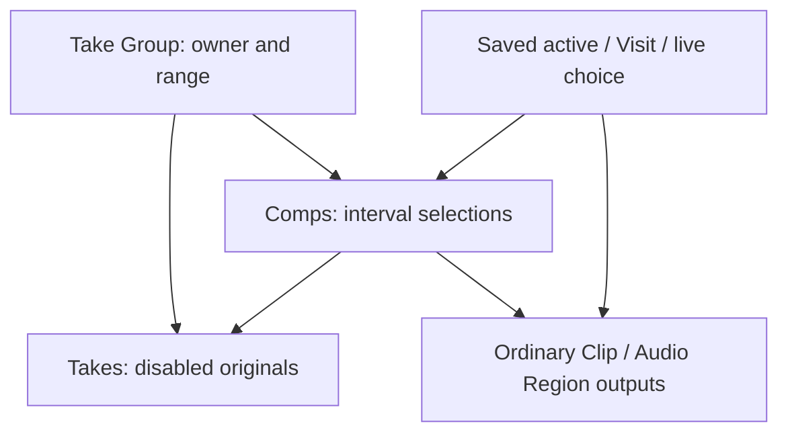

# OSTF 5.1.0 — Complete manual

**2026-11-25 · Official written specification.** This volume integrates current rules, authoring workflow, inherited musical semantics, companion families, migration and examples. See the [complete reference](PARAMETER_REFERENCE.md) for every structural declaration.

## Reading path

A Core-only implementation can start with Score, time, tracks, MIDI and lyrics, adding takes or production data when needed. takeGroups is optional in songs without takes. A session UI can organize Sections while the file format supports arbitrary Tick ranges.

1. Read the current integrated 5.1 specification and take/comp semantics.
2. Use the inherited musical manual and full parameter reference for Core structure.
3. Add Production for audio/mixing, Distributed for collaboration, Package for bundled transport, or Plugin Context for plugin/AI interaction.
4. Preserve both original candidates and materialized results; retain unsupported data or report loss.
5. Read examples as feature illustrations, not runtime test evidence.

## Data model

Several candidate takes share a time range; a separate Comp map chooses material by interval. Original sources need not be destructively cut. Ordinary playback Clips/Audio Regions have independent IDs and are materialized consistently with the saved active Comp. Sections, bars and chords are editing scopes; source-global Tick remains the coordinate authority.



Adjacent intervals of the same source are joined before MIDI boundary processing. Audio transitions are explicitly materialized and never applied twice by readers. Lane layout, colors and buttons belong to each application.

## Authority of inherited material

Collapsible appendices retain publisher-adopted 4.3 sources. Historical Draft numbers, unapproved labels and old release conditions describe history. 5.1 specification decisions are approved and runtime validation is not a release condition. Current rules take precedence; musical semantics not explicitly changed are inherited.


---

## 1. SPECIFICATION

# Open Song Timeline Format 5.1.0 — Specification

**Release: v5.1.0 · 2026-11-25 · Take & Comp**

This is the integrated written specification of OSTF 5.1.0. It retains the published 5.0 musical and project model and adds optional, non-destructive MIDI and audio Take Groups, Comp maps, saved outputs, finite-Visit selections and live-launch selection policies. The Japanese edition is `SPECIFICATION.ja.md`; both editions state the same current requirements. **MUST**, **MUST NOT**, **SHOULD** and **MAY** express mandatory, prohibited, recommended and optional behavior respectively.

## 1. Forms, scope and normative precedence

The two file forms remain **OSTF TEXT** (`.ostf`, BOM-free UTF-8 JSON Score) and **OSTF PROJECT** (`.ostfp`, ZIP container). Production Session and Distributed Session are separately versioned optional JSON document families. Plugin Context Exchange is a logical host/plugin message contract, not a third required file extension or a standardized real-time plug-in API.

The publisher-adopted 4.3.0 musical grammar, the 5.0 family semantics, and all unchanged mandatory fields remain in force. Score 5.1 changes the exact root version discriminator and adds optional `takeGroups`; Production 0.4 adds optional `audioTakeGroups` and the Score 5.1 binding. A document without takes need not contain either field. The versioned Schemas determine types, required fields, unions, enumerations and numeric bounds; this specification and the current family texts determine cross-reference, time, ownership and behavioral constraints beyond JSON Schema. An explicit current amendment overrides inherited text only for the exact named family/version and subject. An example cannot override a rule.

The exact adopted 4.3 source bytes are retained under `../adopted-4.3/`. Historical Draft labels, obsolete release approvals and older navigation embedded in those archived transcripts are provenance, not the status or release gates of 5.1. The complete manuals and parameter references include the inherited vocabulary and current additions. Unknown meaning is not guessed, unsupported data is preserved for lossless saving or the save is declined, and no document reference automatically authorizes an external download or execution.

### Current document identifiers

| Family | Exact identification | Structural authority | Current semantic text |
|---|---|---|---|
| Score | `format:"OSTF"`, `version:"5.1.0"` | [Core Schema](../schema/ostf-5.1.0.schema.json) | This document, [complete manual](COMPLETE_MANUAL.md), adopted 4.3 Score semantics |
| Production | `profile:"OSTF-Production-Session"`, `profileVersion:"0.4.0"`, `score.formatVersion:"5.1.0"` | [Production Schema](../schema/ostf-production-session-0.4.schema.json) | [Production Session 0.4](PRODUCTION_SESSION_0_4.md), adopted Production 0.2 and retained 5.0 amendments |
| Distributed | `profile:"OSTF-Distributed-Session-0.4"`, `recordType:"snapshot"` or `"event"` | [Distributed Schema](../schema/ostf-distributed-session-0.4.schema.json) | [Distributed Session 0.4](DISTRIBUTED_SESSION_0_4_SPECIFICATION.md) |
| Project manifest | `packageFormat:"OSTFP"`, `packageVersion:"1.1.0"` | [Manifest Schema](../schema/ostf-package-manifest-1.1.schema.json) | [Package specification](PACKAGE_SPECIFICATION.md) |
| Plugin Context | `protocol:"OSTF-Plugin-Context"`, `protocolVersion:"1.1.0"` | [Plugin Schema](../schema/ostf-plugin-context-1.1.schema.json) | [Plugin exchange protocol](PLUGIN_EXCHANGE_PROTOCOL.md) |

Legacy Scores and companion documents remain valid at their own exact versions. Recognition of 5.1 does not relabel 4.3 or 5.0 data, and recognition of 5.0 does not imply acceptance of a 5.1 discriminator.

## 2. Inherited authorities and invariant principles

1. A Score's SHA-256 is calculated on its **original exact UTF-8 bytes**, not reserialized or canonicalized JSON. Even a whitespace-only byte change invalidates the old digest. Package construction MUST NOT rewrite enclosed Score, Production/Distributed or Asset bytes. Package bindings use the established package-root paths and exact identities.
2. Core Harmony, Lyrics, Notes, Directions, Voices, resources and musical intent retain their established authorities. Section names, lane order and display colors do not define identity or playback.
3. Core MIDI CC Volume/Expression/Effect controls and Production mixer Gain/Pan/Sends are separate authorities. Production retains its acyclic channel, send and sidechain graph, typed automation and inert plugin-state model. JSON records cannot instantiate a plug-in or guarantee identical audio.
4. A finite Performance Plan is an opt-in projection of source material. It does not rewrite source Notes or create a second authoritative source timeline. Existing fixed/open/silent realization, role override, source-continuous join, hard-cut and source-tempo rules continue to apply.
5. Distributed Session stores collaboration state and phrase proposals/commitments in its own domain. A `phraseCommitted` record does not automatically mutate a Score, select a Take, replace an audio recording or prove that anything sounded. Root `scoreSha256` pins the original Score bytes.
6. Plugin Context is a read-only partial projection or an untrusted proposal. Only the host may apply authorized changes against the original snapshot and stable identities, commit the complete new state, and acknowledge `applied` after successful save. A partial context MUST NOT be saved as a complete Score.
7. Each implementation MUST declare its exact supported family/version and capabilities. Generic “OSTF compatible” does not imply support for every optional family or behavior.

## 3. Time, scope and containment

Every Take Group, Comp Region and audio transition uses the Score's existing PPQ and **source-global Tick** coordinate system. A group has `startTick >= 0` and `durationTicks > 0`; its interval is half-open `[startTick, startTick + durationTicks)`. Stored Tick values and all derived endpoints, offsets and sums used for these structures MUST remain exact integers in `0..9007199254740991`; positive durations may not collapse to zero. Writers MUST diagnose overflow instead of wrapping or rounding it.

Core Clips retain `start` and `duration`; their Notes and MIDI Events retain clip-local starts. Convert local positions with the actual Clip start before comparing them with Comp ranges. Production audio assets retain decoded frame coordinates. Source Ticks, expanded Performance Ticks, Session clocks, audio frames and UI bar numbers MUST NOT be conflated.

An optional `sectionId` is an editing anchor to an existing Section whose interval intersects the group. It does not require identical boundaries or introduce a Section-relative wire timebase. Song-wide, Section, phrase, bar, chord and sub-beat editing all use the same interval representation. A source Section may therefore be presented as a session clip by one host and as part of an arrangement by another. No particular clip grid, lane layout or launch UI is mandated.

Renaming a Section or changing tempo, meter or bar numbering does not implicitly move stored Ticks. Explicit movement, PPQ conversion or a timeline edit MUST update affected material, ranges, outputs and references atomically. Tempo changes alter `native` audio timing and require the corresponding output/rebinding decision; matching Section labels alone do not prove that an old output is still correct. Source-time conversion to seconds integrates every applicable source-tempo segment, including after a finite-Plan re-entry.

## 4. Take Groups and immutable candidate material

Core `takeGroups[]` items own exactly one existing `trackId`. Production `audioTakeGroups[]` items own exactly one existing `channelId` of type `track` or `audioTrack`, never Bus or Master. Group ranges on the same owner in the same family MUST NOT overlap. MIDI and Production audio are independent domains; their simultaneous authored use remains possible.

Each group contains at least one `takes[]` item. A MIDI Take references one or more existing Clips on its owning Track through `clipIds`; an audio Take references one or more existing Audio Regions on its owning Channel through `audioRegionIds`. Each referenced candidate interval is contained in the group. Candidates may differ in start and length, and a short replacement Take need not cover the whole group. Candidate intervals within one Take MUST NOT overlap; polyphony is represented inside a MIDI Clip. Intervals belonging to different Takes may overlap.

A candidate Clip/Audio Region belongs to exactly one Take and MUST NOT also be another group's material or any Comp output. The same Take may be selected by several Comps without copying its candidate data. Audio Regions may reference a shared underlying audio asset according to inherited asset rules. Core `clipChoices` remains available, but MUST NOT claim candidate or output Clips managed by a Take Group. Existing ID namespaces and reference uniqueness remain unchanged.

All candidate MIDI Clips MUST store `enabled:false`; all candidate Audio Regions MUST store `mute:true`. These flags suppress normal playback, not storage. Preserve original Notes, Note-local enablement, MIDI Events, vocal data, decoded-frame selection, gain and fades. Selecting a Take never turns a candidate into the normal output. Explicit host audition may monitor it separately, but MUST NOT persist an inconsistent normal playback selection.

The group owns its playback range: unrelated Clips or Audio Regions of the same owner/domain MUST NOT overlap that range. A writer must split or otherwise explicitly reconcile such material before admitting the group. Source events of material outside the group must not leak through its range unintentionally. DSP reverberation or release tails are not newly defined by these musical interval constraints.

### Candidate metadata

`kind` is `take` for another performance of the same intent, `variation` for a variation within that scope, or `alternative` for another performance candidate. These labels have identical selection mechanics. They do not authorize replacing Harmony, lyric text or song structure; use the existing appropriate musical structures or a separate revision for those edits. Simultaneously sounding doubles/layers are separate parts, not competing Take selections.

`origin` records optional human, AI, imported, derived or unknown provenance. Prompts, model names, URIs and remote participant/proposal IDs are inert metadata. `parentTakeId` resolves to another Take in the same group, and parent links MUST be acyclic. `ratings` are informational scores in `[0,1]`, not automatic selection instructions. `laneOrder` is only a display hint. A metadata field does not grant authentication, execution, network or asset-access permission.

## 5. Comps and complete selection maps

Each `comps[]` item is one saved complete selection. Its `compRegions[]` MUST be ordered by ascending `startTick` and form a gapless, non-overlapping partition of the whole group. Every region has positive duration. Adjacent boundaries use half-open interval semantics, so a boundary Tick belongs to the following region.

| Region kind | Required meaning | Prohibited inference |
|---|---|---|
| `source` | `takeId` and `clipId` or `audioRegionId` resolve to that Take's candidate; the entire selection lies inside its interval | No hidden shift, loop, stretch, substitution or fallback to another Take |
| `silence` | The selected range is explicitly silent; it has no Take or candidate reference | A missing candidate is not equivalent to declared silence |

Candidate and Comp source Ticks are identical. A selection is a reference to the preserved original, not a destructive cut. A partial Take cannot silently fill uncovered ranges; the Comp explicitly selects other Takes or silence there.

`activeCompId` is required and is a group-local Comp ID or `null`. Null means silence for the group's ordinary saved playback. An empty `comps` array therefore requires `activeCompId:null`; any Visit selections must also select null, and live selection can only be fixed/manual. A single uncut Take is selected through a Comp as well; no competing `activeTakeId` exists. Group IDs are unique within their family. Take IDs, Comp IDs and Comp Region IDs are unique within their respective group-scoped namespaces. All current references must resolve, except the explicitly historical IDs described in §12.

## 6. Materialized output, saved flags and atomicity

The Comp map is the **editing authority**. Independently identified ordinary Clips/Audio Regions listed by `outputClipIds` or `outputAudioRegionIds` are the **playback authority**. Every Comp, including inactive Comps, MUST carry its current materialized output; a consumer need not generate Notes or audio from the map in real time. Each output belongs to the same owner and lies within the group's range. Candidate IDs and output IDs are distinct, and an output ID MUST NOT be shared by different Comps or `clipChoices`.

An entirely silent Comp has an empty output list and no nonempty `noteLinks` or `transitions`. A Comp containing any source region requires at least one output. A MIDI source selection containing no musical events is represented by an output Clip with an empty `notes` array, rather than an absent output. MIDI output Clip intervals within one Comp do not overlap; an output Clip may span an explicit silence interval, but its musical gates and selected material must respect the silence. Necessary release/state events may implement the transition into silence. Audio output overlap is permitted only for the transition windows specified in §8. Candidates and inactive outputs remain stored.

The saved ordinary-playback state is exact:

| Managed object | MIDI `enabled` | Audio `mute` |
|---|---|---|
| Candidate material | `false` | `true` |
| Output of `activeCompId` | `true` | `false` |
| Output of every other Comp, or every Comp when active is null | `false` | `true` |

These flags represent the **saved default selection**. The explicit finite-Visit/live selection overlay in §9 is the only standard selection exception: it substitutes the selected Comp's output eligibility at playback without modifying these stored flags. It never enables candidate material. Higher-level Core Track and Note enablement, Production Channel/automation mute, routing and established realization rules retain their separate authority.

All region-level Production automation targeting any managed candidate or output Audio Region is excluded in 5.1. Use Channel automation or explicitly authored/rendered Comp outputs. In particular, automation may not unmute a stored candidate or inactive output. Unmanaged Audio Regions retain inherited automation capabilities.

A writer MUST save the map, candidate edits, all affected materialized outputs, identities, references and saved flags as one consistent transaction. No stale output may be silently accepted after a map or source edit. Missing outputs, wrong owners, unresolved references, contradictory flags or inconsistent material require a diagnostic and rejection of the affected edit/save. An explicit host repair may create a new consistent revision; a reader must not silently guess one. Schema shape alone cannot prove musical correspondence between map and output, and bit-identical DSP is not claimed.

## 7. MIDI and vocal boundaries

Each MIDI Comp requires `noteBoundary`:

| Value | Materialization rule |
|---|---|
| `truncate` | Select only source Notes whose absolute onsets lie inside a selected source interval; cap each gate at that interval's end. A tail whose onset was before the selected start does not create an attack. |
| `retrigger` | Also include source Notes already held at the interval start, with a new attack at that start and a gate restricted to the interval. |
| `authored` | Preserve explicitly edited materialized boundaries/phrasing as the performed result, while retaining the declared source provenance and explicit-silence constraints. |

Adjacent source selections referencing the same candidate are logically joined before these operations, so subdivision alone does not create extra attacks. Compute source onsets from Clip-local starts and retain disabled Note semantics. Output Notes obtain independent IDs; optional `noteLinks` connects source and output Note IDs, resolving within the relevant candidate/output sets. One-to-many and many-to-one relationships are allowed; duplicate pairs are not.

These are **Comp-authoring** rules, not a replacement for finite-Plan cutting. A fixed Visit subsequently selects the materialized output using the inherited source-onset and hard-cut rules. It MUST NOT invent a retrigger at a Visit entry merely because the Comp used `retrigger` when it was authored. A newly desired entry attack must already be an explicitly authored output Note at that source position, or belong to a separate explicitly materialized performance rendition.

Writers must reconcile CC, sustain, Program Change, Pitch Bend, MPE/channel state, note-targeted data, phoneme timing, singing curves and lyric alignments in the output. The source Take's inactive control stream MUST NOT leak into ordinary playback. Required state initialization or release events must be materialized using the inherited supported structures, or the limitation must be disclosed and the edit declined until a representable result exists. Do not send indiscriminate resets that alter unrelated parts on a shared MIDI bus. A remote instrument's unspecified initial state is not made portable merely by selecting a Take.

Retain clip-local candidate vocal data and update output references to the new output IDs. Selection does not rewrite the authoritative lyric text or imply delivery of a complete lyric alignment when only some Notes survived. An implementation that cannot author these boundaries may play the stored output and preserve the additional data without claiming Comp-edit capability.

## 8. Audio materialization, crop phase and transitions

An Audio Comp requires `outputMode:"regions"` or `"rendered"`. In `regions`, ordinary output Region descriptors represent the selected material. In `rendered`, output Regions reference separate pre-rendered `audioSource` assets. Rendering is before Channel devices/mixer processing; a consumer MUST NOT apply baked Channel processing a second time. Original assets remain preserved.

The inherited frame constraints remain mandatory: `sourceStartFrame >= 0`, `sourceFrameCount > 0`, their sum not greater than the asset's decoded `frameCount`, and `fadeInTicks + fadeOutTicks <= durationTicks`. A crop must retain the original candidate's source phase:

- For a native candidate beginning at source Tick `R`, ideal frame position at `t` is `sourceStartFrame + sampleRateHz × T(R,t)`, where `T` integrates every source-tempo segment. Source frame exhaustion yields silence; it never loops or restarts at the beginning of a Comp region or Visit.
- For a fit candidate of source duration `L`, ideal frame position is `sourceStartFrame + sourceFrameCount × (t-R)/L`. A shortened output must preserve that selected phase and rate relationship, including `pitchPolicy`; retaining the original full frame window for a shorter range would incorrectly stretch it.
- Preserve original candidate gain and original Region-local fade meaning over the selected range. A cut does not automatically restart an old fade. If available Region fields cannot represent the required envelope, crop or transition, the writer must use rendered output or explicitly decline that authoring capability. Fractional-frame rounding and resampling/stretch algorithms remain host-dependent; any approximation affecting interchange must be disclosed.

Optional `transitions[]` describe deliberately authored crossfades. `atTick` is a junction between adjacent source selections of different candidates. The half-open window `[startTick,startTick+durationTicks)` must **strictly contain** that junction, lie inside the group, and be backed by available material on both sides throughout the window. Transition windows do not overlap one another or consume another source/silence junction. No transition bridges an explicit silence region.

`curve` is `linear`, `equalPower` or `customRendered`. `regions` supports only linear amplitude transitions represented by matching output Region overlap and explicit inherited fade-in/fade-out values; incompatible pre-existing envelopes require rendered output. For normalized position `u` across the overlap, the added linear transition weights are `1-u` and `u`. Equal-power uses `cos(pi*u/2)` and `sin(pi*u/2)` as the intended added weights and requires `rendered`; `customRendered` likewise requires rendered output, whose stored asset is authoritative. Gain, correlation, DSP and frame rounding can still affect the resulting sound.

Transition metadata records the edit and MUST NOT be applied again to already materialized fades or rendered samples. Without a transition, the junction is a hard cut; no automatic smoothing is implied. Preserving two muted source Takes is not equivalent to providing a rendered crossfade.

## 9. Finite Visits and free live-session launches

### 9.1 Explicit finite-Visit selection

`visitSelections[]` maps a group-local pair `(performancePlanId, visitId)` to a Comp ID or null. Each pair is unique, resolves to an existing finite Plan/Visit, and the Visit's actual selected source-segment union must intersect the group. A noncontiguous Visit is not treated as one filled bounding range. Null explicitly selects silence and is distinct from an absent override.

Resolve ordinary selection as follows:

1. For a finite Visit, use its exact `visitSelections` entry if present, otherwise the saved `activeCompId`. Do not run free live policies to replace a finite Plan decision.
2. For the intersected group range, suppress the outputs of all other Comps and schedule only the selected Comp's materialized output. This overrides only the managed output `enabled`/`mute` flag that encodes saved default selection. Candidate material remains suppressed; no stored flag is rewritten.
3. For Core MIDI, apply Track/Note enablement and the Visit's inherited Part realization. `silent`, `open` and `unspecified` do not become fixed replay merely because a Comp was selected; only `fixed` replays the stored musical output. An open part may be realized through other explicitly supported mechanisms.
4. Project selected material only over the intersection with each actual source segment. Apply the existing continuous-join versus hard-cut, source state, automation and tempo rules after selection. Do not restart original audio frame or fade phase at a Visit boundary.

**Production independence is retained.** A Production Audio Region is independent of Core fixed-note realization even when its Channel references a Core Track. Consequently, audio Comp selection and ordinary audio output are not automatically suppressed by that Core Track's `enabled` or `realization:"silent"`/`"open"`; Production Channel/Region eligibility, mute and routing govern them. The above selection overlay still replaces which managed audio outputs are eligible and projects them over the Visit source segments. To make an audio Take Group silent for a Visit, explicitly select null or an all-silence Comp, or use the appropriate Production mute authority. This resolves the earlier 5.1 delta's ambiguous suggestion of coupling audio candidates to Core Part realization.

A host that supports 5.1 saved playback but not Visit selections may retain and play the saved default only with an explicit unsupported-feature diagnostic. It MUST NOT claim equivalent reproduction of a Plan containing differing overrides.

### 9.2 Free live launches

Optional `liveSelection` is a launch-time policy for a host's free session mode, outside a resolved finite-Plan Visit decision:

| Mode | Selection |
|---|---|
| `fixed` | Saved `activeCompId` |
| `manual` | Explicit host/user selection of a group Comp or silence; otherwise saved active selection |
| `cycle` | First listed candidate at the first launch, then the next listed candidate cyclically |
| `random` | Uniform choice among listed candidates |
| `weighted` | Choice proportional to each listed nonnegative weight; total weight must be positive |

Cycle/random/weighted require a nonempty list of distinct existing Comp IDs. Weight is mandatory on every weighted candidate and forbidden otherwise. Fixed/manual have no candidate list. Silence can be represented in a dynamic list by a named all-silence Comp. Candidates and metadata do not command an automatic launch.

A resolved launch uses the same output selection overlay as §9.1 and does not mutate `activeCompId`. An unresolved or unsupported live selection falls back to the saved active Comp and the host discloses unsupported dynamic behavior. Selection is resolved at launch; quantization, mid-clip switching, indefinite looping, session transport, cross-track scene coordination and random-seed persistence remain host policies, not newly standardized fields. Repeated launching does not require duplicate source clips or an infinite Visit array.

To exchange a finite recorded performance, author explicit Visit decisions in a finite Plan with `visitSelections`. Unrecorded random or manual choices are not promised reproducible. A multi-Track scene may commit several host selections atomically, but the format does not infer a global scene or same-numbered Take relationship from labels.

## 10. Distributed, AI and plugin integration

Distributed Session 0.4 retains the previous Snapshot/Event grammar, clock model and authority rules while binding to Score 5.1 and its exact original bytes, document/revision and finite Plan. Importing an accepted remote phrase as a Take is an explicit host Score edit that creates candidate material and corresponding consistent outputs; a remote commitment alone never selects or changes a Comp. A new Score revision is not a retroactive replacement of immutable prior accepted events or their Score pins. No new network actuator, automatic Comp synchronization or robot permission is introduced.

Plugin Context 1.1 adds Score 5.1 identity. For that combination only, authorized edit paths may additionally address a group at `/takeGroups/{index}`, its descendants at `/takeGroups/{index}/...`, or append a group at `/takeGroups/-`. Legacy Score bindings retain their previous editable roots. The whole `/takeGroups` array is not an editable replace/create target in this protocol. If absent, the host first initializes it in an explicitly saved revision and reissues a context for the new Score SHA.

For a root-array append, `containerId` identifies the pinned Score's actual `document.id`, the envelope includes matching `score.documentId`, and `newEntityId` equals the appended group's `value.id`. If the Score has no document identity, the host establishes one before issuing such an edit context. Nested operations continue to follow the existing stable owner/entity-ID rules. A proposal must atomically maintain Take Groups, affected Track Clips, all Comp outputs and saved selection flags. Changing only a map or active ID while leaving contradictory output flags is invalid. Unsupported referenced IDs, stale snapshots or unauthorized paths are rejected; protocol version alone grants no access.

Core Plugin Context permissions do not authorize Production audio Comp edits. Hosts may implement a separately authorized Production editing path, retaining all Production binding and transactional constraints. Provenance prompts, ratings, model labels and remote identifiers remain data, never executable instructions.

## 11. Packages, migrations and preservation

OSTFP 1.1 retains the 5.0 ZIP layout, mimetype, safe paths, manifest, exact-byte SHA handling and Asset/Binding rules. The allowed companion matrix is explicit:

| Enclosed Score | Production | Distributed |
|---|---|---|
| 4.3.0 | 0.2.0 | `OSTF-Distributed-Session-0.2` |
| 5.0.0 | 0.3.0 | `OSTF-Distributed-Session-0.3` |
| 5.1.0 | 0.4.0 | `OSTF-Distributed-Session-0.4` |

Optional families may be omitted; their presence must use the row matching the enclosed Score. Package 1.0 retains its original accepted versions. Package 1.1 does not erase or reinterpret a legacy Score's identity. Audio Take media uses existing `productionAsset` bindings. Lossless packaging includes managed original and inactive material and all actually required assets, not merely the audible output. Unresolved external material must be disclosed and is not silently downloaded or substituted.

5.0 to 5.1 is an explicit revision/migration. A take-free Score may retain all musical data, but changes to its version bytes require a new SHA and explicit companion/package rebinding. Relevant document/revision identity, production source-tick meaning and newly emitted plugin contexts must remain consistent. Historical distributed events are not silently repinned; follow the retained session-migration rules.

5.1 to 5.0 is an explicit **projection of the saved active output**. Preserve the selected ordinary output and its musical data; remove the new Take Group structures and downgrade companion/package/protocol identities through the stated migration rules. Report loss of alternative selection maps, metadata, histories and Visit/live decisions. Retained source and inactive output clips must remain disabled/muted; deleting them requires repairing all surviving references, vocal alignments and asset bindings. Preserve the source 5.1 project when non-destructive editing must remain available.

Simple downgrade does not preserve different per-Visit selections. To preserve a chosen finite performance, a host must explicitly materialize it into a new arrangement/rendition with appropriate distinct output identities, tempo/state semantics and a disclosed loss report; it must not silently flatten or relabel the source. A 5.0-only reader is not required to accept a 5.1 Score directly.

## 12. Informational selection history

Optional `takeSelectionHistory[]` stores saved selection history. `sequence` is a strictly increasing nonnegative safe integer within the group; `compId` is the then-selected ID or null. `actorId`, `recordedAt` and `reason` are optional. A historical Comp ID may refer to a deleted Comp, but MUST NOT be used to resolve current playback. History does not override `activeCompId`, `visitSelections` or an explicit live launch, and a complete event log is not required. Capture a reproducible finite performance through finite Plan selections, not by guessing it from incomplete history.

## 13. Capability declarations and release scope

Capabilities are independent, not mandatory cumulative levels: `score-5.1-read`, `score-5.1-write`, `take-preserve`, `midi-comp-edit`, `audio-comp-edit`, `visit-selection`, `live-selection`, `distributed-0.4`, `plugin-context-1.1` and `package-1.1`. An application can support saved playback and preservation without exposing lanes or implementing Comp editing. Lossless writers must retain unsupported standard material and assets they manage, or decline a destructive overwrite and describe the loss.

Semantic conformance includes owner/range containment, reference resolution, group/Comp uniqueness, complete partitioning, valid candidate and output flags, state boundaries, correct family bindings and atomic updates. JSON Schema alone does not establish these obligations or guarantee identical rendering, plugin availability or network timing. User-interface design remains an implementation choice.

**This written specification is adopted for release under the publisher's blanket approval. Runtime, independent parser, DAW, DSP, plug-in, physical-device and WAN execution testing are not release conditions and are not claimed as completed.** Specification release is distinct from publication of a repository/tag or certification of any implementing application. No further individual approval or runtime gate is introduced by archived Draft text.

For complete field declarations and authoring guidance, read [parameter reference](PARAMETER_REFERENCE.md), [complete manual](COMPLETE_MANUAL.md), [migration matrix](MIGRATION_MATRIX.md), [conformance](CONFORMANCE.md), [security](SECURITY.md), the current family texts and the retained adopted sources together.


---

## 2. OSTF_STUDIO_IMPLEMENTATION

# OSTF Studio — 5.1 implementation guide

This is application guidance. `SPECIFICATION.md` defines normative timing, saving and selection. This guide does not assert that OSTF Studio has been implemented or tested.

## Section-by-track session view

The session grid may retain Section rows and Track columns. A cell is a view of existing material and Take Group/Comp data, not a new required UI or Ableton-specific object in the format. A group usually spans a Section, while bars, chords, phrases and arbitrary Tick ranges remain legal.

Display a local position as `sourceTick - section.start` while retaining source-global Ticks in the document. Revisited Sections reuse source material and use finite Plan Visits or host launch instances for identity. A group crossing Sections retains one ID while its range is projected into the view.

## Recommended operations

| User action | Stored representation |
|---|---|
| Record / generate | New disabled/muted source Clip/Region and Take |
| Select a whole Take | Comp covering its source plus explicit silence, with separate outputs |
| Pick a bar / chord range | UI-selected source-global Tick interval in compRegions |
| Comp | Complete nonoverlapping map and materialized output updated together |
| Switch saved Comp | activeCompId and old/new output selection flags saved atomically |
| Change during live play | Playback overlay; saved active Comp retained |
| Record a chosen performance | Finite Plan/visitSelections and matching Comp outputs |
| Export legacy | Project saved active outputs into ordinary material and report loss |

## Live launch

The host owns launch quantization, loop length, coordinated track switching, stopping, audition and UI state. Cycle starts at the first candidate on the first launch; random is uniform; weighted uses the explicit positive total. Persist actual choices as finite Visits when reproducibility is needed. Never store an infinite Visit list for indefinite looping.

A Visit/live-selected Comp is played through an overlay independent of saved selection flags. Candidates are not normal playback. Preserve Production Audio independence from Core MIDI silent/open; coordinated stopping uses explicit Channel controls.

## Boundaries and editing

MIDI truncate/retrigger/authored is applied when creating Comp output, not an instruction to invent a Note On on Visit reentry. Output MIDI state, sustain, CC, MPE, lyrics and phonemes must remain consistent. Audio retains source phase and frame ranges; composite envelopes or equalPower transitions that cannot be represented by regions use a pre-channel render.

Colors, lane heights, waveforms, key bindings, section buttons and grid layout belong to each application. Do not invent a required alternative timebase for display or let host extensions silently redefine standard meanings.


---

## 3. PRODUCTION_SESSION_0_4

# OSTF 5 Production Session 0.4 — Interoperability semantics (5.1.0)

> **0.4 inheritance:** All Production 0.3 semantics are retained, with Score 5.1 binding, optional `audioTakeGroups`, and safe-integer time/frame bounds. The original 0.3 Schema is preserved separately. The audio-comp rules below and `SPECIFICATION.md` override earlier exclusions of comping.

**This edition inherits all fourteen named definitions from the byte-verified publisher-adopted 4.3 Production 0.2; the inherited typed automation rules and the explicit 5.1 take additions apply.** The structural authority is `schema/ostf-production-session-0.4.schema.json`. Identify a 5.1 Profile with `profile:"OSTF-Production-Session"`, `profileVersion:"0.4.0"`, `score.formatVersion:"5.1.0"` and the SHA-256 of the exact raw UTF-8 Score bytes. An incompatible family/version must not be silently relabeled.

## References and audio graph

The ID namespaces of Channels, Devices, Assets, Audio Regions, Automation Lanes, Sends (across all Channels) and Sidechains are each unique. Exactly one Master is required. A Track Channel references an existing Core Track; `audioTrack`, Bus and Master do not. Mapping one Core Track into more than one Channel is rejected unless a future explicitly documented duplication rule exists. Every Device is owned once; the order in `deviceIds[]` is the processing order. An Instrument can only be first on a Track Channel, at most once. Bus/Master do not host Instruments. A missing Plugin is not silently replaced by display name.

All non-Master output Channels must resolve. Send targets must be Buses. Sidechains must originate outside the Master, target an Effect Device owned by a different Channel and use a unique `(targetDeviceId,targetPortId)`. Build directed Channel dependencies from Outputs, Sends, and Sidechains (Sidechain target = owning Channel of its Device); cycles and unresolved references are invalid. Do not repair a cycle by deleting a Send without reporting loss.

## Assets and Audio Regions

`stateAssetId` resolves only to a `pluginState` Asset and `sourceAssetId` only to `audioSource`. Require `sourceStartFrame >= 0`, `sourceFrameCount > 0`, `sourceStartFrame + sourceFrameCount <= asset.frameCount`, and `fadeInTicks + fadeOutTicks <= durationTicks`. Audio Regions belong to Track or AudioTrack Channels, not Bus/Master. Source time is in the unmodified Score Tick domain. `native` uses Score Tempo to advance un-stretched frames; `fit` maps the declared source frame interval to Region Tick range with explicit `pitchPolicy`. No implied loops, crossfade, auto normalization, identical DSP algorithm, or waveform identity.

## Automation and ordered semantics

Automation Points use strictly increasing nonnegative Score source Ticks. The same source range played in multiple Visits applies the same source automation again. Duplicate `(target.kind, reference ID, parameter/parameterId)` Lanes are invalid. Boolean controls are Channel Mute, Send Enabled, Audio Region Mute, and DeviceControl Enabled/Bypass, using `valueType:boolean`, `interpolation:step`, and Points containing **both `atTick` and Boolean `value`**. Both fields remain mandatory in every Boolean point.

Numeric ranges: Channel/Send/Region gain in dB according to the field's declared Schema bounds; Pan in -1..1; plugin `device.parameterId` normalized 0..1 unless the Profile specifies otherwise. No implicit clamping. Before the first Point use the static value; after the last Point hold the last. Step holds the previous value, linear interpolation is performed in the declared numeric domain. DeviceControl is not an internal Plugin parameter. MIDI CC7/10/11/91/93 remains performance/instrument control and cannot overwrite Audio Mixer authority.

## Preservation and revisions

A changed Score raw digest invalidates previously pinned companion profiles until an explicit rebind or historical retention decision is made; a Plugin Context `ack` is not automatically an authorization to update Production identity. A Package can carry actual preset bytes but cannot provide Plugin runtime availability, licenses or cross-DAW sound equivalence. Preserve unsupported identities/state and the bytes actually provided, or refuse lossless write and describe the loss. The Profile does not standardize advanced warp, surround, parallel racks, physical I/O, or DSP equivalence.

**Status:** cross-document, timebase and graph semantics are required implementation work beyond JSON Schema shape. The official 4.3 Production 0.2 source has been byte-verified and is included under `adopted-4.3/`; this 0.4 document is an approved written specification. No DAW runtime verification is claimed.

## Automation target type and domain (normative specification)

This edition retains the Production 0.3 repair that excludes Boolean values from numeric automation targets. The versioned 5.0 and 4.3 Schemas remain unchanged.

| Target kind | Parameter | `valueType` | `points[].value` | Meaning |
|---|---|---|---|---|
| `channel` | `gainDb` | `number` | -120 to +24 dB | Audio-channel gain, independent of MIDI CC7 |
| `channel` | `pan` | `number` | -1 to +1 | Audio panning, independent of MIDI CC10 |
| `channel` | `mute` | `boolean` | `true` / `false` | Step interpolation only |
| `send` | `gainDb` | `number` | -120 to +24 dB | Audio send gain |
| `send` | `enabled` | `boolean` | `true` / `false` | Step interpolation only |
| `audioRegion` | `gainDb` | `number` | -120 to +24 dB | Region gain before channel processing |
| `audioRegion` | `mute` | `boolean` | `true` / `false` | Step interpolation only |
| `deviceControl` | `enabled`, `bypass` | `boolean` | `true` / `false` | Not an opaque plugin parameter |
| `device` | `parameterId` | `number` | 0 to 1 | Normalized opaque plugin parameter; actual plugin scale is host-dependent |

**Semantic conditions:** `points[]` contains at least one point; `atTick` must increase strictly without duplicates within each lane, in the original Score global Tick coordinate system. Revisited source sections reapply their original automation points. Duplicate lanes for the exact same target kind, target ID and parameter are invalid; array-order wins are not permitted. Numeric lanes allow `step` or `linear`, whereas boolean lanes allow `step` only. Before the first point, the corresponding static Channel/Send/Device/Region value applies; after the last point, the final point value holds. Missing IDs, unsupported parameters, and out-of-domain values must not be silently coerced; reject or explicitly disclose loss.

**Boundary:** The 0.4 Schema can encode type/domain constraints. It does not independently prove cross-ID integrity, point ordering, duplicate-target exclusion or graph acyclicity; those are separate semantic obligations. It is not a DAW, audio or plugin compatibility certification. See the production examples catalog in `EXAMPLES_GUIDE.md`.


### Exact adopted-source inheritance note

All fourteen named definitions are inherited from the exact publisher-adopted Production Session 0.2 schema, including optional `channel.name`, required `plugin.name`, `plugin.namespace`, `asset.purpose=renderedAudio`, `asset.byteLength`, and `hostExtension.namespace` pattern. `sizeBytes` is a Package Manifest property, not a 0.4 Production Asset property. Version and Score pin were updated for 0.4 and per-target numeric Automation type/domain restrictions were added. See adopted-source reconciliation record.


## Audio Take / Comp — 0.4

`audioTakeGroups[]` owns a source-score Tick interval on one track/audioTrack Channel. Candidate Audio Regions are always `mute:true`. Each Comp has a complete region partition and distinct `outputAudioRegionIds`; only the saved active Comp is unmuted. Region-targeted automation is forbidden for managed regions; use Channel automation. Groups on the same Channel do not overlap.

`regions` output preserves source phase, gain and fade envelopes. Native cropping integrates the original Tempo Map over the full elapsed interval; fit cropping retains the original Region ratio. A linear crossfade must match an explicit transition window and authored output Region/fade descriptors. Use a separately supplied `rendered` audioSource for nonlinear transitions or envelopes that cannot be represented faithfully by Region descriptors. DSP equality is not standardized. Channel processing is applied once after the comp output.

Visit selection is a playback overlay, not an edit to the saved active Comp. It overrides only the selected outputs' selection-related mute flags; candidates remain silent, and Channel mute remains effective. Production Audio remains independent of Core `realized:silent/open`; Core part silence does not silently mute Audio. Use explicit Production control for coordinated muting. Visit cropping applies after Comp materialization.

References, range maps, selection and output must be committed consistently in one production edit. `SPECIFICATION.md` defines the complete take, transition and migration semantics.


---

## 4. DISTRIBUTED_SESSION_0_4_SPECIFICATION

# OSTF 5.1.0 — Distributed Session 0.4 normative specification

**Publisher-adopted 4.3 Distributed Session 0.2 is the byte-verified source for this Score 5.1-only profile.** Authoritative structural Schema: `schema/ostf-distributed-session-0.4.schema.json`. It is a separate JSON record family; it does not confer networking, audio/DSP, identity, robotics or plugin-execution authority.

## Identity and score pin

`profile:"OSTF-Distributed-Session-0.4"` plus `recordType:"snapshot"|"event"` are required discriminators. There is **no** `profileVersion` and **no** nested `score` object. Both Snapshot and Event require root fields `sessionId`, `documentId`, `revisionId`, `performancePlanId`, and `scoreSha256` (64-digit lowercase SHA-256 over exact raw UTF-8 OSTF 5.1 Score bytes). The performance plan must be finite and present in the source Score.

## Snapshot

The Snapshot requires `sessionStatus:prepared|playing|stopped`, nonnegative `stateRevision`, `authorityParticipantId`, and at least one `participants[]` item. Every Participant requires `participantId`, `kind:human|softwareAgent|physicalRobot`, and `assignedTrackIds[]`. `playing` requires a `position`; `prepared`/`stopped` may omit it. Accepted phrases are stored separately under `committedPhrases[]`. An optional `commitmentWindow` with `startPerformanceTick` and `endPerformanceTick` asserts complete intersection coverage of accepted phrases in the half-open range. There is no `coverage` property; omit the window instead of making an inaccurate completeness assertion.

## Event and authority

An Event requires `eventId`, `issuerParticipantId`, `baseStateRevision`, `effectivePerformanceTick`, `kind`, and typed `payload`. Event kinds: `phraseProposed`, `phraseCommitted`, `turnRequested`, `cueIssued`, `performanceObserved`, `participantStatus`, `sessionStateChanged`. The last two state-affecting kinds (`phraseCommitted`, `sessionStateChanged`) require `resultStateRevision` equal to `baseStateRevision+1` on acceptance; other kinds prohibit it. Duplicate event IDs, revision collisions, authoritative actor checks, finite Plan/Visit and Tick projection retain official 0.2 semantics.

A `phrase` uses `representation:"midi1Notes"`, positive `durationTicks` and note items with pitch 0..127 and velocity 1..127. A committed phrase uses `commitEventId`. These are session phrases, **not edits to Core notes**. State changes are `sessionStarted`, `visitChanged`, `assignmentChanged`, `sessionStopped`; starting and changing visits require `position` with Plan/Visit/Source/Performance Tick and clock anchor. No resumption of a stopped session is implied.

## Version and migration from pre-release drafts

Distributed 0.2 is pinned to Score 4.3, 0.3 to Score 5.0, and 0.4 to Score 5.1. Score revision requires an explicit new session rather than text-relabeling old events. Earlier unpublished Draft0.7 candidate used incompatible nested `score`, `participant.id`, `phrase.encoding`, `committedPhrase.eventId` and `commitmentWindow.coverage`. The published 0.4 layout restores the official 0.2 wire layout and transforms its example data. No real-time/plugin/DAW/robot execution tests are claimed.


## Binding to 5.1 takes

Version 0.3 binds Score 5.0; 0.4 binds Score 5.1. All seven event kinds and Snapshot/Event grammar are retained; no network actuator is added. Accepting phraseCommitted does not change Score, takeGroups or activeCompId. A separately authorized host import may create source candidates and record sessionId/proposalId/commitEventId in origin. These are provenance, not permissions. Historical events are never silently rebound to new Score bytes.


---

## 5. PACKAGE_SPECIFICATION

# OSTF Project Package 1.1 — Normative specification for OSTF 5.1 (5.1.0)

## 1. Purpose and representation

OSTF TEXT (`.ostf`) remains a standalone UTF-8 JSON Score. OSTF PROJECT (`.ostfp`) is an **optional ZIP carriage** for exactly one authoritative Score (4.3.0, 5.0.0 or 5.1.0), independent Production/Distributed JSON records and optional actual asset bytes. It does not merge the musical and production authorities or turn text into a binary-only format. A Project Directory is the **unpacked working representation** of the same logical content, not a third interoperable file extension. Source document bytes MUST NOT be changed solely by packaging or unpackaging.

## 2. Archive members, path and media identifier

1. Member 0 **MUST** be `mimetype`, stored without ZIP compression and with exactly the ASCII bytes `application/vnd.ostf-project+zip` (no BOM, whitespace or line break). This is a **proposed, unregistered** media type; no IANA registration or server availability is asserted.
2. Member 1 **MUST** be `manifest.json`, an unencrypted UTF-8 JSON object conforming to `schema/ostf-package-manifest-1.1.schema.json`.
3. Remaining members are the one authoritative Score and exactly those companion JSON documents and binary assets declared by the manifest. Directory placeholders are optional; receivers MUST NOT treat them as content assets. Only ZIP `Stored` and `Deflate` compression are supported; ZIP64 is allowed. Encryption, executable-package semantics and code installation are not standardized.
4. Paths are case-fold-unique, NFC-normalized POSIX relative paths: no absolute paths, drives, backslashes, dot/parent segments, control characters, `mimetype` or `manifest.json` collisions, or names that escape the project root. Reject symlinks and other filesystem redirects on extraction.

A reader MUST treat any ZIP/archive input as untrusted. It MUST use bounded resource budgets, reject duplicate/normalized/case-fold collisions and unexpected members, and prevent Zip Slip, decompression bombs, directory symlink traversal, or premature filesystem changes. The provided `tools/ostfp.py` is an illustrative prototype with its own resource budgets, **not** a security certification or universal limit prescription.

## 3. Manifest identity and byte inventory

Required fields: `packageFormat:"OSTFP"`, `packageVersion:"1.1.0"`, `projectId`, `title`, `score`, `documents[]`, `assets[]`, `bindings[]`. There is exactly **one** authoritative `score` descriptor (`path`, `format:"OSTF"`, `version:"4.3.0"|"5.0.0"|"5.1.0"`, `sha256`). `documents[]` has `id/role/path/family/version/sha256` and optional `required`; `assets[]` has `id/path/purpose/sha256/mediaType/sizeBytes` and optional rights notices. `metadata`, `externalAssets[]` and `extensions` are optional non-authoritative data. For all descriptors, hashes are SHA-256 of **uncompressed exact file bytes**, not ZIP container bytes or JSON-canonicalized objects. An asset's `sizeBytes` is its actual byte length. The manifest itself does not self-hash.

Every content member other than `mimetype` and `manifest.json` MUST be listed **once and only once** among Score, documents and assets; no undeclared or missing payload is permitted. Descriptor paths and IDs are subject to namespace-appropriate uniqueness. A metadata descriptor does not make a second Score authoritative. Array order does not select a new musical authority.

## 4. Version and Score-identity matrix

| Score payload | Production companion | Distributed companion | Manifest family/version values |
|---|---|---|---|
| OSTF 4.3.0 | Production Session 0.2.0, if present | Distributed Session 0.2, if present | Production: family `OSTF-Production-Session`, version `0.2.0`; Distributed: family `OSTF-Distributed-Session-0.2`, version `0.2` |
| OSTF 5.0.0 | Production Session 0.3.0, if present | Distributed Session 0.3, if present | Production: family `OSTF-Production-Session`, version `0.3.0`; Distributed: family `OSTF-Distributed-Session-0.3`, version `0.3` |
| OSTF 5.1.0 | Production 0.4.0 | Distributed 0.4 | `OSTF-Production-Session` / `0.4.0`; `OSTF-Distributed-Session-0.4` / `0.4` |

For Production, payload `profile` and `profileVersion` MUST match the descriptor and `score.formatVersion` and `score.sha256` MUST match the manifest Score version and exact original bytes. If supplied, `score.documentId` and `score.revisionId` MUST identify the Score document. For Distributed, payload `profile` MUST match `documents[].family`, and `recordType` MUST be the corresponding `snapshot` or `event`. **Distributed 0.3/0.4 has no nested `score` object and no `profileVersion`; it uses root `scoreSha256`, `documentId`, `revisionId` and `performancePlanId`.** Those fields MUST match the Score's raw digest, document identity and a real finite Performance Plan. The analogous original root binding of Distributed 0.2 is evaluated under the adopted 0.2 normative source. Do not relabel existing 0.2 sessions, accept stale pins, or convert authority by changing a discriminator.

`documents[].role:"supplement"|"metadata"` does not create Profile or Score authority. Their `family`/`version` identify the actual supplied bytes; unknown such documents may be retained without their semantics being interpreted. A Plugin Context message is **not** a Project document that authorizes a Score edit; archive copies of such messages, if explicitly retained as supplements, are inert data.

## 5. Asset bindings and unresolved resources

`bindings[]` maps one `(documentPath,resourceKind,resourceId)` to one `assets[].id`. `resourceKind` is `coreResource` (Score `resources[].id` only, using `score.path`) or `productionAsset` (the named Production document's `assets[].id`, including `pluginState`). Binding member paths are resolved from **project root**, not relative to the JSON document's folder. Each binding MUST resolve to exactly one real resource and one packaged asset; duplicate tuples, conflicting SHA, mismatching purpose/mediaType where asserted, and unknown document paths are invalid. Package binding **never edits** source JSON `uri`, `sha256`, Score Revision or other data. The rules in this section are the binding authority.

`externalAssets[]` describes references not included as bytes. Retain an unresolved descriptor without claiming the audio or state bytes were supplied, and never automatically fetch an HTTPS reference. The actual media rights, plug-in state compatibility, plug-in installation and audible/DSP equivalence are outside the package guarantee.

## 6. Working directory, transaction, and portability assertions

A Project Directory contains the same `mimetype`, `manifest.json` and exactly declared content paths as an OSTFP archive. Packing or unpacking must retain each declared Score/Profile/Asset payload byte sequence. It need not preserve ZIP member metadata, compression stream or archive SHA. Exporters SHOULD prepare complete content and a matching manifest in a staging area, then publish a consistent generation; OS-level atomicity across multiple directory files is not promised. Do not silently rebind a Production/Distributed Score pin after a Score edit. A Score-only archive is valid; it is *not* a lossless **project** export if the operation's supplied input included Production, Session or asset bytes that were omitted. Missing assets and lossy scope MUST be reported as in `MIGRATION_MATRIX.md`.

## 7. Interoperability and scope of promises

Schema structure, semantic cross-references, source byte identity, package inventory and safety checks are distinct responsibilities. A valid archive is not a VST3/AU/CLAP plug-in, a DAW project executor, a studio reconstruction certificate, a copyright license, an audio rendering guarantee or a real-time distributed session. Implementations advertise feature-by-feature conformance as in `CONFORMANCE.md`; none is automatically granted by this document.

## Preserving take material

Manifest 1.1 carries 4.3/5.0/5.1 at their exact original identities. Legacy Manifest 1.0 does not accept Score 5.1. Production 0.4 uses nested `score.sha256` and optional `score.documentId/revisionId`; Distributed 0.4 uses root `scoreSha256`, `documentId`, `revisionId` and `performancePlanId`. Lossless OSTFP export retains unselected take audio and every materialized Comp output. Supporting comping does not authorize pruning source assets. An active-result-only export is an explicitly partial export.


---

## 6. PLUGIN_EXCHANGE_PROTOCOL

# OSTF Plugin Context Exchange 1.1 — Normative specification (5.1.0)

## 1. Contract, host boundary and version selection

This is a **transport-neutral JSON message contract**, not another OSTF file extension, a VST3/AU/CLAP or Max for Live SDK, an audio/DSP API, or a grant of execution/editing permission. `schema/ostf-plugin-context-1.1.schema.json` defines the envelope of `protocol:"OSTF-Plugin-Context"`, `protocolVersion:"1.1.0"`, unique `messageId`, `operation`, `score`, `scope`, optional `transport`, and operation-dependent `payload`.

`score.format:"OSTF"`, `score.version:"4.3.0"|"5.0.0"|"5.1.0"` and `score.sha256` identify the exact raw UTF-8 Score source bytes. `score.documentId/revisionId`, when present, must match the source. The receiving host must select the correct Score Schema/version rather than infer a Score version from the protocol version. A Plugin Context message does not have authority over Score, Production or Distributed Sessions. Transport/IPCs, plugin lifecycle, permissions and network access are host-specific.

## 2. Scope and transport time

`scope.startTick/durationTicks` describe a nonempty half-open interval `[startTick, startTick+durationTicks)` in **Score PPQ ticks**, with optional `trackIds/sectionIds` as view filters. Scope is not permission. `transport.positionTick` is a **host-PPQ position** with `transport.hostPpq`; `transport.scorePpq` states the Score resolution separately. Adapters must account for the musical Tempo/Meter Map, loops, seeks and discontinuities without equating host and Score ticks or asserting sample-accurate audio execution. `isPlaying` and optional BPM are observations, not instructions.

## 3. Read-only `context`

`payload:{"partial":true,"data":{...}}` is a deliberately **partial projection**, never a complete `.ostf` file. Optional `unavailableFields[]` distinguishes undisclosed data from an empty result. Missing harmony/track/lyric fields cannot be inferred as absent in the original Score. A context Consumer must not serialize the projection as a valid full Score by inventing missing fields, nor expose unprovided data as if authorized. A later Score write requires a separate, host-authorized operation.

## 4. Untrusted atomic `editProposal`

The payload has unique `proposalId`, `baseSha256`, `mode:"atomic"`, one or more `changes[]`, and optional `baseRevisionId`. `baseSha256` must equal `score.sha256` and the active source Score's raw-byte SHA; the Revision, when present, is checked separately. A repeated `proposalId` with the **same parsed content tree** is idempotent; the same ID with different contents is a conflict. An edit proposal carries **no write authority** until the host explicitly grants it.

Each `change` uses `op:"add"|"replace"|"remove"` and a non-root RFC 6901 absolute JSON Pointer `path` (decode `~0` and `~1`). `add` requires `containerId`, `newEntityId`, `value` and may append an array entity via `/-` or insert a previously absent object property only; its inserted entity's stable ID must equal `newEntityId`. `replace` requires `targetId`, `expected`, `value`; `remove` requires `targetId`, `expected`. `expected` compares the original parsed JSON tree with strict type and value equality; numeric/Boolean distinctions cannot be coerced. Stable target ID and Pointer must refer to the same applicable object. The inherited editable roots are `/timeline`, `/harmony`, `/tracks` and `/lyrics`; section 8 adds `/takeGroups` descendants only for Score 5.1 (all subject to external host scope). Score identity, `version`, `ppq`, `document`, vendor extensions and other roots are not editable through this protocol.

All paths, expected values and entity IDs are **resolved against one original immutable Score snapshot**. Reject overlapping parent/child edits, ambiguous array-index shifts, additions that replace existing keys, duplicate entity IDs, and conflicts before attempting to commit. Changes are then applied to a copy in the proposal's declared sequence without changing the snapshot against which old values were checked. Reject **the entire proposal** if any step fails; partial-apply or last-writer-wins is not a supported behavior.

## 5. Host apply and durable `ack`

The host must independently establish caller authority; verify version, Score SHA, optional Revision, scope, stable IDs, JSON Pointer targets and `expected`; construct and validate a new full Score (Schema **and** semantic references); and commit the entire new Score through a host/user-authorized save. Only after actual persistence can it return `ack.payload.status:"applied"` and the actual **new persisted bytes'** `effectiveScoreSha256` (and optionally `appliedRevisionId`). An `ack` references the original message's `messageId` in `payload.inReplyTo`, **not** the `proposalId`.

`status:"received"` means receipt for consideration, not success or durable storage. `status:"rejected"` means nothing was applied. Both **MUST NOT** include `effectiveScoreSha256` or `appliedRevisionId`; the source Score remains unchanged on rejection. A successful Score edit never silently rebinds a Production Session pin or carries forward a Distributed Session's active authorities. Rebinding requires separate explicitly validated processing; changed Score/Plan/Revision requires new Distributed Session as specified.

## 6. Diagnostic and information loss

`diagnostic` operation codes include `invalid`, `unsupported`, `stale`, `scopeViolation`, `permissionDenied`, `conflict`, `informationLoss`, `internalError`. Diagnostics may identify affected JSON Pointers; they do not contain executable instructions. Unsupported features should be reported or preserved, never silently dropped. An edit refusal is not a lossy write and must not be described as if a Score changed.

## 7. Advertised support and non-promises

A third-party instrument, MIDI generator, effect, AI model or Max for Live device may implement only `context` read or proposal creation without Project/Production support. A host may additionally implement edit-apply. Advertise each capability, source Score version and operation separately as in `CONFORMANCE.md`. This document does **not** standardize plug-in binaries, sample-rate conversion, host transport APIs, plugin parameters, exact audio playback, license/DRM, or physical robots.


## 8. Score 5.1 Take Group editing

Only Protocol 1.1 with `score.version:"5.1.0"` adds descendants of `/takeGroups/` to the four inherited editable roots. Adding, replacing or removing the `/takeGroups` array itself is forbidden. This root is not granted for Score 4.3/5.0.

Before the first group is added, the host initializes `takeGroups:[]` and `document.id` through a normal Score edit, and supplies a Context pinned to the new raw bytes. An add to `/takeGroups/-` uses `containerId = Score.document.id`, with the same value in envelope `score.documentId`; `newEntityId` matches the new Group's `id`. Deeper additions use the nearest owning entity under the inherited container rules.

For Comp switching, one atomic proposal should replace the existing Group and the relevant old/new output Clips as whole entities. Every expected value comes from the same unchanged Snapshot. The Host checks all candidate/output references, ownership, activeComp, scope and flags together. Unprovided context is not an empty value; request sufficient context before editing related output beyond the granted scope.

Audio Comp belongs to Production and is not authorized by adding the Core `/takeGroups` edit root. Origin prompts and ratings are inert metadata, not commands, permission or automatic selection.


---

## 7. MIGRATION_MATRIX

# OSTF 5.1.0 — Migration, compatibility and information loss

| Score | Production | Distributed | Manifest | Plugin Context |
|---|---|---|---|---|
| 4.3.0 | 0.2.0 | 0.2 | 1.0.0 / 1.1.0 | 1.0.0 / 1.1.0 |
| 5.0.0 | 0.3.0 | 0.3 | 1.0.0 / 1.1.0 | 1.0.0 / 1.1.0 |
| 5.1.0 | 0.4.0 | 0.4 | 1.1.0 | 1.1.0 |

## 1. Retain exact versions

Read legacy Score 5.0 under its own Schema and semantics. A save without 5.1 takes may retain that version. Packaging alone must not reformat or revise a Score. A 5.0-only reader is not assumed to accept 5.1 directly.

## 2. Upgrade 5.0 to 5.1

1. Retain original bytes, Document ID/Revision, source material and companion records.
2. Explicitly save a new Score at version 5.1.0. takeGroups may be omitted. Preserve structure, harmony, MIDI, lyrics and performance intent.
3. When introducing takes, create source candidates, separate output IDs, Comp maps and flags in the same save. Merely enabling a candidate is not a take-selection operation.
4. Compute the new raw Score digest. Explicitly migrate/rebind Production 0.4 after checking references and safe-integer time/frame bounds. Do not simply swap an old pin.
5. Preserve Distributed history. Create a separate 5.1 Session with a new sessionId and actual authority, clock and Plan identity; never rewrite historical Events onto the new Score.
6. Build Manifest 1.1 from actual new Score/Profile/Asset bytes, SHA, size and bindings.

An explicit 4.3 migration retains adopted semantics. Production 0.2 automation must additionally meet the numeric type/domain rules introduced in 0.3.

## 3. Export the active result to 5.0

Retain the saved active Comp's ordinary Clips/Audio Regions and remove Core takeGroups and Production audioTakeGroups. Null selection retains silence. Retained source candidates stay disabled/muted; deleting them requires repair of every affected note, lyric, resource and other reference. Disposition of unselected Comp outputs is explicit.

Write a new Score 5.0.0 and Production 0.3.0 with matching raw pins and manifest. Alternative Comps, dynamic selection, ratings, origin, history and visitSelections are lost, so preserve the original 5.1 and disclose that loss. Preserving visit-specific choices requires a separate bake to a performance timeline; changing version alone cannot reproduce it. Retain rendered audio and its explicit bindings when used.

## 4. Loss disclosure

| Supplied input and operation | Supported assertion |
|---|---|
| Score-only received and saved | Preservation of that Score scope |
| Score+Production+audio received, only Score exported | Partial project export |
| Only URI/SHA descriptors received | Descriptor preservation, not actual audio preservation |
| Asset/state bytes present, runtime absent | Byte retention, not verified sound reproduction |
| Writer does not understand Comp maps | Preserve the original structure/material/output or decline lossless save |
| Contradiction or stale pin | Report affected IDs and cause; do not repair by guessing |

A loss report names the operation, actual supplied documents/bytes, target version, affected ID/Pointer, omitted/approximated/unavailable/unsupported/unresolved/stale_binding classification, and save outcome. This vocabulary is advisory, not a new mandatory file family.


---

## 8. CONFORMANCE

# OSTF 5.1.0 — Independent capability declarations

Capabilities are independent, not a mandatory level hierarchy. Every declaration includes document family, exact version and operation such as read/write/edit.

| Capability | Scope |
|---|---|
| `score-read/write` | Exact Score version, Core semantics and unknown-data retention |
| `take-preserve` | Consistent preservation of candidates, maps, outputs, selections and metadata |
| `midi-comp-edit` | MIDI candidate/selection/output editing with note and MIDI-state materialization |
| `audio-comp-edit` | Audio candidates, frames, phase, transitions, output and asset retention |
| `visit-selection` | Finite Plan/Visit range and selection overlay |
| `live-selection` | Launch-time policies and unsupported-feature disclosure |
| `production-read/write` | Version, Score pin and declared Channel/Device/Audio/Automation scope |
| `distributed-read/authority` | Session pin, state, events and independently established authority |
| `project-read/write` | OSTFP version, inventory, raw SHA, size, paths and bindings |
| `plugin-context-consume` | Treat Context as a partial view, never a complete Score |
| `plugin-edit-propose/apply` | Atomic proposals, ACK after persistence and external authorization |
| `loss-report` | Actual supplied scope and preserved/lost information |

A 5.1 reader without Comp editing may play saved ordinary outputs, but must not claim to reproduce Visit/live dynamic selection. A 5.0-only reader requires an explicit 5.0 export. MIDI support does not imply audio support; retention does not imply interpretation; Schema conformance does not imply audio/DSP equivalence.

Normative responsibility for reference/range/musical consistency is separate from actual runtime testing status. This release is an approved written specification; no hardware, DAW or independent-implementation runtime test was performed.


---

## 9. SECURITY

# OSTF 5.1.0 — Import safety, content boundaries and implementation security

This specification serializes inert, untrusted **data**, not authorized instructions or executable behavior. Neither a URI nor a `pluginId`, schema `$id`, `asset.path`, MIDI note, physical-action hint or collaboration event grants software installation, file-system access, network access, I/O, device actuation or copyright permission.

## ZIP and directory handling

- Use the exact first uncompressed `mimetype` ZIP member and second `manifest.json` member, as specified in `PACKAGE_SPECIFICATION.md`.
- Reject absolute, drive-prefixed, parent `..`, dot `.` and empty path segments; reject backslashes, control chars, non-NFC paths, case-fold collisions, symlink or redirected extraction, unexpected/unlisted members and duplicate JSON keys.
- Enforce implementation-defined decompression, nesting, recursion, JSON and total-size limits before allocating memory; avoid ZIP bombs, path traversal and replacement of existing files.
- Extract to a staging directory; verify each uncompressed payload digest and size; only then perform a host-authorized, atomic final rename or equivalent safe save action.
- A relative resource URI in a Profile is never silently rewritten or used as an automatic remote-fetch instruction. Package binding is descriptive, not network consent.

## Score and plugin editing

Plugin Context `editProposal` is untrusted. Every `expected` value, stable ID, pointer and change must refer to one immutable source snapshot; reject overlapping edits or stale SHAs/revisions. Host permission is **outside** JSON; an `applied` Ack requires a successful real save and new digest. Do not let a parser import an inert plugin-state blob and execute it, or treat unknown plugin IDs as installed equivalents. Never confuse Score MIDI CC automation with Production mixer/send automation.

## Distributed sessions

The Versioned Distributed Session `snapshot`/`event` contract does not authenticate a participant or authorize events. SessionId, eventId, scoreSha256 and stateRevision provide data-level consistency; external identity, authorization, networking, scheduling and physical safety remain host responsibilities. Unverified fields and unavailable dependencies should be preserved as data or reported, not silently fabricated.

## Publication and interoperability limitations

`application/vnd.ostf-project+zip` is a proposed unregistered MIME identifier. JSON Schema `$id` identifiers are not evidence that the listed URLs serve content. A valid archive or passing structural Schema is not a security review, DAW interoperability certification or license clearance of third-party WAV, plugin state, samples, presets or voice assets. The included `tools/` scripts are static reference utilities, not hardened production parsers.


## Take handling

Candidate and unselected outputs remain disabled on import; importing does not automatically audition them. A writer without Comp support preserves candidates, outputs and additional information, or declines lossless save and reports loss. Unresolved references, contradictory selection and conflicting managed-Region automation are not repaired by guessing.


---

## 10. FORMAT_REGISTRY

# OSTF 5.1.0 — Exact format and version registry

Dispatch by exact identifiers inside each document, not filenames or display names. The 5.0 and 4.3 Schemas are preserved as originals; current Schemas do not silently relabel legacy documents.

| Family | Version | Exact identity | Schema |
|---|---|---|---|
| Score | 5.1.0 | `format=OSTF; version=5.1.0` | [ostf-5.1.0.schema.json](../schema/ostf-5.1.0.schema.json) |
| Production | 0.4.0 | `profile=OSTF-Production-Session; profileVersion=0.4.0` | [ostf-production-session-0.4.schema.json](../schema/ostf-production-session-0.4.schema.json) |
| Distributed | 0.4 | `profile=OSTF-Distributed-Session-0.4; recordType=snapshot/event` | [ostf-distributed-session-0.4.schema.json](../schema/ostf-distributed-session-0.4.schema.json) |
| Manifest | 1.1.0 | `packageFormat=OSTFP; packageVersion=1.1.0` | [ostf-package-manifest-1.1.schema.json](../schema/ostf-package-manifest-1.1.schema.json) |
| Plugin Context | 1.1.0 | `protocol=OSTF-Plugin-Context; protocolVersion=1.1.0` | [ostf-plugin-context-1.1.schema.json](../schema/ostf-plugin-context-1.1.schema.json) |
| Score | 5.0.0 | `format=OSTF; version=5.0.0` | [ostf-5.0.0.schema.json](../schema/ostf-5.0.0.schema.json) |
| Production | 0.3.0 | `profile=OSTF-Production-Session; profileVersion=0.3.0` | [ostf-production-session-0.3.schema.json](../schema/ostf-production-session-0.3.schema.json) |
| Distributed | 0.3 | `profile=OSTF-Distributed-Session-0.3` | [ostf-distributed-session-0.3.schema.json](../schema/ostf-distributed-session-0.3.schema.json) |
| Manifest | 1.0.0 | `packageFormat=OSTFP; packageVersion=1.0.0` | [ostf-package-manifest-1.0.schema.json](../schema/ostf-package-manifest-1.0.schema.json) |
| Plugin Context | 1.0.0 | `protocol=OSTF-Plugin-Context; protocolVersion=1.0.0` | [ostf-plugin-context-1.0.schema.json](../schema/ostf-plugin-context-1.0.schema.json) |
| Score | 4.3.0 | `format=OSTF; version=4.3.0` | [ostf-4.3.0.schema.json](../adopted-4.3/schema/ostf-4.3.0.schema.json) |
| Production | 0.2.0 | `profile=OSTF-Production-Session; profileVersion=0.2.0` | [ostf-production-session-0.2.schema.json](../adopted-4.3/schema/ostf-production-session-0.2.schema.json) |
| Distributed | 0.2 | `profile=OSTF-Distributed-Session-0.2` | [ostf-distributed-session-0.2.schema.json](../adopted-4.3/schema/ostf-distributed-session-0.2.schema.json) |

## Companion matrix

| Score | Production | Distributed | Manifest | Plugin Context |
|---|---|---|---|---|
| 4.3.0 | 0.2.0 | 0.2 | 1.0.0 / 1.1.0 | 1.0.0 / 1.1.0 |
| 5.0.0 | 0.3.0 | 0.3 | 1.0.0 / 1.1.0 | 1.0.0 / 1.1.0 |
| 5.1.0 | 0.4.0 | 0.4 | 1.1.0 | 1.1.0 |

Production, Distributed and Plugin support are optional; a Core-only implementation need not implement them. `documents[].version` is `0.2`/`0.3`/`0.4` for Distributed, and `0.2.0`/`0.3.0`/`0.4.0` for Production. Distributed has no profileVersion or nested score.

`.ostf` is BOM-free UTF-8 JSON. `.ostfp` is ZIP with stored mimetype first and manifest.json second. `application/vnd.ostf-project+zip` is a proposed unregistered identifier. Schema $id denotes identity, not deployed hosting. Score/asset hashes are SHA-256 of original bytes.


---

## 11. EXAMPLES_GUIDE

# OSTF 5.1.0 — Complete example catalog

36 files: 22 standalone `.ostf`, 6 `.ostfp`, 2 Production, 3 Distributed and 3 Plugin JSON records. These examples cover feature themes; they are not an exhaustive test of every legal value or input combination. The 25 original 5.0 Score themes are retained directly, consolidated, or carried inside a package as mapped below.

| File | Focus | Inherited source |
|---|---|---|
| [01-prepared.json](../examples/distributed/01-prepared.json) | Prepared snapshot for the AABA Score in 04-combined-production-distributed.ostfp | 01-prepared.json, 22-pinned-session-aaba.ostf |
| [02-phrase-proposed.json](../examples/distributed/02-phrase-proposed.json) | Illustrative proposed phrase during open piano chorus; data alone does not change Score Takes | 04-phrase-proposed.json, 22-pinned-session-aaba.ostf |
| [03-playing-committed.json](../examples/distributed/03-playing-committed.json) | Playing snapshot with committed phrase and finite Plan/source/performance coordinates | 06-playing-committed.json, 22-pinned-session-aaba.ostf |
| [01-score-only.ostfp](../examples/ostfp/01-score-only.ostfp) | Minimal self-contained 5.1 Score-only archive | 01-score-only.ostfp |
| [02-legacy-4.3-compatible.ostfp](../examples/ostfp/02-legacy-4.3-compatible.ostfp) | Manifest 1.1 carrying unchanged legacy 4.3 Score bytes | 06-legacy-4.3-compatible.ostfp |
| [03-inert-plugin-state.ostfp](../examples/ostfp/03-inert-plugin-state.ostfp) | Actual authored post-proposal Score bytes; Production pin; preserved fictional plugin identity/state and source-audio binding | 04-inert-plugin-state.ostfp |
| [04-combined-production-distributed.ostfp](../examples/ostfp/04-combined-production-distributed.ostfp) | AABA Score document/revision pin, Production and Distributed 0.4 together, exact raw-byte SHA and supplied audio bytes | 11-combined-production-distributed.ostfp, 22-pinned-session-aaba.ostf |
| [05-audio-linear-comp.ostfp](../examples/ostfp/05-audio-linear-comp.ostfp) | Original two Take WAVs; non-destructive source handles; explicit linear region crossfade; inactive hard-cut Comp; no duplicate source playback | 5.1 new |
| [06-audio-rendered-comp.ostfp](../examples/ostfp/06-audio-rendered-comp.ostfp) | Original source assets plus a new equal-power rendered audioSource; outputMode=rendered; no second application of fades | 5.1 new |
| [01-context.json](../examples/plugin/01-context.json) | Read-only partial take/clip projection pinned to 26-midi-comp | 5.1 new |
| [02-edit-proposal.json](../examples/plugin/02-edit-proposal.json) | Atomic whole-Group and two whole-output replacements using one immutable base snapshot | 5.1 new |
| [03-applied-with-new-score.json](../examples/plugin/03-applied-with-new-score.json) | Illustrative applied acknowledgement whose effective SHA identifies the authored Score inside 03-inert-plugin-state.ostfp | 5.1 new |
| [01-production-04.json](../examples/production/01-production-04.json) | Production 0.4 audio source and independent mixer authority | 01-production-03.json |
| [02-typed-automation-04.json](../examples/production/02-typed-automation-04.json) | Typed Boolean/numeric channel, send, ordinary audio-region and device automation | 03-boolean-and-device-automation-03.json |
| [01-minimal.ostf](../examples/score/01-minimal.ostf) | Minimal required Score | 01-minimal.ostf |
| [02-guitar-solo.ostf](../examples/score/02-guitar-solo.ostf) | Guitar performed notes | 02-guitar-solo.ostf |
| [03-jazz-comping.ostf](../examples/score/03-jazz-comping.ostf) | Jazz harmony and ensemble comping | 03-jazz-comping.ostf |
| [04-aaba-performance-plan.ostf](../examples/score/04-aaba-performance-plan.ostf) | Finite AABA form and repeated Visits | 04-aaba-performance-plan.ostf |
| [06-scat.ostf](../examples/score/06-scat.ostf) | Scat and non-lexical vocal intent | 06-scat.ostf |
| [07-vocal-alternatives.ostf](../examples/score/07-vocal-alternatives.ostf) | Lyric alternatives plus a separate R&B open-vocal part | 07-vocal-alternatives.ostf, 05-rnb-vocal-open.ostf |
| [09-techno-variation.ostf](../examples/score/09-techno-variation.ostf) | Techno variation intent | 09-techno-variation.ostf |
| [10-physical-robot-requirements.ostf](../examples/score/10-physical-robot-requirements.ostf) | Physical performance requirements as inert data | 10-physical-robot-requirements.ostf |
| [11-harmony-plus-phrasing.ostf](../examples/score/11-harmony-plus-phrasing.ostf) | Harmony, key and phrasing | 11-harmony-plus-phrasing.ostf |
| [13-fixed-notes-and-directions.ostf](../examples/score/13-fixed-notes-and-directions.ostf) | Fixed notes with optional directions | 13-fixed-notes-and-directions.ostf |
| [14-tempo-map-reentry.ostf](../examples/score/14-tempo-map-reentry.ostf) | Tempo reentry and an explicit sourceRange Visit with a label | 14-tempo-map-reentry.ostf, 23-range-visit-and-label.ostf |
| [15-vocal-response-phrasing.ostf](../examples/score/15-vocal-response-phrasing.ostf) | Gospel response, vocal phonemes, curves and fixed-Plan boundaries | 15-vocal-response-phrasing.ostf, 08-gospel-response.ostf |
| [16-inherited-comprehensive-core.ostf](../examples/score/16-inherited-comprehensive-core.ostf) | Broad inherited Core: MIDI, resources, voices, provenance, clipChoices, localization and generation | 16-inherited-comprehensive-core.ostf |
| [17-fixed-note-source-cut.ostf](../examples/score/17-fixed-note-source-cut.ostf) | Source cuts, contiguous joins, repeated note occurrences and probability metadata | 17-fixed-note-source-cut.ostf, 25-source-note-repeated-visits.ostf |
| [18-visit-role-override.ostf](../examples/score/18-visit-role-override.ostf) | Visit realization and playing-role overrides | 18-visit-role-override.ostf |
| [20-phrasing-with-motif-reference.ostf](../examples/score/20-phrasing-with-motif-reference.ostf) | Motif reference and phrasing | 20-phrasing-with-motif-reference.ostf |
| [21-visit-and-range-intersection.ostf](../examples/score/21-visit-and-range-intersection.ostf) | Both Visit-only and Visit/range intersection response scopes | 21-visit-and-range-intersection.ostf, 12-visit-scoped-response.ostf |
| [24-intra-track-voices-response.ostf](../examples/score/24-intra-track-voices-response.ostf) | Concurrent voices and intra-track call/response | 24-intra-track-voices-response.ostf, 19-concurrent-voice-directions.ostf |
| [26-midi-comp.ostf](../examples/score/26-midi-comp.ostf) | Partial second Take; bar/chord-aligned Comp; lineage, ratings, note links, finite Visit override, weighted live selection and history | delta/examples/01-midi-comp.ostf |
| [27-silence-and-null.ostf](../examples/score/27-silence-and-null.ostf) | All-silence Comp, null active selection, partial silence, retained candidates and historical deleted IDs | 5.1 new |
| [28-midi-boundaries.ostf](../examples/score/28-midi-boundaries.ostf) | Sub-bar cut; truncate/retrigger/authored outputs; held note clipping, sustain/timbre chase and explicit sustain-off; cycle selection | 5.1 new |
| [29-live-selection-policies.ostf](../examples/score/29-live-selection-policies.ostf) | Fixed/manual/cycle/random/weighted live selection; explicit zero weight; independent track ownership; stored active fallback | 5.1 new |


## Bindings

Standalone Production/Distributed records pin the exact Score bytes inside `04-combined-production-distributed.ostfp`. The Plugin proposal base is `26-midi-comp.ostf`; the ACK new SHA identifies `score/song.ostf` inside `03-inert-plugin-state.ostfp`. This is authored illustration, not evidence of a plugin execution. Distributed examples illustrate independent states/events, not a complete replayable event log.

Audio05/06 use short original synthetic 16-bit PCM assets created for these examples, not an external artist recording. Original candidates and selected results are both retained. No audio playback or runtime test was conducted.

## Migration of the 25 original Score themes

| 5.0 source | 5.1 destination |
|---|---|
| `01-minimal.ostf` | [01-minimal.ostf](../examples/score/01-minimal.ostf) |
| `02-guitar-solo.ostf` | [02-guitar-solo.ostf](../examples/score/02-guitar-solo.ostf) |
| `03-jazz-comping.ostf` | [03-jazz-comping.ostf](../examples/score/03-jazz-comping.ostf) |
| `04-aaba-performance-plan.ostf` | [04-aaba-performance-plan.ostf](../examples/score/04-aaba-performance-plan.ostf) |
| `05-rnb-vocal-open.ostf` | [07-vocal-alternatives.ostf](../examples/score/07-vocal-alternatives.ostf) |
| `06-scat.ostf` | [06-scat.ostf](../examples/score/06-scat.ostf) |
| `07-vocal-alternatives.ostf` | [07-vocal-alternatives.ostf](../examples/score/07-vocal-alternatives.ostf) |
| `08-gospel-response.ostf` | [15-vocal-response-phrasing.ostf](../examples/score/15-vocal-response-phrasing.ostf) |
| `09-techno-variation.ostf` | [09-techno-variation.ostf](../examples/score/09-techno-variation.ostf) |
| `10-physical-robot-requirements.ostf` | [10-physical-robot-requirements.ostf](../examples/score/10-physical-robot-requirements.ostf) |
| `11-harmony-plus-phrasing.ostf` | [11-harmony-plus-phrasing.ostf](../examples/score/11-harmony-plus-phrasing.ostf) |
| `12-visit-scoped-response.ostf` | [21-visit-and-range-intersection.ostf](../examples/score/21-visit-and-range-intersection.ostf) |
| `13-fixed-notes-and-directions.ostf` | [13-fixed-notes-and-directions.ostf](../examples/score/13-fixed-notes-and-directions.ostf) |
| `14-tempo-map-reentry.ostf` | [14-tempo-map-reentry.ostf](../examples/score/14-tempo-map-reentry.ostf) |
| `15-vocal-response-phrasing.ostf` | [15-vocal-response-phrasing.ostf](../examples/score/15-vocal-response-phrasing.ostf) |
| `16-inherited-comprehensive-core.ostf` | [16-inherited-comprehensive-core.ostf](../examples/score/16-inherited-comprehensive-core.ostf) |
| `17-fixed-note-source-cut.ostf` | [17-fixed-note-source-cut.ostf](../examples/score/17-fixed-note-source-cut.ostf) |
| `18-visit-role-override.ostf` | [18-visit-role-override.ostf](../examples/score/18-visit-role-override.ostf) |
| `19-concurrent-voice-directions.ostf` | [24-intra-track-voices-response.ostf](../examples/score/24-intra-track-voices-response.ostf) |
| `20-phrasing-with-motif-reference.ostf` | [20-phrasing-with-motif-reference.ostf](../examples/score/20-phrasing-with-motif-reference.ostf) |
| `21-visit-and-range-intersection.ostf` | [21-visit-and-range-intersection.ostf](../examples/score/21-visit-and-range-intersection.ostf) |
| `22-pinned-session-aaba.ostf` | [01-prepared.json](../examples/distributed/01-prepared.json) |
| `22-pinned-session-aaba.ostf` | [02-phrase-proposed.json](../examples/distributed/02-phrase-proposed.json) |
| `22-pinned-session-aaba.ostf` | [03-playing-committed.json](../examples/distributed/03-playing-committed.json) |
| `22-pinned-session-aaba.ostf` | [04-combined-production-distributed.ostfp](../examples/ostfp/04-combined-production-distributed.ostfp) |
| `23-range-visit-and-label.ostf` | [14-tempo-map-reentry.ostf](../examples/score/14-tempo-map-reentry.ostf) |
| `24-intra-track-voices-response.ostf` | [24-intra-track-voices-response.ostf](../examples/score/24-intra-track-voices-response.ostf) |
| `25-source-note-repeated-visits.ostf` | [17-fixed-note-source-cut.ostf](../examples/score/17-fixed-note-source-cut.ostf) |

## Retention mode and concrete field coverage

A version migration of a complete musical tree is distinguished from consolidating its feature theme into another example. The field evidence and changes below record the actual handling; no byte-identical migration is claimed.

| Source | Destination/member | Retention | Field evidence / deliberate changes |
|---|---|---|---|
| `01-minimal.ostf` | [01-minimal.ostf](../examples/score/01-minimal.ostf)  | complete_score_migrated | Whole inherited musical tree retained; see changes for deliberate additions. Root version and demonstration title updated. |
| `02-guitar-solo.ostf` | [02-guitar-solo.ostf](../examples/score/02-guitar-solo.ostf)  | complete_score_migrated | Whole inherited musical tree retained; see changes for deliberate additions. Only root version changes from 5.0.0 to 5.1.0. |
| `03-jazz-comping.ostf` | [03-jazz-comping.ostf](../examples/score/03-jazz-comping.ostf)  | complete_score_migrated | Whole inherited musical tree retained; see changes for deliberate additions. Only root version changes from 5.0.0 to 5.1.0. |
| `04-aaba-performance-plan.ostf` | [04-aaba-performance-plan.ostf](../examples/score/04-aaba-performance-plan.ostf)  | complete_score_migrated | Whole inherited musical tree retained; see changes for deliberate additions. Only root version changes from 5.0.0 to 5.1.0. |
| `05-rnb-vocal-open.ostf` | [07-vocal-alternatives.ostf](../examples/score/07-vocal-alternatives.ostf)  | entities_merged | /tracks/1/id = lead; /tracks/1/directions/0/id = open-vocal-direction; /tracks/1/directions/0/parameters: voiceId=voice-lead, textPolicy=open, melodyPolicy=open, vocalizationKind=lexical; /lyrics/documents/1/id = doc-lead; /lyrics/voices/1: id=voice-lead, trackId=lead, documentId=doc-lead Original lead Track, its open lexical vocalFreedom, lyric document and voice are appended. Direction ID is renamed to open-vocal-direction to avoid an ID collision. The old separate song title is not retained as a second Score. |
| `06-scat.ostf` | [06-scat.ostf](../examples/score/06-scat.ostf)  | complete_score_migrated | Whole inherited musical tree retained; see changes for deliberate additions. Only root version changes from 5.0.0 to 5.1.0. |
| `07-vocal-alternatives.ostf` | [07-vocal-alternatives.ostf](../examples/score/07-vocal-alternatives.ostf)  | complete_score_migrated | Whole inherited musical tree retained; see changes for deliberate additions. Root version/title updated; old example 05 open-vocal entities are appended. |
| `08-gospel-response.ostf` | [15-vocal-response-phrasing.ostf](../examples/score/15-vocal-response-phrasing.ostf)  | theme_equivalent | /tracks/0/id = lead; /tracks/1/id = choir; /lyrics/voices: vlead->lead/lead-words with role=lead; vchoir->choir/choir-words with role=response; /ensembleInteractions/0: actorTrackId=choir, partnerTrackId=lead, actorVoiceId=vchoir, partnerVoiceId=vlead, relation=respondTo, start=0, duration=15360 The separate minimal empty-track Score is not copied. Its lead/choir voice relationship and respondTo interaction are demonstrated by the richer existing vocal example. The interaction duration is that richer example's 15360 ticks, not old 08's 30720 ticks. |
| `09-techno-variation.ostf` | [09-techno-variation.ostf](../examples/score/09-techno-variation.ostf)  | complete_score_migrated | Whole inherited musical tree retained; see changes for deliberate additions. Only root version changes from 5.0.0 to 5.1.0. |
| `10-physical-robot-requirements.ostf` | [10-physical-robot-requirements.ostf](../examples/score/10-physical-robot-requirements.ostf)  | complete_score_migrated | Whole inherited musical tree retained; see changes for deliberate additions. Only root version changes from 5.0.0 to 5.1.0. |
| `11-harmony-plus-phrasing.ostf` | [11-harmony-plus-phrasing.ostf](../examples/score/11-harmony-plus-phrasing.ostf)  | complete_score_migrated | Whole inherited musical tree retained; see changes for deliberate additions. Only root version changes from 5.0.0 to 5.1.0. |
| `12-visit-scoped-response.ostf` | [21-visit-and-range-intersection.ostf](../examples/score/21-visit-and-range-intersection.ostf)  | interaction_merged | /ensembleInteractions/1/id = whole-visit-response; /ensembleInteractions/1: actorTrackId=piano, partnerTrackId=sax, relation=respondTo; /ensembleInteractions/1/scope: performancePlanId=plan1, visitId=visit-head; start/duration are absent; /ensembleInteractions/0 keeps visit-solo plus start=30720 and duration=30720 for comparison The Visit-only response object is added as whole-visit-response and assigned to visit-head, so it does not duplicate the existing visit-solo/range interaction. The shared Plan, two Visits and piano/sax Tracks already exist in 21. This is an equivalent scope example, not an unchanged copy of the old solo-Visit decision. |
| `13-fixed-notes-and-directions.ostf` | [13-fixed-notes-and-directions.ostf](../examples/score/13-fixed-notes-and-directions.ostf)  | complete_score_migrated | Whole inherited musical tree retained; see changes for deliberate additions. Only root version changes from 5.0.0 to 5.1.0. |
| `14-tempo-map-reentry.ostf` | [14-tempo-map-reentry.ostf](../examples/score/14-tempo-map-reentry.ostf)  | complete_score_migrated | Whole inherited musical tree retained; see changes for deliberate additions. Root version updated; old example 23 sourceRange Visit is appended. |
| `15-vocal-response-phrasing.ostf` | [15-vocal-response-phrasing.ostf](../examples/score/15-vocal-response-phrasing.ostf)  | complete_score_migrated | Whole inherited musical tree retained; see changes for deliberate additions. Only root version changes from 5.0.0 to 5.1.0. |
| `16-inherited-comprehensive-core.ostf` | [16-inherited-comprehensive-core.ostf](../examples/score/16-inherited-comprehensive-core.ostf)  | complete_score_migrated | Whole inherited musical tree retained; see changes for deliberate additions. Only root version changes from 5.0.0 to 5.1.0. |
| `17-fixed-note-source-cut.ostf` | [17-fixed-note-source-cut.ostf](../examples/score/17-fixed-note-source-cut.ostf)  | complete_score_migrated | Whole inherited musical tree retained; see changes for deliberate additions. Root version updated; a source Note with old example 25 probability/deviation is added. |
| `18-visit-role-override.ostf` | [18-visit-role-override.ostf](../examples/score/18-visit-role-override.ostf)  | complete_score_migrated | Whole inherited musical tree retained; see changes for deliberate additions. Only root version changes from 5.0.0 to 5.1.0. |
| `19-concurrent-voice-directions.ostf` | [24-intra-track-voices-response.ostf](../examples/score/24-intra-track-voices-response.ostf)  | theme_equivalent_with_text_transfer | /tracks/0/id = vocal-group; /tracks/0/directions/0 and /tracks/0/directions/1 both start=0 and duration=3840, with voiceId=vlead and vchoir respectively; /tracks/0/directions/0/label = Lead vocal flexibility; /tracks/0/directions/0/instruction = Sing with gentle ornaments; text remains fixed.; /lyrics/voices/0/trackId and /lyrics/voices/1/trackId = vocal-group One Track with two simultaneous voice-specific directions is demonstrated by 24. The old first-direction label/instruction is transferred. Old 19's two fixed/ornamentable voice policies are not retained as a separate rendition: 24 deliberately uses fixed/ornamentable lead and open/nonLexical response. |
| `20-phrasing-with-motif-reference.ostf` | [20-phrasing-with-motif-reference.ostf](../examples/score/20-phrasing-with-motif-reference.ostf)  | complete_score_migrated | Whole inherited musical tree retained; see changes for deliberate additions. Only root version changes from 5.0.0 to 5.1.0. |
| `21-visit-and-range-intersection.ostf` | [21-visit-and-range-intersection.ostf](../examples/score/21-visit-and-range-intersection.ostf)  | complete_score_migrated | Whole inherited musical tree retained; see changes for deliberate additions. Root version updated; a Visit-only response derived from old example 12 is added for the head Visit. |
| `22-pinned-session-aaba.ostf` | [04-combined-production-distributed.ostfp](../examples/ostfp/04-combined-production-distributed.ostfp) score/song.ostf | complete_score_inside_package_migrated | /timeline/sections: A1,A2,B,A3 each duration=30720; /tracks: sax,piano,bass,drums; /performancePlans/0: id=form, visits=head/piano-chorus/sax-chorus/head-out; /document/id = doc-remote-aaba-43; /document/revisionId = r2-51; manifest.score.sha256 and sessions/production.json score.sha256 and sessions/distributed.json scoreSha256 identify the same uncompressed Score bytes The full AABA musical tree is enclosed as the one authoritative Score. Version becomes 5.1.0, title identifies the new 0.4 example, and revision becomes r2-51. A new Distributed session and Production companion are pinned to its exact new bytes; historical session records are not repinned in place. |
| `23-range-visit-and-label.ostf` | [14-tempo-map-reentry.ostf](../examples/score/14-tempo-map-reentry.ostf)  | visit_merged | /performancePlans/0/visits/2/id = range-selected; /performancePlans/0/visits/2/ordinal = 2; /performancePlans/0/visits/2/label = Only the second authored Section; /performancePlans/0/visits/2/sourceRange: start=7680, duration=3840; sourceSectionIds absent The sourceRange Visit and its label are copied into the existing tempo-reentry Plan as ordinal 2. The old one-Visit Plan title and separate Score title are not duplicated. |
| `24-intra-track-voices-response.ostf` | [24-intra-track-voices-response.ostf](../examples/score/24-intra-track-voices-response.ostf)  | complete_score_migrated | Whole inherited musical tree retained; see changes for deliberate additions. Root version updated; old example 19 label/instruction is copied to the first concurrent voice direction. |
| `25-source-note-repeated-visits.ostf` | [17-fixed-note-source-cut.ostf](../examples/score/17-fixed-note-source-cut.ostf)  | note_semantics_merged | /tracks/0/clips/0/notes/6/id = probabilistic-repeated-source; /tracks/0/clips/0/notes/6: start=960, duration=1440, pitch=64, velocity=90, probability=0.5, velocityDeviation=-8; /performancePlans/0/defaultRealization = fixed; /performancePlans/0/visits/0 and /performancePlans/0/visits/1 both include section-one The note values are reproduced under a fresh source Note ID on the existing long-source clip. Both existing Visits select section-one, so the same stored source Note can have two performance occurrences. Old Track/Clip/Plan names and the old silent default are not copied; the retained Plan explicitly uses fixed realization. |


## Complete inherited Core, Production and Distributed text


<details>
<summary>Inherited complete musical manual</summary>

> **Current document edition: Draft 0.69 (unratified).** Older Draft headings and snapshot notes are retained as history. D01–D05 remain pending.

> **Historical editorial snapshot: Draft 0.59 (unratified).** Existing headings referring to earlier Drafts describe cumulative editorial proposals, not competing active document versions. The exact versioned Schemas remain unchanged; the single current release gate is RELEASE_READINESS.md (historical reference: `RELEASE_READINESS.md`). Publisher acceptance D01–D05 is still pending; runtime/independent tests are excluded, not passed.

## Draft 0.33 — Integration checklist: choose the operation first

Before implementing a third-party OSTF workflow, choose one operation: read, preview, Score write, Production Profile rebind, Distributed event accept, partial/export, or publication. For each identify (1) exact input family/version, (2) canonical owner, (3) supplied bytes vs descriptors, (4) what may change, (5) what must remain unchanged and (6) explicit outcome/loss disclosure. Refer to `CONFORMANCE.md` Draft 0.33 for a compact decision matrix. This editorial guidance does not authorize plugins, web calls, physical robots, or automatic generation. All historical 4.2 Core manual text remains inherited.

---

# OSTF 4.3.0 — Complete Implementation Manual (Development Draft)

## Draft 0.44 — Rule ID disambiguation (D01/D04 PENDING)

`SEMANTIC_RULES.md` previously used the identifiers S13 and S14 twice, once
for Distributed Session semantics and again for later Core music semantics.
To prevent incompatible implementations, the earlier S13 and S14 remain
**Session-only**, and the later fixed continuous-join and fixed vocal/lyric
rules are uniquely identified as **S22** and **S23**. S21 remains the
source-tempo Session rule. Rule numbers are documentary cross-references,
not JSON fields or a priority order. See the canonical ID table and the
published corrections in `PUBLISHER_RELEASE_DECISIONS.md`.
Publisher adoption and English/Japanese editorial review are still required;
no Schema, 4.2 inherited field, runtime claim or license changes are made.

**Status: Draft 0.43 editorial edition. All six JSON Schemas remain byte-identical to Draft 0.42; the existing Score example 15 is newly expanded with inherited 4.2 vocal data. This manual covers candidate portable song, distributed session and production data semantics; publication and independent/runtime certification remain unapproved.**

## I. Overall approach

OSTF is a UTF-8 JSON document with `.ostf` extension, not an AI model, DAW project file, web service or robot controller. It is musical meaning, musical structure, authored notes, lyrics, and optional intent. Its core source authorities remain the inherited 4.2 fields. New optional 4.3 fields can be absent from any simple composition.

A conformant 4.3-aware implementation SHOULD parse and validate with the exact matching version schema, build a document-wide ID index, resolve Sections/Tracks/Notes/Lyric Voices, then resolve new 4.3 Directions, Interactions and Plans. This order prevents accidental name-based references and unintended auto-generation.

## Draft 0.43 — Interpreting an existing vocal source in a finite Plan

See `examples/15-vocal-response-phrasing.ostf` and `NOTE_AND_MIDI_CUT_SEMANTICS.md` Draft 0.43. Before Plan expansion, resolve source Voice→Track/Document, source Lyric Unit/Alignment→Note and per-Clip VocalPerformance links. Then evaluate the selected Note attacks and surviving gates per finite Visit. Preserve source IDs across repeated Visits; a partially selected multi-Note lyric Alignment is not complete vocal delivery. A phoneme, expressive curve or technique that extends beyond a hard-cut gate needs explicit omission/approximation reporting in any materialized export. Source-contiguous joins do not create new vocal attacks, units or synthesized syllables. This rule does not replace the frozen inherited 4.2 manual excerpt below. D01/D04 acceptance remains pending.

## II. 4.3 quick guide

### Phrasing

Use `tracks[].directions[]` with `type:"phrasing"` and nested `parameters`. Provide an explicit `adherence` plus at least one other property. See `examples/02-guitar-solo.ostf`. Onsets are counted as *simultaneous-onset groups* per quarter note, not per polyphonic voice.

### Vocal Freedom

Use `type:"vocalFreedom"`, `parameters.voiceId`, `textPolicy`, `melodyPolicy`, `adherence`. The voice must be explicitly declared in `lyrics.voices[]`; a melody Track name alone is not a voice. When `alternatives`, supply two or more candidate phrase sequences from the Voice's Lyric Document. This does not edit source alignment. See examples `05`–`08`.

### Ensemble Interactions

Use `ensembleInteractions[]` with directed actor/partner Track IDs. Include a source range, specific Plan/Visit scope, or both. Voice IDs further disambiguate vocal parts. `respondTo` is abstract musical coupling; there is no required AI or response-generation algorithm. See examples `03`, `08` and `12`.

### Performance Plan

Use `performancePlans[]` for opt-in finite replay forms such as a jazz head + piano solo + sax solo + head. Each Visit selects a source Section sequence or source range and explicitly assigns `fixed/open/silent` for relevant Tracks. Sections retain source musical times; Visits derive performance time by concatenation. No source notes are rewritten on load. For visits that use the same Section with different role/free part states, use visit-specific `parts` rather than replicating Harmony and Section objects. See example `04`.

### Performance Requirements

Use `tracks[].performanceRequirements` when part-specific musical requirements need portable expression. `requiredPolyphony`, `requiredPitchRange`, `requiredArticulations`, and `peakOnsetGroupsPerQuarter` do not authorize a physical machine. An external runtime maps these against performer capabilities.

## III. Distributed remote session companion

Use the current separate `schema/ostf-distributed-session-0.2.schema.json` (Profile 0.1 is archived draft history) to represent participants, version-pinned OSTF documents, expanded Visit Position, clock identity/uncertainty, and musical events. This is *data exchange semantics*. Network transport, authentication, real-time buffering, audio generation and robot safety are independent host responsibilities. See `docs/SESSION_PROFILE.md`.

## IV. Safety and preservation

Music instruction text and session payloads are untrusted data, never executable commands. Unsupported optional data must be preserved in non-lossy writes. When downgrading, report precise lost 4.3 fields; never silently drop Phrasing/Plan/Voice details. When an application materializes open material to Notes, this is an explicit authoring/editing operation, not read-time normalization.

## V. Reference and full inherited technical material

The following inherited OSTF 4.2 manual is retained as a **separately marked reference** so a developer can look up all 4.2 Core structures. It is not silently rewritten or relabeled as 4.3 normative text; if an inherited rule conflicts with a new rule specifically defined in `docs/SPECIFICATION.md`, the explicit 4.3 addition governs only the new field. The inherited manual bytes were separately authenticated to the published official 4.2 SHA256 on 2026-11-13.

---

## Draft 0.23 — 4.3 links for the frozen 4.2 manual excerpt

The **inherited 4.2 manual reproduced below is intentionally unmodified**, including its now-unresolvable *historical* intra-repository links. The packaged 4.2 Schema and source-reconciliation records remain pinned. For this 4.3 development package, use these **navigation substitutes**, not silent rewrites of the authoritative 4.2 source:

| Link in the frozen 4.2 excerpt | Useful local 4.3-package destination | Scope caution |
| --- | --- | --- |
| `MIGRATION.md` | 4.2 → 4.3 migration (historical reference: `MIGRATION_4.2_TO_4.3.md`) | 4.3 migration guidance, not the original 4.2 file |
| `../examples/04-basic-vocal.ostf` | Inherited comprehensive Core example (historical reference: `../examples/16-inherited-comprehensive-core.ostf`) | Includes a concrete Voice/Alignment example; **not** the archived 4.2 Basic Vocal example |
| `PARAMETER_COVERAGE.md` | 4.3 new-field witness matrix (historical reference: `NEW_FIELDS_COVERAGE.md`) and [complete reference](../adopted-4.3/docs/PARAMETER_REFERENCE.md) | The witness matrix covers **new 4.3 fields only**; a full inherited-4.2 example-by-field witness map is **not packaged** |

These redirects repair implementer navigation without claiming that the 4.2 original examples or complete per-field evidence were included under different filenames. Source links to `SPECIFICATION.md` inside the frozen 4.2 section mean the **official 4.2 specification**, not the candidate 4.3 specification in this same package. This is an editorial correction only; it changes no Score or Session/Profile data formats.

---

# Inherited baseline reference — official OSTF 4.2.0 complete manual (verbatim; published hash verified)

> **Navigation note:** Relative links inside the verbatim inherited 4.2 manual were written for the 4.2 repository. In particular, its references to `docs/SPECIFICATION.md` refer to the **official 4.2 normative specification**, not the new 4.3 prose immediately adjacent in this package. Refer to <https://github.com/yoh-nak/Open-Song-Timeline-Format-4.2/blob/main/docs/SPECIFICATION.md> for the inherited normative text. The 4.2 inherited manual is preserved without rewording so its source checksum remains auditable.

# OSTF 4.2.0 — Complete Implementation Manual

Open Song Timeline Format (OSTF) 4.2.0 is an open, DAW-independent JSON interchange format for structured songs, harmony, arrangement, lyrics, MIDI-ready performance data, and track-level semantic performance directions.

This manual is the implementation-oriented guide for reading, writing, validating, preserving, editing, merging, migrating, playing, and generating with OSTF 4.2.0. For exact field names, requiredness, numeric bounds, enums, and object shapes, use [`PARAMETER_REFERENCE.md`](../adopted-4.3/docs/PARAMETER_REFERENCE.md). For normative Track Direction semantics and version rules, use [`SPECIFICATION.md`](../adopted-4.3/docs/SPECIFICATION.md). The structural authority is `../schema/ostf-4.2.0.schema.json` (historical reference: `../schema/ostf-4.2.0.schema.json`).

## Part I — Foundation

## 1. What OSTF 4.2 is

OSTF is a structured-song interchange format. It preserves song metadata, harmony, arrangement, lyrics, MIDI-ready performance and semantic Track Directions without becoming a DAW project. Version 4.2 preserves all 4.1 Core fields and adds optional phonetics, voice profiles and per-clip vocal performance metadata. None of those additions is mandatory for instrumental music. AI or humans can author the format directly; no dedicated Max for Live device is required.

## 2. What OSTF 4.1 is not

OSTF is not a plug-in preset format, audio-session archive, device-state container, operating-system MIDI-port map, or replacement for a DAW project. Physical ports, USB device names, DAW routing graphs, plug-in binary state, audio routing, SysEx, MIDI clock/MTC/MMC, and MIDI 2.0 UMP are outside Core 4.1.

Applications may keep those details in host-local state. They should not invent portable Core fields for host-only information.

## 3. File format and extension

OSTF 4.2 files are UTF-8 JSON documents with the `.ostf` extension. The root declares `format: "OSTF"` and `version: "4.2.0"`. Do not emit comments, trailing commas, duplicate properties, non-finite numbers or unpaired Unicode surrogates. Unicode display text is preserved. A reader may accept a UTF-8 BOM, but writers should emit plain UTF-8.

## 4. Required root objects

Every 4.1 document contains ten required root fields: `format`, `version`, `ppq`, `song`, `timeline`, `harmony`, `tracks`, `soundSlots`, `lyrics`, and `resources`.

Other Core objects such as `contributors`, `drumKits`, `document`, `relativePhrases`, `generation`, `presentation`, `phraseLibrary`, `clipChoices`, `localization`, `provenance`, and document-level `midi` are optional.

## 5. Structural authority and semantic authority

The JSON Schema defines structural validity: object shape, required fields, enum members, numeric ranges, and most local constraints. The specification and this manual define semantic rules that cannot be expressed cleanly in JSON Schema, such as reference resolution, ownership, overlap rules, migration behavior, and safe preservation.

A document can pass JSON Schema and still be semantically invalid if its references or cross-object relationships are inconsistent.

## 6. Version handling

Select semantics by the declared version. A 4.1-only reader must not assume a 4.2.0 document is 4.1.0. A reader that explicitly supports 4.2 may perform compatibility playback while preserving optional unsupported data. A valid 4.1 document can be migrated by changing only the root version; no vocal metadata is inferred. Never silently relabel data just to pass a schema.

## 7. PPQ and global musical time

`ppq` is the number of ticks per quarter note. OSTF stores musical timeline positions as integer ticks. Time is not stored as seconds and is not fundamentally stored as bar numbers.

All absolute timeline objects—including Sections, Tempo changes, Meter changes, Key changes, Chords, Harmony Scale contexts, Clips, and Track Directions—share the same document PPQ.

## 8. Half-open time ranges

Timed ranges use the half-open convention `[start, start + duration)`. Two objects may meet exactly at a boundary without overlapping.

This rule is especially important for same-type Track Directions and timed Harmony Scale contexts.

## 9. Absolute versus local time

Timeline-level objects use absolute document ticks. Clips have an absolute `start`, while Note and MIDI-event `start` values are stored inside the Clip and may be signed. This allows pickups and pre-roll material relative to a Clip.

An implementation should not convert between local and absolute positions without preserving exact tick values.

## 10. IDs

Core IDs are stable document-local identifiers. They are not display names. IDs should remain stable when the same logical object is moved or edited, and new IDs should be created when an independent copy is created.

Never resolve references by array index, visible name, localized label, or inferred musical role.

## 11. Global Core ID uniqueness

Core object IDs participate in a shared document namespace unless the specification explicitly says otherwise. A Note ID must not collide with a Track ID, Chord ID, Direction ID, or other Core ID.

Reference objects reuse IDs but do not create new identity. Validators must distinguish references from object declarations.

## 12. References

Generic Core references use `{ "type": ..., "id": ... }`. The type vocabulary includes Sections, Tracks, Clips, Notes, Chords, Scales, Sound Slots, Drum Kits, lyric objects, Resources, metadata objects, MIDI Buses, MIDI Events, Lyric Voices, and 4.1 Track Directions.

References must resolve by ID to an object of the declared type.

## 13. Unknown data and preservation

A non-lossy editor must preserve supported Core data that it does not actively edit. Unknown vendor Direction data and legacy extension payloads must not disappear merely because an application cannot interpret them.

If safe preservation is impossible, the application should refuse destructive overwrite or clearly offer an explicitly lossy export.

## 14. Authority boundaries

OSTF deliberately separates several kinds of truth. Harmony describes musical harmonic context. Notes and MIDI Events describe concrete stored performance. Track Directions describe how a Track should be performed, interpreted, or generated. Generation records process/history/intention. Presentation describes non-musical display metadata.

Do not store the same concept in several competing locations.

## Part II — Song, Timeline, Key, Scale, Harmony

## 15. Song metadata

`song.title` is the only required Song field. Optional fields include subtitle, description, alternate titles, credits, genres, key, song-level scale, languages, primary lyric document, moods, rights, and multiple melody-track declarations.

Original authored text is authoritative. Localization adds display translations without replacing source text.

## 16. Alternate titles

Alternate titles have stable IDs and title text. Array position is not identity. Use them for established alternate names, not UI-transient aliases.

## 17. Genres

Genres are song-local open tags with stable IDs and authored names. OSTF does not impose one genre taxonomy. An optional external URI may point to an external vocabulary but is never auto-dereferenced or authoritative over the local label.

## 18. Moods

Moods are authored descriptive tags. They are not generation presets, probabilities, or automatic emotional analysis results. They may also carry an optional external vocabulary URI.

## 19. Languages

`song.languages` records relevant language tags for the work. It does not replace language fields on lyric documents and does not imply that every textual field has been translated.

## 20. Contributors and credits

`contributors[]` defines stable song-local identities. `song.credits[]` assigns roles to those contributors. One contributor can receive multiple credit roles without duplicating identity records.

Credit `role` is an open semantic token. `label` can provide display wording when needed.

## 21. Rights

`song.rights` is an authored rights statement. OSTF never infers ownership, permission, copyright status, or license validity. `rightsHolderIds` reference Contributor IDs.

The existence of a license URI is descriptive data, not a guarantee that the license applies correctly.

## 22. Timeline

`timeline` contains Sections, Tempo changes, Meter changes, optional Key changes, optional total duration, and optional bar origin. These objects share the global PPQ timebase.

A Reader should build the timeline before interpreting time-dependent Harmony, Clips, or Directions.

## 23. Sections

Sections have stable IDs, names, starts, and positive durations. `role` is an open authored role such as `intro`, `verse`, `chorus`, `bridge`, or a custom term.

Sections may overlap if an application intentionally models nested or alternative structure, unless a higher-level workflow imposes stricter rules.

## 24. Tempo changes

Tempo changes are step changes at absolute ticks and store BPM as a positive numeric value. The first event is normally at tick zero, although the schema does not use Tempo changes to encode ramps.

Tempo changes do not rewrite musical tick positions.

## 25. Meter changes

Meter changes store numerator, denominator, and optional beat grouping. `beatGroups` is useful for meters such as 7/8 grouped 2+2+3.

Meter describes metrical interpretation; it does not change the PPQ unit.

## 26. Bar origin

`timeline.barOrigin` allows display systems to choose a bar-count origin without changing stored positions. It is metadata for bar numbering, not a second timing coordinate system.

## 27. Key

A Key can be `tonal`, `atonal`, or `unspecified`. Tonal Keys require a spelled tonic and mode string. Atonal and unspecified Keys do not carry tonic/mode.

Mode strings are open. Applications must preserve unknown modes rather than silently rewriting them to major or minor.

## 28. Initial Key and Key changes

The initial Key belongs at `song.key`. Changes after tick zero belong in `timeline.keyChanges[]`. Key changes use positive ticks so tick zero does not have two competing authorities.

A Key change persists until another Key change or the end of the document.

## 29. Song-level Scale

`song.scale` is an explicit song-level scale definition with stable ID, tonic, and pitch-class intervals relative to the tonic. It is distinct from the Key object and distinct from timed Harmony Scale contexts.

The interval set includes 0 and uses unique pitch classes 0–11.

## 30. Chords

Harmony Chords have ID, start, duration, and label. A Writer may store only the label, or may also provide structured root, intervals, bass, and voicing.

When `root` or `intervals` is used, both are required together. The label remains authored text and should not be regenerated unnecessarily.

## 31. Chord intervals

Chord intervals may extend beyond one octave, allowing explicit tensions. Interval 0 must be present in structured interval lists.

Applications should not flatten all chord semantics to a fixed transposition of pitch classes if the authored chord spelling or label carries meaningful information.

## 32. Slash bass

`bass` stores the authored chord bass pitch class independently from root. A slash bass is harmony information, not automatically a concrete bass-line Note.

## 33. Chord voicing

A Chord may carry a `voicing` snapshot of MIDI-style pitches and optional velocities. Voicing is descriptive harmonic realization, not a Track Clip and not an automatic playback sequence.

Concrete arrangement notes still belong in Tracks.

## 34. Timed Harmony Scale contexts

`harmony.scales[]` stores timed harmonic or analytical scale contexts. These objects may overlap only when the intended analytical model can tolerate ambiguity; array order never defines precedence.

They are not automatic performance instructions. OSTF 4.1 Track Directions can reference them explicitly when a generator should follow them.

## 35. Scale targets

A timed Scale may explicitly target a Section, Track, Clip, Chord, or Note by ID. The target narrows its analytical context; it does not make that Scale a Track Direction.

## 36. Harmonic authority versus improvisation authority

A scale that describes the harmony and a scale chosen as an improvisational pitch vocabulary can differ. For example, a song may remain in A minor while a Guitar Direction requests A-minor pentatonic only for an interlude.

Do not overwrite Harmony merely to express a performance strategy.

## Part III — Tracks, Clips, Notes, Sound Slots, Drums

## 37. Tracks

Tracks have stable ID, name, Clips, and optional role, Instrument, enabled state, Track type, preferred view, Sound Source, Drum Kit, MIDI interpretation, localized names, and 4.1 Directions.

A Track is a logical musical lane, not a DAW mixer channel.

## 38. Track roles

`track.role` is the authored default role for the whole Track. The vocabulary is open. OSTF 4.1 `playingRole` Directions can temporarily override its interpretation for a range.

## 39. Track types

`trackType` is `melodic`, `drum`, or `mixed`. It is a structural/editorial hint. A melodic Track cannot declare `drumKitId`.

## 40. Preferred view

`preferredView` can request `auto`, `pianoRoll`, or `drumGrid`. It is a display preference, not musical authority.

## 41. Instrument

`instrument.name` is required when an Instrument object is present. Optional family and localized names support display and classification without defining a standardized instrument ontology.

4.1 adds optional `playablePitchRange` as an authored pitch capability.

## 42. Sound Source

`soundSource` is an informational rendering class or opaque destination hint. It can be unassigned, GM1, external MIDI, plug-in, or host managed.

It does not bind a physical port, load a plug-in, or carry plug-in state.

## 43. Clips

Clips have stable ID, absolute start, positive duration, concrete Notes, and optional MIDI Events. Note and event starts are local to the Clip.

Moving a Clip should normally preserve its internal local timing.

## 44. Notes

A Note addresses either a pitch or a Sound Slot ID, never both. Pitch Notes use MIDI-style 0–127 pitch numbers. Sound-slot Notes address logical percussion targets.

Notes are the authoritative stored Note events. Note On/Off messages are not duplicated into `midiEvents[]`.

## 45. Note velocity

`velocity` is optional and uses 1–127. Absence means unspecified, not automatically 100 or 127. Applications may use a playback default but must not write back an invented value unless the user chooses it.

## 46. Release velocity

`releaseVelocity` stores optional Note-Off velocity 0–127. It is distinct from Note-On velocity.

## 47. Enabled state

`enabled:false` preserves a Note but suppresses scheduling/playback. It is not the same as deleting the Note and is not the same as `probability:0`.

## 48. Probability

`probability` is 0.0–1.0. Omission means full probability. OSTF does not standardize a shared random-number sequence, so deterministic interchange requires materializing the chosen result as concrete Notes.

## 49. Velocity deviation

`velocityDeviation` describes an optional relative variation endpoint and requires `velocity`. The resulting velocity must remain in 1–127.

## 50. Pitch role

Pitch Notes may declare `pitchRole:"musical"` or `pitchRole:"fixedTrigger"`. Fixed triggers represent exact MIDI keys such as keyswitches and should not be transposed or treated as musical-pitch evidence.

Sound-slot Notes do not use `pitchRole`.

## 51. Sound Slots

Sound Slots are stable logical percussion targets. Equal names or MIDI mappings do not merge different slot IDs.

A Slot may carry a legacy MIDI-note hint, an explicit MIDI mapping, localized names, and an open role.

## 52. MIDI mapping for Sound Slots

`midiMapping.standard` is `gm1` or `custom`. GM1 percussion mappings are constrained to GM percussion key range. Custom mappings use any MIDI 1.0 note 0–127.

Mapping is an external output mapping, not the slot's identity.

## 53. Drum Kits

A Drum Kit is a named ordered list of global Sound Slot IDs. It does not define samples, plug-in presets, choke groups, or kit-local remapping.

Track `drumKitId` references one Drum Kit.

## Part IV — Lyrics, Melody Relationships, Resources, Localization

## 54. Lyrics model

Lyrics are separated into Documents, Phrases, Units, Alignments, and optional Voices. This separation allows text to be shared across several melody/vocal tracks without duplicating the authored lyric document.

## 55. Lyric Documents

A Lyric Document has stable ID and optional title/language. It is the textual document identity used by Phrases and Lyric Voices.

## 56. Lyric Phrases

Phrases reference a Lyric Document and store text plus optional pronunciation and optional timed range. Timing is optional; text identity does not depend on timing.

## 57. Lyric Units

Units subdivide a Phrase and may also carry pronunciation and optional timing. Applications may choose word-, syllable-, mora-, or other unit granularity according to the authored data.

## 58. Lyric Alignments

Alignments connect one or more Lyric Unit IDs to one or more concrete Note IDs. Alignment does not copy Note timing into lyric text and does not replace the Notes.

## 59. Multiple Melody Tracks

`song.melodyTrackIds` explicitly identifies multiple melody Tracks. `primaryMelodyTrackId` may identify one primary melody without implying that other melody Tracks are secondary or disposable.

Names such as “Lead Vocal” are not substitutes for explicit IDs.

## 60. Lyric Voices

A Lyric Voice explicitly relates one Track to one Lyric Document and may declare an open role such as lead, harmony, backing, unison, double, counter, adlib, or response.

Several Voices may reference the same Lyric Document.

## 61. Voice-specific alignment

`lyricAlignment.voiceId` makes an alignment specific to one Lyric Voice. When present, aligned Units should belong to that Voice's document and aligned Notes should belong to that Voice's Track.

## 62. Primary lyric document

`song.primaryLyricDocumentId` is an explicit preferred lyric-document reference. It does not delete or hide other lyric documents.

## 63. Resources

Resources point to external audio, MIDI, text, or other files using URI strings. Optional SHA-256 may identify exact bytes.

A Resource URI is data. Readers should not automatically fetch or execute external resources without the application's normal security and permission model.

## 64. Localized names

Several Core objects support `localizedNames` directly for simple display-name translation. The original source name remains authoritative.

Language-tag dictionaries must preserve independently authored translations.

## 65. Standard Localization object

The root `localization` object supports structured translation entries for approved textual fields on stable Core targets. It uses explicit targets and dependency status.

Localization must not target arbitrary musical values or rewrite source metadata.

## 66. Legacy extensions

`extensions` exists for preserved third-party or older compatibility payloads. Standard first-party Core information should not be hidden only in extensions.

Unknown extensions should be preserved if an editor claims non-lossy round-trip behavior.

## Part V — Derived and Advanced Core

## 67. Status and dependencies

Several advanced Core objects use `status` plus `dependencies`. Status is `current`, `stale`, or `unverified`. Dependencies can apply to the whole document, no dependency, or explicit object references.

Applications should not pretend stale derived information is current after editing its dependencies.

## 68. Relative Phrases

`relativePhrases` records relationships between concrete Notes and chord-tone or scale-degree contexts. It does not replace concrete pitch Notes.

A relative assignment identifies the concrete Note, basis, context ID, anchor pitch, index, and chromatic offset.

## 69. Generation

`generation` records generation process/history/intention. A Generation Process stores generator identity, input references, output references, protected Notes, optional target range, and optional intent.

Loading a file never re-runs generation automatically.

## 70. Generation Intent

Generation Intent may describe genre names, mood names, groove intent, prompt text, and seed. These are descriptive process metadata and do not overwrite `song.genres`, `song.moods`, or concrete Notes.

Prompt text is untrusted document content and is not permission to execute external actions.

## 71. Groove Intent

Groove Intent can describe a name or a long/short subdivision weighting with `unitTicks`. It is an intent record, not a playback transformation that must be re-applied to already stored Notes.

## 72. Presentation

`presentation` stores optional role definitions, Section-role assignments, and appearance colors. Presentation never changes musical semantics.

An editor may ignore colors while preserving them.

## 73. Role definitions and role colors

Role Definitions create stable custom presentation roles. Appearance can color generic roles, custom role IDs, or specific target objects.

Color uses six-digit hexadecimal RGB text.

## 74. Phrase Library

Phrase Library stores reusable templates and materialized instances. Template Notes are not played by themselves. Concrete Track Notes remain playback authority.

## 75. Phrase templates

A Phrase Template has ID, duration, and template-local source Notes. Source Notes can carry the same note-state properties as concrete Notes but remain template content.

## 76. Phrase instances

A Phrase Instance links a Template to a concrete Clip, repeat count, transpose amount, and Note mapping. Velocity and note-state linkage modes define how explicit refresh operations treat those values.

Loading a document does not refresh or regenerate an instance automatically.

## 77. Clip Choices

`clipChoices` groups alternative Clip candidates and records a selected candidate or `null`. Candidate identity is stable; selection is not inferred from which Clips happen to be enabled.

## 78. Document identity

The optional `document` object records an opaque document ID, revision ID, parent revisions, and creator/modifier software. It supports revision lineage without imposing a network service.

## 79. Provenance

Provenance records non-executable historical assertions such as create, import, conversion, edit, transpose, merge, and generation actions. Provenance is not a composer credit and does not prove authorship.

## 80. Transpose provenance

A transpose Provenance Record may store semitone count and before/after Key snapshots. `semitones` is only legal for the transpose action.

## Part VI — MIDI Performance Layer

## 81. MIDI principle

OSTF stores Notes as Notes and stores controller/program/pitch/pressure streams separately as MIDI Events. It is not a JSON serialization of raw MIDI Note On/Off messages.

## 82. Logical MIDI Buses

Document-level `midi.buses[]` defines portable logical MIDI destinations. Each Bus has its own channel namespace.

A Bus is not a physical OS port or DAW destination. The Host maps a logical Bus to its own environment.

## 83. MIDI channels

MIDI channels are 1–16 in OSTF user-facing numeric form. Program numbers remain wire-style 0–127 as defined by the Schema; applications that display 1–128 must convert explicitly.

## 84. Track MIDI modes

A Track MIDI object uses `singleChannel`, `multiChannel`, or `mpe` mode. Single-channel mode requires one channel. Multi-channel mode leaves channel assignment to Notes/Events. MPE mode requires an MPE zone declaration.

## 85. Control Change

Control Change Events store controller number, value, optional channel, optional order, and optional per-note target where permitted. They remain separate from Notes.

## 86. Bank Select

Bank Select uses standard CC 0 and CC 32 Events. OSTF does not create a separate Bank event type. Applications should preserve same-tick ordering with Program Change when order matters.

## 87. Program Change

Program Change stores program 0–127. A UI showing programs 1–128 must convert to and from the wire value explicitly rather than writing the display value directly.

## 88. Pitch Bend

Pitch Bend stores the full 14-bit value. Do not collapse it to 7-bit or convert it to arbitrary floating-point normalization in the file.

## 89. Channel Pressure

Channel Pressure stores one pressure value for a MIDI channel. In MPE it may also be associated semantically with a targeted Note according to the authored event/channel relationship.

## 90. Polyphonic Key Pressure

Poly Pressure stores channel, pitch, and pressure value and may identify a target Note. It is distinct from Channel Pressure.

## 91. Channel Mode

Channel Mode messages use the standard MIDI controller-number/value representation with event type `channelMode`.

## 92. Same-tick order

MIDI Events may carry signed `order` values to provide deterministic ordering when several Events share a start tick. Array order is not a substitute for explicit order when wire-order semantics matter.

## 93. MPE zones

MPE settings declare a lower or upper zone plus member-channel count. Lower-zone master is channel 1 and upper-zone master is channel 16; member channels are derived contiguously.

## 94. MPE Notes

In an MPE Track, member-channel Notes store their actual MIDI channel. MPE does not require a separate MPE Note type.

## 95. Per-note MPE expression

Pitch Bend, CC, or Pressure events may use `targetNoteId` as defined by the 4.0 performance model. Targeted events should resolve to a concrete Note in the appropriate musical context.

Do not invent MPE-only duplicate event types.

## 96. Multiple MIDI buses

The same MIDI channel number may appear independently on different logical Buses. `(bus, channel)` is the relevant routing context, not channel alone.

## Part VII — OSTF 4.1 Track Directions

## 97. Why Track Directions exist

MIDI can store concrete performance control but is poor at storing higher-level semantic instructions such as “improvise with A-minor pentatonic for this interlude” or “act as the soloist for these four bars.” Track Directions provide a typed Core location for those instructions.

They are semantic instructions, not a second MIDI stream.

## 98. One timeline, not a Track-specific timeline

`tracks[].directions[]` does not create another clock or independent Track timeline. Every Direction is positioned on the same global OSTF timebase.

Range Standard Directions use `start` and `duration`. Vendor Directions may also be point-timed with `at`.

## 99. Standard Direction types

OSTF 4.1 standardizes three range Direction types: `improvisation`, `playingRole`, and `pitchRange`. `vendor` is the controlled extension mechanism.

The 4.1 vocabulary is intentionally small so instrument-specific technique taxonomies can mature before becoming Core.

## 100. Improvisation Direction

`improvisation` defines pitch-vocabulary guidance for generation or interpretation. It does not change Song Key, Chords, or Harmony Scale contexts.

It requires a `pitchSource` and explicit `adherence` policy.

## 101. `effectiveKeyScale`

This pitch source derives a canonical pitch collection from the effective Key and Key changes. 4.1 defines mappings for major, minor, dorian, phrygian, lydian, mixolydian, and locrian.

Atonal, unspecified, and unknown mode strings remain unresolved rather than being guessed.

## 102. `songScale`

This source uses explicit `song.scale`. It is invalid semantically if the Song has no explicit Scale. A Writer must not invent one just to satisfy the Direction.

## 103. `harmonyScales`

This source references authored `harmony.scales` IDs and is intended for chord-scale or jazz-style operation. The referenced Scale objects keep their own timing authority.

Referenced scale contexts must not overlap each other inside the same Improvisation Direction range, and array order is never precedence.

## 104. `explicitScale`

This source embeds a Direction-local pitch collection. It is the standard solution for a temporary pentatonic or blues vocabulary that should not become a Harmony assertion.

For example, an A-minor song can give only the Guitar an A-minor-pentatonic `explicitScale` during an eight-bar solo.

## 105. `adherence`

`strict` means generated pitches should stay within the chosen pitch vocabulary. `preferred` makes that vocabulary primary while allowing intentional passing tones, approaches, ornaments, or other outside notes.

No implicit default is defined; the Writer must state the intended policy.

## 106. Playing Role Direction

`playingRole` temporarily changes Track role interpretation for a range. A Guitar whose default role is accompaniment can become `solo` during an interlude and automatically return to the Track default after the range ends.

The role string is open and must be preserved even if unknown.

## 107. Pitch Range Direction

`pitchRange` constrains or prefers a temporary register with `lowPitch`, `highPitch`, and explicit `constraint` (`strict` or `preferred`). It is an instruction to a generator or performer-aware system, not a new Note range inside existing concrete Notes.

## 108. Instrument playable pitch range

`instrument.playablePitchRange` declares a non-timed authored capability. It can distinguish, for example, a 5-string Bass that reaches Low B from a more limited instrument setup.

A timed `pitchRange` Direction must stay inside a declared playable range.

## 109. Why tuning/fret/string models are not Core 4.1

Playable pitch capability is broadly interoperable; exact string count, tuning, fret geometry, fingering, and technique taxonomies are much more instrument- and application-specific. 4.1 deliberately leaves them outside Standard Core.

They can be explored with Vendor Directions or future versions.

## 110. Vendor Range Directions

A Vendor Direction uses `type:"vendor"` plus a stable reverse-domain-style namespace, name, optional version, and arbitrary JSON object `data`. Range Vendor Directions use `start` and `duration`.

`org.ostf` and descendants are reserved for OSTF-defined use.

## 111. Vendor Point Directions

Vendor Directions may use a single absolute `at` position instead of a range. This allows experimentation with point concepts such as breath cues or one-shot gestures without prematurely standardizing them.

## 112. Unknown Vendor Directions

Unsupported Vendor Directions may be ignored behaviorally but must be preserved by a non-lossy Writer. Software must not reinterpret a Vendor payload as a Standard Direction merely because names look similar.

## 113. Natural-language instruction

Any Direction may include optional `instruction` text for human or AI-readable nuance. Structured Core parameters remain authoritative if the text conflicts with them.

`instruction` is untrusted document data. It is not executable code, permission for file/network/account actions, or privileged instructions to an AI system.

## 114. Direction overlap

Different Standard Direction types may overlap. Same-type Standard range Directions on one Track must not overlap for `improvisation`, `playingRole`, or `pitchRange`.

4.1 defines no hidden priority, last-wins behavior, or array-order precedence.

## 115. Directions and concrete Notes

Concrete Notes and MIDI Events remain authoritative for deterministic playback. A Direction does not invalidate existing Notes merely because they do not satisfy it.

Generation or regeneration from Directions must be an explicit application/user action, not an automatic consequence of loading the file.

## Part VIII — Reading, Writing, Editing, Merging, Migration

## 116. Reader implementation order

A robust Reader should: parse JSON; verify `format` and `version`; select the matching Schema; validate structure; build the global ID index; resolve references; build Timeline/Harmony; build Tracks/Clips/Notes; resolve Lyrics and advanced Core; then interpret MIDI and Track Directions according to supported capabilities.

Do not derive identities from names before reference resolution.

## 117. Writer principles

A Writer should preserve stable IDs, preserve unsupported optional Core data, avoid inventing omitted values, emit valid references, and use atomic save where practical.

A Writer must not silently normalize open vocabularies into its own preferred terms.

## 118. Safe deletion

Before deleting a Core object, an editor should find all references to it. Deletion may affect Harmony Scale targets, lyric alignments, generation records, presentation objects, phrase instances, clip choices, MIDI targets, or Directions.

Offer a repair plan instead of leaving dangling references.

## 119. Moving Tracks and Clips

Moving a Track does not change absolute timing because Track order is not time. Moving a Clip changes the Clip start while preserving its local Note and MIDI-event starts unless the editing operation explicitly changes them.

Track Directions belong to the Track and use absolute document time, so arrangement edits should move them consistently when the user moves the musical range they describe.

## 120. Section editing

Resizing or moving Sections does not automatically stretch unrelated Notes, Chords, or Directions. An editor must define the user's intended reflow operation explicitly.

Do not infer a global ripple edit merely because one Section duration changed.

## 121. Merge

Merge must operate by stable IDs and explicit conflict rules. Two objects with the same display name are not automatically the same object.

Track merge includes Clips, Notes, MIDI configuration, and Track Directions as part of that Track's authored state.

## 122. Atomic save

For files on disk, a safe Writer should write a complete new file, validate it, and then replace the previous file atomically where the platform supports that operation. This reduces corruption risk.

## 123. 4.0 to 4.1 migration

A valid 4.0 document can become 4.1 without inventing any new data. The minimal migration is an explicit version change after validation.

Do not infer Directions, playable ranges, solo roles, or pentatonic choices from Track names, Notes, Genre, or common practice unless the user explicitly asks for such inference.

## 124. 4.1 to 4.0 downgrade

Downgrade is lossless only when no 4.1-only Core data exists. `tracks[].directions`, `instrument.playablePitchRange`, and references of type `trackDirection` cannot be represented in 4.0 Core.

A lossy exporter must disclose what will be removed and must not silently claim round-trip preservation.

## 125. Compatibility Playback

A 4.1-aware Player may ignore optional Directions that it cannot execute while still playing concrete Note/MIDI content. It should distinguish “unsupported behavior” from “missing data.”

A 4.0-only Player is not automatically a 4.1 Compatibility Player.

## 126. Unknown future versions

A 4.2 implementation must not assume 4.3 or 5.x has unchanged semantics. Refuse unsupported destructive writes or use an explicitly preservation-only mode. Recognition of a future version is not established merely by ignoring unknown keys.

## Part IX — Validation and Conformance

## 127. Structural validation

Use `schema/ostf-4.2.0.schema.json` with JSON Schema Draft 2020-12. Structural validation should happen before semantic reference checks.

The bundled validator performs both stages.

## 128. Semantic validation

Semantic validation includes global ID uniqueness, reference resolution, Track Direction overlap, playable-range relationships, Harmony Scale references, lyric relationships, MIDI Bus references, Phrase Library mappings, Clip Choice references, and other cross-object rules.

A production implementation may add stricter domain checks as long as it does not reject valid Core data merely because the application lacks a feature.

## 129. Reader conformance

A conforming Reader recognizes 4.2 explicitly, uses its structure and semantics, resolves typed references and distinguishes musical authority. Lyrics are not Notes; Directions are not Harmony; vocal pitch is not ordinary MIDI Bend. Unsupported optional behavior may be ignored for playback only if the source data remains preserved.

## 130. Writer conformance

A conforming Writer emits structurally and semantically valid Core data, preserves unsupported information in non-lossy mode, and does not silently invent or discard meaningful fields.

## 131. Compatibility Player conformance

A Compatibility Player explicitly recognizes 4.1 and may skip unsupported Direction execution. It must still preserve those Directions if it saves the document non-lossily.

## 132. Direction-aware generator conformance

A generator should declare which Direction types and pitch-source modes it actually supports. It must not claim `harmonyScales` support if it cannot resolve referenced Scale IDs and timing.

It must not claim `strict` adherence if it knowingly emits outside pitches without another explicit authored rule.

## 133. Validation versus musical quality

Validation proves format correctness, not musical quality. A structurally valid improvisation instruction can still lead to a poor musical phrase. Musical generation quality belongs to the implementing application.

## Part X — Common implementation mistakes

## 134. Do not duplicate Note On/Off into MIDI Events

Notes remain in `notes[]`. MIDI controller/program/pitch/pressure streams remain in `midiEvents[]`.

## 135. Do not store physical ports as MIDI Bus identity

Logical Buses are portable document-local routing identities. Physical/virtual host port assignments are environment state.

## 136. Do not store Program display numbers directly

If a UI displays 1–128, convert explicitly to stored Program 0–127.

## 137. Do not reduce Pitch Bend to 7-bit

Store the specified 14-bit value.

## 138. Do not create MPE-only duplicate event types

Use the existing MIDI Event types plus channel and target-note relationships.

## 139. Do not treat Harmony Scale as a hidden improvisation command

A Harmony Scale describes analytical/harmonic context. Use an `improvisation` Direction when a Track should actively use a pitch vocabulary for generation.

## 140. Do not turn Directions into a second timeline

Directions use the shared OSTF timebase. There is no independent Track clock.

## 141. Do not resolve conflicts by array order

If the specification says an overlap is invalid, report it. Do not silently apply last-wins behavior.

## 142. Do not execute document text

Prompts, Instructions, URIs, identifiers, Vendor data, and Provenance descriptions are document data. They are not application commands or permission to perform external actions.

## 143. Do not discard unsupported 4.2 information on save

Preserve inherited data and optional phonetics, profiles and vocal performances. If preservation is not possible, refuse a non-lossy overwrite or offer an explicitly lossy export with a separate filename.

## Part XI — Practical implementation patterns

## 144. Simple single-channel piano

Use one melodic Track, one or more Clips, pitch Notes, a logical MIDI Bus if routing is relevant, and `singleChannel` MIDI mode. No Direction is required unless a semantic generation/performance instruction is authored.

## 145. Multi-timbral track

Use `multiChannel` Track MIDI mode and explicit Note/Event channels. Do not set a single Track channel in this mode.

## 146. External synth collection

Use multiple logical MIDI Buses or Tracks as needed, with optional `soundSource.kind:"externalMidi"` informational identifiers. Keep physical device mapping in Host state.

## 147. MPE synth

Declare a logical Bus, `mpe` Track mode, MPE zone, member-channel Notes, and ordinary MIDI Events for expression. Use `targetNoteId` where the 4.0 model requires explicit Note association.

## 148. Lead plus harmony vocals

Declare both melody Tracks, define one or more Lyric Documents, define Lyric Voices linking Tracks to Documents, and optionally use voice-specific Alignments.

## 149. Call and response

Separate lead and response Tracks and Lyric Voices. Use open `role` values such as `lead` and `response`; do not infer role from Track names.

## 150. Popular-music solo

Keep the Song Key/Harmony intact. On the solo Track, use `playingRole:"solo"` and an `improvisation` Direction with `explicitScale` or `effectiveKeyScale` for the relevant range.

## 151. Jazz solo

Author timed Harmony Scale contexts and reference them from the soloist's `harmonyScales` pitch source. Keep scale timing in Harmony and solo intent in the Direction.

## 152. Five-string bass

Declare `instrument.playablePitchRange` to include Low B. Add a temporary `pitchRange` Direction only when the arrangement should prefer or require a narrower register.

## 153. Standard vocal breath events and vendor cues

For portable 4.2 breath timing, use `clips[].vocalPerformances[].breathEvents` with an explicitly assigned Voice. A vendor Direction remains available for application-specific cues but must not become a competing authoritative standard breath timeline. Do not automatically migrate historic vendor payloads by guessing their meaning.

## 154. AI-assisted generation

Use structured Direction parameters for interoperable constraints and optional `instruction` for nuance. Keep AI model-specific settings in Vendor data or external application state rather than forcing them into Standard Core.


# Part XII — Complete 4.2 vocal workflow

This part integrates all optional 4.2 semantics into the same manual as the inherited Core. Read it before implementing a singing adapter; melodic roles alone never authorize vocal assignment.

## 1. Purpose

OSTF 4.2 provides a neutral interchange representation, allowing AI or humans to author OSTF directly and separate adapters to translate explicitly assigned vocal content into singing-synthesizer project formats. Examples of *potential* targets include UFDATA, SVP, USTX, VPR/VSQX and CCS. Mentioning a target is **not** a claim of implemented or tested support. OSTF does not provide audio synthesis, vendor voicebanks, proprietary synthesizer APIs or a dedicated vocal Max for Live device.

## 2. OSTF 4.1 Core preservation

- Existing `ppq`, `timeline`, `harmony`, `tracks[]`, `clips[]`, `notes[]`, `midiEvents[]`, `lyrics.*`, and `resources[]` retain their 4.1 structures and meanings.
- Ordinary MIDI performance continues to be represented by `notes[]` and `midiEvents[]`. CC, 14-bit Pitch Bend, channel/poly aftertouch and MPE semantics are not redefined.
- `song.melodyTrackIds`, `primaryMelodyTrackId`, `track.role`, and `trackType="melodic"` **do not** imply a vocal track. Vocal parts can exist in non-melody roles; instrumental melodies remain valid.
- `lyrics.documents`, `phrases` and `units` retain lyric ownership; `lyrics.voices` and `lyrics.alignments` retain vocal assignment and lyric-to-note relationships.
- An otherwise valid OSTF 4.1 document can ordinarily be migrated by changing only `version` to `4.2.0`. New vocal fields MUST NOT be fabricated to satisfy a migration.

## 3. Optional 4.2 fields

```text
lyrics.units[].phonetics[]                   optional
lyrics.voices[].vocalProfile                 optional
tracks[].clips[].vocalPerformances[]         optional
  id, voiceId                                required within each performance
  noteIds[]                                  optional explicit ownership
  phonemeEvents[]                            optional phoneme timing
    order                                    optional same-tick tie breaker
  pitchCurves[]                              optional note-relative cents
  expressionCurves[]                         optional voice/clip or note curves
  techniques[]                               optional vocal intent
  breathEvents[]                             optional breath timing
```

These fields extend existing 4.1 objects and are never required for an instrumental track. Basic explicit voice + alignment can be exported without `vocalPerformances`. Field types, enums, numeric ranges and required properties are specified by the 4.2 Schema and `PARAMETER_REFERENCE.md`.

## 4. Identity, ownership and note authority

1. Each vocal performance references a `lyrics.voices[].id` using `voiceId`. That Voice's `trackId` MUST match the enclosing Track.
2. At most one VocalPerformance per Voice is permitted in the same Clip. A Clip MAY have several different Voices. Existing 4.1 pitch Notes are referenced, never recreated as separate authoritative vocal notes.
3. When `noteIds[]` is supplied, it explicitly identifies existing pitched Notes within the parent Clip. It MUST contain every Note assigned by the same Voice's scoped Alignments in that Clip. Missing Notes, fixed triggers and non-pitched sound slots MUST NOT be referenced.
4. Without `noteIds[]`, use Notes explicitly resolved through `lyrics.alignments[].voiceId`. A melody role MUST NOT be treated as a substitute for assignment.
5. A legacy Alignment without `voiceId` MUST NOT be silently attributed to a specific Voice. Require explicit resolution when necessary.
6. Alignments must reference existing Notes. Voice-scoped Alignments must use pitched Notes on the declared Voice Track. Multiple Voices MAY share a source Note ID, but exporting separate voices may require duplication/splitting with an explicit diagnostic.

## 5. Lyrics and pronunciation

`lyrics.units[].text` is display text; `pronunciation` is authored reading; `phonetics[]` supplies optional phoneme candidates. Neither field silently overwrites another. `phonetics[].alphabet` is one of `ipa`, `xsampa`, `arpabet`, `other`; `other` requires `namespace`, and `symbols[]` is ordered. `preferred:true` is permitted at most once for each alphabet and case-insensitively compared language grouping; different alphabets may each have a preferred entry.

The adapter's source priority is: explicitly timed `phonemeEvents` → target-mappable `phonetics` → `pronunciation` → a documented target dictionary estimate based on display `text`. Estimates MUST NOT silently modify the source. No interchange format guarantees pronunciation equivalence across languages, phoneme dictionaries or voicebanks.

### 5.1 Same-tick phoneme event order

`phonemeEvents[].order` is an optional signed integer that orders events of the same Voice, Clip and start Tick. If any event in such a same-start group supplies `order`, all events in that group MUST supply distinct values. If all omit it, structure remains valid, but their ordering is unresolved: an exporter MUST NOT claim a completely determined phoneme sequence without resolution. `order` does not govern MIDI or acoustic rendering priority.

### 5.2 Many-to-many lyric alignment

- One Unit to one Note: ordinary syllable-to-note association.
- One Unit to several Notes: melisma; do not invent repeated words or continuation symbols without a target-specific, disclosed loss/approximation policy.
- Several Units to one Note: requires explicit sequencing/timing to determine phoneme delivery; otherwise flag ambiguity.
- Several Units to several Notes: a valid representation but ambiguous for automated export until sufficiently disambiguated by alignment and phoneme timing.

`lyrics.alignments` is authoritative. A second, conflicting lyric mapping MUST NOT be invented in VocalPerformance. AI authors SHOULD prefer explicit, single-unit alignments when possible.

## 6. Vocal expression semantics

### 6.1 Vocal pitch

- Each `pitchCurves[].targetNoteId` references an existing pitched Note. `points[].value` is a **cents offset from that Note's base pitch**; `points[].at` is Clip-relative Tick. Interpolation is `step` or `linear`.
- At most one pitch curve exists per Voice/Clip/Note. Points are strictly ordered with no repeated Tick and MUST remain inside that Note's gate.
- A single-point curve defines a constant offset across the Note. With multiple points, values are **unspecified** outside the explicit point interval; do not extrapolate silently.
- For vocal export, an explicitly authored 4.2 pitch curve takes priority over overlapping 4.1 pitch-bend information for the corresponding Note. For ordinary MIDI playback, the **4.1 MIDI stream** remains authoritative. Do not sum curves and bend unconditionally.
- A legato or portamento contour across Note boundaries may exceed this note-scoped representation. Approximate or omit only with transparent loss reporting; do not create another authoritative melody.

### 6.2 Vocal expression curves

- Parameters are `dynamics`, `breathiness`, `tension`, `brightness`, and `voicing`, in abstract `[0, 1]` ranges. Missing is **unspecified**, not 0.5. These are not acoustically equivalent parameters across vendor engines.
- Without `targetNoteId`, the curve applies to the Voice/Clip; a note-scoped curve **replaces**, rather than adds to, the matching Clip-level parameter during its defined interval.
- A single point is a constant for the applicable scope. The interval outside a multi-point curve is unspecified; a note curve may fall back to a defined Clip curve outside its interval. Neither is silently extended.
- Vendor parameter mapping, audible fidelity and range conversions are adapter- and application-specific.

### 6.3 Techniques and breath events

Technique kinds (e.g., `scoop`, `fall`, `vibrato`, `legato`, `whisper`, `growl`, `falsetto`) are performance **intent**, not a replacement for explicit numeric curves. Optional intensity is abstract `[0,1]`. `breathEvents` represent timed `inhale` and `exhale`; rendering remains target-dependent. A technique MUST NOT be applied twice when the concrete curve already embodies it.

## 7. Shared timeline and tick conversion

- All time uses the existing song `ppq`. `clip.start` is song-absolute; Notes and vocal events/curves use Clip-relative Ticks.
- Negative local starts may represent preceding consonants or gestures, but the resulting song-absolute time MUST NOT be negative. Events MUST NOT extend beyond their parent Clip end.
- A target adapter SHOULD quantize absolute start/end positions using the exact rational PPQ ratio, then subtract the mapped end minus mapped start. Do not separately round an original duration and add it to the rounded start.
- The proposed deterministic reference rounding rule for target tick quantization is nearest integer, with exact halfway ties **away from zero**. It is an adapter reference rule and does not override a target format's specified interpretation.
- Positive events that collapse to zero duration, or distinct curve points that collide after quantization, MUST NOT be silently discarded or merged. Preflight must block or require an explicit approximation decision.
- `timeline.tempoChanges` remains authoritative. When converting Tick positions to milliseconds, integrate across every applicable tempo segment; never silently flatten tempo changes.

## 8. Rendering authority and compatibility

1. MIDI playback uses 4.1 `notes[]` and `midiEvents[]`; vocal metadata may be ignored.
2. Vocal export resolves Voice → Track/Clip/Note → Alignment → phonetic timing → pitch/expression → target-specific mapping.
3. Basic vocal data without VocalPerformance is a valid interchange input; a 4.1-to-4.2 version-only migration is valid when Schema and semantics pass.
4. Report exact mapping, approximations, omissions, ambiguity, and unverified features separately. Do not rewrite the source.
5. `unverified` or a successful local file write MUST NOT be described as an application-tested conversion. Application import, re-save and round-trip require independent evidence.
6. A 4.2 Reader MUST NOT silently drop future 4.3+ properties and save the result as if their meaning was preserved.

## 9. Conformance checks and limitations

Readers and writers must check structural validity and the applicable normative semantics: declared IDs, typed references, Voice/Track ownership, note membership, time bounds, curve order, value ranges and phoneme tie order. A reference containing an `id` is not a new ID definition. Export ambiguity is distinct from an invalid Core document. The bundled audit is a static package/field-coverage checker; it does not certify all semantic rules or execute a synthesizer.

## 10. Strict JSON intake

- OSTF 4.2 accepts UTF-8 JSON. Reject duplicate member names, NaN/Infinity, non-finite values, nonzero numeric underflow to zero, malformed UTF-8 and isolated Unicode surrogates before Schema validation. No implicit first-wins or last-wins interpretation.
- On rejection, do not silently repair or write source/converted documents. Reading a UTF-8 BOM MAY be supported solely for legacy input compatibility.
- Schema validity alone never proves complete semantic constraints (Voice/Note ownership, lyric mapping, same-tick order, PPQ conversion fidelity).

## 11. Adapter contracts (outside the Core Schema)

- **Export:** Explicitly resolve Voices from `lyrics.voices`/`lyrics.alignments`; do not infer them from a melodic Track. Disclose lost, approximated, ambiguous, and unsupported notes, phonemes, pitch, expression, voicebank, tempo or meter. Data loss is never implicitly approved.
- **Sidecar:** The opt-in `.vocal-sidecar.json` captures source vocal data and binds source/native/report hashes and original PPQ. It is neither a native synthesizer project nor a replacement for the source OSTF.
- **Edited-native review:** Independently verify source OSTF, baseline native, edited native, export report and sidecar. Display eligible lyric/pitch changes for read-only review; changed Notes, tempo, meter and Voice routing block safe mapping. Native pitch edits are not silently converted into OSTF cents.
- **Lyric-only approval/writeback:** New approval manifests default to `pending`/`false`. Only unambiguous one-Unit-to-one-Note edits with explicit approval may create a **new** OSTF containing changes limited to `lyrics.units[].text` and `lyrics.phrases[].text`. Preserving potentially stale pronunciation/phonetics/vocal performance requires additional explicit acknowledgement. Do not overwrite any existing file.
- SHA256 (SHA-256) is an identity/integrity check, not a signature or proof of authorship. Local adapter tests do not establish synth application interoperability.

Implementation-specific adapter contracts are outside this Core specification.

## 12. Versioning and compatibility

- Version-only migration from valid 4.1 changes `version: "4.1.0"` to `"4.2.0"` without inventing unspecified vocal data.
- Down-conversion to 4.1 when 4.2-only fields exist is lossy and MUST be disclosed. Unknown later-version fields MUST NOT be dropped through an apparently lossless save.
- Core conformance, locally tested adapter output, independently verified application import and acoustically equivalent rendering are **different claims with different evidence**.
- Post-release changes to an existing field's meaning, required status or timebase require a compatibility review. The 4.2.0 Core field definitions and normative semantics are frozen for this release.

For export and preservation boundaries, see Conformance (historical reference: `CONFORMANCE.md`) and Migration (historical reference: `MIGRATION.md`).

## 13. Specification release scope

This is the OSTF 4.2.0 Core specification release. It defines portable data and semantics, not target-application compatibility. Native converters, voicebanks and synthesizer programs are not shipped in this package. No external application test is claimed. See conformance and implementation boundaries (historical reference: `CONFORMANCE.md`).

# Part XIII — Practical authoring, editing and publication

## A. Build a basic document

Start with the ten required root properties. Choose PPQ once, define global Sections and harmonic context, then create Track-owned Clips and Clip-local Notes. Use stable IDs and explicit references. Empty optional collections do not create fabricated musical content. The Basic Vocal example (historical reference: `../examples/04-basic-vocal.ostf`) shows the conventional Voice/Alignment path without requiring detailed vocal curves.

## B. Add an expressive vocal

Create a Lyric Document, Phrase and Units. Create a Voice referring to the actual Track and Document. Associate each Unit with existing Notes through voice-specific Alignments. Add a single VocalPerformance for each Voice/Clip only when authored expression is available. Add note IDs for wordless vocals rather than inventing display lyrics. Phoneme candidate data and timed phoneme events are separate.

For each pitch point use a Clip-local tick and a cents deviation from the targeted Note. A value of 100 means one semitone; it is neither an absolute MIDI note number nor a raw bend word. For expression use an explicit 0..1 value only when authored. A missing value is not a neutral preset.

## C. Editing operations

Moving a Clip updates global `clip.start` but normally preserves local Note and vocal timings. Recheck absolute time for pre-note negative offsets. Moving or deleting a Note must reconcile Voice membership, Alignments, curve targets, phoneme links and technique targets. Moving a vocal Track must preserve the Voice relationship. Splitting a Clip requires splitting or rehoming its vocal events without duplicating authoritative Notes. Update IDs and references together, never by display-name matching.

Changing displayed lyrics does not authorize rewriting pronunciation, phonetics or expression. A non-lossy editor either preserves these independent fields or explicitly requests a regeneration action. Deleting a Unit must not leave dangling phoneme references.

## D. Export decisions

Keep the OSTF source unchanged. Ask the adapter to select explicit Voices, resolve Notes and Alignments, map timing, and report omitted or approximated content. Reject an export that would silently collapse positive-duration events to zero or merge distinct curve points after rounding. Do not infer a commercial voicebank from `voiceDescription`. Shared voice Notes may require target-specific duplication, but that duplication belongs to the export result.

## E. Demo suite and parameter witnesses

See Demo Guide (historical reference: `EXAMPLES_GUIDE.md`) for the technical fixtures and complete mini-arrangements. Parameter Coverage (historical reference: `PARAMETER_COVERAGE.md`) identifies a real example and JSON Pointer for every reachable named field declaration. The count is declaration-location coverage, not exhaustive combinations of enum values, languages, numeric boundaries or external application outcomes.

## F. Read-only local audit

```bash
python -m pip install -r requirements.txt
python tools/audit_release.py
```

This checks strict JSON, declared 4.2 schema structure, example field witnesses, file-count bounds, local Markdown links and checksums. It does not run a DAW, a singing application or an acoustic comparison. It is not a complete semantic validator.

# Part XIII — OSTF 4.3 Draft 0.3 implementation clarifications (retained historical draft section)

> The entire earlier 4.2 manual above remains the inherited 4.2 authoring guidance. This part adds proposed 4.3 meaning; it is not a claim of third-party runtime validation. The complete field list is `PARAMETER_REFERENCE.md` and all new property witnesses are in `NEW_FIELDS_COVERAGE.md`.

## A. Source authority and performance visits

Treat `performancePlans[]` as an opt-in alternate *interpretation* of the song, never as a rewrite of stored Sections/Clips/Notes. A Visit has a stable ID, a finite ordinal and exactly one original source selector (`sourceSectionIds[]` or `sourceRange`). Build expanded performance time by concatenating selected nonoverlapping source segments and computing `performanceTick = expandedSegmentStart + sourceTick - sourceSegmentStart`. Reset Tempo, Meter, Key and Harmony to source state at every cut. Do not treat `performanceTick` as a new authoritative source Note start.

For `fixed` Parts, select Note On attacks only inside the selected half-open source intervals. A selected Note can **sustain across an adjacent source-continuous Section join in the same fixed Visit** without duplicate Note Off/On; gate Notes at authored end or a **hard cut** (gap/jump, new Visit, or realization change), whichever is first. Do not synthesize old attacks when a Note tail overlaps an entry that was not reached continuously. Time-scoped MIDI Events use their source start; previously selected controller events may retain ordinary state across a continuous join but MUST NOT be replayed there. If external MIDI state is unresolved because CC/Program/Bend state was needed before a hard cut, issue an explicit warning; the source does not fully define external instrument initialization. `open` or `silent` Parts do not replay source fixed Notes in that Visit.

## B. Phrasing and vocal freedom

The inherited improvisation Direction controls the pitch vocabulary, the inherited playingRole controls the source role, and inherited pitchRange controls register. New `phrasing` describes segmentation, onset density, contour, development, energy and a Phrase Library motif. An explicit phrase interval is necessary to assess strict numeric phrasing claims: note streams alone do not uniquely imply phrase boundaries. `vocalFreedom` references an explicit Lyric Voice and separates text and melody freedom; selection of lyric alternative Phrases is not a hidden update of Lyric Units/Alignments/Notes.

## C. Ensemble, role precedence and requirements

Interactions are directed by authored Track/Voice IDs; optional `scope` restricts the relation to one Plan/Visit and intersects source range if both are provided. A Visit Part role overrides Track default during that Visit, but a conflicting timed `playingRole` can only be displaced by listing its exact ID under `replacesDirectionIds`. Part `performanceRequirements` describe the *musical demand*, not a specific human/AI/robot capability or permission to actuate.

## D. Companion Session Profile 0.2

This is a separate JSON schema, **not** an OSTF Core field. A session Snapshot pins document/revision and authority/participants, and optionally contains a clock sample and active future committed phrases. Event kinds have typed payloads. Proposed phrases do not advance authoritative revision; `phraseCommitted` and `sessionStateChanged` require an authorized `resultStateRevision = baseStateRevision+1`. Events are idempotent by ID and no last-writer-wins policy is inferred. Session Phrase 0.2 is only a portable simple MIDI1 pitched-note payload; advanced vocal/robotic performance remains out of this Profile and any physical execution is subject to independent controls.

## E. Release and implementation boundary

4.2→4.3 schema conversion can be a version update when the 4.2 source is semantically valid; no new fields are invented. 4.3→4.2 loss must be reported by affected JSON Pointer. Unknown optional data must be preserved in non-lossy mode. The publisher has specifically excluded runtime, physical robot and independent parser verification from the release gate, which must never be represented as passed. Editorial semantic adoption and rights licensing remain independent required approvals.

# Draft 0.4 clarifications — Authoring and Interchange

1. **Two Voices on one Track:** use two existing Lyric Voice IDs, both explicitly named in one same-Track `ensembleInteraction`. Do not invent a separate Track to circumvent the old Draft 0.3 rule. The Voice IDs must be distinct; voice ownership is checked semantically. See `SEMANTIC_RULES.md`.
2. **Repeatable source notes:** `performancePlans` are a view over the same source. A source Note can be encountered twice at different Visit positions but does not obtain two source Note IDs. A Plan renderer derives an occurrence key from the Plan, Visit, source segment and Note; only a separate explicit fixed rendition creates distinct Notes in a new revision. See `SOURCE_OCCURRENCE_IDENTITIES.md`.
3. **Remote snapshot status:** optional companion Session Profile 0.2 now requires `sessionStatus` prepared/playing/stopped, and requires Position when playing. It is not an OSTF Core field. See `SESSION_PROFILE.md`.
4. **Event identity:** on receiving duplicate event IDs, compare parsed JSON content, not raw serialized whitespace. Actual cryptographic authorization and hardware safety are host/transport responsibilities. This is a candidate semantic rule, not a promise that any robot or DAW implements it.

# Draft 0.7 implementation note — immutable Session score and accepted phrase history

The optional Distributed Session Profile 0.2 now has a more explicit **editorial proposal** for cross-record behavior. An application that joins a Session MUST use the same pinned OSTF document/revision and finite Performance Plan as the authority, and MUST NOT silently replace the source when a Web API returns new JSON. The source Plan's `sourceTick` and derived `performanceTick` are stable within one Session. Accepted `phraseCommitted` messages are immutable Session-history records; they are distinct from actual musical output. Duplicate accepted Event-ID retries are no-ops even after a later state Revision; altered same-ID content and genuinely new stale events are rejected. Playing Visit transitions are forward-only in the expanded Tick space. A terminal stop or forward skip does not erase accepted records, but neither proves that those phrases sounded. Track reassignment preserves the accepted Track commitments and is never robotic execution authorization. See `SESSION_STATE_MACHINE.md` (Draft 0.7) and `SESSION_PROFILE.ja.md` for the proposed normative details. These additions are *documentation/semantic work*, not a runtime feature claim; the Core and companion JSON Schemas remain unchanged.

## Draft 0.8 — Profile 0.2 structural correction and truthful history

The separate optional Session Profile 0.2 now structurally prohibits `position` inside `assignmentChanged`, without touching the Core Schema or adding definitions. Session Notes are bounded by the duration of their containing phrase even in a Snapshot without a `commitmentWindow` or in a stopped Snapshot. Immutable historical phrases after a skip or stop do not imply a current performer assignment or audible performance. An idempotent Event retransmission must be authenticated and matched to the pinned Score before replay detection; only then may an identical accepted event bypass a stale Session revision check. See `SESSION_STATE_MACHINE.md` Draft 0.8. This is an editorial candidate, not certified WAN/robot behavior.

## OSTF 4.3 Draft 0.9 — Separate Session source/Plan binding

The Core 4.3 schema and inherited 4.2 musical model remain unchanged. The *unpublished* optional Distributed Session Profile 0.2 now requires `performancePlanId` and `scoreSha256` on Snapshot/Event roots to bind an exact finite score Plan and original score bytes, even when a prepared Snapshot has no musical Position. Any included Position's Plan ID must equal the root. SHA-256 byte pinning is not a canonical JSON hash or security authorization. See `SESSION_STATE_MACHINE.md` § Draft 0.9 and `SESSION_PARAMETER_REFERENCE.md` for complete fields. Do not read these fields into `.ostf` Core or infer runtime/network/robot conformance.

## Draft 0.10 companion Profile authoring note

When authoring a Profile 0.2 `visitChanged`, emit an authoritative new `position` object, not just the destination Visit ID. Use `position.sourceTick` at the start of that Visit source material and `position.performanceTick` equal to the event effective Tick and expanded Visit start. The UTC `epochUtc` is a clock-domain estimate for that Tick; do not infer real WAN/robot readiness. The separate Profile still has 16 `$defs`, and Core 4.3 schema remains unchanged. See SESSION_STATE_MACHINE.md Draft 0.10.

## Draft 0.11 — Session Profile clock and tempo authoring notes

When constructing a separate Profile 0.2 `sessionStarted`, choose one externally established musical `clockDomainId`. Preserve this exact ID on subsequent `visitChanged` positions and `playing` Snapshots; do not silently switch clock domains even when `epochUtc` is re-anchored. Match any authored `position.tempoBpm` to the effective **source** OSTF `timeline.tempoChanges` value at `position.sourceTick`. Prefer omission when no redundant tempo is needed, not an inferred tempo. The `sessionStopped` Event effective Tick reports musical context but does not delay the authoritative stop, control an emergency stop, or assert the last physically sounded Note. See `SESSION_STATE_MACHINE.md` Draft 0.11. This is semantic authoring guidance, not remote playback verification.

## Draft 0.12 — Implementer checklist for distributed musical clock anchors

For `--session --pinned-ostf` readers or adapters, verify that each running Position resolves the source song's effective Tempo at its `sourceTick` before treating `epochUtc` as a usable musical-time anchor. Missing optional `tempoBpm` is not a default; wrong supplied BPM is an inconsistency; absent source Tempo means no authoritative running anchor. For requested future ticks in a Visit, integrate the source's step-Tempo intervals and re-evaluate tempo after each selected source-segment cut. Do not silently assume a constant BPM across arbitrary selected sections or claim that such integration corrects WAN clock skew. Draft 0.12 also enforces at least one participant in a separate Profile 0.2 Snapshot. Neither rule modifies Core 4.3 song documents.

## Draft 0.13 — Third-party music-production applications

The score Core is not a DAW project or a plug-in host. Standalone application developers MAY use the separate Production Session Profile 0.1.0 for serial audio Device chains, Mute/Solo/Mixer controls, Bus/Sends, limited source-tick automation and inert opaque plug-in state asset references. The Profile binds the exact score bytes with SHA-256; the Core score remains unaffected and can be edited or consumed independently. Implementers MUST NOT reinterpret Core `track.enabled`, `midi.buses` or MIDI CC7/10/11/91/93 as audio mixer controls. A missing plug-in must be disclosed as unavailable, retaining its descriptor/state if non-lossy preservation is claimed. See `PRODUCTION_SESSION_PROFILE.md`, `PRODUCTION_COMPATIBILITY.md`, and `PRODUCTION_SESSION_PROFILE.md`.


## Draft 0.16 Production Mixer guidance (separate optional Profile)

For standalone third-party music-production hosts, distinguish the score's Track/Clip source enablement from the Studio Profile Channel mute/Solo and independently authored Production audioRegions. The **still-unratified** `docs/PRODUCTION_SESSION_PROFILE.md` §22 defines portable source eligibility for Solo/SoloSafe and reachable solo buses, send-automation-sensitive source selection and sidechain/mute boundaries without altering Core Note or MIDI state. Static explanatory inspection is available with `python tools/validate_production_profile.py examples/production/03-audio-regions-sidechain-02.json --explain-audition --at-tick 0` (without `--score`, cross-checking the Score content is not claimed). Actual DAW pan law, DSP, plugin licensing, robot/network timing and unknown device state remain host-dependent.

## Draft 0.18 — Third-party Production Profile re-entry guidance

For third-party music production hosts, keep original Score source Tick and expanded Performance Plan Tick distinct. Production Profile 0.2 `audioRegions[].startTick/durationTicks` and `automation[].points[].atTick` always refer to the **original score**. On a repeated Visit, a region does not restart at its own first frame unless the selected source interval itself returns to the Region's original beginning; Region fades do not reset at a Visit boundary. Native-region frame offsets integrate the **original source** tempo from the Region start; this is separate from the expanded performance clock, which skips omitted source ranges. Automation is re-evaluated using source Tick, including a point outside the visited subset when it governs the current state. No stale mixer latch from the previous Visit is retained. For an opaque numeric plug-in parameter lacking a typed static baseline, a pre-first-point value remains unresolved without a capable plug-in-state reader. See `PRODUCTION_SESSION_PROFILE.md` §24 and `PRODUCTION_SESSION_PROFILE.ja.md` §24. These are unpublished semantic proposals and do not establish DAW or DSP implementation compatibility.

## Draft 0.19 — Linking a standalone music-production project with a remote Session

A third-party host that uses both Production Profile and Distributed Session Profile must load an explicit original OSTF Score and verify both raw-score SHA-256 pins and document/revision metadata. Use the remote record's finite Performance Plan to interpret source Visit position, and Production source-Tick semantics to read Automation/Audio Regions; do not infer physical routing from identical `trackId` values. For the bundled examples, an optional data-only association check can be run from the package root:

`python tools/validate_production_profile.py examples/production/03-audio-regions-sidechain-02.json --score examples/22-pinned-session-aaba.ostf --distributed examples/session/03-snapshot-02.json`

This does not launch an audio engine, inspect plugin availability, invoke a network API, generate MIDI or actuate robots; it only checks source-binding claims. See `PRODUCTION_SESSION_PROFILE.md` §25 for rules and limitations.

## Draft 0.20 — Standalone studio import after editing the OSTF Score

A separate Production Profile always remains pinned to the exact score bytes and revision it names. A third-party editor that changes a Score should first create a new authored Score revision; it should not update a studio Profile `score.sha256` and report success. Compare old/new source PPQ, Section IDs/ranges, Tempo/Meter, musical Track IDs and finite Plan Visit projection. In particular a new Tempo map may change `native` Audio Region sample-frame interpretation, and changed source Ticks can affect both Regions and Automation. Preserve opaque plug-in states and Studio-only media independently; avoid silent note, automation or asset edits. Once the author accepts all required mapping and loss decisions, write a separate new Production Profile bound to the new byte digest. Keep existing remote Distributed Sessions pinned to the old source and start a new Session ID for any new revision. The optional `tools/validate_production_profile.py --score OLD.ostf --rebind-target NEW.ostf` produces a conservative read-only report, not a converted JSON or an acoustic/DAW/robot conformance result. The detailed, not-yet-ratified semantics appear in `PRODUCTION_SESSION_PROFILE.md` §26 and its Japanese counterpart.

## Draft 0.21 — Practical third-party import/export preservation workflow

On import, recognize each supplied **versioned file independently** (Core Score, optional Production Profile, optional Distributed Profile), and do not auto-fetch URI assets. Resolve their explicit Score-byte pins only after a caller-authorized source is supplied. Record feature support separately for *parsing*, *opaque data/asset preservation*, *semantic interpretation* and *execution*. Before writing, determine whether the user requested `score-only`, `selected-profile`, or `full supplied bundle`. For a full non-lossy save, retain all supplied companion documents and available opaque Asset bytes, or refuse if unsupported data would disappear. For a deliberate partial/lossy export, disclose affected stable IDs, unavailable bytes, approximations and unsupported execution rather than silently claiming equivalent sound or session state. When editing the Score, issue a new explicit Revision as appropriate and review new Production Profile Score identity/digests/source-Tick mappings; never reuse a pinned Distributed Session ID across changed Score content. This is a data-format authoring workflow, **not** automatic plugin loading, JSON command execution, robotic permission or third-party sound certification. Proposed full contract in Production §27 / `CONFORMANCE.md`.

## Draft 0.22 — Reading source data without mistaking packaging for the interchange format

When a client receives an OSTF `.ostf` file, optional Production/Distributed JSON documents, or separately supplied audio/opaque device-state Assets, it must determine the **exact set of supplied bytes and declared versions** before claiming any lossless project-wide interchange. The six JSON Schemas cover different versioned JSON formats, not an enclosing normative ZIP structure. The development ZIP, its `PACKAGE_MANIFEST.json` and `SHA256SUMS.txt` distribute this specification and examples, and do **not** establish any portable user's Production project container. Follow the relevant Profile's own identity, optional URI and non-lossy preservation rules; never infer existence of a binary Asset from a JSON descriptor alone. Preserve the original Score byte-pin or explicitly rebind after a new Score revision. This does not authorize network fetch, plug-in loading or robot movement, and is proposed Draft text only. See `PRODUCTION_SESSION_PROFILE.md` §28 and `CONFORMANCE.md`.


## Draft 0.40 — Fixed Part source selection and inherited Note state (D01/D04 pending)

A `fixed` Performance Plan Part deterministically selects source Note/MIDI records from its chosen original-score half-open intervals, but its sounding output is not necessarily deterministic. Read `track.enabled`, `clip.enabled`, and `note.enabled` without deleting disabled records. Inherited 4.2 `note.probability` (default 1; a value strictly between zero and one leaves the sounding decision open) and nonzero `velocityDeviation` (an authored variation endpoint, not a standardized probability distribution) remain unchanged; an omitted Note-On `velocity` remains unspecified. The format defines no shared random draw sequence, seed, or per-Visit stochastic sampling rule.

A repeated fixed source Note can have several **derived performance occurrences** while still retaining one authored source Note identity. Consequently, source selection and timing can be fully defined even when actual Note-On or velocity outcomes cannot be reproduced byte-for-byte as MIDI. To claim a deterministic expanded Note/MIDI result, an implementation must author concrete selected Notes and velocities into an explicit new Score revision with distinct occurrence IDs, without silently overwriting the source or claiming missing prior MIDI/Program/controller state was recovered. The new `examples/25-source-note-repeated-visits.ostf` fixture illustrates this inherited Note-state issue; the six versioned Schemas remain unchanged.

## Draft 0.41 — Finite-Visit joins and legato note gates (unratified)

An ordinary **Section boundary is not automatically a Note Off**. When the next Section begins at the previous Section's exact source end and both are selected in order inside the *same* `fixed` Visit, keep a previously selected Note's authored gate through the join (bounded by the eventual hard cut); do not emit a duplicate Note On at the join. A gap or jump in source Tick, a Visit boundary or a switch to `open`/`silent` is a hard cut. At a hard cut, selected voices stop at the boundary; an attack prior to the following selected source interval cannot be reconstructed. Re-evaluate the source Tempo/Key/Meter/Harmony at every segment start; selected MIDI CC/Program/Pitch Bend state may persist only along a continuous selected sequence, never inferred from skipped earlier events. The worked example is `examples/17-fixed-note-source-cut.ostf` and the authoritative candidate event table is in `NOTE_AND_MIDI_CUT_SEMANTICS.md`. The example is illustrative only and the proposal is pending publisher D01/D04 adoption.


## Draft 0.42 — Implementer handoff: selected MIDI event versus Note target

For a finite `fixed` Plan, calculate MIDI Event position from Clip-local event `start` just as Note attacks are projected from Clip-local Note `start`. Before attaching a selected targeted CC/Bend/Pressure Event to an expanded Note, prove that the referenced Note attack was selected in that Visit, survived any intervening hard cuts and has an active gate at the Event Tick. A source-contiguous fixed join does not duplicate the Note or reset its association. If the target is not selected, preserve the original record and request an explicit lossy-MIDI disposition or decline a deterministic export; do not coerce it into a generic un-targeted Channel event. Same-Tick MIDI `order` does not determine all Note On/CC ordering. Implementations can use the optional read-only `tools/validate.py --explain-plan-midi-targets examples/17-fixed-note-source-cut.ostf` as a **local editorial explanation only**. None of this certifies a DAW, MPE, audio DSP or robot.

## Draft 0.45 — Voice/Clip-wide vocal data under finite fixed Plans (S24, UNRATIFIED)

The inherited 4.2 VocalPerformance model also permits **non-note-targeted**
`breathEvents`, `techniques` without `targetNoteId`, `phonemeEvents` without
`noteId`, and `expressionCurves` without `targetNoteId`. These do not become
Note-scoped simply because the same Voice has a Lyric Alignment. For each
finite `fixed` Plan Visit, select a discrete item's original onset from the
Clip-relative time converted to absolute Score Tick; a skipped onset stays
unselected, a contiguous fixed join keeps one ongoing occurrence, and a hard
cut ends any selected ongoing item. An unbound phoneme retains its Unit and
Voice attribution but cannot be claimed as a fully specified Note/phoneme
association. Voice/Clip-wide curves are projected from their *source-time*
interpolation on selected segments, never by extrapolating missing values,
carrying a prior Visit's value, or rewriting 4.2 source points. A single-point
curve is constant over the applicable Clip/Voice scope; multi-point curves are
unspecified outside their authored point span. Existing note-targeted curves
replace overlapping Voice/Clip values where 4.2 defines such replacement;
they are not summed. Neither an audible rendering nor the automatic creation
of new Units/Alignments/Notes is specified. See `SEMANTIC_RULES.md` S24 and
the updated `examples/15-vocal-response-phrasing.ostf`. This is an editorial
D01/D04 proposal only.


</details>


<details>
<summary>Inherited Core normative source</summary>

> **Current adoption candidate: Draft 0.77 (UNRATIFIED).** The first reference-binding decision table is the active proposal. Older dated clauses in this document are historical and must not be interpreted as simultaneous alternative normative rules. This edition changes editorial identification only; it does not alter serialization or Schema.

# Draft 0.77 — Active reference-binding decision table (PROPOSED / NOT RATIFIED)

**Review gate D01.** This active candidate is the controlling *proposal* for reference-binding interpretation. Earlier Draft 0.62–0.72 sections below are historical change records, **not alternative active requirements**. This front section has no authority until publisher adoption. Schema structures and serialization are unchanged.

| Evaluation order | Condition | Implementation-side report |
|---|---|---|
| 1 | Companion JSON, required pin or declared format is malformed | `INVALID` (outside four binding statuses) |
| 2 | Companion format/version unsupported | `UNSUPPORTED` (outside four binding statuses) |
| 3 | Authorization boundary undefined, authorized candidates not completely enumerated, or required Score bytes not retrievable | `NOT_EVALUATED`; disclose partial evidence, no conclusive binding status |
| 4 | Complete explicitly authorized candidate set contains no Score byte streams | `MISSING` within that scope only |
| 5 | Complete set contains bytes but no raw-byte SHA-256 match to pinned Score | `MISMATCH` within that scope only |
| 6 | Digest-matched Score is not parseable or violates its applicable Core structure | Score-format error, **not** `RESOLVED` |
| 7 | Matching valid Score has absent, duplicate, or invalid required Track/Plan/Visit/range referents | `AMBIGUOUS` plus specific diagnostic details (including `missing_referent` or `nonunique_referent`) |
| 8 | Matching valid Score and all required referents resolve uniquely | `RESOLVED` within declared scope |

**Byte identity and permissions.** Hash the original Score file bytes in the declared hash domain; do not normalize Unicode, change line endings, strip BOMs, reserialize JSON, or hash the ZIP wrapper as a substitute. A copy of identical Score bytes is one byte identity. Never infer identity from a filename, URI, cached digest, or matching musical contents. A narrower candidate set is a **new explicitly disclosed assessment**; silently dropping failed retrievals is prohibited. None of these reporting labels are JSON Schema fields, and digest equality does not establish authorship, trust, permission, audible reproduction, network execution or physical-actuator safety. Score rebind after editing requires deliberate approval and a new pin.

**Release control.** D01, D02, D03, D04 and D05 remain PENDING. Independent parser, DAW/plugin/DSP, vocal, WAN/distributed execution, and physical AI/robot runtime verification are excluded from the requested publication gate and have not been performed.

---

# Draft 0.72 — Editorial authority and adoption boundary (UNRATIFIED)

**Adoption target: D01 / Core Score 4.3.** Only the text explicitly identified in the release ballot and its existing schema is eligible for adoption. Previous Draft 0.62–0.70 binding examples are retained as change history, not simultaneous alternative definitions. For conflicting reference outcomes, Draft 0.71's fully enumerated/fully fetched authorized candidate-set rule prevails **within this candidate**. A partial collection is externally `NOT_EVALUATED`; no JSON property is introduced.

An implementation MUST distinguish: (a) reading/retaining unknown data, (b) round-trip preservation, (c) editing, (d) interpretation, and (e) actual execution. A claim covering one operation MUST NOT imply all others. A valid matching digest is not evidence of Session execution, mixer audio parity or robot actuation. These proposed MUST statements become normative **only after D01 publisher adoption**.

> **Current proposed editorial precedence: Draft 0.71.** This first section supersedes the Draft 0.70 incomplete-enumeration RESOLVED exception; historical sections below are retained as version history. No publisher adoption is implied.

## Draft 0.71 — Completion barrier for binding resolution (PROPOSED; not ratified)

This clause supersedes the Draft 0.70 exception allowing `RESOLVED` on incomplete candidate enumeration based on an implementer's prediction that additional candidates cannot change the outcome. Predictions about uninspected candidates MUST NOT be treated as verified evidence.

1. First establish that the Profile is structurally valid and its version is supported; otherwise return `INVALID` or `UNSUPPORTED` outside the binding classifications. Do not infer authorization to read Score bytes from a locator or a hash.
2. Define a **bounded, authorized candidate set** and record its identification, coverage and whether each candidate was retrieved and hashed from actual bytes. The binding diagnosis is strictly local to this declared set, never a global absence claim.
3. If the set is not completely enumerated **or** at least one required candidate's original bytes could not be retrieved, report external diagnostic `NOT_EVALUATED` with observed partial evidence. Do not issue any of the four conclusive statuses, even when one inspected candidate matches the pin. A caller MAY explicitly define a narrower *complete* authorized set and reassess, but MUST disclose the changed scope rather than silently discard failures.
4. Once authorized enumeration and required byte retrieval are complete: zero eligible Score candidates produces `MISSING`; one or more candidates but zero raw-byte SHA-256 matches produces `MISMATCH`; a matching Score whose required semantic referents are absent, nonunique or invalid for the declared target produces `AMBIGUOUS` with external details; exact digest match and all required referents uniquely resolved produces `RESOLVED`.
5. Multiple physical copies of the same exact Score bytes count as the same byte identity; distinct mismatching candidates do not become matches from identical labels, URLs, musical content, or hashes asserted without byte verification. Rebinding to a changed Score always requires explicit user/application authorization and a new digest assertion. The binding outcome grants no execution, network, audio, plugin or robot permissions.

`NOT_EVALUATED`, `INVALID`, `UNSUPPORTED` and optional diagnostic suffixes are **reporting statuses**, not new wire fields or schema enums. The four binding names are also editorial diagnostics, not newly serialized properties. These rules are proposed interpretations for publisher decision D01/D02/D03 and have not undergone implementation or interoperability testing.

---

# Draft 0.69 — Authorized Score candidate boundaries (UNRATIFIED)

**Proposed clarification for R04/R11/R13/R14.** The four reference outcomes are evaluated against the *candidate set explicitly supplied or authorized for this operation*, not against every Score that might exist elsewhere. Do not scan local unrelated directories, query remote URLs, or search a repository implicitly merely to turn `MISSING` into `RESOLVED`. The user/host may separately authorize additional bytes and then **rerun** the assessment; this is a new evaluation, not a retrospective correction of the earlier result.

- **No supplied/authorized candidate bytes:** `MISSING`, meaning *not found within the evaluated scope*, not a global assertion that the Score no longer exists.
- **At least one candidate byte stream, none matching the pin:** `MISMATCH` within that scope, even when every available candidate is a newer revision. Do not claim the old Score is globally absent.
- **Matched bytes, invalid Score structure:** Score-format error; the digest match alone cannot establish `RESOLVED`.
- **Matched valid Score, missing/non-unique required referent:** `AMBIGUOUS` with `missing_referent` / `nonunique_referent` detail respectively (diagnostics only, not serialized fields).
- **All required referents unique:** `RESOLVED` within the evaluated scope. Duplicate copies of identical bytes are one byte identity.

A cached digest, filename, URL, signed link or filename-index hit **does not replace possession of the actual Score bytes** for a fresh raw-byte check. Implementations may disclose an additional `not_evaluated`/`unknown` operation-level condition when access to the nominated candidate bytes was not actually possible; this is not a fifth OSTF binding status and must not be reported as verified `MISSING` or `MISMATCH`. No result grants authenticity, recording, playback, plug-in restoration or physical actuation authority. **Publisher adoption D01–D03 and rights/ZIP approvals D05/D04 remain pending.**

---

# Draft 0.68 — Reference outcome precedence and historical-table reconciliation (UNRATIFIED)

**Current proposed interpretation (R04/R11/R13/R14; not an adopted standard):** Apply the following decisions *in order* to an explicitly authorized Score candidate set. A historical table below that differs from this precedence is superseded as editorial guidance, not silently rewritten as if it had never existed.

1. Reject malformed or unsupported companion format/version/pin as `INVALID / UNSUPPORTED` (outside binding diagnostics).
2. If no original Score byte candidates are available, report `MISSING`. A matching filename or metadata is not a byte candidate.
3. If one or more bytes candidates exist but no raw SHA-256 digest matches, report `MISMATCH`, **including when only a newer Score revision is present**. This corrects the Draft 0.62 historical example that had called that case `MISSING`.
4. If digest-matched Score bytes cannot be parsed or violate mandatory Score structure, report a **Score format error** outside binding diagnostics.
5. For a valid matching Score, evaluate *all required* companion referents, never permitting a digest match alone to imply resolution: zero referents => `AMBIGUOUS` + `missing_referent`; more than one => `AMBIGUOUS` + `nonunique_referent`; contradictory/invalid scope => `AMBIGUOUS` + explanatory detail. If multiple required referents fail, disclose each failure and retain one summary `AMBIGUOUS`.
6. Only when every required referent resolves uniquely, report `RESOLVED`. Duplicate file paths containing identical bytes are **one** Score identity; no ambiguity merely from file copies.

All displayed statuses/details are implementation-side diagnostic guidance, **not** new serialized schema fields or enumerations. This decision does not authenticate a Score, imply execution, permit network retrieval, grant rights, or authorize automatic rebind. The EN/JA versions have equal editorial review priority; a conflicting translation blocks adoption. D01–D05 remain PENDING; runtime/DAW/DSP/network/robot/independent-parser checks remain excluded and unperformed.

---

# Draft 0.67 — Reference-diagnostic semantic closure candidate (NOT ADOPTED)

**Actual editorial inconsistency for publisher resolution (R04/R11/R13/R14):** the Draft 0.64 conformance matrix labels an *absent* required Track/Plan referent `AMBIGUOUS`, even though that word normally describes *more than one valid candidate*. The published four-outcome reference-diagnostic vocabulary does not separately serialize a `REFERENT_MISSING` state. This is an ambiguity in proposed explanatory text, **not** evidence of a Schema defect or of a tested parser.

**Recommended normative clarification:** keep the four existing human-readable binding statuses and do not change any JSON Schema. First require valid, supported Profile structure and an exact raw-byte Score digest match. Only then resolve semantic referents. When a required Track/Plan/Visit referent resolves to **zero** objects, emit `AMBIGUOUS` at the *companion binding summary* level **with an explicit detail `missing_referent`**, never describe this as multiple valid targets; when it resolves to **more than one** object, emit `AMBIGUOUS` with detail `nonunique_referent`. When it resolves to exactly one object and all other required referents likewise resolve, emit `RESOLVED`. These detail labels are **recommended diagnostic strings, not new OSTF fields, enum members, or required serialized values**. Implementations may use their own diagnostic codes provided they preserve the distinction. `MISSING` remains reserved for missing exact Score bytes, not missing objects inside a matched Score.

**Binding security/privacy boundary:** Only candidates explicitly supplied or authorized by the caller may be used to resolve a Score pin. A matching path, filename, URL, metadata title or semantically equivalent reserialization does not prove a raw-byte identity; implementations MUST NOT silently pull unrelated network objects, automatically rebind, replace a source, or claim lossless round trips without backing bytes. This is proposed normative wording pending publisher adoption.

**Decision:** D01/D02/D03 must explicitly adopt, revise, or reject this clarification; any future accepted normative text must be reflected in the EN/JA pairs and conformance examples. D04/D05 still pending. Tests of runtime, independent parsers, DAWs, WAN and robots remain out of scope and unexecuted.

---

# Draft 0.66 — Current review baseline and normative authority (UNRATIFIED)

**This is the active Draft 0.66 review baseline; earlier Draft-numbered addenda in this file are historical design rationale, not separately applicable alternative versions.** This section does not alter the six JSON Schemas, Score data, Profiles, or reference tools. It also does not record publisher acceptance.

- **Core 4.3:** `schema/ostf-4.3.0.schema.json` together with the *current consolidated* `docs/SPECIFICATION.md`, `docs/SPECIFICATION.ja.md`, `docs/SEMANTIC_RULES.md` and `docs/PERFORMANCE_TIMELINE.md`. Inherited Core 4.2 semantics remain in force where 4.3 does not explicitly amend them.
- **Distributed Session 0.2:** `schema/ostf-distributed-session-0.2.schema.json`, `docs/SESSION_PROFILE.md`, `docs/SESSION_PROFILE.ja.md`, `docs/SESSION_STATE_MACHINE.md`. This records synchronization/session state, **not** network service or physical-actuation permissions.
- **Production Session 0.2:** `schema/ostf-production-session-0.2.schema.json`, `docs/PRODUCTION_SESSION_PROFILE.md`, `docs/PRODUCTION_SESSION_PROFILE.ja.md`, `docs/PRODUCTION_COMPATIBILITY.md`. Host mixer state and plug-in/asset descriptions do **not** imply DSP or plug-in execution.
- **Interpretation hierarchy proposed for adoption:** for structural constraints, version-matched Schema is authoritative; for semantic constraints, the applicable version-matched normative specification is authoritative; explicit Core 4.2 inheritance continues where 4.3 is silent. Editorial examples, diagnostics, implementation guides, old change notes and checklists cannot override either. If Schema and normative prose disagree, it is an **unresolved release-blocking inconsistency**, not permission to pick whichever is convenient.
- **Companion binding:** validate the specific companion format/version first; digest-match against authorized **original Score bytes**, then resolve required referents. `RESOLVED`, `MISSING`, `MISMATCH` and `AMBIGUOUS` are proposed human-readable binding diagnoses, not wire-format fields. Invalid/unsupported inputs are errors outside these four diagnoses. Missing referents must be named precisely even when grouped under `AMBIGUOUS`; they are not proof that several equally valid targets exist. Never silently rebind or claim atomic cross-file saving.
- **Conformance:** claims must identify family, version, and operations (read, edit, write/export, preserve, execute) separately. Retaining a URI does not retain the asset; storing plugin state does not guarantee reconstruction; an acknowledged remote event is not proof of performance. Explicitly report unsupported or lost data.

**Freeze proposal:** R01–R14 below are recommended for ACCEPT as a single non-breaking editorial closure set, subject to the publisher reviewing the exact normative documents. Any contradictory interpretation found during that review returns the affected D01–D03 gate to AMEND. D04 and D05 must not be approved by inference; the final exact ZIP and rights evidence remain required. Excluded runtime/integration tests are neither performed nor certified.

---

## Draft 0.64 — Reference resolution versus validation: decision boundary (candidate, unratified)

The four diagnostic labels in Draft 0.63 describe **reference resolution** of an otherwise recognized, well-formed companion. They are not JSON fields, wire-level status codes, or runtime certification. The precedence is:

1. **VALIDATE THE COMPANION FIRST.** Determine the declared family/version and check required pin syntax, including the documented location of its SHA-256 pin. Unsupported versions and malformed required pins are **INVALID / UNSUPPORTED**, not `MISSING` or `AMBIGUOUS`.
2. **IDENTIFY THE AUTHORIZED SCORE CANDIDATE SET.** An empty set of original Score bytes is `MISSING`; an existing set with no matching raw-byte SHA-256 is `MISMATCH`. Do not substitute filenames, document titles or a semantically equivalent reserialization.
3. **RESOLVE REFERENCES ONLY AFTER A DIGEST MATCH.** Check the identity, Track, Plan, Visit, range and revision referents actually required by the specific companion Profile. Only a complete, uncontradicted resolution is `RESOLVED`. A matching digest with unresolved, conflicting or non-unique required referents is `AMBIGUOUS` as a human-readable reference diagnosis; retain the specific underlying error.
4. **NO IMPLICIT REPAIR.** None of the four labels authorizes digest rewriting, Score relinking, deleting unsupported payloads or a claim that a saved or executed performance succeeded. An explicit rebind is an independently authorized edit and must preserve the previous Score/Profile until the edit is committed.

If a score file's bytes match the pin but the Score itself is unparsable or violates a required Core constraint, report a **Score-format validation failure** explicitly rather than pretending reference coherence or selecting a different Score by name. The four labels must not conceal a prerequisite structural error. The above is not a cryptographic authenticity, authorization, device-safety or distributed-consensus guarantee. **R04/R11/R13/R14 and D01–D03 are still pending.**

---

> **Historical editorial snapshot: Draft 0.64 (unratified); D01–D05 pending.**


## Draft 0.63 — Deterministic companion Score binding decision procedure (candidate normative clarification)

This procedure determines whether a *given companion record* can be interpreted against available Score bytes; it neither changes any JSON Schema nor makes the host fetch or execute content.

1. Read the companion's **required pin and identity fields** from its declared Profile version. For Distributed 0.2 the pin is root `scoreSha256`; for Production 0.2 the pin is `score.sha256`. Do not treat an absent, invalid or unsupported-version required pin as `MISSING`: this is a **malformed/unsupported companion**, outside the four binding outcomes.
2. Form a finite candidate set from Score **bytes already explicitly supplied or locally authorized** for this binding. Do not use matching filenames, titles, paths, Track names or the most recent revision as a substitute for the digest. Do not retrieve network assets implicitly.
3. Hash each candidate's **original byte sequence** using SHA-256, before parsing/reserializing. Distinct paths containing identical bytes count as one byte identity. A cryptographic digest match is evidence of byte identity for this purpose, not proof of content provenance or authenticity.
4. Apply this decision precedence:
   - If no Score bytes are available: **MISSING**.
   - If exactly one distinct matching byte identity is available and its Score identity, revision, referenced Track(s), and (when applicable) Plan/Visit/ranges are resolvable according to the companion's normative Profile: **RESOLVED**.
   - If one matching byte identity is available but any required referent is absent, contradictory or non-unique: **AMBIGUOUS** at the *semantic binding* layer; do not claim RESOLVED merely from the digest.
   - If no candidate bytes match the expected digest, despite candidates being present: **MISMATCH**. Multiple different mismatching candidates do not turn a known digest mismatch into ambiguity.
   - If distinct matching byte identities or incompatible referent resolutions remain after the prescribed checks: **AMBIGUOUS**; record the conflicting identities without choosing arbitrarily. Under ordinary SHA-256 byte-identity assumptions distinct matching bytes would be exceptional; do not infer they have been encountered.
5. Only **RESOLVED** can support a claim that the companion's *binding* is currently coherent. The other outcomes must not trigger an implicit edit of the companion's digest/identity fields. An explicit rebind is a separately authorized edit that must review and update all required references and produce a newly identified companion revision where the Profile requires it. Preserve the original companion and Score if a rebind fails or is uncommitted.

The order above makes `MISMATCH` and `AMBIGUOUS` disjoint in routine file-search cases and clarifies that the four labels are **human-facing editorial outcomes**, not required wire enums, standardized error codes, a universal trust model, or validated runtime behavior. An implementation may provide a more detailed diagnostics vocabulary, but must not silently assert RESOLVED for a failed reference check. This proposal is pending R04/R11/R13/R14 and D01–D03 adoption.

---

> **Historical editorial snapshot: Draft 0.62 (unratified).** Companion binding resolution states clarified; D01–D05 pending. Runtime tests excluded, not passed.


## Draft 0.62 — Companion binding resolution states (candidate; not adopted)

When an implementation opens a Distributed or Production companion bound to a Score digest, it SHOULD distinguish **RESOLVED** (the exact original Score bytes have the expected digest), **MISSING** (no original Score bytes available), **MISMATCH** (bytes are available but digest differs), and **AMBIGUOUS** (multiple candidates/identities are present and the intended binding cannot be established). A matching display title, file path, or musically equivalent re-export is not sufficient to change a MISSING/MISMATCH/AMBIGUOUS case into RESOLVED. Multiple identical-byte copies are one byte identity, not an ambiguity.

A non-RESOLVED binding MUST NOT be silently repaired by selecting the latest local Score or guessing from Track names. Implementations MAY display the unresolved companion read-only, but any reassociation is an explicit user/author operation subject to referenced Track, Plan, Visit and range checks. Do not claim a lossless coherent bundle while a required companion binding is unresolved. This is an **editorial proposal** for R04/R11/R13/R14 and D01–D03, not an additional JSON property, mandatory diagnostic wire format, network-retrieval permission, or tested implementation.

---

## Draft 0.61 — Old-Score retention and crash-recovery boundary (PROPOSED; unsigned)

**Dependency preservation:** A companion Profile left pinned to the old exact Score digest remains usable *as a coherent old-version bundle* only if the corresponding old Score bytes remain available. Retaining the Profile alone is insufficient. A save/export UI MUST NOT describe the new Score plus an unmodified old-pinned Profile as a consistent new-version bundle. The safe outcomes are: (i) preserve and identify the old Score with its old companion, (ii) explicitly rebind a selected companion after verifying all references, or (iii) report a detached/unresolved companion and avoid a lossless-bundle claim.

**Partial failures:** Writing files to temporary destinations does not itself create an atomic transaction. If a crash, failed rename, permission error or interrupted network transfer occurs, the implementation must report which exact Score/Profile bytes were durably committed, which are pending, and which references are unresolved before it claims a coherent export. If status cannot be established, treat it as *unknown*, not success. Never fabricate an updated pin or silently discard the old Score. A manifest or UI status is evidence of a claim, not proof of an atomic filesystem or network operation.

**Not a newly required serialized property:** The exact storage location, durable-commit mechanism, backup policy and recovery UI are implementation concerns; this paragraph proposes an observable interoperability outcome, not an OSTF filesystem protocol. This applies equally to Distributed and Production companions. R04/R11/R13/R14 and D01–D03 adoption pending; no publisher approval is implied.

---

## Draft 0.60 — Transactional companion Profile rebinding after a Score edit (PROPOSED, unsigned)

A Score edit that changes its exact serialized bytes changes its pinned identity even when the music sounds equivalent. **Proposed authoring operation** (not a new OSTF JSON command or mandatory API):

1. Preserve the original Score bytes, its digest, and every referring Profile **unchanged** until an explicit new Score export is accepted. List the companion Distributed and Production documents separately, including any unavailable or opaque reference targets.
2. Produce a new Score artifact and compute the digest from the **exact exported byte sequence**. Do not substitute a parsed-object comparison, whitespace-normalized JSON, decoded audio, or a manifest entry for the referenced Score bytes.
3. Before any companion update, classify each reference as: (a) still targeting the unchanged original Score; (b) selected for explicit rebind to the new Score; or (c) unresolved/unknown. Never silently convert (a) or (c) to (b). A musical-performance plan or Track ID matching by name is not sufficient evidence for rebinding.
4. For each selected companion, verify the old pinned digest corresponds to the expected original Score bytes and verify that its referenced IDs/ranges still resolve under the new Score. If a reference no longer resolves, leave that companion unchanged and report the specific incompatibility. Do not silently drop events, automation or non-note vocal information to make rebind appear successful.
5. Write each new or updated artifact to a **separate destination** until all chosen edits are ready. An implementation promising an all-or-nothing multi-file export must complete or roll back the *entire chosen set*; the OSTF format itself does not provide an atomic filesystem, archive or network transaction. Do not overwrite the original Score/Profiles before the chosen consistency boundary is satisfied.
6. Report the output Score digest, companion-by-companion binding decision, retained unknown data, omitted information and missing assets. Where a local tool cannot complete steps 4–5, export the new Score only with old Profiles still explicitly pinned to the original, or decline the combined export; never call an unresolved bundle lossless or coherently rebound.

**Cross-family safety boundary:** Session commitment is not approval of Score mutation; Production mixer state is not a substitute for Score MIDI CC. An unknown optional payload can be retained as opaque data without claiming it was interpreted. Rebinding metadata cannot grant plug-in, network, filesystem or robot execution authority. This is candidate guidance for R04, R11, R13 and R14 under D01–D03; it has no authority until adopted by the publisher and creates no new JSON properties.

---

## Draft 0.56 — operation-scoped preservation and explicit binding (candidate, not ratified)

An importer/exporter MUST NOT conflate **parsing**, **preserving**, **editing**, **executing**, and **rendering**. In the following decision examples, MUST is **proposed normative language** subject to publisher adoption under D01–D03; it does not revise the versioned JSON Schema:

- A read-only Score import does not commit Session events or change Production state. An editor may report Score-only support while retaining opaque optional fields, but must disclose any deleted or rewritten unsupported data when it exports.
- A byte-pinned Score association cannot be silently transferred to a different serialized Score. Even if musical content is equivalent, a changed hash requires explicit review/rebinding; old associations may remain attached to the old Score.
- A Profile's descriptive state and a real-world action are independent. An accepted Session phrase is not proof of played sound, a robot action or an audio render. Likewise, a Production plug-in descriptor is not proof of executable plug-in availability.
- Missing external Asset bytes must be reported as missing, even where the URI, digest or descriptor is preserved. A Studio importer must not silently rewrite musical source notes, velocities or MIDI events to realize mixer or automation data.
- Reporting loss should identify affected family/version, operation, affected paths or external resources, and whether information was retained, transformed, omitted or unavailable; this reporting convention is **out-of-band**, with no newly required serialized OSTF property.

If the application cannot safely preserve or disclose information necessary for its advertised operation, it must narrow the claim instead of representing the result as full-fidelity interchange. See `CONFORMANCE.md` and R14 in `PUBLISHER_RELEASE_DECISIONS.md`.

# Open Song Timeline Format 4.3.0 — Proposed Normative Score Specification (Draft 0.55)

> **Historical editorial snapshot: Draft 0.59 (unratified).** Existing headings referring to earlier Drafts describe cumulative editorial proposals, not competing active document versions. The exact versioned Schemas remain unchanged; the single current release gate is RELEASE_READINESS.md (historical reference: `RELEASE_READINESS.md`). Publisher acceptance D01–D05 is still pending; runtime/independent tests are excluded, not passed.

## Draft 0.44 — Rule ID disambiguation (D01/D04 PENDING)

`SEMANTIC_RULES.md` previously used the identifiers S13 and S14 twice, once
for Distributed Session semantics and again for later Core music semantics.
To prevent incompatible implementations, the earlier S13 and S14 remain
**Session-only**, and the later fixed continuous-join and fixed vocal/lyric
rules are uniquely identified as **S22** and **S23**. S21 remains the
source-tempo Session rule. Rule numbers are documentary cross-references,
not JSON fields or a priority order. See the canonical ID table and the
published corrections in `PUBLISHER_RELEASE_DECISIONS.md`.
Publisher adoption and English/Japanese editorial review are still required;
no Schema, 4.2 inherited field, runtime claim or license changes are made.

## Draft 0.43 — Lyric/Voice/VocalPerformance selection in finite Performance Plans (unratified)

`performancePlans` do **not** promote authored `lyrics.units[]`, `lyrics.alignments[]` or Clip `vocalPerformances[]` into duplicated source objects on Visit replay. First resolve the inherited 4.2 voice and alignment ownership, then select the concrete Note **attack** occurrences and surviving gates of each `fixed` Visit. A many-to-many or melismatic source Alignment may be partially selected even while the original source data remains valid. A selected Note crossing contiguous source Sections retains its associated source vocal metadata without a duplicate phoneme or onset; a hard cut that shortens its gate does **not** assert that the unplayed portion of an authored phoneme event, pitch/expression curve or technique was reproduced. An explicit deterministic vocal export must remap new Note occurrences to valid lyric/performance references and disclose loss or unresolved timing. The fully worked source witness is `examples/15-vocal-response-phrasing.ostf`; precise non-executing rules are in `NOTE_AND_MIDI_CUT_SEMANTICS.md` Draft 0.43. This is a proposed D01/D04 interpretation, not a new field or singing-synth implementation.


## Draft 0.33 — Operation-scoped authority (publisher review pending)

A reader, previewer, Score writer, Production rebinder, Distributed event acceptor, partial exporter, and publisher perform **separate operations**. Successful parsing does not authorize generation, companion mutation, remote fetching, plug-in/DSP processing or physical robot actuation. Each operation retains its own canonical data authority and reports partial success / loss where material. See `CONFORMANCE.md` Draft 0.33 for the operation table and failure-isolation rule. This is a semantic editorial proposal only; Core JSON shape is unchanged.

---

## Draft 0.32 — Original-byte identity versus information preservation (unratified editorial decision)

**Three separate assertions must not be conflated:**

| Assertion | Required evidence | What it does not guarantee |
| --- | --- | --- |
| **Original-byte Score identity** | SHA-256 of the exact supplied UTF-8 `.ostf` document bytes, bound to the referenced Score and checked before any parse/rewrite | JSON semantic equality, audio playback or external-source authorization |
| **Score meaning-preserving export** | Correct versioned structure, identities, references and original authored musical content, with unsupported optional information retained or losses disclosed | The resulting byte sequence is unchanged (formatting, key order and escaping may differ) |
| **Collection/Asset byte-complete preservation** | Inventory and exact retention of all *actually supplied* Score/Profile documents and supplied opaque Asset byte streams, according to explicitly requested collection scope | Playable plug-ins, same rendered audio, robotic execution or retention of never-supplied Asset bodies |

**Critical binding rule:** JSON parse-and-serialize may preserve the same musical values while changing raw Score bytes. If Score bytes change, the old `scoreSha256` / `score.sha256` is not valid for the newly serialized Score, even when semantic content is judged unchanged. A Writer MUST NOT silently reuse an old companion digest. It must either (a) preserve the original Score bytes unchanged; (b) explicitly create/rebind appropriate companion records with the newly computed digest under the applicable revision and session rules; or (c) decline the operation / issue a clearly labelled partial or lossy output with scope disclosure. A revision or distributed Session must never be silently rewritten merely to make a hash check pass. There is no portable canonical-JSON hashing algorithm in Score Core 4.3.

**External delivery:** HTTP compression and transport headers are not part of the hashed Score bytes. If decoded resource bytes are unavailable, a URI, ETag, digest declaration or visually equal JSON is not proof of Score-byte identity. The implementation must report `not_evaluated` / unresolved binding instead of manufacturing certainty.

This is a **proposed D01–D04 editorial clarification**, not a Schema change, automatic publication approval, required serialized reporting field or completed interoperability validation.

---

## Draft 0.29 — Portable diagnostics and operation capability (editorial proposal)

The accompanying `docs/CONFORMANCE.md` Draft 0.29 section defines optional **reporting categories** distinguishing invalid data, unresolved references, conflicting meanings, unsupported but preservable semantics, missing asset bytes, intentional loss, stale binding and unverified execution. These categories are explanatory terms **outside the serialized OSTF 4.3 Core**. No new Core/Session/Production fields are adopted. Interpretability and non-lossy preservation remain distinct; the author must explicitly approve the convention before final publication.

---

## Draft 0.27 publisher-review guidance (editorial only)

Before treating this material as a published interchange standard, consult `PUBLISHER_RELEASE_DECISIONS.md` decisions D01–D05 and `CONFORMANCE.md` Draft 0.27 for accurate third-party capability claims and input-byte retention expectations. This note creates no JSON parameter or authority to execute devices. All new 4.3 normative proposals remain subject to explicit adoption.

---

## Open Song Timeline Format 4.3.0 — Proposed Normative Specification

**Historical status note (Draft 0.26; not the current edition):** Editorial edition dated 2026-11-14 (not adopted). This document proposes interoperable semantics for the added 4.3 fields. It is not yet an adopted release. Throughout this document, MUST/SHOULD/MAY apply to implementations *claiming the corresponding feature*, not all software.

## Draft 0.26 — Cross-family implementer navigation (editorial candidate)

For a third-party importer or exporter, **the record's exact version discriminator selects its Schema before semantic processing**. Score 4.3 uses `format`/`version`; Distributed Session 0.2 uses a versioned `profile` token (no `profileVersion`); Production Session 0.1.0/0.2.0 uses both `profile` and `profileVersion`. The precise decision matrix and loss/uncertainty reporting states are in `CONFORMANCE.md` Draft 0.26. A successful parse does not certify a coherent multi-record binding, available Asset bytes, plug-in DSP, WAN timing or robot actuation. This note adds no JSON parameter and does not amend the official inherited 4.2 semantics. Publisher ratification and bilingual editorial sign-off remain pending.

## 1. Purpose and scope

OSTF 4.3 is an additive extension to the 4.2 musical document: composition, human/AI improvisation, ensemble interaction, expressive vocals and finite performance-form interpretation can share the same source score and performance-intent data. It does not mandate an AI algorithm, DAW, runtime, HTTP API, robot controller, robot safety envelope, audio renderer or network clock.

## 2. Inherited 4.2 authority

The 4.2 root contains `format`, `version`, `ppq`, `song`, `timeline`, `harmony`, `tracks`, `soundSlots`, `lyrics`, `resources`, with additional inherited optional fields. 4.3 has the same required root fields, but the root version is `4.3.0`. The inherited 4.2 Schema was byte-verified against the published final checksum; see `SOURCE_RECONCILIATION.md`. All prior fields retain their prior meaning, except for the explicit addition of new optional types, properties and reference vocabulary. Schema Draft 2020-12 is the structural authority; this specification is the semantic authority for new fields.

- Harmony describes harmonic context; a Track Direction cannot overwrite Harmony.
- Clips/Notes/MIDI Events contain concrete source performance; Directions do not constitute a second stream of notes.
- Lyrics Documents/Phrases/Units and Alignments are authoritative for text and note alignment. VocalPerformances do not copy lyrics into a competing authority.
- Generation and Provenance record process and history, never automatically invoke an engine.
- Phrase Library templates are not independently sounding notes; concrete Notes remain authoritative.
- Source Timeline and all source-scoped Directions are in integer global document PPQ ticks. Event-relative ticks in Clips retain their inherited meaning. Half-open source ranges are `[start, start+duration)`.

## 3. New `phrasing` Direction

A Track MAY contain a `type:"phrasing"` Direction in `tracks[].directions[]`, following the inherited `id`, `start`, `duration`, `type`, `parameters` shape. Parameters MUST include `adherence` (`strict` or `preferred`) and at least one musical parameter. The optional parameters are:

- `phraseLengthTicks`: `{min,max}` inclusive positive tick bounds; `min <= max`. Describes an approximate phrase segmentation, not a mandatory clip partition.
- `onsetGroupsPerQuarter`: `{min,max}` inclusive numbers in 0–128; `min <= max`. One onset group counts all note attacks at the same tick **within the Track** as one group (chord polyphony does not multiply onset group count). Count per quarter-note over the **authored phrase interval**, not per-second, based on the song PPQ (onset density = distinct onset timestamps × PPQ / interval duration ticks). For an explicitly empty source phrase the density is zero. If a phrase segmentation is not authored, the density is intent for future realization rather than a measurable claim about existing notes.
- `development`: `repetition`, `motivicVariation`, `sequence`, `contrast`, `free`.
- `contour`: `ascending`, `descending`, `arch`, `valley`, `stable`, `free`. Describes a dominant pitched contour, not a prohibition on every local contrary motion.
- `energyShape`: `rising`, `falling`, `arch`, `valley`, `stable`, `free`. Abstract musical energy; MUST NOT be interpreted as a fixed velocity/volume curve.
- `motifRef`: stable ID of `phraseLibrary.templates[]` in the same document. The template MUST exist when referenced.
- `adherence`: `strict` is an explicitly authored constraint; `preferred` is a soft preference. This affects intent-aware realization only. It never invalidates already authored concrete Notes.

`phrasing` does not replace inherited `improvisation` (pitch vocabulary), `pitchRange` (register), `playingRole` (role), or Generation/Groove Intent (process history). No implicit regeneration is permitted upon read.

## 4. New `vocalFreedom` Direction

`type:"vocalFreedom"` MUST use the inherited Track Direction envelope and include a `parameters` object with `voiceId`, `textPolicy`, `melodyPolicy`, `adherence`. Optional `vocalizationKind` and `candidatePhraseSets` apply.

- `voiceId` MUST resolve to exactly one `lyrics.voices[]` whose `trackId` matches the enclosing Track.
- `textPolicy`: `fixed` (authored text is retained), `alternatives` (one of authored phrase sequences MAY be selected), or `open` (text may be realized later; no placeholder Unit is required).
- `melodyPolicy`: `fixed` (authored pitched Notes remain the intention), `ornamentable` (keep phrase identity with expressive pitch/rhythm ornaments), or `open` (melody may be realized later).
- `vocalizationKind`: `lexical`, `scat`, `humming`, `nonLexical`.
- If `textPolicy:"alternatives"`, `candidatePhraseSets` MUST have at least two distinct alternatives. Each set's ordered `phraseIds` MUST resolve to authored Lyric Phrases, all belonging to the target Voice's Lyric Document. The alternative lists MUST NOT be identical. Otherwise `candidatePhraseSets` MUST be absent.

Selection of an alternative MUST NOT silently change `lyrics.alignments`. Any new concrete text, notes, phonetics, and alignment must be materialized by an explicit editing/realization action. A Vocal Freedom Direction by itself never creates an audible voice and does not imply that an instrumental melodic Track is vocal.

## 5. New `ensembleInteractions[]`

Every Interaction is directed (`actorTrackId` acts relative to `partnerTrackId`). Both Track IDs MUST resolve to existing Tracks. **Distinct Tracks** are the ordinary case. **The same Track is permitted only if BOTH `actorVoiceId` and `partnerVoiceId` are supplied, they resolve to different existing Lyric Voices, and both Voices belong to that shared Track.** An Interaction MUST NOT direct a Voice to itself; `actorVoiceId == partnerVoiceId` is invalid regardless of Track IDs. When distinct Tracks are used, Voice IDs are optional but MUST still resolve to their respective Track owners if supplied. This permits two vocal parts carried within one Track to exchange a musical relationship without inventing a second Track or changing lyric ownership. The `relation` value is one of:

- `respondTo`: actor provides a musically responsive part after/during partner material;
- `followRhythm`: actor uses partner attacks/groove as a reference;
- `alternateWith`: actor/partner take turns, not necessarily in a fixed 4-bar pattern;
- `leaveSpaceFor`: actor is directed to avoid masking partner material;
- `reinforce`: actor emphasizes partner rhythm or accents.

An Interaction MUST have a global `(start,duration)` source range, a `scope:{performancePlanId,visitId}`, or both. `scope` references one Plan and one of its Visits. Without `(start,duration)`, scope means the whole Visit. With both, the Interaction applies only to the exact source-tick intersection with the selected Visit segments; non-intersection is a semantic error. A `(start,duration)` range MUST lie inside the source song time domain even when scope is present. Within a Visit that concatenates multiple Sections, interaction timing is mapped per intersecting source segment, not as one unbroken source clock. `responseWindowTicks` is an optional positive source musical-tick interval, not a network latency limit.

Every Interaction MUST include authored `adherence`. Interactions convey neither real-time event messages nor a specific rendering algorithm; multiple relations MAY overlap where not explicitly contradictory. Identical duplicate interactions SHOULD be diagnosed. A directed relation does not imply its reverse. Track role changes and voice ownership are independent of Interaction identities.

## 6. New `performancePlans[]`

A Plan MUST have `id`, `mode:"orderedFinite"`, `defaultRealization`, and a nonempty `visits[]`. `defaultRealization` is explicitly one of `fixed`, `silent`, `unspecified` and applies to Tracks not named in a Visit's `parts`. A Plan is opt-in; an ordinary OSTF reader which ignores it MUST continue to read and preserve original Notes/Timeline.

Each Visit MUST declare a stable `id`, a unique zero-based `ordinal` in the contiguous range `0..N-1` within its Plan, a `parts` array, and EXACTLY ONE source selector:
- `sourceSectionIds`: one or more authored Section IDs in explicit playback sequence (IDs resolve without using name matching); or
- `sourceRange`: a valid nonempty source Timeline range.

Section spans in `sourceSectionIds` are concatenated **without inserting unrepresented source gaps**. The same source Section MAY be revisited in separate Visits, but no overlapping/duplicate source Section spans are allowed within one Visit in this draft. All referenced source ranges must be inside the declared source song duration. Visits are concatenated by `ordinal` to derive *performance* time. For any segment with source start `S` and visit-performance segment start `P`, mapping is `performanceTick = P + (sourceTick - S)`. Every selected source segment MUST lie within the source Timeline, and source pieces MUST be well-defined and non-overlapping inside a Visit. At the beginning of **each concatenated segment**, the effective source Tempo, Meter, Key and Harmony context MUST be re-evaluated from the source maps at the segment start; it MUST NOT inherit a stale context from a preceding Visit. No musical ramp/interpolation is inferred across the cut. A single `performanceTick` can have only one active source position per Visit and one mapped musical context. A source Section MAY reoccur in another Visit. `performanceTick` is a derived coordinate, NOT a second source authority or a new source Note timestamp.

Per-Visit parts identify `trackId` and `realization`: 
- `fixed`: selected source Notes/MIDI remain the **authored source events** for that Part and Visit (possibly empty); the source-event selection is determinate, but actual Note-On/velocity outcomes may still be conditional under inherited 4.2 Note-state fields; see §13 and §Draft 0.40 below;
- `open`: this Visit contains no fixed realization for that part, even if a source Clip contains Notes used in other Visits; this is a *view-specific intentional omission* and MUST NOT mutate original Notes or auto-generate replacements;
- `silent`: the part is silent in that Visit, without deleting source Notes.

A `fixed` part with no Notes still has silence. An unlisted Track uses `defaultRealization`; `unspecified` MUST NOT be silently treated as either playback or omission when making deterministic export claims. To produce reproducible complete music, a generator must explicitly materialize `open` material or provide a disclosed external recording. Runtime realization is an application concern.

`parts[].role` is a visit-local override of the Track default role. If an inherited timed `playingRole` Direction also covers selected source positions and conflicts with that role, the Visit Part MUST explicitly list all affected Direction IDs in `replacesDirectionIds`, otherwise the Plan is semantically ambiguous. Other Direction types continue to apply by their scoped source timing unless otherwise specified in a future revision. An explicitly replaced `playingRole` Direction is suppressed **only for the current Visit and Track**, not deleted or changed in source. All replacement IDs MUST intersect that Visit source interval and belong to its Track; replacement with no applicable time interval is an invalid stale override. A Visit-local role that matches an existing timed role does not require replacement. `replacesDirectionIds` MUST reference only playingRole Directions owned by the same Track.

No infinite loops, conditional cue branching, automatic network renegotiation, or robot actuation are defined by Plan 0.1. Dynamic cues belong to a separately negotiated session-profile extension.

## 7. New `tracks[].performanceRequirements`

An optional Track object describes the *minimum musical requirements of the part*, not what an actual performer can do. Fields: `requiredPolyphony` (1..128), `requiredPitchRange` (`lowPitch <= highPitch`), `requiredArticulations` (open, unique strings), `peakOnsetGroupsPerQuarter` (>0..128). If an authored `instrument.playablePitchRange` is present, the required range MUST be a subset of that range; a contradiction is a semantic error. These parameters describe only a track’s requested musical capability; no one may infer that a specific robot is capable of it. Real robot speed, motor limits, safety interlocks, device mapping, preparation latency, and actuator permissions are OUTSIDE OSTF Core.

## 8. Identity, overlap and preservation

New ID-bearing Core objects (`ensembleInteraction`, `performancePlan`, `performanceVisit` and new Track Directions) join the existing document-local ID uniqueness domain. New reference vocabulary names may be used where `ref.type` accepts them. References MUST resolve by type and ID. A 4.3 Writer MUST preserve unsupported optional data or refuse a purportedly non-lossy overwrite.

Inherited same-Type Direction overlap restrictions apply. For `phrasing`, two authored ranges on the same Track MUST NOT overlap. For `vocalFreedom`, two ranges for the **same voiceId** on the same Track MUST NOT overlap; different Voices on that Track MAY have concurrent Vocal Freedom. Different Direction types MAY overlap because they describe distinct facets, without implicit precedence or order-based 'last wins'.

## 9. Compatibility and migration

A structurally/semantically valid 4.2.0 source may migrate by replacing `version` with `4.3.0` without creating a Phrasing/Plan/etc.; a 4.3 implementation MUST still check the actual final 4.2 schema baseline, not guess migration from shape alone. A pure 4.2 reader is NOT a 4.3 reader. Dropping 4.3 fields on downgrade requires explicit loss reporting. Unknown future versions must not be edited destructively under silent fallback.

## 10. Distributed Session Profile — independent binding

The JSON Schema `ostf-distributed-session-0.1.schema.json` defines *session snapshots and events*, not song fields. Snapshot stores session ID, OSTF document/revision, monotonic state revision, participating entities, and optionally a musical position associated with an identified clock domain/UTC epoch and uncertainty. Events store event ID, issuing participant, base state revision, musical effective position, type and non-executable payload. Neither data shape specifies an HTTP path, WebSocket protocol, a clock-sync algorithm, actuator movement nor an authorization mechanism. Implementers MUST implement authorization, synchronization, jitter buffering, deduplication and safe scheduling independently before claiming remote physical execution.

## 11. Security and conformance

Natural-language `instruction`, prompts, URIs, session event payloads and Vendor data are untrusted data, NOT executable instructions or permissions. A conformant serialization reader MUST NOT auto-fetch arbitrary URLs, run commands, regenerate notes or actuate a robot upon load. Conformance levels are Core Reader/Writer, Direction-aware, Ensemble-aware, Plan-aware, Vocal-aware, Requirement-aware, and Session-profile-aware; feature claims are independent and must not imply unimplemented runtime behavior.

## 12. Release status

The inherited 4.2 Schema is now byte-verified against the published official 4.2.0 SHA256. Release approval is **NO-GO** pending final 4.3 editorial and publication review. The inherited final-4.2 Schema is now authenticated and structurally preserved. Independent tool, DAW, singing-software, network, and robot validation have been intentionally excluded from *this* readiness assessment at the user's request; this exclusion is NOT a claim they passed.

## 13. Draft 0.3 normative clarification — Fixed performance at source cuts

The following resolves ambiguity left open in Draft 0.3 without changing any 4.2 Core Note or MIDI structure. It applies ONLY when a consumer intentionally expands a `performancePlans[]` Visit whose Part resolves to `fixed`.

1. Each selected source segment is half-open `[S,E)`. For each source Clip/Note or timed MIDI Event, compute the **absolute source attack/start Tick** using the inherited Clip-relative coordinate semantics. Only an attack/start Tick `t` with `S <= t < E` is selected. A Note already sounding before `S` does NOT acquire an invented new Note On at `S` merely because its gate overlaps the segment.
2. Distinguish a **continuous source join** from a **cut**. Two adjacent source segments within the **same Visit** form a continuous join for a Track whose resolved Part is `fixed` when the first ends at source Tick `E`, the second begins at the **same** source Tick `E`, and their expanded Performance intervals are adjacent. In that case a Note attacked in the first segment MUST retain its authored gate into the next contiguous segment (if that selected attack is actually realized), bounded by the end of the maximal continuous fixed run; it is not retriggered. At a discontinuity, a Visit boundary, or a change of Part realization away from `fixed`, the Note MUST release at that boundary. A source Note `[t,t+d)` maps to `[mapped(t),mapped(min(t+d,R)))`, where `R` is the end of its maximal continuous fixed run. Original Note duration/IDs MUST NOT change. No new Note On is synthesized when an earlier attack was not selected.
3. MIDI Events (Control Change, Program Change, Pitch Bend, Pressure, etc.) with source start outside the selected segment are not synthesized at entry. At a **continuous join** inside one Visit, previously selected MIDI control state MAY continue in ordinary time order; the join does not itself reset it or duplicate an event. At a discontinuous cut or new Visit, no portable MIDI or plug-in-state checkpoint is implied. The inherited Notes/MIDI Events do not encode a full controller-state snapshot, and a deterministic exporter MUST report unresolved state when the result depends on missing initialization. Merely jumping to a later source section is not permission to replay all earlier source events.
4. At each source cut, Harmony, Key, Meter, and Tempo derive from the **source** at `S` as in Draft 0.3. The expanded performance tick positions are unambiguous, but real-time wall-clock timing is still the host's responsibility. A source map change at exactly `S` is effective at `S`.
5. A Part marked `open` or `silent` does not replay any selected source Notes/MIDI Events for that Part within that Visit. A missing Part with Plan `defaultRealization:"unspecified"` prevents claims of fully determined expanded playback.
6. The rule above applies to score-level MIDI/Note state only. Release tails, reverb, sample audio, voice synthesis, MPE instrument state and physical robot trajectory continuity are NOT standardized by OSTF Performance Plans. An application MUST disclose approximation rather than asserting faithful audio equivalence.

### Example: source cuts and note gates

Source sections A `[0,3840)`, B `[7680,11520)`, and C `[11520,15360)` occur in **one Visit**. A→B is discontinuous: a Note at source 3600 with duration 960 is cut at 3840, so its expanded duration is 240; a Note starting at 7400 that only sustains into B is not retriggered. **B→C is continuous**: a Note attacked at source 11280 with duration 720 is allowed to sound through source 12000 with no duplicate Note On at 11520. A newly attacked Note at 11520 belongs to C only. A later Visit returning to A is a new cut, even if its expanded Performance Tick is adjacent. This scenario is included in `examples/17-fixed-note-source-cut.ostf`.

### Draft 0.40 clarification — Fixed Part is not necessarily deterministic playback (UNRATIFIED)

A `fixed` Part deterministically *selects source Note/Event records* at the chosen source intervals; it **does not** guarantee that every eligible Note produces an audible Note-On or that a complete fixed MIDI output can be derived from the authored JSON alone. Inherited OSTF 4.2 Note state remains authoritative and is not rewritten by Performance Plan expansion:

1. The original `track.enabled`, `clip.enabled`, and `note.enabled` values retain their 4.2 enable/scheduling meaning. When an applicable element is explicitly disabled, its contained events are not scheduled. Do not delete or alter those original objects merely because they do not sound in a Visit.
2. `note.probability` is 0..1 (omitted = 1). At 0, the Note does not sound; at values strictly between 0 and 1 its inclusion in a realized performance is unresolved. OSTF defines **no shared random sequence or draw-per-Visit algorithm**. Equal source Note IDs revisited in two Visits do not imply the same stochastic outcome or two independently authored source Notes.
3. `note.velocityDeviation` is an optional 4.2 variation endpoint relative to authored `velocity` (omitted = 0); a nonzero value does not specify a portable sampling law or a uniquely determined outgoing velocity. Omitted `velocity` remains **unspecified** rather than an implied value. Neither value may be silently normalized during Plan projection. `releaseVelocity`, `pitchRole` and other inherited Note fields keep their existing meanings.
4. An application claiming *fully deterministic Note/MIDI export* MUST either use already resolved concrete Note/velocity outcomes or explicitly materialize the realization into a separately authored Score revision with fully specified Note states. The materialized Notes receive distinct IDs for distinct Visit occurrences, while the original source and provenance are retained as appropriate. Do not call an unresolved probability, velocity deviation, unspecified velocity, or earlier MIDI controller/program state a deterministic output.
5. `open` and `silent` remain distinct from a `fixed` Part containing disabled/probabilistic Notes. An `open` Part supplies no source fixed playback for the Visit; a `fixed` Part continues to reference its authored sources even when their inherited enabled/probability values result in silence. Do not reinterpret the former as a command to improvise, or the latter as an automatic generator.

This is an **editorial clarification of inherited 4.2 fields**, not a new 4.3 JSON field, PRNG standard, or mandatory renderer. See `NOTE_AND_MIDI_CUT_SEMANTICS.md` for the proposed source-cut event table and `examples/25-source-note-repeated-visits.ostf` for an illustrative repeated source Note with stochastic state. D01 (musical semantics) and D04 (editorial/example approval) remain unsigned.

## Draft 0.42 — Note-targeted MIDI event association across finite Plan cuts (D01/D04 PENDING)

The inherited 4.2 `targetNoteId` on Control Change, Pitch Bend, Channel Pressure, and Poly Pressure is a **semantic association with an authored source Note**, not a substitute for MIDI channel/pitch wire semantics. It is NOT a new source Note or guaranteed per-note actuator routing. This proposal applies to a **derived fixed-Plan selection view**, not to validating or rewriting original 4.2 events.

1. Compute each MIDI event's source position using `clip.start + midiEvent.start`; select its original record exactly once if that source Tick lies in an eligible half-open source segment of the current `fixed` Part and Visit. An event exactly at an adjacent source boundary belongs to the next segment. Events in skipped source gaps are not synthesized or copied as a state checkpoint.
2. An **untargeted** event remains a channel/bus-scoped authored source event, selected solely by its own source Tick. Its prior MIDI Program/CC/Bend state at a hard-cut entry can still be unknown; do not invent a snapshot.
3. A **targeted** event only has a resolvable *Visit-local Note association* when the referenced source Note has an eligible selected attack occurrence whose gate is still within the same continuous fixed run at that event's Tick. A Note attacked in the skipped region is **not** selected merely because its later targeted event lies inside a selected segment. The continuous-join rule may carry a selected target Note into the following contiguous Section without creating a duplicate Note occurrence.
4. When the referenced Note has no eligible active occurrence, is disabled, or has a potentially suppressed Note-On due to probabilistic realization, the event is **not automatically reinterpreted as an untargeted channel event, assigned to a different Note, or claimed to be a deterministically rendered per-note gesture**. The source event bytes remain intact. A deterministic expanded-MIDI writer must make and disclose an explicit omit/preserve/approximation policy or decline the conversion. This caveat is especially important for MPE member channels and multi-timbral routing. A derived source-selection preview may label such an event `unresolved_target` without declaring the original Score structurally invalid.
5. A selected targeted event carries the original `targetNoteId` in source documents. For expanded *diagnostic* views, associate it with the selected **derived Note occurrence** `(performancePlanId, visitId, sourceAttackSegmentOrdinal, sourceNoteId)`; its own MIDI-event occurrence may use `(performancePlanId, visitId, eventSegmentOrdinal, midiEventId)`. These are computed addresses, never new Core IDs. Event and Note ordinals may differ for a sustained Note across a continuous join. Explicit materialization into a new Score needs fresh Core IDs and rewritten valid target references; none is created by merely reading a Plan.
6. The existing 4.2 MIDI `order` resolves ordering among same-Tick MIDI Events only under its inherited rules. This amendment does NOT invent a universal Note-On versus controller ordering at an identical Tick or mandate a plug-in/MPE playback policy. Report unresolved ordering instead of inventing a deterministic MIDI wire sequence.

**Worked static witness — `examples/17-fixed-note-source-cut.ostf`:** In the first Visit, `target-prior-note-selected` at source 3750 is associated with source Note `cut-shortened` in Section One. `ctrl-omitted-gap` at 4000 is not selected. On the source jump to Section Two, `program-on-source-entry` at 7680 is included once, while `target-prior-note-not-selected` at 7800 references the unselected `cut-pre-sustain` attack at 7400 and therefore has no selected target occurrence. At the continuous Two→Three source join, `controller-on-contiguous-join` at 11520 is selected once and `target-across-contiguous-join` at 11760 remains associated with the already-selected `carry-across-contiguous-join` Note attacked in Two. The later One Visit supplies separate derived occurrences for One; it does not reuse the first Visit's MIDI state. These cases are a **non-executing data interpretation example**, not a DAW/robot test or new serialized requirement.

## 14. Draft 0.3 normative clarification — Phrasing interpretation

- `phraseLengthTicks` and `onsetGroupsPerQuarter` express constraints on *future realized phrasing*; they do not imply that a source Clip, Section, a bar, a lyric Phrase or a Note is a uniquely determined phrase boundary.
- For an authored explicit phrase, count distinct Note onset timestamps **in the relevant Track and bounded phrase interval**. Simultaneous polyphonic attacks count as one onset group. The average density is `(onset group count * document ppq) / phrase duration ticks`.
- Without explicit realized phrase segmentation, one cannot assert that a stored passage has passed strict phrase-length/density constraints. A feature-aware reader may preserve the Direction and report `not-assessable`, but MUST NOT silently infer its own phrase boundaries as the only standard interpretation.
- `adherence:"strict"` constrains a subsequent realization **if that feature is supported**; it does not retroactively invalidate existing fixed Notes. Contradictory strict Phrasing and Pitch/Role guidance must be reported as unsatisfiable when identified; no last-wins array semantics.

## 15. Draft 0.3 normative clarification — Scope and authority

- Track-level Directions use the authored **source** absolute Tick range. Repeated sections duplicate the effective *meaning* in each Visit, but do not duplicate source IDs.
- An Interaction scoped by Plan/Visit is evaluated independently for each source segment in that Visit. It applies only to the intersecting source ticks and to the named actor/partner Track/Voice objects; it MUST NOT reach other Visits simply because their source positions are the same.
- A Visit-local `parts[].role` replaces the *Track default role* for the whole Visit, subject to explicit `replacesDirectionIds` when an inherited timed `playingRole` conflicts on selected source material. The replaced Direction remains untouched in the OSTF Core and remains active in other Visits.
- Unknown `relation`, `development`, `vocalizationKind` or policies must not be guessed into known meanings. A consumer lacking the corresponding feature may preserve it without realizing it.

## 16. Draft 0.3 normative clarification — Lyric alternatives

`vocalFreedom` means an **authoring/realization permission**, not an automatic rewrite of existing Lyrics. For `textPolicy:"fixed"`, the authored Lyric Unit sequence and text are not rewritten; for `alternatives`, only listed Phrase ID sequences are eligible; for `open`, concrete words need not exist yet. Any chosen or newly authored concrete phrase requires distinct normal Core phrase/unit identities and valid Alignments to any realized Notes before a fixed vocal export can claim reproducibility. `melodyPolicy:"ornamentable"` does not itself materialize MIDI or vocal curves; existing 4.2 VocalPerformance remains authoritative for authored voice expression.

## 17. Compatibility and editorial priority

Rules in §§13–16 are part of the proposed 4.3 semantic authority. They do not add mandatory fields. The 4.2 source data model, including absolute-vs-local Clip timing, remains unchanged. The companion Distributed Session Profile is independently versioned; Draft 0.3 proposes Profile 0.2 with typed event payloads alongside archived Profile 0.1, neither of which is a required Core implementation.

## 18. Draft 0.4 clarification — Occurrence identity during finite Plan expansion

An OSTF source Note ID identifies the **source** Note, not every sounding event after Plan expansion. A Plan-aware renderer MAY derive a private occurrence key as `(performancePlanId, visitId, sourceSegmentOrdinal, sourceNoteId)`; this key is **not a new Core object identity** and MUST NOT be stored as a duplicate source Note ID. The `sourceSegmentOrdinal` is the zero-based order within one Visit's chosen source Section sequence (or zero for a single `sourceRange`). A repeated source Note thus has different *performance occurrences* in different Visits while retaining the same authored source Note ID. For each fixed occurrence, event onset is mapped using the chosen segment's source-to-performance Tick mapping; the sounding Note gate is cut at the selected source segment end as specified in §13.

A renderer with only a *source* Note ID MUST NOT mistake a repeated later Visit for the first appearance. At a cut, any Clip-local Note start is first converted to the document source Tick using the inherited Clip start; a negative Clip-local start is not itself a license to synthesize a new Note-On at a later segment entry. Source Note identity is unchanged when selected multiple times.

**Materialization is a separate authoring action:** converting expanded Visit occurrences to a new fixed `.ostf` song MUST mint distinct new source Note IDs for each occurrence, create an explicit resulting document revision, and preserve provenance of the original source, Plan, Visit and segment where supported. Merely reading or rendering the Plan MUST NOT write such new Notes. Collision-free identity generation and materialization are the exporter/editor's responsibility; there is no normative implicit canonical Note-ID algorithm in this format.

## 19. Draft 0.4 clarification — Explicit event identity and absence of execution authority

New Core `ensembleInteractions` between two Lyric Voices on the same Track are valid only under §5's explicit distinct-Voice conditions; Voice ID ownership remains bound to the inherited 4.2 `lyrics.voices[]` authority. OSTF does not infer multiple audio voices merely from storing two Voice IDs. A Plan scoped interaction applies by its Visit identity; a duplicated source Section in another Visit does not inherit that scope. No event proposal, Web API URI, or Note materialization example conveys authorization to actuate a robot, call a model, or transmit external data.

## 20. Draft 0.5 clarification — Lyrics and VocalPerformance on fixed Plan cuts

Plan expansion does not create new authoritative `lyrics.*` IDs, nor does replaying the same source Note create new source lyric content. A fixed, repeated source Note is a distinct **performance occurrence** using the same authored Note ID, with the source Lyric Voice, Units and Alignments unchanged. At finite source cuts, MIDI Note gates can be clipped under §13, but phoneme events and expression curves must not be silently adjusted or invented to make truncated vocal delivery appear lossless. Source Units aligned to multiple Notes require an explicit re-assessment when only some aligned Notes are selected. A reader must report unresolved or lossy fixed-vocal materialization and must not silently manufacture a replacement 4.2 Alignment. The detailed editorial rule is `docs/SPECIFICATION.md`; the 4.2 VocalPerformance schema remains unchanged.

## 21. Draft 0.5 companion Profile 0.2 lifecycle note

`sessionStarted` and `commitmentWindow` are **not 4.3 Core parameters**. They amend only the proposed, separately versioned Distributed Session Profile 0.2; see `docs/SESSION_STATE_MACHINE.md`. Core Reader compliance must not be mistaken for remote orchestration capability.

## 22. Draft 0.6 companion Profile interoperability boundary

No change to Core 4.3 field definitions is made in Draft 0.6. A session phrase cannot silently convert source `fixed` material into a generated part, or perform on `silent` material. The separately versioned Profile 0.2 permits `phraseCommitted` only in an explicitly `open` pinned Performance Plan Part, completely within one Visit. The normative proposed algorithm and its late-join constraints are in `docs/SESSION_STATE_MACHINE.md`. This is a cross-document rule, not an alteration of OSTF's source musical authority.

## 23. Draft 0.7 companion-only clarifications — Frozen source and accepted-phrase history

The OSTF 4.3 **Core** remains a portable musical score/intent document. Its source document/revision, authored Track/Note/Lyrics authority and finite Performance Plan are **not mutable by Session events**. A Profile 0.2 Session may pin one source `(documentId, revisionId, performancePlanId)` and must treat changed source bytes/semantics under the same revision as an integrity conflict rather than a transparent refresh.

The separate Profile 0.2 candidate now explicitly distinguishes (a) event *acceptance* in an append-only authoritative revision log, (b) selected Visit traversal along a monotonic expanded Performance Tick axis, and (c) actual audio/robot performance, which the JSON cannot certify. An authorized stop or forward Visit skip does not delete historical accepted phrases or imply that skipped/unplayed future phrases sounded. Event-ID replay is resolved before stale-base-revision rejection; a new stale Event remains invalid. An assignment change does not transfer execution authority for accepted phrases or rewrite Core Tracks. The complete companion semantics and proposed diagnostics are in `docs/SESSION_STATE_MACHINE.md` (Draft 0.7 section). None of these refinements adds new Core or Session JSON fields, new actuator commands or automatic rendering behavior.

## 24. Draft 0.8 companion profile integrity amendment

The separate **unreleased** Distributed Session Profile 0.2 now rejects a `position` object in an `assignmentChanged` payload. A corrected JSON Schema conditional enforces the existing musical separation between Track assignment and musical-clock anchoring. At Draft 0.8, `sessionStarted` alone carried the clock position; Draft 0.10 supersedes that limitation by requiring an anchored `position` also on `visitChanged`. All retained Session phrases, with or without a `commitmentWindow`, have Note gates bounded by their own phrase duration. A historical commitment retained after stopping or a forward Visit skip need not imply a currently assigned performer or physical playback. Incoming matching Event IDs still require authentication and immutable Session/Score identity verification before any replay acknowledgment; only the stale state-Revision comparison may be bypassed for an accepted identical retry. Parsed-event comparison is independent of object property order, and numeric equality must be exact. The unchanged OSTF 4.3 Core Schema carries no live participant/clock state. Detailed rules: `SESSION_STATE_MACHINE.md` § Draft 0.8.

## Draft 0.9 companion Profile source-binding amendment

OSTF 4.3 Core fields, root requirements and inherited 4.2 musical authority are **unchanged**. The separately versioned, still-unpublished Distributed Session Profile 0.2 now requires root `performancePlanId` and exact-byte `scoreSha256` in Snapshots and Events. This resolves ambiguity when a `prepared` Snapshot has no Position and provides an explicit content-integrity check beyond document/revision name matching. A nested Position's Plan must match the record's root; changed source bytes must not be silently rebound in an active Session. SHA-256 pinning is neither authentication nor a physical robot permission. The candidate normative source of truth is `SESSION_STATE_MACHINE.md` § Draft 0.9.

## Draft 0.10 — Companion remote Visit anchoring

Only the separate unratified Distributed Session Profile 0.2 changes in this revision. A `visitChanged` event now requires a new authoritative `position` mapping the target Visit beginning from source musical Tick to expanded Performance Tick and clock-domain UTC. It must match `targetVisitId`, the pinned Plan, and the enclosing `effectivePerformanceTick`. Previous `sessionStarted` anchoring remains. Profile 0.1 remains version-distinct. This is a remote session event-format requirement, not a new OSTF 4.3 Core field or a promise of physical synchronization. See `SESSION_STATE_MACHINE.md` Draft 0.10.

## 4.3 Draft 0.11 candidate — Session clock continuity without Core changes

The **separate**, unpublished Distributed Session Profile 0.2 now specifies continuity of the `clockDomainId` established by `sessionStarted` through subsequent `playing` Snapshots and `visitChanged` records. Source `timeline.tempoChanges` remains the sole musical tempo authority at every mapped source Tick: optional `position.tempoBpm` is redundant and MUST agree exactly, and cannot fill in missing source tempo. `sessionStopped.effectivePerformanceTick` is audit context, not a scheduled future stop. These are **proposed semantic requirements**, with no added Core fields or 4.2 change. `SESSION_STATE_MACHINE.md` Draft 0.11 is the detailed reference.

## Draft 0.12 companion-session clarification — authoritative Tempo at a clock anchor

For a separate Distributed Session Profile 0.2 running clock Position (`playing` Snapshot or `sessionStarted` / `visitChanged` Event), the active source score Tempo MUST resolve at `sourceTick`, even if optional `position.tempoBpm` is omitted. If absent, the Session record has no valid running clock anchor and MUST NOT claim synchronized performance. Source segments and Tempo changes are integrated piecewise when deriving ideal musical elapsed time from an anchor; a cut does not inherit the skipped interval's BPM. The companion Snapshot's required `participants[]` now has `minItems:1` to support authority resolution. These new constraints do not change any 4.3 `.ostf` Core musical field. See `SESSION_STATE_MACHINE.md` for detailed semantics. Publisher adoption remains pending.

## Draft 0.13 — Separate Production Session Profile (non-Core)

A third-party app MAY store stereo/mono mixer Mute/Solo/Gain/Pan, audio Buses and Sends, ordered plug-in/effect chains, plug-in identities, opaque state asset references, parameter automation and host extensions in the **independent** `OSTF-Production-Session` Profile `0.1.0`. None of these are new OSTF 4.3 Core fields. `tracks[].enabled` and MIDI CC events retain musical/source authority; production Mute/Solo and audio Gain/Pan are separate authorities. This Profile also does not encode participants or clocks from **OSTF Distributed Session Profile 0.2**. Readers that understand only Core MAY ignore the external Profile. See `PRODUCTION_SESSION_PROFILE.md` for the proposed Profile's normative fields, conflict and preservation rules. Public adoption remains pending.

## Draft 0.20 companion-boundary note — score revisions

The Core 4.3 JSON musical semantics and `document` lineage are not extended by this editorial update. An independently versioned Production Profile may be re-associated with a changed Score only through an explicitly authored new copy and a deliberate source-Tick/Track review; a new score digest on an old Production profile is not proof of mapping equivalence. A live Distributed Session cannot silently rebind to a newer score revision; it requires a new Session ID and fresh event/clock state. See the candidate Production Profile §26. This boundary is non-executable and does not grant automatic Web API fetch or physical actuation rights.

## Draft 0.21 — Portable interchange and non-lossy claims

This change **adds no Core fields**. OSTF 4.3 musical authority remains Score/Timeline/Harmony/Notes/MIDI/Lyrics/Directions, independent of non-executable Production and Distributed companion JSON documents. An application that reads only Score 4.3 MAY ignore companions, but MUST NOT claim it preserved a bundled Production/Distributed project non-lossily if it discarded those documents or referenced Asset bytes. A claimed non-lossy Writer must preserve unsupported optional Core fields or explicitly refuse/label a lossy export. An exact-byte Score change invalidates old companion source hashes until explicitly re-bound; it does not authorize reusing a live remote Session. The proposed feature-level preservation/reporting contract is described in `CONFORMANCE.md` and Production Profile §27. It is not an executed transport, renderer, plug-in host or robot-control specification.

## Draft 0.22 — Explicit authority of the separate companion documents

OSTF 4.3 is a versioned **Score JSON model**. A Production Session Profile or Distributed Session Profile is **another independently versioned JSON document**, not a hidden OSTF Score field. Each explicit Profile schema governs only its own JSON record and does not change Core Note, Track, Harmony, Lyrics or MIDI authority. The packaged `PACKAGE_MANIFEST.json` and release ZIP are publisher development artifacts, not OSTF music-production interchange structures. This release does **not** standardize a multi-file Production archive container or HTTP API.

For an implementation's data claim, distinguish Schema structure, feature-specific proposed normative semantics, example illustrations, opaque referenced Asset bytes and real application/robot execution. Do not infer permission to fetch assets or execute JSON as instructions. Unknown/conflicting semantics must be surfaced for publisher resolution rather than silently chosen from the latest historical Draft paragraph. See `CONFORMANCE.md` and Production Profile §28. All these statements are unratified Draft editorial guidance, not new Core fields.

## Draft 0.23 — Current interpretive priority across Score and companions (editorial proposal)

For implementers reading the cumulative Draft history: structural field/requiredness authority comes from the **exact version-matched Schema**; 4.2 musical semantics come from the inherited official 4.2 specification; proposed 4.3 semantics come from the *current* Core sections here. Companion Distributed/Production semantics are governed by their **own version-matched** Profile specification and Schema. Earlier historical companion paragraphs are retained for editorial traceability, not alternative rules that can override the current exact-byte pin and source-Tick boundary requirements. A conflict between current candidate normative texts is a **publication defect requiring a publisher decision**, not permission for a tool to choose last-wins or infer behavior.

`scoreSha256` and `score.sha256` are defined only by their respective companion Profile versions, over the original Score bytes, **not** as new Core 4.3 root fields. A `phraseCommitted` belongs to a live Distributed Session's record, not to Core `notes[]`, Production `audioRegions[]` or plug-in parameter values. An application's binding of those sources remains informational, not authority to install plug-ins, transmit audio, write a new Score or actuate a remote robot. This clarifies existing proposals and adds no Core field or automatically executable instruction.

## Draft 0.24 — Exact companion-family selection and event authority (editorial candidate)

The OSTF music Score is selected using `format:"OSTF"` and `version:"4.3.0"`. Distributed 0.2 Snapshots/Events are selected using `profile:"OSTF-Distributed-Session-0.2"` and `recordType` and have **no `profileVersion`**. Production 0.1/0.2 is selected using `profile:"OSTF-Production-Session"` and mandatory `profileVersion:"0.1.0"` / `"0.2.0"`. These documents are not secretly embedded in the Score, and neither a filename nor API endpoint substitutes for their exact discriminators. The tabular authority and conformance rules are in `CONFORMANCE.md`.

A novel accepted state-changing Distributed Event requires the current `baseStateRevision` at admission. After independent authentication/Source pin verification, an identical previously accepted eventId/full parsed event is a **no-op** even if its historic base revision is old; altered same-ID content is an integrity conflict. A newly submitted stale command is rejected, not reclassified as an authoritative proposal. No Event grants Score editing or physical actuation rights. All existing 4.2 Core semantics and six existing Schema structures remain unchanged, subject to publisher ratification and publication rights approval.

## Draft 0.25 — Separate data authorities and software support claims (editorial candidate)

Fixed OSTF Note/MIDI values, musical performance Directions, accepted remote Session Events and Studio Mixer/AudioRegion/plug-in descriptors each have a **distinct authority**. JSON parsing alone does not imply full non-lossy preservation, sound generation or robot control. An accepted remote phrase is not an automatic edit to Score Notes. Persisted Asset *descriptors* are not preserved Asset *bytes* if the referenced source material was not supplied. Revising a Score does not implicitly rebind its pinned Production/Distributed companions.

See the current decision matrix, capability wording and failure classifications in `CONFORMANCE.md` Draft 0.25. The six shipped Schemas and inherited 4.2 authority remain unchanged. These additions are unratified pending final bilingual editor and rights-holder approval.

### Draft 0.41 — Continuous-source join versus hard cut (UNRATIFIED)

For each Track and ordered source segment pair in a finite Visit, a continuous join exists **only** when `previous.endSourceTick == next.startSourceTick`, both occupy adjacent expanded intervals, and that Track's resolved realization is `fixed` on both sides. A new Visit is a hard cut even if source intervals happen to be numerically adjacent: Visit roles, source occurrences and session transition semantics are separately scoped. Any source gap, backwards jump, overlap-invalid pair or change to `open`/`silent` terminates the fixed voice. A same-Tick Note attack at the join belongs to the following half-open segment and is emitted once. In a continuous run, a selected earlier attack's gate is mapped through the join **only until the end of the maximal run or its authored Note end, whichever is earlier**; do not insert a duplicate Note On or artificial release/retrigger. Per-Note probability and velocity-deviation remain unresolved exactly as in Draft 0.40; extending a selected gate is not a probability draw. This rule concerns source Note/MIDI timing, not continuous acoustic output, synth release tails, plug-in tails, audio-region fades, vocal phoneme rendering, or robot actuator trajectories. Underlying `notes[]` and MIDI Events remain authoritative and unmodified. See `NOTE_AND_MIDI_CUT_SEMANTICS.md`, the updated `examples/17-fixed-note-source-cut.ostf`, and D01/D04 approval gates.

## Draft 0.45 — Voice/Clip-wide vocal data under finite fixed Plans (S24, UNRATIFIED)

The inherited 4.2 VocalPerformance model also permits **non-note-targeted**
`breathEvents`, `techniques` without `targetNoteId`, `phonemeEvents` without
`noteId`, and `expressionCurves` without `targetNoteId`. These do not become
Note-scoped simply because the same Voice has a Lyric Alignment. For each
finite `fixed` Plan Visit, select a discrete item's original onset from the
Clip-relative time converted to absolute Score Tick; a skipped onset stays
unselected, a contiguous fixed join keeps one ongoing occurrence, and a hard
cut ends any selected ongoing item. An unbound phoneme retains its Unit and
Voice attribution but cannot be claimed as a fully specified Note/phoneme
association. Voice/Clip-wide curves are projected from their *source-time*
interpolation on selected segments, never by extrapolating missing values,
carrying a prior Visit's value, or rewriting 4.2 source points. A single-point
curve is constant over the applicable Clip/Voice scope; multi-point curves are
unspecified outside their authored point span. Existing note-targeted curves
replace overlapping Voice/Clip values where 4.2 defines such replacement;
they are not summed. Neither an audible rendering nor the automatic creation
of new Units/Alignments/Notes is specified. See `SEMANTIC_RULES.md` S24 and
the updated `examples/15-vocal-response-phrasing.ostf`. This is an editorial
D01/D04 proposal only.


## Draft 0.70 — Candidate-set closure and conservative binding result (unratified)

The four reference-binding outcomes are **evaluated conclusions**, not proof that every possible remote location has been searched. A reader MUST first declare its authorized candidate scope and whether enumeration and byte retrieval within that scope are complete. A candidate is verified only after its original Score bytes have actually been read and hashed; a filename, declared hash, network response header, or matching musical content is not verification.

For a supported structurally valid Profile with a valid declared digest, the candidate resolution procedure is:

1. Record the authorized, bounded candidate scope and whether the scope has been fully enumerated. Treat a failed download, revoked access or incomplete enumeration as **NOT_EVALUATED**, an external diagnostic, not one of the four resolved binding states.
2. If all eligible candidate Score bytes are retrieved and the scope is complete, zero candidate Scores gives **MISSING** within that scope; one or more Score candidates with no matching raw-byte SHA-256 gives **MISMATCH**. This does not assert global absence.
3. If matching Score byte identities exist, collapse duplicate copies of the **same bytes** before resolving Track/Plan/Visit and other required referents. Required referents absent or not uniquely identifiable yield **AMBIGUOUS**, with `missing_referent` / `nonunique_referent` as non-serialized diagnostic details.
4. Only a matching Score with all required referents uniquely resolved yields **RESOLVED**. Multiple distinct byte sequences matching a SHA-256 digest are outside the normal identity model and must not be silently treated as identical.
5. If any authorized candidate remains unenumerated or its bytes cannot be retrieved, report **NOT_EVALUATED** regardless of any already observed hash match. No partial or conditional **RESOLVED** is allowed. The diagnostic MUST identify the incomplete authorized scope; an implementation MUST NOT infer MISSING, MISMATCH, AMBIGUOUS, or RESOLVED from a partial candidate set. No writer may silently rebind an old Profile to a revised Score.

**NOT_EVALUATED** is an implementation/report status, not an OSTF JSON enum or new Schema field. INVALID and UNSUPPORTED remain separate pre-binding format/version errors. Hash integrity alone does not authenticate authors or grant access, playback, recording, plug-in installation, network requests or robotic actuation. This candidate rule requires D01–D03 publisher approval; it is not a verified implementation.


## Draft 0.76 — Binding rule editorial consolidation (unratified)

Draft 0.70 step 5 is corrected above in place to eliminate its obsolete partial-`RESOLVED` exception. The active Draft 0.71/0.73 precedence remains: INVALID and UNSUPPORTED are pre-binding errors; incomplete authorized enumeration or byte retrieval yields external `NOT_EVALUATED`; only complete authorized candidate evidence permits MISSING, MISMATCH, AMBIGUOUS or RESOLVED. A SHA-256 match observed before enumeration closure is provisional evidence, **not** RESOLVED. This is documentary clarification only: no Schema field or mandatory network discovery is introduced. This text remains subject to D01–D03 publisher adoption.


</details>


<details>
<summary>Inherited Production normative source</summary>

> **Current adoption candidate: Draft 0.77 (UNRATIFIED).** The first reference-binding decision table is the active proposal. Older dated clauses in this document are historical and must not be interpreted as simultaneous alternative normative rules. This edition changes editorial identification only; it does not alter serialization or Schema.

# Draft 0.77 — Active reference-binding decision table (PROPOSED / NOT RATIFIED)

**Review gate D03.** This active candidate is the controlling *proposal* for reference-binding interpretation. Earlier Draft 0.62–0.72 sections below are historical change records, **not alternative active requirements**. This front section has no authority until publisher adoption. Schema structures and serialization are unchanged.

| Evaluation order | Condition | Implementation-side report |
|---|---|---|
| 1 | Companion JSON, required pin or declared format is malformed | `INVALID` (outside four binding statuses) |
| 2 | Companion format/version unsupported | `UNSUPPORTED` (outside four binding statuses) |
| 3 | Authorization boundary undefined, authorized candidates not completely enumerated, or required Score bytes not retrievable | `NOT_EVALUATED`; disclose partial evidence, no conclusive binding status |
| 4 | Complete explicitly authorized candidate set contains no Score byte streams | `MISSING` within that scope only |
| 5 | Complete set contains bytes but no raw-byte SHA-256 match to pinned Score | `MISMATCH` within that scope only |
| 6 | Digest-matched Score is not parseable or violates its applicable Core structure | Score-format error, **not** `RESOLVED` |
| 7 | Matching valid Score has absent, duplicate, or invalid required Track/Plan/Visit/range referents | `AMBIGUOUS` plus specific diagnostic details (including `missing_referent` or `nonunique_referent`) |
| 8 | Matching valid Score and all required referents resolve uniquely | `RESOLVED` within declared scope |

**Byte identity and permissions.** Hash the original Score file bytes in the declared hash domain; do not normalize Unicode, change line endings, strip BOMs, reserialize JSON, or hash the ZIP wrapper as a substitute. A copy of identical Score bytes is one byte identity. Never infer identity from a filename, URI, cached digest, or matching musical contents. A narrower candidate set is a **new explicitly disclosed assessment**; silently dropping failed retrievals is prohibited. None of these reporting labels are JSON Schema fields, and digest equality does not establish authorship, trust, permission, audible reproduction, network execution or physical-actuator safety. Score rebind after editing requires deliberate approval and a new pin.

**Release control.** D01, D02, D03, D04 and D05 remain PENDING. Independent parser, DAW/plugin/DSP, vocal, WAN/distributed execution, and physical AI/robot runtime verification are excluded from the requested publication gate and have not been performed.

---

# Draft 0.72 — Editorial authority and adoption boundary (UNRATIFIED)

**Adoption target: D03 / Production Session 0.2.** Only the text explicitly identified in the release ballot and its existing schema is eligible for adoption. Previous Draft 0.62–0.70 binding examples are retained as change history, not simultaneous alternative definitions. For conflicting reference outcomes, Draft 0.71's fully enumerated/fully fetched authorized candidate-set rule prevails **within this candidate**. A partial collection is externally `NOT_EVALUATED`; no JSON property is introduced.

An implementation MUST distinguish: (a) reading/retaining unknown data, (b) round-trip preservation, (c) editing, (d) interpretation, and (e) actual execution. A claim covering one operation MUST NOT imply all others. A valid matching digest is not evidence of Session execution, mixer audio parity or robot actuation. These proposed MUST statements become normative **only after D03 publisher adoption**.

> **Current proposed editorial precedence: Draft 0.71.** This first section supersedes the Draft 0.70 incomplete-enumeration RESOLVED exception; historical sections below are retained as version history. No publisher adoption is implied.

## Draft 0.71 — Completion barrier for binding resolution (PROPOSED; not ratified)

This clause supersedes the Draft 0.70 exception allowing `RESOLVED` on incomplete candidate enumeration based on an implementer's prediction that additional candidates cannot change the outcome. Predictions about uninspected candidates MUST NOT be treated as verified evidence.

1. First establish that the Profile is structurally valid and its version is supported; otherwise return `INVALID` or `UNSUPPORTED` outside the binding classifications. Do not infer authorization to read Score bytes from a locator or a hash.
2. Define a **bounded, authorized candidate set** and record its identification, coverage and whether each candidate was retrieved and hashed from actual bytes. The binding diagnosis is strictly local to this declared set, never a global absence claim.
3. If the set is not completely enumerated **or** at least one required candidate's original bytes could not be retrieved, report external diagnostic `NOT_EVALUATED` with observed partial evidence. Do not issue any of the four conclusive statuses, even when one inspected candidate matches the pin. A caller MAY explicitly define a narrower *complete* authorized set and reassess, but MUST disclose the changed scope rather than silently discard failures.
4. Once authorized enumeration and required byte retrieval are complete: zero eligible Score candidates produces `MISSING`; one or more candidates but zero raw-byte SHA-256 matches produces `MISMATCH`; a matching Score whose required semantic referents are absent, nonunique or invalid for the declared target produces `AMBIGUOUS` with external details; exact digest match and all required referents uniquely resolved produces `RESOLVED`.
5. Multiple physical copies of the same exact Score bytes count as the same byte identity; distinct mismatching candidates do not become matches from identical labels, URLs, musical content, or hashes asserted without byte verification. Rebinding to a changed Score always requires explicit user/application authorization and a new digest assertion. The binding outcome grants no execution, network, audio, plugin or robot permissions.

`NOT_EVALUATED`, `INVALID`, `UNSUPPORTED` and optional diagnostic suffixes are **reporting statuses**, not new wire fields or schema enums. The four binding names are also editorial diagnostics, not newly serialized properties. These rules are proposed interpretations for publisher decision D01/D02/D03 and have not undergone implementation or interoperability testing.

---

# Draft 0.69 — Authorized Score candidate boundaries (UNRATIFIED)

**Proposed clarification for R04/R11/R13/R14.** The four reference outcomes are evaluated against the *candidate set explicitly supplied or authorized for this operation*, not against every Score that might exist elsewhere. Do not scan local unrelated directories, query remote URLs, or search a repository implicitly merely to turn `MISSING` into `RESOLVED`. The user/host may separately authorize additional bytes and then **rerun** the assessment; this is a new evaluation, not a retrospective correction of the earlier result.

- **No supplied/authorized candidate bytes:** `MISSING`, meaning *not found within the evaluated scope*, not a global assertion that the Score no longer exists.
- **At least one candidate byte stream, none matching the pin:** `MISMATCH` within that scope, even when every available candidate is a newer revision. Do not claim the old Score is globally absent.
- **Matched bytes, invalid Score structure:** Score-format error; the digest match alone cannot establish `RESOLVED`.
- **Matched valid Score, missing/non-unique required referent:** `AMBIGUOUS` with `missing_referent` / `nonunique_referent` detail respectively (diagnostics only, not serialized fields).
- **All required referents unique:** `RESOLVED` within the evaluated scope. Duplicate copies of identical bytes are one byte identity.

A cached digest, filename, URL, signed link or filename-index hit **does not replace possession of the actual Score bytes** for a fresh raw-byte check. Implementations may disclose an additional `not_evaluated`/`unknown` operation-level condition when access to the nominated candidate bytes was not actually possible; this is not a fifth OSTF binding status and must not be reported as verified `MISSING` or `MISMATCH`. No result grants authenticity, recording, playback, plug-in restoration or physical actuation authority. **Publisher adoption D01–D03 and rights/ZIP approvals D05/D04 remain pending.**

---

# Draft 0.68 — Reference outcome precedence and historical-table reconciliation (UNRATIFIED)

**Current proposed interpretation (R04/R11/R13/R14; not an adopted standard):** Apply the following decisions *in order* to an explicitly authorized Score candidate set. A historical table below that differs from this precedence is superseded as editorial guidance, not silently rewritten as if it had never existed.

1. Reject malformed or unsupported companion format/version/pin as `INVALID / UNSUPPORTED` (outside binding diagnostics).
2. If no original Score byte candidates are available, report `MISSING`. A matching filename or metadata is not a byte candidate.
3. If one or more bytes candidates exist but no raw SHA-256 digest matches, report `MISMATCH`, **including when only a newer Score revision is present**. This corrects the Draft 0.62 historical example that had called that case `MISSING`.
4. If digest-matched Score bytes cannot be parsed or violate mandatory Score structure, report a **Score format error** outside binding diagnostics.
5. For a valid matching Score, evaluate *all required* companion referents, never permitting a digest match alone to imply resolution: zero referents => `AMBIGUOUS` + `missing_referent`; more than one => `AMBIGUOUS` + `nonunique_referent`; contradictory/invalid scope => `AMBIGUOUS` + explanatory detail. If multiple required referents fail, disclose each failure and retain one summary `AMBIGUOUS`.
6. Only when every required referent resolves uniquely, report `RESOLVED`. Duplicate file paths containing identical bytes are **one** Score identity; no ambiguity merely from file copies.

All displayed statuses/details are implementation-side diagnostic guidance, **not** new serialized schema fields or enumerations. This decision does not authenticate a Score, imply execution, permit network retrieval, grant rights, or authorize automatic rebind. The EN/JA versions have equal editorial review priority; a conflicting translation blocks adoption. D01–D05 remain PENDING; runtime/DAW/DSP/network/robot/independent-parser checks remain excluded and unperformed.

---

# Draft 0.67 — Reference-diagnostic semantic closure candidate (NOT ADOPTED)

**Actual editorial inconsistency for publisher resolution (R04/R11/R13/R14):** the Draft 0.64 conformance matrix labels an *absent* required Track/Plan referent `AMBIGUOUS`, even though that word normally describes *more than one valid candidate*. The published four-outcome reference-diagnostic vocabulary does not separately serialize a `REFERENT_MISSING` state. This is an ambiguity in proposed explanatory text, **not** evidence of a Schema defect or of a tested parser.

**Recommended normative clarification:** keep the four existing human-readable binding statuses and do not change any JSON Schema. First require valid, supported Profile structure and an exact raw-byte Score digest match. Only then resolve semantic referents. When a required Track/Plan/Visit referent resolves to **zero** objects, emit `AMBIGUOUS` at the *companion binding summary* level **with an explicit detail `missing_referent`**, never describe this as multiple valid targets; when it resolves to **more than one** object, emit `AMBIGUOUS` with detail `nonunique_referent`. When it resolves to exactly one object and all other required referents likewise resolve, emit `RESOLVED`. These detail labels are **recommended diagnostic strings, not new OSTF fields, enum members, or required serialized values**. Implementations may use their own diagnostic codes provided they preserve the distinction. `MISSING` remains reserved for missing exact Score bytes, not missing objects inside a matched Score.

**Binding security/privacy boundary:** Only candidates explicitly supplied or authorized by the caller may be used to resolve a Score pin. A matching path, filename, URL, metadata title or semantically equivalent reserialization does not prove a raw-byte identity; implementations MUST NOT silently pull unrelated network objects, automatically rebind, replace a source, or claim lossless round trips without backing bytes. This is proposed normative wording pending publisher adoption.

**Decision:** D01/D02/D03 must explicitly adopt, revise, or reject this clarification; any future accepted normative text must be reflected in the EN/JA pairs and conformance examples. D04/D05 still pending. Tests of runtime, independent parsers, DAWs, WAN and robots remain out of scope and unexecuted.

---

# Draft 0.66 — Current review baseline and normative authority (UNRATIFIED)

**This is the active Draft 0.66 review baseline; earlier Draft-numbered addenda in this file are historical design rationale, not separately applicable alternative versions.** This section does not alter the six JSON Schemas, Score data, Profiles, or reference tools. It also does not record publisher acceptance.

- **Core 4.3:** `schema/ostf-4.3.0.schema.json` together with the *current consolidated* `docs/SPECIFICATION.md`, `docs/SPECIFICATION.ja.md`, `docs/SEMANTIC_RULES.md` and `docs/PERFORMANCE_TIMELINE.md`. Inherited Core 4.2 semantics remain in force where 4.3 does not explicitly amend them.
- **Distributed Session 0.2:** `schema/ostf-distributed-session-0.2.schema.json`, `docs/SESSION_PROFILE.md`, `docs/SESSION_PROFILE.ja.md`, `docs/SESSION_STATE_MACHINE.md`. This records synchronization/session state, **not** network service or physical-actuation permissions.
- **Production Session 0.2:** `schema/ostf-production-session-0.2.schema.json`, `docs/PRODUCTION_SESSION_PROFILE.md`, `docs/PRODUCTION_SESSION_PROFILE.ja.md`, `docs/PRODUCTION_COMPATIBILITY.md`. Host mixer state and plug-in/asset descriptions do **not** imply DSP or plug-in execution.
- **Interpretation hierarchy proposed for adoption:** for structural constraints, version-matched Schema is authoritative; for semantic constraints, the applicable version-matched normative specification is authoritative; explicit Core 4.2 inheritance continues where 4.3 is silent. Editorial examples, diagnostics, implementation guides, old change notes and checklists cannot override either. If Schema and normative prose disagree, it is an **unresolved release-blocking inconsistency**, not permission to pick whichever is convenient.
- **Companion binding:** validate the specific companion format/version first; digest-match against authorized **original Score bytes**, then resolve required referents. `RESOLVED`, `MISSING`, `MISMATCH` and `AMBIGUOUS` are proposed human-readable binding diagnoses, not wire-format fields. Invalid/unsupported inputs are errors outside these four diagnoses. Missing referents must be named precisely even when grouped under `AMBIGUOUS`; they are not proof that several equally valid targets exist. Never silently rebind or claim atomic cross-file saving.
- **Conformance:** claims must identify family, version, and operations (read, edit, write/export, preserve, execute) separately. Retaining a URI does not retain the asset; storing plugin state does not guarantee reconstruction; an acknowledged remote event is not proof of performance. Explicitly report unsupported or lost data.

**Freeze proposal:** R01–R14 below are recommended for ACCEPT as a single non-breaking editorial closure set, subject to the publisher reviewing the exact normative documents. Any contradictory interpretation found during that review returns the affected D01–D03 gate to AMEND. D04 and D05 must not be approved by inference; the final exact ZIP and rights evidence remain required. Excluded runtime/integration tests are neither performed nor certified.

---

## Draft 0.64 — Reference resolution versus validation: decision boundary (candidate, unratified)

The four diagnostic labels in Draft 0.63 describe **reference resolution** of an otherwise recognized, well-formed companion. They are not JSON fields, wire-level status codes, or runtime certification. The precedence is:

1. **VALIDATE THE COMPANION FIRST.** Determine the declared family/version and check required pin syntax, including the documented location of its SHA-256 pin. Unsupported versions and malformed required pins are **INVALID / UNSUPPORTED**, not `MISSING` or `AMBIGUOUS`.
2. **IDENTIFY THE AUTHORIZED SCORE CANDIDATE SET.** An empty set of original Score bytes is `MISSING`; an existing set with no matching raw-byte SHA-256 is `MISMATCH`. Do not substitute filenames, document titles or a semantically equivalent reserialization.
3. **RESOLVE REFERENCES ONLY AFTER A DIGEST MATCH.** Check the identity, Track, Plan, Visit, range and revision referents actually required by the specific companion Profile. Only a complete, uncontradicted resolution is `RESOLVED`. A matching digest with unresolved, conflicting or non-unique required referents is `AMBIGUOUS` as a human-readable reference diagnosis; retain the specific underlying error.
4. **NO IMPLICIT REPAIR.** None of the four labels authorizes digest rewriting, Score relinking, deleting unsupported payloads or a claim that a saved or executed performance succeeded. An explicit rebind is an independently authorized edit and must preserve the previous Score/Profile until the edit is committed.

If a score file's bytes match the pin but the Score itself is unparsable or violates a required Core constraint, report a **Score-format validation failure** explicitly rather than pretending reference coherence or selecting a different Score by name. The four labels must not conceal a prerequisite structural error. The above is not a cryptographic authenticity, authorization, device-safety or distributed-consensus guarantee. **R04/R11/R13/R14 and D01–D03 are still pending.**

---

> **Historical editorial snapshot: Draft 0.64 (unratified); D01–D05 pending.**


## Draft 0.63 — Deterministic companion Score binding decision procedure (candidate normative clarification)

This procedure determines whether a *given companion record* can be interpreted against available Score bytes; it neither changes any JSON Schema nor makes the host fetch or execute content.

1. Read the companion's **required pin and identity fields** from its declared Profile version. For Distributed 0.2 the pin is root `scoreSha256`; for Production 0.2 the pin is `score.sha256`. Do not treat an absent, invalid or unsupported-version required pin as `MISSING`: this is a **malformed/unsupported companion**, outside the four binding outcomes.
2. Form a finite candidate set from Score **bytes already explicitly supplied or locally authorized** for this binding. Do not use matching filenames, titles, paths, Track names or the most recent revision as a substitute for the digest. Do not retrieve network assets implicitly.
3. Hash each candidate's **original byte sequence** using SHA-256, before parsing/reserializing. Distinct paths containing identical bytes count as one byte identity. A cryptographic digest match is evidence of byte identity for this purpose, not proof of content provenance or authenticity.
4. Apply this decision precedence:
   - If no Score bytes are available: **MISSING**.
   - If exactly one distinct matching byte identity is available and its Score identity, revision, referenced Track(s), and (when applicable) Plan/Visit/ranges are resolvable according to the companion's normative Profile: **RESOLVED**.
   - If one matching byte identity is available but any required referent is absent, contradictory or non-unique: **AMBIGUOUS** at the *semantic binding* layer; do not claim RESOLVED merely from the digest.
   - If no candidate bytes match the expected digest, despite candidates being present: **MISMATCH**. Multiple different mismatching candidates do not turn a known digest mismatch into ambiguity.
   - If distinct matching byte identities or incompatible referent resolutions remain after the prescribed checks: **AMBIGUOUS**; record the conflicting identities without choosing arbitrarily. Under ordinary SHA-256 byte-identity assumptions distinct matching bytes would be exceptional; do not infer they have been encountered.
5. Only **RESOLVED** can support a claim that the companion's *binding* is currently coherent. The other outcomes must not trigger an implicit edit of the companion's digest/identity fields. An explicit rebind is a separately authorized edit that must review and update all required references and produce a newly identified companion revision where the Profile requires it. Preserve the original companion and Score if a rebind fails or is uncommitted.

The order above makes `MISMATCH` and `AMBIGUOUS` disjoint in routine file-search cases and clarifies that the four labels are **human-facing editorial outcomes**, not required wire enums, standardized error codes, a universal trust model, or validated runtime behavior. An implementation may provide a more detailed diagnostics vocabulary, but must not silently assert RESOLVED for a failed reference check. This proposal is pending R04/R11/R13/R14 and D01–D03 adoption.

---

> **Historical editorial snapshot: Draft 0.62 (unratified).** Companion binding resolution states clarified; D01–D05 pending. Runtime tests excluded, not passed.


## Draft 0.62 — Companion binding resolution states (candidate; not adopted)

When an implementation opens a Distributed or Production companion bound to a Score digest, it SHOULD distinguish **RESOLVED** (the exact original Score bytes have the expected digest), **MISSING** (no original Score bytes available), **MISMATCH** (bytes are available but digest differs), and **AMBIGUOUS** (multiple candidates/identities are present and the intended binding cannot be established). A matching display title, file path, or musically equivalent re-export is not sufficient to change a MISSING/MISMATCH/AMBIGUOUS case into RESOLVED. Multiple identical-byte copies are one byte identity, not an ambiguity.

A non-RESOLVED binding MUST NOT be silently repaired by selecting the latest local Score or guessing from Track names. Implementations MAY display the unresolved companion read-only, but any reassociation is an explicit user/author operation subject to referenced Track, Plan, Visit and range checks. Do not claim a lossless coherent bundle while a required companion binding is unresolved. This is an **editorial proposal** for R04/R11/R13/R14 and D01–D03, not an additional JSON property, mandatory diagnostic wire format, network-retrieval permission, or tested implementation.

---

## Draft 0.61 — Old-Score retention and crash-recovery boundary (PROPOSED; unsigned)

**Dependency preservation:** A companion Profile left pinned to the old exact Score digest remains usable *as a coherent old-version bundle* only if the corresponding old Score bytes remain available. Retaining the Profile alone is insufficient. A save/export UI MUST NOT describe the new Score plus an unmodified old-pinned Profile as a consistent new-version bundle. The safe outcomes are: (i) preserve and identify the old Score with its old companion, (ii) explicitly rebind a selected companion after verifying all references, or (iii) report a detached/unresolved companion and avoid a lossless-bundle claim.

**Partial failures:** Writing files to temporary destinations does not itself create an atomic transaction. If a crash, failed rename, permission error or interrupted network transfer occurs, the implementation must report which exact Score/Profile bytes were durably committed, which are pending, and which references are unresolved before it claims a coherent export. If status cannot be established, treat it as *unknown*, not success. Never fabricate an updated pin or silently discard the old Score. A manifest or UI status is evidence of a claim, not proof of an atomic filesystem or network operation.

**Not a newly required serialized property:** The exact storage location, durable-commit mechanism, backup policy and recovery UI are implementation concerns; this paragraph proposes an observable interoperability outcome, not an OSTF filesystem protocol. This applies equally to Distributed and Production companions. R04/R11/R13/R14 and D01–D03 adoption pending; no publisher approval is implied.

---

## Draft 0.60 — Transactional companion Profile rebinding after a Score edit (PROPOSED, unsigned)

A Score edit that changes its exact serialized bytes changes its pinned identity even when the music sounds equivalent. **Proposed authoring operation** (not a new OSTF JSON command or mandatory API):

1. Preserve the original Score bytes, its digest, and every referring Profile **unchanged** until an explicit new Score export is accepted. List the companion Distributed and Production documents separately, including any unavailable or opaque reference targets.
2. Produce a new Score artifact and compute the digest from the **exact exported byte sequence**. Do not substitute a parsed-object comparison, whitespace-normalized JSON, decoded audio, or a manifest entry for the referenced Score bytes.
3. Before any companion update, classify each reference as: (a) still targeting the unchanged original Score; (b) selected for explicit rebind to the new Score; or (c) unresolved/unknown. Never silently convert (a) or (c) to (b). A musical-performance plan or Track ID matching by name is not sufficient evidence for rebinding.
4. For each selected companion, verify the old pinned digest corresponds to the expected original Score bytes and verify that its referenced IDs/ranges still resolve under the new Score. If a reference no longer resolves, leave that companion unchanged and report the specific incompatibility. Do not silently drop events, automation or non-note vocal information to make rebind appear successful.
5. Write each new or updated artifact to a **separate destination** until all chosen edits are ready. An implementation promising an all-or-nothing multi-file export must complete or roll back the *entire chosen set*; the OSTF format itself does not provide an atomic filesystem, archive or network transaction. Do not overwrite the original Score/Profiles before the chosen consistency boundary is satisfied.
6. Report the output Score digest, companion-by-companion binding decision, retained unknown data, omitted information and missing assets. Where a local tool cannot complete steps 4–5, export the new Score only with old Profiles still explicitly pinned to the original, or decline the combined export; never call an unresolved bundle lossless or coherently rebound.

**Cross-family safety boundary:** Session commitment is not approval of Score mutation; Production mixer state is not a substitute for Score MIDI CC. An unknown optional payload can be retained as opaque data without claiming it was interpreted. Rebinding metadata cannot grant plug-in, network, filesystem or robot execution authority. This is candidate guidance for R04, R11, R13 and R14 under D01–D03; it has no authority until adopted by the publisher and creates no new JSON properties.

---

## Draft 0.56 — operation-scoped preservation and explicit binding (candidate, not ratified)

An importer/exporter MUST NOT conflate **parsing**, **preserving**, **editing**, **executing**, and **rendering**. In the following decision examples, MUST is **proposed normative language** subject to publisher adoption under D01–D03; it does not revise the versioned JSON Schema:

- A read-only Score import does not commit Session events or change Production state. An editor may report Score-only support while retaining opaque optional fields, but must disclose any deleted or rewritten unsupported data when it exports.
- A byte-pinned Score association cannot be silently transferred to a different serialized Score. Even if musical content is equivalent, a changed hash requires explicit review/rebinding; old associations may remain attached to the old Score.
- A Profile's descriptive state and a real-world action are independent. An accepted Session phrase is not proof of played sound, a robot action or an audio render. Likewise, a Production plug-in descriptor is not proof of executable plug-in availability.
- Missing external Asset bytes must be reported as missing, even where the URI, digest or descriptor is preserved. A Studio importer must not silently rewrite musical source notes, velocities or MIDI events to realize mixer or automation data.
- Reporting loss should identify affected family/version, operation, affected paths or external resources, and whether information was retained, transformed, omitted or unavailable; this reporting convention is **out-of-band**, with no newly required serialized OSTF property.

If the application cannot safely preserve or disclose information necessary for its advertised operation, it must narrow the claim instead of representing the result as full-fidelity interchange. See `CONFORMANCE.md` and R14 in `PUBLISHER_RELEASE_DECISIONS.md`.

# OSTF Production Session Profiles 0.1.0 / 0.2.0 — Proposed Semantics (Draft 0.55)

> **Historical editorial snapshot: Draft 0.59 (unratified).** Existing headings referring to earlier Drafts describe cumulative editorial proposals, not competing active document versions. The exact versioned Schemas remain unchanged; the single current release gate is RELEASE_READINESS.md (historical reference: `RELEASE_READINESS.md`). Publisher acceptance D01–D05 is still pending; runtime/independent tests are excluded, not passed.

## Draft 0.33 — Production save/rebind operation boundary (pending adoption)

Production save or Score-rebind is separate from Score authoring and Distributed event acceptance. A host MUST NOT claim plug-in/Asset-byte preservation based solely on a descriptor, and MUST NOT modify Score Notes, Session state or opaque Asset bytes merely because a Production reference resolves. A cross-document operation must report each modified or omitted component and refuse the non-lossy claim on incomplete scope. See `CONFORMANCE.md` for operation-by-operation distinction. No new Studio schema or serialized report field.

---

## Draft 0.32 — Production binding after Score reserialization (pending)

The `score.sha256` value pins **exact Score resource bytes**, not a JSON-semantic equivalence class. Reserializing Score without changing its music may still invalidate the old digest. Use an explicit Production Profile copy/rebinding workflow (and review affected source-Tick/Track/Plan meanings), retain the old binding for the old Score, or decline the claimed non-lossy *combined* export. A URI or descriptor alone is not proof that original Score or opaque Asset bytes were supplied. See `CONFORMANCE.md` Draft 0.32. No Schema/JSON-field change.

---

## Draft 0.29 — Implementation diagnostics and preservation claims (unratified)

See the new proposed reporting taxonomy in `docs/CONFORMANCE.md`: a Profile descriptor retained without referenced audio/plug-in bytes is not complete asset preservation; unsupported semantics need not mean invalid serialized input; an intentionally partial export must identify supplied components omitted; stale Score digest/revision needs explicit rebind. This adds no Production JSON fields or mandatory report format. Publisher review is pending.

---

## Draft 0.28 editorial cross-reference — preservation scope

The explicit five-case preservation/export matrix in `docs/CONFORMANCE.md` (Draft 0.28) distinguishes Score-only non-lossy operations, partial studio export, descriptor-only asset retention, preservation of genuinely supplied asset bytes and accepted remote-phrase history. This is a cross-reference to a proposed conformance convention, **not** a new JSON field or standard project archive. All wording remains subject to publisher adoption and rights clearance.

---

## OSTF Production Session Profiles 0.1.0 / 0.2.0 — Proposed normative specification

**Status: Draft 0.29 editorial edition, experimental, not publisher-ratified.** Section 1–11 records legacy Profile 0.1 rules; Section 12 onward is the proposed Profile 0.2 addition. A `profileVersion` explicitly selects the exact schema; do not reinterpret a 0.1 document as 0.2 merely by ignoring unknown keys. In 0.2 the `audioTrack` type and additional audio/sidechain rules extend the channel semantics below without altering any 0.1 payload.

## 1. Purpose and position

The optional **OSTF Production Session Profile** describes portable production-session settings for an application that uses an OSTF 4.3 score: track mixer settings, audio channel destinations, ordered instrument/effect devices, opaque plug-in state references, buses, sends, and time-based automation. It enables an independent commercial or open-source third-party host to **record the intended session configuration**, not to execute plug-ins by virtue of parsing JSON. The word *Session* here means a persistent studio project configuration, **NOT** the mutable live **OSTF Distributed Session Profile 0.2** used for remote performance. Implementations MUST distinguish these profile names and version numbers.

The OSTF score (`.ostf`) is immutable relative to this profile. A production profile is a separate UTF-8 JSON document, normally stored as `song.ostfprod.json`; this filename is a convention and not a new registered file type. Its required root tokens are `profile:"OSTF-Production-Session"`, `profileVersion:"0.1.0"`, `score`, and nonempty `channels[]`. The structural authority is `schema/ostf-production-session-0.1.schema.json`. This document is the proposed cross-reference/semantic authority. More advanced audio editing, sampler libraries, render engines, plug-in UI layouts and native host projects are **not** fully represented in 0.1. Companion profiles may coexist without one implicitly altering the other.

## 2. Score binding

`score.formatVersion` MUST be `4.3.0`. `score.sha256` is the lowercase hexadecimal SHA-256 over the **exact UTF-8 original byte sequence** of the referenced `.ostf` score. JSON reformatting alters this value. Optional `score.documentId`, `score.revisionId` must match declared OSTF Core `document.id` and `document.revisionId` when included. Optional `score.sourceUri` is an informational locator; it MUST NOT be implicitly fetched. A consumer with both documents MUST reject a digest mismatch rather than silently attaching the production settings to a different score revision. Hashing alone does not authenticate the publisher or grant plug-in execution permission.

Track channels reference existing **Core** `tracks[].id` using `trackId`. Names are never identifiers. A 0.1 profile maps at most one production channel to any one OSTF track. A production channel may be absent for a Core track; this omission does not mean mute. Track `enabled` and `clip.enabled` describe **musical/source participation**; channel `mute` describes the audio mixer's runtime signal state; `solo` describes the mixer's audition-selection state. **These three are not interchangeable.**

## 3. Channels, Mute/Solo, Gain and Pan

`channels[]` defines track channels, bus channels and exactly one `kind:"master"` channel. `id` is the profile-local identifier, not a Core Track ID. Every track channel MUST carry a valid `trackId`; non-track channels MUST NOT. Master MUST omit `outputChannelId`; every other channel MUST route to an existing bus or master. The combined output/send routing graph MUST be acyclic, and sends MUST target a bus. These are 0.1 portability constraints, not claims about what a specific DAW can route.

Each channel declares `audioChannels` (1 or 2), `gainDb` (-120…+24 dB, with 0 dB as unity), `pan` (-1 left, 0 center, +1 right, stereo balance/mono pan intent), and three explicit booleans `mute`, `solo`, `soloSafe`. **No omitted-value mixer defaults are inferred**. A `mute:true` channel is intended not to contribute audible output, including through its sends. `solo` denotes user-authored audition intent and `soloSafe` marks channels meant to remain auditionable during an external solo. Exact host-specific bus-solo, pre-fader mute and sidechain behavior can vary; applications MUST disclose any incompatible rendering behavior and preserve the authored settings. The Profile does not certify identical signal output in different hosts.

A Core Track's `midiEvents` CC7 (volume), CC10 (pan), CC11 (expression), CC91/93 (effects sends) remain part of the **instrument/MIDI stream** and MUST NOT be rewritten as production `gainDb`, `pan` or `sends`. Conversely, a mix control does not replace MIDI events. No implicit double-application, CC emission or DAW internal routing is prescribed by the data format.

## 4. Ordered device chains and plug-in identity

Every channel's `deviceIds[]` is an **ordered** list of unique references to `devices[]`. Every declared device MUST belong to exactly one channel chain in Profile 0.1. This is the portable processing order. Only track channels may include an `instrument` device; if present it MUST be first and there MUST NOT be more than one on that channel. Effect and utility devices may follow in order, and bus/master channels may contain effect/utility devices. Plug-ins in parallel racks, nested containers or instrument layers are future candidates, not silently mapped to a serial chain.

A device has `role` (`instrument`/`effect`/`utility`), `enabled`, `bypass`, `plugin`, optional `stateAssetId`, and optional `onUnavailable`. `plugin.format` is one of `vst2`, `vst3`, `clap`, `au`, `aax`, `builtin`, `hostNative`, `other`; `plugin.pluginId` is a **format-scoped opaque identifier**, **not** a universal name or filesystem path. A plugin name or vendor label is descriptive only. `plugin.version` is descriptive, not sufficient to establish state compatibility. `builtin` and `hostNative` require a stable vendor/host namespace by agreement, not universal interoperability. AU and AAX are retained as descriptors; their actual host support depends on the platform and licensing.

`enabled:false` means a device is not participating in the authored chain. `bypass:true` denotes an active slot whose processing is bypassed. They MUST NOT be conflated, and neither is the Core Track `enabled`. A reader MUST NOT instantiate or execute a plug-in solely because its record is present. Plug-in discovery, legal licensing, sandboxing and permission are host responsibilities.

## 5. Plug-in state and assets

The Profile does **not** standardize a plug-in vendor's private binary state format. Instead, `stateAssetId` references a typed `assets[]` entry of `purpose:"pluginState"`, whose `uri` points to a blob stored in a containing project bundle or at an explicitly authorized HTTPS location. `sha256` covers its exact bytes; `byteLength` is optional. Assets may also reference rendered audio or other supplemental media, but 0.1 does not define an audio clip/region timeline. Local asset paths use bundle-relative POSIX separators, and MUST reject path traversal, absolute filesystem paths or `file:`/`javascript:` URIs. HTTP(S) fetch, file reads and plugin-state loading are always subject to host permission and trust policies. This JSON alone is not an instruction to fetch or execute code.

The `onUnavailable` preference can be `reportAndPreserve`, `preserveAndBypass`, or `preserveAndSilence`. It describes a preferred *degraded import representation*, **never** a promise of equivalent sound. A host that cannot load a plug-in SHOULD retain its identifier, bypass/enabled flags and opaque state asset reference without altering them, and MUST report that the original DSP is unavailable. It MAY render silence or bypass an effect if consistent with the explicit authored preference and disclosed to the user. It MUST NOT silently use an unrelated installed plug-in with a similar name. A data-only reader can keep every unknown state byte and device descriptor without being a plug-in host.

For VST3, the component and controller state streams have distinct persistence roles; a host-side adapter decides how to store/replay the vendor-defined stream(s). For CLAP, the state extension likewise serializes implementation-defined state. OSTF does NOT impose a common binary representation across VST3, CLAP, AU or AAX. See https://steinbergmedia.github.io/vst3_dev_portal/pages/FAQ/Persistence.html and https://github.com/free-audio/clap/blob/main/include/clap/ext/state.h for reference.

## 6. Output buses and sends

`outputChannelId` expresses the channel's normal downstream audio destination. The master channel is the terminal logical destination; connection to the computer's physical audio output is outside the Profile. `sends[]` entries contain `id`, a bus `targetChannelId`, send `gainDb`, `preFader`, and `enabled`. Sends reference a bus (not an arbitrary plug-in or the Core logical MIDI bus). No graph cycle is permitted across **either** the output links or sends. 0.1 does not represent explicit feedback routing, sidechain key-input mappings, surround speaker assignments, instrument sidechains or parallel wet/dry graphs. A host unable to represent a route MUST report the loss and preserve the record.

A `midi.buses[]` Core logical MIDI Bus is **not** an audio bus in this Profile. No physical port or OS device is serialized here.

## 7. Automation

`automation[]` contains unique automation IDs, a target, `valueType` (`number`/`boolean`), `interpolation` (`step`/`linear`), and nonempty `points[]` of `{atTick,value}`. A target is either a `channel` `gainDb`/`pan`/`mute` control, or a `device` identifier plus its implementation-defined `parameterId`. Each target may have at most one automation lane in Profile 0.1. Points MUST be strictly ordered by unique, nonnegative **Core global source ticks**. They are source-time musical instructions, and reoccur when a finite Performance Plan repeats a source range. No other clock domain is invented. When applying a Plan source cut, initial automation state MUST be resolved from the effective source value at the segment start; previous Visit state MUST NOT leak across the cut.

- Channel `mute` automation MUST be `boolean` and `step`.
- Channel `gainDb` and `pan` automation MUST be numeric and within channel bounds.
- Device automation MUST be numeric with values normalized to `[0,1]` and mapped to the plug-in's parameter space only by a capable adapter. Stable vendor parameter IDs are **not standardized** by OSTF. A host unable to map a parameter MUST preserve it and report that automation was not applied.
- For a numeric lane, linear interpolation occurs between points; values before the first point retain the static parameter if defined, and values after the last point hold the final point. A boolean step lane holds its last known point; before its first point the static value applies. At the same Tick, an authored automation point takes precedence for **that controlled mixer/parameter value**, but does not rewrite an opaque plug-in state blob or Core MIDI Events.

Automation `solo` is intentionally **not** defined in 0.1: Solo is an audition flag and host implementations differ in real-time routing behavior. Do not silently repurpose a mute automation as solo automation.

## 8. Host extensions and lossless preservation

`hostExtensions[]` is optional and carries `{namespace, version?, data}`. `namespace` is an independently controlled reverse-domain identifier (e.g. `com.example.myhost`) and `data` is inert, non-executable JSON. Host extensions must never override the standard Core, `channels`, `devices`, `assets`, or `automation` authority without explicit import logic and a documented conflict policy. Applications claiming lossless round-trip MUST preserve unsupported standard fields and unknown extension objects (and external assets they manage), or decline destructive overwrite. Host extensions do not create a new musical timeline or authorize external actions.

## 9. Bundling and file interchange

For a portable deliverable, a producer MAY distribute a ZIP containing `score.ostf`, `production.ostfprod.json`, and `assets/*`. This is an **illustrative bundle convention**, not a new registered OSTF file extension or guaranteed DAWproject-equivalent package. Each file remains independently identified and integrity-checked; packaging MUST NOT rewrite the pinned score bytes without updating `score.sha256`. Source URI, relative profile paths, and asset URLs are data only. Cross-host load and licensing must be explicitly handled by the recipient. It is acceptable to ship a score without this Profile; consumers which only understand Core 4.3 MUST be able to ignore the companion document.

## 10. Compatibility, errors, security and conformance

This optional Profile does not alter `schema/ostf-4.3.0.schema.json`, original OSTF 4.2 inherited definitions, or the independently versioned Distributed Session Profile 0.2. An implementation MAY support score-only, production-data reading, production-data writing, or plug-in host restoration independently; capabilities MUST be described accurately. Example diagnostics include `E-PRODUCTION-SCORE-MISMATCH`, `E-PRODUCTION-TRACK-UNKNOWN`, `E-PRODUCTION-DEVICE-DUPLICATE`, `E-PRODUCTION-STATE-MISSING`, `E-PRODUCTION-ROUTE-CYCLE`, `W-PRODUCTION-PLUGIN-UNAVAILABLE`, `W-PRODUCTION-LOSSY-AUTOMATION`.

The supplied Python `tools/validate_production_profile.py` checks structural and selected reference/routing constraints only. It does **not** open a plug-in host, emulate a DSP engine, authorize a third-party resource fetch, validate vendor state, certify a compatible DAW, or prove remote robot/WAN behavior. Runtime verification remains explicitly outside the user's requested release gate; no such verification is claimed.

## 11. Relationship to other industry formats

DAWproject has concrete project/mixer/device models including inserts, sends, mute, pan and plug-in state. The OSTF Profile does not copy its XML/XSD or promise identical exchange; a third-party adapter MAY convert compatible fields and MUST explicitly report data that cannot be represented. DAWproject is especially relevant where detailed audio clip/DAW-project transfer is required. Its authoritative public implementation reference is https://github.com/bitwig/dawproject/blob/main/Project.xsd.

## 12. Production Session Profile 0.2 — extension and scope (Draft 0.15)

Profile 0.2 is a **separate, explicitly versioned** optional JSON studio-session document: `profile:"OSTF-Production-Session"`, `profileVersion:"0.2.0"`, and `score` pinned exactly as in 0.1. Structural authority: `schema/ostf-production-session-0.2.schema.json`. Profile 0.1.0 remains separately readable and its exact schema is retained. All old 0.1 semantics for Score, explicit Mixer state, serial Device chains, assets, bus output, sends, automation and inert vendor extensions continue to apply except where this 0.2 section explicitly extends them.

0.2 adds three independent capabilities: (i) a **production-only** `audioTrack` Channel without an OSTF Core Track; (ii) `audioRegions[]` referring to byte-pinned, decoded-frame-addressable `audioSource` assets; and (iii) `sidechainConnections[]` targeting an effect's explicitly named input port. Neither new array is required. An application can author a complete 0.2 document without audio Regions, sidechains or any known plug-ins. Existing Core 4.3 (127 `$defs`), Distributed Session Profile 0.2 (16 `$defs`) and the inherited 4.2 score remain unaffected.

The 0.2 portability subset is deliberately mono/stereo, fixed-channel, source-tick-based, serial effect chains and acyclic signal dependencies. *Not* standardized here: multi-point warp maps, external timecode or sample-accurate synchronized recording, looping audio source material, comp takes, surround/ambisonics, parallel plug-in racks, hardware mixer control, oscillator/DSP internals, latency-compensation values, automated sample-rate conversion algorithms, and guaranteed identical audio output. Applications MAY maintain those in non-executable `hostExtensions`, but MUST report loss when translating to a profile that cannot represent them.

## 13. Production-only audio tracks and score-bound tracks

In 0.2, `channels[].kind` additionally permits `audioTrack`. It is a studio recording/mixing channel with its **own production Channel ID**, intentionally not an OSTF Core Track. Such a channel MUST omit `trackId`; `kind:"track"` still MUST resolve `trackId` to an existing Score Track. `bus` and `master` also have no Core `trackId`. Production audio-only channels are not implicitly added as a Core music Track or given a `playingRole`, chord, melody, lyric, or generated Note.

`audioRegions[].channelId` MUST refer to `track` or `audioTrack`; placing an audio Region on a Bus or Master is not standardized in this subset. The former allows audio on a source-bound Score Track; the latter allows recording-only studio material without corrupting the Core. A Core MIDI instrument and a Production audio Region on the same `kind:"track"` Channel may coexist; their *audio outputs* are summed at the input of the subsequent serial effects on that Channel, while MIDI control routing is unchanged. Source audio does not become MIDI Notes or a separate Core Clip. The order of input summation is not an additional signal-processing effect.

Production Channel `mute` and Solo audition state remain distinct from the Score's `tracks[].enabled` and from Region-level `mute`. A muted Region contributes no output; it does not mutate Score Notes. Multiple Regions on one track MAY overlap; their decoded audio is summed and each Region keeps its own envelope.

## 14. Audio asset identity, exact bytes, and decoded frame metadata

For `purpose:"audioSource"`, an `assets[]` object MUST contain all of `uri`, SHA-256 of exact *original encoded bytes*, `mediaType`, `sampleRateHz` (>0), `frameCount` (>0), and `audioChannels` (1 or 2). `byteLength` remains optional. `frameCount` is the number of **decoded sample frames** in the entire source asset (one frame per time instant including all audio channels; not the number of individual channel samples). `sampleRateHz` describes decoded frames per second, not a rendering device's output clock. Per-Region trim offsets are measured in integer decoded source frames.

A consuming host MUST check SHA-256 against bytes it actually obtains through an authorized, non-traversing path, and MUST report a mismatch between declared frame format/count and the decoder result. WAV is used for the synthetic example; the schema does not force a particular audio codec, and no universal set of codecs is guaranteed. A file can pass JSON structure checks yet be unavailable, undecodable or unacceptable to a host. A host MUST NOT fetch external URIs merely because they occur in a JSON file, and MUST NOT execute plug-in state or binaries merely because they are referenced. Mono/stereo mismatch between Region source and Channel has no implicit upmix/downmix in 0.2: it requires an explicit host-specific lossy decision or rejection.

No asset in 0.2 defines copyright authorization, model weights, plug-in license ownership or the right to redistribute a recording. Any of these concerns remain publisher/host responsibilities.

## 15. Audio Regions: timeline, trims, playback modes

`audioRegions[]` contains uniquely identified objects with `channelId`, `sourceAssetId`, `startTick` >= 0 and `durationTicks` > 0 on the **original OSTF source-score global Tick timebase**. An item additionally declares `sourceStartFrame` >= 0 and `sourceFrameCount` > 0; their sum MUST NOT exceed its Audio Asset's `frameCount`. No negative score-absolute start positions are standardized for 0.2 Regions. A Region covers the half-open `[startTick,startTick+durationTicks)` interval. The source file itself is *not* embedded in the `.ostf` Core.

`playbackMode:"native"`: first frame is the selected `sourceStartFrame` at `startTick`. Frame position progresses at the declared **native sample rate**, using the time elapsed in seconds computed by integrating the effective source OSTF `timeline.tempoChanges` and Score `ppq`. Playback stops when the selected source frame window ends **or** when the Region ends, whichever comes first; any remaining Region tail is silent. Native mode never silently loops/stretches and MUST NOT carry `pitchPolicy`. A tempo map that cannot resolve elapsed source time is not a basis for guaranteed sample-accurate audio playback; report this rather than inventing an unstated BPM.

`playbackMode:"fit"`: maps musical source Tick progress *linearly* across the Region's selected frame interval: selected frame position = `sourceStartFrame + sourceFrameCount × ((tick-startTick)/durationTicks)`. Exact implementation rounding of fractional frame positions is renderer-dependent; do not claim acoustic or sample-bit identity. Fit MUST declare `pitchPolicy`: `preserve` (keep original perceived pitch while adjusting duration, if an available algorithm can achieve it) or `followRate` (pitch changes with effective playback-speed adjustment). This is semantic intent; it is NOT a normative DSP stretch/resampler algorithm. Applications unable to reproduce this intent MUST preserve the instructions and describe an approximation or omission. Tempo changes can alter speed in wall-clock time but never alter authored source Tick positions.

For both modes, region `gainDb` -120..+24 dB is a per-Region amplitude multiplier before the channel effects and mixer fader, and `mute` is an independent Region boolean. Absence of a Region does NOT imply a muted Track, and an asset may be reused by many Regions without duplicating bytes.

## 16. Fades, selected Performance Plan ranges and authority

Optional `fadeInTicks` / `fadeOutTicks` default to **zero** when absent. A fade is linear in amplitude relative to its *original Region-local Tick* start/end boundary; the maximum of `fadeInTicks + fadeOutTicks` MUST NOT exceed `durationTicks`. With fade-in of positive duration, amplitude starts at zero and reaches full Region gain at `startTick + fadeInTicks`; fade-out starts at `endTick - fadeOutTicks` and approaches zero at the excluded Region end. No nonlinear crossfade law or automatic overlap crossfade is specified. When Regions overlap, summing them is permitted without implied normalization.

A Performance Plan Visit that selects only part of a source interval projects the **intersection** of the Region range with the selected source range into that Visit. The Region's original source-frame mapping, original fade position and ID remain authoritative; do not restart the Region or its fades at every Visit cut. A Region is re-encountered in each Visit selecting that source range. The Studio Profile projection is *not* remote Distributed Session `phraseCommitted` activity, and Core `realization:"open"` does not grant permission to record a new Session phrase or silently delete a separately authored production Region. Audio arrangement revisions are explicit Production Profile edits; they never modify immutable Score Notes.

If a source cut requires audio sample reconstruction or tempo information that the target host cannot resolve, the importer MUST warn, preserve the authored Region, and decline claiming a lossless rendered result. A Production Profile export to Score-only is lossy whenever it contains Regions even if the Score hash remains unchanged.

## 17. Sidechain signal inputs and no-feedback routing

`sidechainConnections[]` is a separate optional directed signal-dependency set, **not** another audible output Channel or a MIDI Bus. Each Connection requires unique `id`, `sourceChannelId`, `targetDeviceId`, opaque `targetPortId`, `tapPoint` (`preFader`/`postFader`), `followMute`, `gainDb`, `enabled`. The source MUST be a non-master channel; the target MUST be an `effect` Device that belongs to exactly one Channel chain. The target's owning Channel MUST be different from the source. At most one source may address a given `(targetDeviceId,targetPortId)` in the 0.2 portability subset; to combine multiple sources, route them through an explicit Bus and use one Connection.

`tapPoint:"preFader"` obtains post-serial-Device audio **before** Channel fader/pan; `postFader` obtains it after Channel gain/pan. `followMute:true` applies source Channel `mute` to the key signal; false allows a muted-audible source to retain detector signal. `gainDb` applies to the sidechain key only and does not affect audible Channel output. Core `MIDI CC` and `Track.enabled` remain independent; disabled music-source tracks do not generate audio by virtue of a Connection. Sidechain inputs to missing plug-in ports are unresolved, not auto-mapped to a similarly named input.

The dependency graph formed by all audio `outputChannelId`, `sends[].targetChannelId`, and sidechain links from source Channel to the Channel containing the target Device MUST be **acyclic**. Self-sidechain, feedback paths and implicit DSP delay loops are outside this portable Profile. Target Device bypass/unavailable state may prevent actual key processing; the Connection is still retained as authored metadata. No guaranteed sidechain timing, PDC, lookahead or detector response is implied.

## 18. Migration, preservation, conformance and errors

A valid 0.1 document may upgrade to 0.2 by changing only `profileVersion`, **after** checking 0.2 Schema and semantics; new optional arrays, audio-only Channels and assets are NOT invented. The original 0.1 document remains valid as 0.1. A 0.2 document can downgrade to 0.1 *without information loss* only if it has **no** `audioTrack` Channels, `audioRegions`, `sidechainConnections`, `audioSource` assets or other 0.2-only fields. In that case, omit empty 0.2 arrays, relabel version and revalidate. Otherwise, a consumer MUST report the exact discarded features or refuse the downgrade; it MUST NOT lie about a lossless 0.1 round-trip. Both Profiles remain separately versioned and no hidden auto-migration takes place on JSON parse.

Example messages: `E-PRODUCTION-AUDIO-ASSET-UNKNOWN`, `E-PRODUCTION-AUDIO-FRAME-RANGE`, `E-PRODUCTION-AUDIO-CHANNEL-MISMATCH`, `E-PRODUCTION-REGION-FADE`, `E-PRODUCTION-SIDECHAIN-PORT-DUPLICATE`, `E-PRODUCTION-DSP-CYCLE`, `W-PRODUCTION-STRETCH-UNSUPPORTED`, `W-PRODUCTION-PORT-UNAVAILABLE`, `W-PRODUCTION-DOWNGRADE-LOSS`. Structural validation and cross-reference/semantic validation are separate; only the latter has access to a pinned Score and external asset bytes. 0.2 compatibility means accurate interpretation and loss reporting, **not** bit-identical audio or successful plug-in hosting.

The `tools/validate_production_profile.py` helper accepts Profile 0.1.0 or 0.2.0 by explicit version and implements selected static checks. It does not inspect every audio decoder/DAW/plugin DSP implementation; a successful result must never be described as a third-party renderer/interoperability or live robot/WAN test. All such tests remain excluded from the user's publication decision. The new 0.2 meanings remain **not ratified** pending explicit author approval, bilingual editorial sign-off and verified publication rights/licensing.

## 19. 0.2 feature ownership matrix (not a host conformance claim)

| Task | Score 4.3 Core | Production Profile 0.1 | Production Profile 0.2 | Host-native / external |
|---|---|---|---|---|
| Chords, sections, MIDI, lyrics | **Authoritative** | Pin Score only | Pin Score only | Rendering |
| Mixer Solo/Mute, gain, pan, Bus/Send | No | Authored data | Inherited unchanged | Audition / signal flow |
| Instrument and FX chain/state | No | Ordered chain, opaque hashes | Inherited unchanged | Plug-in discovery, DSP, vendor license |
| Audio-only studio track | No | Not represented | **`audioTrack`** | Recording device/monitor |
| Audio clips / trims / fades | Core Resources only | Not represented | **`audioRegions`** | Decoder and sample rendering |
| Fixed-rate vs time-fit / pitch intent | No | Not represented | **`native` / `fit`** | Resampling/stretch algorithm |
| Sidechain input/key port | No | Not represented | **`sidechainConnections`** | Actual plug-in key port/DSP |
| Remote AI/physical robot session | Planned musical intent | Not represented | Not represented | **Distributed Profile 0.2** + Transport/Safety |

## 20. 0.2 sample inventory (illustrative, invented)

- `examples/production/01-track-mixer-plugin-chain.json`: 0.1 Mixer/plug-in chain, synthetic nonfunctional state bytes.
- `examples/production/02-unavailable-plugin.json`: 0.1 missing plug-in preservation policy.
- `examples/production/03-audio-regions-sidechain-02.json`: 0.2 `audioTrack`, native and fit audio Regions, original WAV test tone, sidechain detector routing to a fictitious plugin port.
- `examples/production/assets/example-audio.wav`: small original synthetic waveform; *not* a commercially licensed recording or an example of verified time-stretch output.
- `tests/invalid/07-production-invalid-bus.json`: intentionally invalid 0.1 channel routing fixture.

A 0.2 Writer MUST NOT invent a valid sidechain plugin port merely from a readable `plugin.name`. The sample `org.example.demo.sidechain-compressor` and its `key` port are fictional identifiers used to demonstrate serialization only.


## 21. Production Profile 0.2 automation targets — Draft 0.15 normative proposal

This pre-release update expands **only** `schema/ostf-production-session-0.2.schema.json`; the published-score Core, separate Distributed Session Profile 0.2 and historical Production Profile 0.1 remain byte-identical to Draft 0.14. Because 0.2.0 is not yet ratified or publicly released, these proposed new 0.2 automation targets are a revision of the candidate, **not** a post-release silent compatibility change. Importers MUST select an exact version and SHOULD report unsupported targets; no automation may be inferred by silently dropping an unfamiliar target.

In addition to existing `kind:"channel"` (channel `gainDb`, `pan`, `mute`) and `kind:"device"` (normalized opaque plug-in parameter), 0.2 adds the following mutually exclusive typed `automation[].target` choices:

| Target | Required identity | `parameter` choices | Value type / baseline |
|---|---|---|---|
| `kind:"send"` | `sendId` | `gainDb`, `enabled` | dB number (-120..+24) or boolean; `channels[].sends[]` static value |
| `kind:"audioRegion"` | `audioRegionId` | `gainDb`, `mute` | dB number (-120..+24) or boolean; `audioRegions[]` static value |
| `kind:"deviceControl"` | `deviceId` | `enabled`, `bypass` | boolean; `devices[]` static value |

Every identity MUST resolve to the actual owning object in this **Production Profile**; a `sendId` is unique across all Channels. `deviceControl` flags are portable slot/processing intent rather than a vendor-defined plug-in parameter; they MUST NOT be misinterpreted as `kind:"device"` `parameterId` values. No second Automation lane for the same exact typed target is valid. An Automation lane does not create or remove a Send, Region, or Device. The Studio Profile remains the only source for Mixer/FX targets; OSTF music Core notes, MIDI CC, Lyric and Score provenance are unaffected.

All Automation points remain at **global original Score source Ticks** and MUST have strictly increasing, unique Tick positions. Boolean targets MUST use `valueType:"boolean"` and `interpolation:"step"`; numeric targets MUST use `valueType:"number"`. Channel Pan is [-1,1], gain values in dB are [-120,+24], and a plug-in `kind:"device" numeric parameter stays normalized [0,1]; no implicit plug-in normalization for Send/Region/Device-control targets.

Before the first point, the target's explicitly stored static value is effective (a device plug-in parameter with no known static value remains unspecified). A point at Tick T takes effect **at** T. `step` holds the most recent authored value until the next point; numeric `linear` interpolates only inside adjacent point intervals; after the last point, hold the final point. Any `audioRegion` lane is audible only within the owning Region's half-open lifetime; points outside that lifetime remain portable data and MUST NOT create audio or extend the Region. Source cuts and Performance Plan Visit repeats re-evaluate the value from **source time**; previous Visit's live value MUST NOT leak through a cut. A region-level gain/mute automation is resolved together with original Region-local fade/trim but never rewrites it.

`send.enabled:false` suppresses that Send regardless of gain automation; `audioRegion.mute:true` suppresses that Region even if its gain is automated. Device `enabled:false` makes its slot inactive; when active and `bypass:true`, the slot bypasses processing. Both author-set flags are retained even if a host cannot realize the requested processing. Automation does not override Core musical `track.enabled`, does not imply a Solo change and does not authorize plug-in state execution. A Reader lacking any new target MUST preserve the entire lane in non-lossy save and disclose the missing behavior. The down-conversion to Profile 0.1 is **lossy whenever any `send`, `audioRegion` or `deviceControl` Automation target is present**, even if it contains no Regions or sidechains. 0.1 instruments MUST NOT be silently re-labelled 0.2 data.

Illustrative Profile 0.2 example: `examples/production/03-audio-regions-sidechain-02.json` now contains valid Send gain/on, Region gain/mute and Device enabled/bypass Automation targets. Structural and selected cross-reference checks are authoring aids only, not runtime host/DAW or plug-in tests.


## 22. Portable mixer, Solo/Solo Safe and production-source authority — Draft 0.16 candidate

This section **proposes** an explicit, deterministic *audition-source selection baseline* for the still-unpublished **Production Profile 0.2.0**. Earlier 0.1 files and their Schema remain unchanged; interpreting 0.1 with this newly proposed 0.2 rule is **not** a conforming automatic upgrade. The actual plug-in DSP sound, pan law, bus-latency compensation and sampling are host responsibilities; the following selection rules only define which musical or audio sources may contribute in principle.

### 22.1 Source types and independent authority

- A **source channel** is a `channel.kind:"track"` or `"audioTrack"` record. `"bus"` routes/mixes existing signals; `"master"` is the terminal output and is not a source.
- For a score-bound `"track"` channel, the OSTF score's `track.enabled`, each `clip.enabled`, concrete Notes and MIDI Events determine participation of the **score-derived** input only. The Production Profile MUST NOT override or rewrite them. An independently authored Production `audioRegion` on that same channel remains eligible as an audio source even if the score Track is disabled: only its own source interval, `mute` and profile channel processing affect it.
- An `"audioTrack"` has no Core `trackId` and contributes only Production audio regions or intentionally host-native content. The mere existence of a channel does not create audible content.
- Channel `mute`, Send `enabled`, Region `mute`, Device `enabled`/`bypass` and time-varying Automation control distinct layers. `solo` and `soloSafe` are *authored audition flags*, not source note editing, generator instructions, MIDI CC messages or authority to load a plug-in. Master `solo`/`soloSafe` flags do not select musical sources and SHOULD be `false`; for preservation, a Reader MUST NOT silently change an authored historical value.

### 22.2 Selected source channels under Solo (portable 0.2 rule)

1. Form the directed **audible routing graph** from `outputChannelId` edges plus Sends whose `enabled` is true at the queried **source Score Tick** (resolve `send.enabled` Automation first using Section 21). This graph excludes sidechain key paths and is acyclic per Section 17. Channel `mute` does not erase graph identity; muting is applied afterward.
2. Define the set `S` of channels with `solo:true` and `kind != "master"`. If `S` is empty, all source channels are *selected*, regardless of `soloSafe`.
3. If `S` is nonempty, a source channel `c` is selected if **(a)** it has `solo:true`, **(b)** it has `soloSafe:true`, or **(c)** it can reach at least one `solo:true` **bus** through the directed audible graph. A solo-safe bus does *not* by itself select unrelated upstream sources. An isolated soloed bus with no enabled upstream path does not invent audio.
4. All outputs and enabled Sends of a selected source remain eligible for audible routing, subject to actual source availability, channel/Region mute and downstream routing. Thus a soloed Bus may select an upstream source whose direct dry output is also eligible; a host with wet-only bus Solo MUST disclose its deviation and preserve the authored state rather than claiming equivalent rendering. Transit buses, including solo-safe effect returns, MAY carry only the signals of selected, unsuppressed sources. `soloSafe` on a bus means preserving that bus/return against native-host solo gating; it MUST NOT restore audio from an unselected source.
5. Source eligibility is recalculated when an automated Send `enabled` change alters reachability or a Performance Plan Visit re-enters a source interval. A previously selected state MUST NOT silently persist after a source cut or a different Visit. In 0.2, `solo` and `soloSafe` themselves are **static, non-automatable fields**.

This rule describes an explicitly portable **selection** subset. If a host implements different bus-Solo, solo-safe, pre-fader audition, or multi-output policies, it MUST preserve all authored values and report the incompatible audition behavior. Two hosts complying with the JSON format alone are not guaranteed sample-identical or perceptually identical output.

### 22.3 Mute, Sends, key inputs and signal-flow boundaries

- Resolve an active source's Production Region gain/mute/fade and its score material independently; sum participating sources at that channel's input before its serial Device chain. Score Track `enabled:false` excludes score-derived input, **not** separately authored Production Regions on the same channel.
- Within the portable 0.2 subset the signal order is: **source inputs → serial Devices → pre-fader tap → gain/pan → post-fader tap → audible output/Sends and terminal Master**. Sends with `preFader:true` take the pre-fader signal; `preFader:false` uses the post-fader signal. Neither reinterprets MIDI CC7/CC10/CC11 as mixer controls. The exact stereo panning law and device DSP are host-specific and MUST NOT be claimed interchangeable.
- Effective `channel.mute:true` suppresses all **audible** output and Sends from that channel, regardless of pre/post-fader placement, even when `solo:true`. A muted Bus similarly cannot restore audible output downstream; Solo never overrides Mute. Disabling a Send suppresses that edge, even with gain Automation. An inactive Device and a bypassed Device remain distinct from channel Mute.
- Sidechains are detector/key paths, never audible output paths and never a means of selecting source channels. `followMute:true` suppresses the key when its source Channel's effective Mute is true. `followMute:false` allows key input from the still-available upstream signal despite that channel's Mute; this flag does **not** restore an unselected source or score input disabled by the Score. Source Solo eligibility is respected for sidechain feed in this portable subset; a host with a different key-listening policy MUST disclose it. `sidechainConnection.enabled:false` always suppresses that detector path.
- The Master receives the routed eligible signals, applies its gain/pan where supported and `mute`, and is the only audible terminal. A master `solo:true` cannot force disabled/unselected inputs to sound. These are interchange selection semantics, not a universal signal-processing implementation.

### 22.4 Original file paths and safe asset boundaries

A relative `asset.uri` is resolved only below the directory of the Production Profile document after path normalization and symbolic-link resolution. An importer MUST reject relative asset paths that escape the package root, **including** paths that appear safe lexically but traverse a symbolic link to an outside file. Relative path checking and SHA-256 do not authorize access to an external filesystem. External HTTPS URIs remain data and MUST NOT be auto-fetched. The included Python authoring aid now checks resolved relative-path containment as a basic safety guard; no claim of complete security auditing is made.

### 22.5 Worked source-selection cases (source eligibility only)

| Authored mix state | Selected source channel IDs | Limitation |
|---|---|---|
| No `solo:true` channels | All `track` and `audioTrack` source channels | Mute/region/score source gating still applies |
| Sample `03-audio-regions-sidechain-02.json` (`sax-channel.solo:true`, `reverb.soloSafe:true`) | `sax-channel` | Solo-safe Bus does not independently restore piano send |
| `reverb.solo:true` with piano's Send enabled, no other solo and no source soloSafe | `piano-channel` | Portable baseline also allows piano's dry path; wet-only host must report difference |
| `reverb.solo:true` but piano Send disabled at a source Tick | None via that Bus | Reachability changes with Send Automation |
| `sax-channel.solo:true`, `piano-channel.soloSafe:true` | `sax-channel`, `piano-channel` | Channel mute can still suppress either |

The helper's optional `--explain-audition --at-tick N` displays this *static/source-tick* selection model and is not a DAW renderer, signal analyzer or runtime conformance test. This addendum introduces no new JSON fields and leaves all six existing Schemas byte-identical to Draft 0.15. **Publisher ratification is still required.**

## 23. Safe Asset URI decoding and Score Plan / Production-source boundary — Draft 0.17 candidate

### 23.1 Cross-platform relative `asset.uri` interpretation

A bundle-relative Asset URI is a **URI path**, not a raw operating-system path. For both Profile 0.1 and 0.2, the normative portability candidate is: (1) reject a URI that declares an unexpected scheme, authority, query or fragment; only explicitly authorized external HTTPS may remain external; (2) split the relative URI using **literal `/`** into nonempty components; (3) reject malformed `%` escapes and decode each component **exactly once** as strict UTF-8; (4) reject the resulting `.` and `..` components, encoded `/` or `\\`, residual `%` (including `%252e` double-decode ambiguity), controls, leading/trailing spaces, trailing dots, colon and other Windows-reserved filename characters, and device names such as `CON`/`NUL`; (5) join the decoded components below the directory containing the Production Profile, resolve symbolic links and reject any resolved path outside that root; (6) check original-byte hashes only after a separately authorized file read. Do not Unicode-normalize, percent-decode twice, map a filesystem drive, or fetch an external URL on JSON import. An implementation unable to represent the filename safely MUST retain the original URI as data and report that it cannot resolve the Asset. Percent-encoded internal spaces are permitted (`assets/My%20Take.wav` → a file named `My Take.wav`); raw spaces are not.

| Illustrative relative URI | Interpretation |
|---|---|
| `assets/take.wav` | Allowed; bundle-relative file |
| `assets/My%20Take.wav` | Allowed; decode exactly once to `assets/My Take.wav` |
| `assets/%2e%2e/private.bin` | Reject: decoded parent segment |
| `assets/%252e%252e/private.bin` | Reject: nested percent-decoding ambiguity |
| `assets/%2Fetc.bin` or `assets/%5cprivate.bin` | Reject: disguised separator |
| `assets/note%FF.wav` | Reject: invalid UTF-8 |
| `assets/CON.txt` | Reject: Windows-reserved filename |
| `assets/link/escape.wav` | Reject if link resolves outside the bundle root |

This does **not** grant authorization to read any bytes, prove ownership or eliminate every platform-specific filesystem risk. The Schema continues to store the original URI string; parsing into a local path is a consent-gated host operation. No new JSON field, Score representation or Profile version token is introduced by Draft 0.17.

### 23.2 Performance Plan `realization` vs. Production audio

The Core `performancePlans[].visits[].parts[].realization` (`fixed` / `open` / `silent`) governs the **Core Score-derived performance** of the referenced Track. It does **not** implicitly rewrite or mute a separately authored `audioRegions[]` Region placed on a Production Channel, even when that Channel is bound to the same Core Track. For example, a Visit declaring a guitar Track `silent` prohibits Score-derived Notes for that Visit but does not by itself suppress an independent studio recording on the guitar Channel. That Region is eligible if its source Tick intersects the Visit and its own Region/Channel/Automation/Mixer conditions permit it. A `kind:"audioTrack"` Production-only Channel never becomes a Core Plan Part merely because it has a similar name.

A Host needing the entire composite audio output silent MUST apply an explicit Production Region or Channel Mute (or an authored Automation lane) in the Production Profile; a Score `silent` assertion is not a hidden Mixer Mute. Conversely, Production Mute does not change Score Notes or turn `open` into `silent`. A consumer that instead suppresses all studio audio on a Score-silent Part MUST report the resulting playback difference and preserve the source data unchanged. These rules preserve one authority for each kind of data and make Plan Visit repetition and studio overdubs unambiguous.

**Editorial and release status:** both clauses are proposed semantics for the unpublished Profile candidate, subject to publisher adoption and bilingual editing. Nothing in this section certifies plugin, DSP, filesystem security, network or robot execution.

## 24. Performance Plan re-entry: Source-Tick automation and Audio Region phase (Draft 0.18 candidate)

### 24.1 Three distinct coordinates and no implicit transport state

This clause applies to the **unreleased Production Session Profile 0.2.0** and clarifies Sections 7, 15, 16, 21–23 without adding JSON fields. **Source Tick** (`t`) is the absolute OSTF score Tick used to author a Production Region or Automation point; **performance Tick** (`P`) is the finite Performance Plan Visit expansion coordinate; actual device/sample clocks are host-managed. For selected source interval `[S,E)` placed at performance interval `[Q,Q+(E-S))`, the relation is `P=Q+(t-S)`. The Profile never stores a new authoritative copy of the source Timeline, and a Visit never edits a Region ID, Automation point, source MIDI stream or Score hash.

### 24.2 Source-range intersection and audio-frame position

A Region with authored source span `[R,R+L)` contributes only over the **half-open intersection** `[max(S,R), min(E,R+L))` when this interval is nonempty. At the projected entry, its source-frame position is evaluated at the **original source Tick** `t=max(S,R)`, *not* reset to `sourceStartFrame` merely because a Visit or a source segment begins. Repeating a Visit that selects the same source span repeats its original Region content from the corresponding source position, not from the previous Visit's runtime cursor.

- For `playbackMode:"native"`, the ideal continuous decoded-frame coordinate at source Tick `t>=R` is `sourceStartFrame + sampleRateHz × T(R,t)`, where `T(R,t)` is elapsed **source-score** ideal seconds, integrating the score's effective tempo over `[R,t)` in original source order: `Σ 60 × deltaTicks/(ppq × bpm)` for each constant-tempo subinterval. `sourceFrameCount` bounds the selected window; at or beyond `sourceStartFrame+sourceFrameCount` the Region yields **no source samples** rather than wrapping or restarting. At a Visit cut, the asset-frame offset is computed using original source time since `R` even if the Plan omitted earlier source ranges; this does **not** add skipped durations to the *expanded performance* clock.
- For `playbackMode:"fit"`, the ideal continuous decoded-frame coordinate is `sourceStartFrame + sourceFrameCount × (t-R)/L`. It too uses original Region-local source position at re-entry or truncation. Actual fractional-frame rounding, resampling/stretching and output are host-dependent; Profile compliance does not certify identical audio.
- The existing `fadeInTicks`/`fadeOutTicks` envelope is evaluated at original Region-local Tick `t-R`. A cut MUST NOT implicitly start a new fade-in or fade-out. A hard cut may be discontinuous; invented smoothing, crossfade or tail playback is a host approximation that MUST be disclosed if claimed as equivalent. Region/Channel `mute` and gain are separately applied as specified in Sections 21–23.
- A Region beginning before a selected source span is **not analogous to a MIDI Note whose attack preceded the cut**: Region samples may be read at the correct later source-frame offset, whereas Core fixed-Note selection does not synthesize a preceding Note On. Likewise, prior MIDI CC/Program state is not auto-restored by this Production rule.

### 24.3 Stateless Source-Tick Automation value at each Visit entry

For every Production Automation lane, determine its effective value as a **function of the queried original source Tick `t`**. This evaluation uses the *entire authored lane*, including points located in source ranges omitted by the current finite Plan; it does not emit those skipped points as new performance events. If a point is at `t`, that point is effective at `t`. Between adjacent numeric points, `linear` uses their source-Tick fraction; `step` holds the most recent point. After the last point hold its value. Before the first point use the target's explicit static property (`channel`, `send`, `audioRegion`, `deviceControl`) when available. For `kind:"device"` numeric plug-in parameters, the portable Profile has **no typed static numeric baseline**; before the first point the value is **unresolved** unless a capable host can interpret the opaque plug-in state. Never infer 0, 0.5, the first point or a previous Visit's value.

At every source cut, Visit restart or backward source jump, re-resolve each controlled parameter using the new source Tick. **No Automation latch survives from a prior Visit**, even when a transition's expanded `performanceTick` is increasing. This includes `send.enabled`, `channel.mute`, `audioRegion.mute`, Device enabled/bypass and gains. For a Region target, applying the value does not create audio outside the Region's own source span. Production Automation is a **continuous/state-value query**, unlike the Core fixed-MIDI event selection (which does not synthesize earlier Program/CC events). Source-tick values are the same in all finite Visits visiting the same source Tick, absent a new explicit Profile revision; Visit-local mixer overrides are not represented by Profile 0.2.

### 24.4 Deterministic editorial examples, not playback evidence

Assume score `ppq=960`, source tempo `120 BPM`, `sampleRateHz=48000`, and a native Region starting at source Tick `0` and source frame `0`. At source Tick `960`, the ideal native frame offset is `48000 × (60/120)=24000`. A Visit selecting only `[960,1920)` does **not** replay frame 0; the frame window may already be exhausted. Likewise a `fit` Region `R=1920`, `L=1920`, `sourceStartFrame=0`, `sourceFrameCount=11025` has ideal frame position `5512.5` at source Tick `2880`, not frame 0 after a cut. Source-frame sample rounding remains implementation-specific.

In the bundled Profile example `03-audio-regions-sidechain-02.json`, `reverb-send-on-automation` sets `enabled:false` at source Tick `7680`. Any Visit re-entering source Tick `7680` or later (until another point changes it) observes the disabled Send, **even if its transition jumped over the point at 7680**. A subsequent Visit returning to source Tick `0` observes the earlier `enabled:true`; there is no previous-Visit latch. The same example's `room-clip-native` has only 11025 decoded source frames at 44100 Hz, i.e. 0.25 s: at 120 BPM and 960 PPQ the media window is exhausted at source Tick `480` despite the Region's authored duration of 960 Ticks. A source selection of `[480,960)` does not restart this recording.

### 24.5 Error disclosure, compatibility and release status

If source tempo required for native frame indexing is undefined, or an opaque plug-in parameter's pre-first-point value cannot be resolved, a consumer MUST preserve the original data and report the ambiguity; it MUST NOT claim fully determined sample rendering. Suggested (informational) diagnostics: `E-PRODUCTION-NATIVE-TEMPO-UNRESOLVED`, `W-PRODUCTION-DEVICE-BASELINE-UNKNOWN`, `W-PRODUCTION-CUT-DISCONTINUITY`, `W-PRODUCTION-VISIT-LOCAL-MIX-UNREPRESENTABLE`. The same caveat applies when a host implements Visit-local Automation, automatic fades or note/mixer-state carryover as a host-specific extension. These 0.18 clauses change **no field names, no Schema byte hashes, no Production Profile version** and do not imply independent parser, DAW/DSP or robot/WAN verification. **Publisher adoption and bilingual editorial approval remain pending.**

## 25. Co-binding a Production Profile with a Distributed Session (Draft 0.19 candidate)

### 25.1 Explicit three-document association — no implicit host session

This clause concerns an optional **OSTF Production Session Profile 0.1.0 or 0.2.0** combined with a separate **OSTF Distributed Session Profile 0.2** Snapshot or Event, both referring to one **exact OSTF 4.3 Score**. It does **not** define a new JSON field, change any Schema, merge the two Profile identities, or require that every production client support remote sessions. A studio-only tool may read the Production Profile without any Distributed record. A remote performance client may read the Distributed record without production data.

The canonical source is the **original byte sequence** of the externally supplied Score `.ostf`. The Production `score.sha256` and Distributed root `scoreSha256` are both mandatory *original-score byte digests*, and when paired MUST equal each other and the SHA-256 of the exact pinned Score bytes. Hashes describe byte identity, **not** rights, authority, approval, shared Session participation or cryptographic identity. No implicit JSON reserialization, score download or silent score migration is permitted to make the hashes match. Production `score.sourceUri` is only a hint; it is not consent to fetch an asset. The external Production Profile JSON may be independently edited without changing the Score's SHA-256; the Profile's own changes are never transmitted as part of a Distributed Event unless a separate authorized mechanism explicitly defines that exchange.

When Production `score.documentId` or `score.revisionId` is present, it MUST agree with both the corresponding Distributed root fields and the Score's actual `document.id` / `document.revisionId`. Their omission in Production is **unspecified**, not a license to fabricate IDs. The Distributed Profile 0.2 root requires its `documentId`, `revisionId`, `performancePlanId` and `scoreSha256`; it MUST resolve its Plan ID against that pinned Score's `performancePlans[]`, rather than interpreting the first Plan or name. If the Score bytes are unavailable, equality between two Profile digest declarations is at most **claim consistency**; the original Score identity, effective source Track IDs and Plan validity remain **unverified** and MUST NOT be reported as checked.

### 25.2 Source binding is not hardware routing

Production `channels[kind:"track"].trackId` names a Core `tracks[].id`. The Distributed `participants[].assignedTrackIds` and phrase Event `targetTrackId` also refer to Core Track IDs. Matching these two references does **NOT** bind a remote Participant to a Production Channel or plug-in slot, authorize plug-in state loading, set physical output ports, assign a robotic actuator or grant Session authority. A Core Track may intentionally have no Production Channel; absence cannot be inferred as mute or Session ineligibility. Production-only `kind:"audioTrack"` Channels have no Core Track ID and MUST NOT become remote Participant assignments or open-Plan Parts by a similar name.

The Distributed finite Plan's active `visitId`, `sourceTick` and `performanceTick` determine which source material is eligible for Score-derived musical performance. Production automation and recorded Audio Regions, when independently authored, remain governed by Production §23–24: evaluate against **original source Tick** for each Visit; do not carry prior Visit mixer-state latches; independent Audio Regions are not automatically silenced by Core `realization:"silent"`. A Distributed `phraseCommitted` adds an accepted, separately identified musical phrase to an explicit `open` Part; it does **not** change the original Score bytes, materialize the Core Note array, rewrite Production automation, replace a studio recording or trigger an effect/plugin/robot. To save an edited Score, publish a **new byte-pinned Score revision** with its own profiles or perform an explicitly authorized migration; existing pinned remote sessions do not silently switch.

### 25.3 Cross-profile consumer behavior and diagnostics

An adapter making the optional claim **`OSTF 4.3 Cross-Profile Binding Reader`** MUST reject automatic co-binding when the Score digests disagree; MUST reject conflicting explicit document/revision IDs or absent/unresolvable Plan/Track IDs when it has the pinned Score; and MUST preserve all source Profile records without mutating them on rejection. It MAY show two independent records separately, labeled *not bound*. It MUST NOT infer remote host permissions, latency correction, deterministic audio mix, MIDI restoration or robot safety from successful association. A `Production Profile Reader` and a `Distributed Session Profile Reader` remain independent conformance claims.

Suggested diagnostics: `E-CROSS-PROFILE-SCORE-HASH`, `E-CROSS-PROFILE-DOCUMENT`, `E-CROSS-PROFILE-REVISION`, `E-CROSS-PROFILE-PLAN`, `E-CROSS-PROFILE-TRACK`, `W-CROSS-PROFILE-SCORE-UNAVAILABLE`, `W-CROSS-PROFILE-ROUTING-UNDEFINED`. These are descriptive proposed reporting codes, not a new required Schema enum. A URI locator without permission to fetch is never treated as equivalent to a locally verified Score.

### 25.4 Worked bundled case — exact-score association

The included `examples/production/03-audio-regions-sidechain-02.json`, `examples/session/03-snapshot-02.json`, and `examples/22-pinned-session-aaba.ostf` deliberately refer to the same pinned Score digest and identities. The Production channel `trackId:"bass"` and Distributed Participant assignment `"bass"` denote the **same musical Track**, but do not assert that the remote robot should output sound through the Production `bass-channel`, nor that this host has a compatible bass plug-in installed. The distributed Session's `performancePlanId:"form"` is a Core Plan ID, absent from Production root; the two Profiles retain distinct version tokens and unrelated local IDs. Studio Audio Regions, Sends, Sidechains and Device state remain host/local representations unless explicitly exported via a separate authorized workflow.

**Status:** Draft 0.19 semantic candidate only. Successful structural/source-binding inspection cannot prove remote synchronization, plug-in execution, audio rendering, robotics, copyright rights or formal publisher adoption. All prior author-owned non-test release decisions remain open.

## 26. Explicit Score revision re-binding for separate Production and Distributed Profiles (Draft 0.20 proposal)

### 26.1 Two separate operations, not automatic migration

A new OSTF Score byte sequence is a different **pinned source** even if musical contents appear identical after JSON reformatting. A Production Profile 0.1/0.2 may be **explicitly re-associated** with a new Score revision; a Distributed Session Profile 0.2 live Session is **not** re-associated in place. This clause is a candidate *non-executable data-authoring rule* for third-party tools. It adds no JSON fields, does not rewrite the Core, and does not make a Studio Profile into a live Session document. Updating a `score.sha256` alone MUST NOT be advertised as a safe or lossless migration.

A source Score edit, such as changing Notes, Harmony, Tempo, Sections, Track IDs or the finite `performancePlans`, MUST create an intentionally chosen new Score resource. For a claimed revision of the same work, preserve `document.id` and assign a **new** `document.revisionId`; if a different `document.id` is supplied, this is cross-song reassignment rather than a same-song revision. OSTF Core permits optional document metadata, but without explicit document/revision identities the application cannot claim revision lineage from a matching title or a content hash. Publishing replacement bytes under an unchanged `(document.id, document.revisionId)` or unchanged immutable URL is **not** a legitimate revision operation for companions relying on that identity. A format-only byte change still requires an explicit re-pin; the claim of music equivalence is separate from source-byte integrity.

### 26.2 Re-binding a Production Profile without silent music edits

A Studio application MAY prepare a **new copy** of a Production Profile referencing the new Score. It MUST retain the original Profile and previous Score unchanged unless the author separately requests deletion. A purported non-lossy re-binding is acceptable only after all these independently reviewable facts are established:

1. The *old* Production `score.sha256` matches the original OSTF Score's exact bytes, and the proposed new score bytes are available with a freshly calculated SHA-256. Optional old Production document/revision fields, when authored, MUST agree with the old Score; a new Profile copy MUST use the new Score digest and any newly authored document/revision identity, not copy stale identity claims.
2. All Production `channels[kind:"track"].trackId` map to valid Tracks in the new Score. An unchanged Track ID establishes **identity only**, not unchanged music, channel sound, routing or source timing. A removed/renamed Track requires an explicit author-approved re-map, separation as a different Profile, or a declared **lossy** export. The Schema requires valid Track references; a tool MUST NOT fabricate a matching Track by channel name or knowingly emit a broken Profile copy.
3. Score PPQ, Sections, Tempo/Meter maps and any selected Performance Plans must be compared for effects on **original source Ticks**. A changed tempo map changes the mathematical `native` Audio Region source-frame offset/time relationship; a changed PPQ or source timeline may change the intended positions of `audioRegions[].startTick`, `durationTicks`, fades and `automation[].points[].atTick`. A changed Performance Plan can alter source-to-Visit projection even when source ticks are the same. The importer MUST NOT shift, stretch, quantize, trim or latch such information solely from a new score digest, matching Track ID or section label.
4. Retained plug-in state Assets, independent Production Audio Regions, Send/Bus routing, opaque Device IDs and host extensions remain **Production-owned**, not Score-owned. Changing a Score must not automatically overwrite or execute them. Any unresolvable source-time intent or unsupported re-map requires author review; a target host unable to preserve the data must retain the original Profile or issue an itemized loss report before a separate lossy export.

Thus three states must be distinguished: **pinned to original** (old Production is still valid against old Score); **re-bind candidate requiring review** (new Score is a plausible revision but all ported meanings are not yet accepted); **author-approved new binding** (new Production copy and new Score digest/identities are authored and verified as a pair). A structurally valid changed hash is never, by itself, evidence of the third state. Retaining unknown assets or plugin IDs without activation is permitted, but there is no automatic acoustic-fidelity claim.

### 26.3 Distributed Session immutability across Score edits

A playing or stopped **Distributed Session Profile 0.2** is bound to its original `(documentId, revisionId, performancePlanId, scoreSha256)` and its accepted event history. A new Score revision MUST use a **new Session identity** for new collaboration; existing `stateRevision`, `eventId`, accepted `phraseCommitted` records, `visitId`, `performanceTick`, source-Tempo clock anchor, committed-phrase window and participant assignments MUST NOT be transparently migrated by changing the Score digest. Historical records remain attached to the original pinned Score. Any desire to reuse some musical material in a new Session is a **new explicit conversion/authoring action** with separately assigned identities and any necessary loss reports, not event replay or a hidden authorized robot command.

A third-party host receiving an API response with changed Score bytes SHOULD retain the old pin while preparing an explicit new revision/new Session workflow. It MUST NOT treat `latest` URL changes, HTTP `ETag` changes, a UI save, a consistent new title or identical Track IDs as consent to mutate an active remote Session. Hash pinning does not authenticate a publisher or authorize plug-in loading or physical actions.

### 26.4 Optional read-only revision assessment

The bundled `tools/validate_production_profile.py` has a Draft 0.20 optional `--score OLD.ostf --rebind-target NEW.ostf` **preview**. It reports hash/identity/Track correspondence and whether source timing and Performance Plan declarations differ. It NEVER saves a modified Profile, edits OSTF Notes, auto-retimes audio, starts a Session or certifies losslessness. Its `REVIEW_REQUIRED` status is deliberate, including for format-only changes. An unresolved or malformed target must be reported as `BLOCKED` or an input error without changing existing records. This is a local authoring aid, not an independent interoperability test or publisher approval.

Suggested diagnostics (not new Schema enum values): `E-REBIND-SCORE-INVALID`, `E-REBIND-IDENTITY`, `E-REBIND-REVISION-REUSE`, `E-REBIND-TRACK-UNRESOLVED`, `W-REBIND-SOURCE-TIME-CHANGED`, `W-REBIND-PLAN-CHANGED`, `W-REBIND-NEEDS-AUTHOR-REVIEW`, `W-DISTRIBUTED-NEW-SESSION-REQUIRED`.

**Publication status:** This §26 is an **unratified Draft 0.20 normative candidate**. Core 4.3, inherited Core 4.2, Distributed Profile 0.2, Production 0.1/0.2 Schemas and all bundled song/profile JSON examples remain byte-for-byte unchanged. The rights holder's explicit adoption, bilingual editorial approval and licensing decisions remain pending, irrespective of the user-excluded runtime/independent validation.

## 27. Portable preservation and feature-level disclosure (Draft 0.21; unratified)

### 27.1 Independent artifacts and three different kinds of claims

An OSTF Score, a **Production Session Profile**, and a **Distributed Session Profile** have independent file/Schema versions and separate authorities. Preserving their JSON documents is not the same claim as interpreting their musical meaning; interpreting them is not the same claim as reproducing their audio or acting on physical devices. A third-party application MUST distinguish these claims when exporting or advertising support. A Core-only Reader MAY ignore the **separate** Profile documents, but an application claiming to save the **complete source bundle non-lossily** MUST preserve or explicitly account for each companion and each referenced asset it received. It MUST NOT silently drop an unsupported Profile while advertising complete-project round-trip capability.

### 27.2 Minimum source preservation at a transfer boundary

For an explicitly **non-lossy data-preservation** operation, a writer MUST either (a) retain the exact source documents and bytes of available referenced opaque assets, including plug-in state, or (b) produce a new explicitly authored valid document version with stable referential meaning and all dependent Profile pins re-established. Rewriting the Score changes its raw-byte `sha256` even if the parsed JSON appears equivalent; it MUST NOT leave a stale Production/Distributed Score pin. Production `assets[].sha256` pins source material bytes, not an asset's display name, plugin identity or URI alone. A metadata-only import with missing asset bytes is **descriptor preservation**, not a complete non-lossy transfer of that asset. Unknown inert `hostExtensions` and plugin-state bytes MAY remain uninterpreted; preserved does not mean installed, decoded, licensed, executable or sonically equivalent.

### 27.3 Unsupported features and explicit loss disclosure

An importer/exporter that cannot preserve some requested feature MUST refuse an advertised non-lossy overwrite or provide an explicit, opt-in **lossy export**. The disclosed affected elements SHOULD identify stable source IDs (Track/Channel/Device/Region/Asset/Automation/Event/Voice/Plan where applicable), describe why the target cannot represent them, and distinguish **omitted**, **approximated**, **unavailable bytes**, **unsupported execution** and **unverified equivalence**. These are editorial report categories, **not new mandatory JSON fields or Schema enum values**. Keeping a plugin descriptor and its binary state bytes but bypassing DSP is *data-preserving but acoustically degraded*; dropping the state bytes is *data-lossy*. A Score-only export is explicitly lossy with respect to any companion production mix or recorded Regions not also preserved as separate files.

### 27.4 Score revision and remote session boundary

If a Score is edited or reserialized, the old Score and existing Profile pins remain historical. Follow §26 to author-review any Production Profile re-binding, including all present `score.documentId`, `score.revisionId`, `score.sourceUri` and `score.sha256` fields and the source-Tick media/automation meaning. A `sourceUri` is **only a locator**, not a replacement for the exact-byte digest or an instruction to fetch. A new Score revision requires a new **Distributed `sessionId`**, not a rewrite of accepted Event IDs, authoritative `stateRevision`, clock anchors or committed phrases. A new JSON hash proves byte equality of available content, **not** publisher authenticity or any audio, plug-in, network or robot execution permission.

### 27.5 Capability matrix for honest claims

An implementation MAY independently claim: `Core 4.3 Data Reader`, `Core 4.3 Data Writer`, `Production Profile 0.1 Data Reader/Writer`, `Production Profile 0.2 Data Reader/Writer`, `Opaque Asset-Preserving`, `Cross-Profile Binding Reader`, `Plan-Aware`, `Distributed Profile 0.2 Snapshot/Event Reader`, or separately qualified host DSP/remote actuation support. A claim must name the supported exact versions and operations. None of these is an automatically conferred certificate, and a local format helper never proves cross-vendor sound or robotic performance. Unknown future versions cannot be silently relabeled as 4.3 or 0.2.

**Status:** This section is a non-executable, unratified normative candidate. It adds zero Schema fields, does not require new servers or APIs, and leaves the Core musical authority unchanged. Author adoption, bilingual proofing and complete-package licensing remain required before publication; runtime tests are excluded by the user, not marked passed.

## 28. Distribution package versus a defined Production interchange set (Draft 0.22 candidate)

### 28.1 No standardized project archive in OSTF 4.3

The optional Production Session Profile 0.1.0/0.2.0 specifies **JSON records**, stable references and Asset URI semantics; it does **not** specify a portable `.zip`, directory layout, manifest encoding, central index, streaming framing, file extension for a multi-file project, encryption, signatures, plug-in binary package, or HTTP API. The `OSTF_4.3_Draft_*_Development_Package.zip` used to distribute this specification is a **publisher release artifact**, **not** a production-session interchange container. An application MUST NOT interpret the development ZIP layout, the publisher `PACKAGE_MANIFEST.json`, or the publisher's `SHA256SUMS.txt` as additional normative fields of a user-authored Score or Production Profile.

### 28.2 Define a preservation claim by the supplied document/Asset set

A third-party implementation MAY receive a Score and zero or more independent versioned Profiles, plus zero or more referenced Asset byte streams through an application-specific folder, archive or user-authorized service. The existence of an Asset descriptor or checksum does **not** prove that the Asset bytes were supplied. For an interchange claim, distinguish **(a) original Score bytes and declared Profile JSON**, **(b) received exact opaque Asset bytes**, and **(c) missing/unauthorized/unresolvable Asset bytes**. This is an import/export **reporting distinction**, not three new Profile fields or a requirement to disclose a host filesystem layout.

A tool claiming **non-lossy preservation of the supplied collection** MUST retain each **actually supplied** versioned document and each **actually supplied** referenced Asset byte sequence it includes in the claim, together with their identity references, without silent modification. It MUST refuse that claim or supply an explicit loss report if such data is dropped or altered. A descriptor-only import with unavailable Asset bytes MUST NOT be represented as complete studio project restoration; conversely, absence of a Profile that was **never supplied** MUST NOT be described as that tool deleting the Profile. The producing/receiving application MUST clearly define the scope and presence of data on which its claim is based.

### 28.3 Exact byte pinning and archive/container responsibilities

The existing Score hash fields continue to cover the exact **original Score file bytes**, not the bytes of an outer archive, a URL, a normalized JSON reserialization or a newly exported Score. Byte-identical source retention preserves a compatible Profile pin; a genuine Score rewrite requires explicit revision/rebinding as defined in §26. The checksums of Production binary Assets apply to the referenced Asset bytes as authored, not to an outer host container. A container application MAY add independent access controls, encryption, signatures, compression or a user interface, but MUST NOT mistake such host capabilities for OSTF Profile features or remote actuation authority.

### 28.4 Compatibility and conformance wording

Use **"Score 4.3 Reader"**, **"Production Profile 0.2 JSON Reader"**, **"Production Profile 0.2 Data/Asset-Preserving Writer"**, **"Full Supplied Collection Preservation"** (with an explicit collection inventory), and **"DAW/plug-in rendering"** as different, version-scoped claims. Merely opening a ZIP or reading `LICENSE`/`PACKAGE_MANIFEST.json` does not provide any of these capabilities. An implementation can preserve data while declining to interpret or execute it. The project packaging question is **out of scope for OSTF 4.3 Core and this Profile**; if standardized in the future it needs a separately versioned proposal and explicit publisher ratification.

**Status:** unratified Draft 0.22 semantic guidance; no JSON Schema changes, no new interop archive standard, no run-time/independent implementation testing or license approval claimed.

## 29. Current cross-document interpretation matrix (Draft 0.23 editorial reconciliation; unratified)

A single original Score can be referenced by optional separate Production and Distributed Profile JSON documents. **Co-binding is a read-time association of declarations, not a state mutation.** The following table is the current candidate interpretation where earlier chronological Draft sections might otherwise look conflicting:

| Observed record or operation | Score Core 4.3 effect | Production Profile effect | Distributed Session effect |
| --- | --- | --- | --- |
| Retrieve a versioned Score over an authorized API | Read exact bytes, verify `format`/`version` and supported meaning | Nothing automatically; confirm `score.sha256` if provided | Nothing automatically; confirm pinned `scoreSha256` if supplied |
| Receive a `phraseProposed` Event | No new Core Notes | No region/device/automation change | Proposal/observation only; not an accepted phrase |
| Accept a valid `phraseCommitted` Event | **No mutation** of Core `notes[]` | **No implicit** mute, render, plug-in state change or Region replacement | Accepted phrase is in the Session's ledger for its authorized `open` Visit Part |
| Save that accepted music into a revised Score | Requires explicit new authored Score and new byte/revision identity | Re-bind a **new Profile copy** only after source-Tick and Track reconciliation | New Score pin requires **new Session identity**, not replay of the old event log |
| Score differs but one Profile still refers to old digest | Do not silently relabel version or edit source bytes | Keep Profile independently, mark it **not co-bound** with new Score | Keep original Session pinned; never reinterpret as a new one |
| Metadata-only Asset with no actual bytes available | No invented Core audio | Descriptor preservation **only**, not complete audio/state restoration | No remote Asset or robot execution implied |

Where exact original Score bytes are unavailable, matching declared SHA-256 values are insufficient to claim source verification, valid Plan/Track references or complete production transfer. A Source URI, ETag, ZIP filename or matching Track name is not a substitute. Session authority has no implied rights to change Production channels, and a Studio Writer has no implied rights to commit a Distributed Event. Existing §§25–28 continue to specify the detailed identity, re-binding, preservation and archive boundaries. This section **adds no fields or transport API** and has no runtime/DAW/robot validation claim.

## 30. Draft 0.24 — Record-version interoperability discriminator (editorial)

A Production 0.1.0 or 0.2.0 file MUST declare `profile:"OSTF-Production-Session"` and, respectively, `profileVersion:"0.1.0"` or `"0.2.0"`. Both are mandatory exact discriminator fields and select the corresponding packaged JSON Schema. Unlike Production, Distributed Session 0.2 instead declares `profile:"OSTF-Distributed-Session-0.2"` and `recordType`; it has no `profileVersion`. This corrects an obsolete sentence in `PRODUCTION_COMPATIBILITY.md`, not an existing Schema or example. A host MUST NOT silently convert Distributed Event state into audio Mixer automation or the inverse, and an authenticated session replay must not rewrite the Studio data. See `CONFORMANCE.md` and `SESSION_STATE_MACHINE.md`. This is a candidate interpretation, not publisher adoption, a new field or a tested plugin/runtime feature.


## Draft 0.70 — Candidate-set closure and conservative binding result (unratified)

The four reference-binding outcomes are **evaluated conclusions**, not proof that every possible remote location has been searched. A reader MUST first declare its authorized candidate scope and whether enumeration and byte retrieval within that scope are complete. A candidate is verified only after its original Score bytes have actually been read and hashed; a filename, declared hash, network response header, or matching musical content is not verification.

For a supported structurally valid Profile with a valid declared digest, the candidate resolution procedure is:

1. Record the authorized, bounded candidate scope and whether the scope has been fully enumerated. Treat a failed download, revoked access or incomplete enumeration as **NOT_EVALUATED**, an external diagnostic, not one of the four resolved binding states.
2. If all eligible candidate Score bytes are retrieved and the scope is complete, zero candidate Scores gives **MISSING** within that scope; one or more Score candidates with no matching raw-byte SHA-256 gives **MISMATCH**. This does not assert global absence.
3. If matching Score byte identities exist, collapse duplicate copies of the **same bytes** before resolving Track/Plan/Visit and other required referents. Required referents absent or not uniquely identifiable yield **AMBIGUOUS**, with `missing_referent` / `nonunique_referent` as non-serialized diagnostic details.
4. Only a matching Score with all required referents uniquely resolved yields **RESOLVED**. Multiple distinct byte sequences matching a SHA-256 digest are outside the normal identity model and must not be silently treated as identical.
5. If any authorized candidate remains unenumerated or its bytes cannot be retrieved, report **NOT_EVALUATED** regardless of any already observed hash match. No partial or conditional **RESOLVED** is allowed. The diagnostic MUST identify the incomplete authorized scope; an implementation MUST NOT infer MISSING, MISMATCH, AMBIGUOUS, or RESOLVED from a partial candidate set. No writer may silently rebind an old Profile to a revised Score.

**NOT_EVALUATED** is an implementation/report status, not an OSTF JSON enum or new Schema field. INVALID and UNSUPPORTED remain separate pre-binding format/version errors. Hash integrity alone does not authenticate authors or grant access, playback, recording, plug-in installation, network requests or robotic actuation. This candidate rule requires D01–D03 publisher approval; it is not a verified implementation.


## Draft 0.76 — Binding rule editorial consolidation (unratified)

Draft 0.70 step 5 is corrected above in place to eliminate its obsolete partial-`RESOLVED` exception. The active Draft 0.71/0.73 precedence remains: INVALID and UNSUPPORTED are pre-binding errors; incomplete authorized enumeration or byte retrieval yields external `NOT_EVALUATED`; only complete authorized candidate evidence permits MISSING, MISMATCH, AMBIGUOUS or RESOLVED. A SHA-256 match observed before enumeration closure is provisional evidence, **not** RESOLVED. This is documentary clarification only: no Schema field or mandatory network discovery is introduced. This text remains subject to D01–D03 publisher adoption.


</details>


<details>
<summary>Inherited Distributed normative source</summary>

> **Current adoption candidate: Draft 0.77 (UNRATIFIED).** The first reference-binding decision table is the active proposal. Older dated clauses in this document are historical and must not be interpreted as simultaneous alternative normative rules. This edition changes editorial identification only; it does not alter serialization or Schema.

# Draft 0.77 — Active reference-binding decision table (PROPOSED / NOT RATIFIED)

**Review gate D02.** This active candidate is the controlling *proposal* for reference-binding interpretation. Earlier Draft 0.62–0.72 sections below are historical change records, **not alternative active requirements**. This front section has no authority until publisher adoption. Schema structures and serialization are unchanged.

| Evaluation order | Condition | Implementation-side report |
|---|---|---|
| 1 | Companion JSON, required pin or declared format is malformed | `INVALID` (outside four binding statuses) |
| 2 | Companion format/version unsupported | `UNSUPPORTED` (outside four binding statuses) |
| 3 | Authorization boundary undefined, authorized candidates not completely enumerated, or required Score bytes not retrievable | `NOT_EVALUATED`; disclose partial evidence, no conclusive binding status |
| 4 | Complete explicitly authorized candidate set contains no Score byte streams | `MISSING` within that scope only |
| 5 | Complete set contains bytes but no raw-byte SHA-256 match to pinned Score | `MISMATCH` within that scope only |
| 6 | Digest-matched Score is not parseable or violates its applicable Core structure | Score-format error, **not** `RESOLVED` |
| 7 | Matching valid Score has absent, duplicate, or invalid required Track/Plan/Visit/range referents | `AMBIGUOUS` plus specific diagnostic details (including `missing_referent` or `nonunique_referent`) |
| 8 | Matching valid Score and all required referents resolve uniquely | `RESOLVED` within declared scope |

**Byte identity and permissions.** Hash the original Score file bytes in the declared hash domain; do not normalize Unicode, change line endings, strip BOMs, reserialize JSON, or hash the ZIP wrapper as a substitute. A copy of identical Score bytes is one byte identity. Never infer identity from a filename, URI, cached digest, or matching musical contents. A narrower candidate set is a **new explicitly disclosed assessment**; silently dropping failed retrievals is prohibited. None of these reporting labels are JSON Schema fields, and digest equality does not establish authorship, trust, permission, audible reproduction, network execution or physical-actuator safety. Score rebind after editing requires deliberate approval and a new pin.

**Release control.** D01, D02, D03, D04 and D05 remain PENDING. Independent parser, DAW/plugin/DSP, vocal, WAN/distributed execution, and physical AI/robot runtime verification are excluded from the requested publication gate and have not been performed.

---

# Draft 0.72 — Editorial authority and adoption boundary (UNRATIFIED)

**Adoption target: D02 / Distributed Session 0.2.** Only the text explicitly identified in the release ballot and its existing schema is eligible for adoption. Previous Draft 0.62–0.70 binding examples are retained as change history, not simultaneous alternative definitions. For conflicting reference outcomes, Draft 0.71's fully enumerated/fully fetched authorized candidate-set rule prevails **within this candidate**. A partial collection is externally `NOT_EVALUATED`; no JSON property is introduced.

An implementation MUST distinguish: (a) reading/retaining unknown data, (b) round-trip preservation, (c) editing, (d) interpretation, and (e) actual execution. A claim covering one operation MUST NOT imply all others. A valid matching digest is not evidence of Session execution, mixer audio parity or robot actuation. These proposed MUST statements become normative **only after D02 publisher adoption**.

> **Current proposed editorial precedence: Draft 0.71.** This first section supersedes the Draft 0.70 incomplete-enumeration RESOLVED exception; historical sections below are retained as version history. No publisher adoption is implied.

## Draft 0.71 — Completion barrier for binding resolution (PROPOSED; not ratified)

This clause supersedes the Draft 0.70 exception allowing `RESOLVED` on incomplete candidate enumeration based on an implementer's prediction that additional candidates cannot change the outcome. Predictions about uninspected candidates MUST NOT be treated as verified evidence.

1. First establish that the Profile is structurally valid and its version is supported; otherwise return `INVALID` or `UNSUPPORTED` outside the binding classifications. Do not infer authorization to read Score bytes from a locator or a hash.
2. Define a **bounded, authorized candidate set** and record its identification, coverage and whether each candidate was retrieved and hashed from actual bytes. The binding diagnosis is strictly local to this declared set, never a global absence claim.
3. If the set is not completely enumerated **or** at least one required candidate's original bytes could not be retrieved, report external diagnostic `NOT_EVALUATED` with observed partial evidence. Do not issue any of the four conclusive statuses, even when one inspected candidate matches the pin. A caller MAY explicitly define a narrower *complete* authorized set and reassess, but MUST disclose the changed scope rather than silently discard failures.
4. Once authorized enumeration and required byte retrieval are complete: zero eligible Score candidates produces `MISSING`; one or more candidates but zero raw-byte SHA-256 matches produces `MISMATCH`; a matching Score whose required semantic referents are absent, nonunique or invalid for the declared target produces `AMBIGUOUS` with external details; exact digest match and all required referents uniquely resolved produces `RESOLVED`.
5. Multiple physical copies of the same exact Score bytes count as the same byte identity; distinct mismatching candidates do not become matches from identical labels, URLs, musical content, or hashes asserted without byte verification. Rebinding to a changed Score always requires explicit user/application authorization and a new digest assertion. The binding outcome grants no execution, network, audio, plugin or robot permissions.

`NOT_EVALUATED`, `INVALID`, `UNSUPPORTED` and optional diagnostic suffixes are **reporting statuses**, not new wire fields or schema enums. The four binding names are also editorial diagnostics, not newly serialized properties. These rules are proposed interpretations for publisher decision D01/D02/D03 and have not undergone implementation or interoperability testing.

---

# Draft 0.69 — Authorized Score candidate boundaries (UNRATIFIED)

**Proposed clarification for R04/R11/R13/R14.** The four reference outcomes are evaluated against the *candidate set explicitly supplied or authorized for this operation*, not against every Score that might exist elsewhere. Do not scan local unrelated directories, query remote URLs, or search a repository implicitly merely to turn `MISSING` into `RESOLVED`. The user/host may separately authorize additional bytes and then **rerun** the assessment; this is a new evaluation, not a retrospective correction of the earlier result.

- **No supplied/authorized candidate bytes:** `MISSING`, meaning *not found within the evaluated scope*, not a global assertion that the Score no longer exists.
- **At least one candidate byte stream, none matching the pin:** `MISMATCH` within that scope, even when every available candidate is a newer revision. Do not claim the old Score is globally absent.
- **Matched bytes, invalid Score structure:** Score-format error; the digest match alone cannot establish `RESOLVED`.
- **Matched valid Score, missing/non-unique required referent:** `AMBIGUOUS` with `missing_referent` / `nonunique_referent` detail respectively (diagnostics only, not serialized fields).
- **All required referents unique:** `RESOLVED` within the evaluated scope. Duplicate copies of identical bytes are one byte identity.

A cached digest, filename, URL, signed link or filename-index hit **does not replace possession of the actual Score bytes** for a fresh raw-byte check. Implementations may disclose an additional `not_evaluated`/`unknown` operation-level condition when access to the nominated candidate bytes was not actually possible; this is not a fifth OSTF binding status and must not be reported as verified `MISSING` or `MISMATCH`. No result grants authenticity, recording, playback, plug-in restoration or physical actuation authority. **Publisher adoption D01–D03 and rights/ZIP approvals D05/D04 remain pending.**

---

# Draft 0.68 — Reference outcome precedence and historical-table reconciliation (UNRATIFIED)

**Current proposed interpretation (R04/R11/R13/R14; not an adopted standard):** Apply the following decisions *in order* to an explicitly authorized Score candidate set. A historical table below that differs from this precedence is superseded as editorial guidance, not silently rewritten as if it had never existed.

1. Reject malformed or unsupported companion format/version/pin as `INVALID / UNSUPPORTED` (outside binding diagnostics).
2. If no original Score byte candidates are available, report `MISSING`. A matching filename or metadata is not a byte candidate.
3. If one or more bytes candidates exist but no raw SHA-256 digest matches, report `MISMATCH`, **including when only a newer Score revision is present**. This corrects the Draft 0.62 historical example that had called that case `MISSING`.
4. If digest-matched Score bytes cannot be parsed or violate mandatory Score structure, report a **Score format error** outside binding diagnostics.
5. For a valid matching Score, evaluate *all required* companion referents, never permitting a digest match alone to imply resolution: zero referents => `AMBIGUOUS` + `missing_referent`; more than one => `AMBIGUOUS` + `nonunique_referent`; contradictory/invalid scope => `AMBIGUOUS` + explanatory detail. If multiple required referents fail, disclose each failure and retain one summary `AMBIGUOUS`.
6. Only when every required referent resolves uniquely, report `RESOLVED`. Duplicate file paths containing identical bytes are **one** Score identity; no ambiguity merely from file copies.

All displayed statuses/details are implementation-side diagnostic guidance, **not** new serialized schema fields or enumerations. This decision does not authenticate a Score, imply execution, permit network retrieval, grant rights, or authorize automatic rebind. The EN/JA versions have equal editorial review priority; a conflicting translation blocks adoption. D01–D05 remain PENDING; runtime/DAW/DSP/network/robot/independent-parser checks remain excluded and unperformed.

---

# Draft 0.67 — Reference-diagnostic semantic closure candidate (NOT ADOPTED)

**Actual editorial inconsistency for publisher resolution (R04/R11/R13/R14):** the Draft 0.64 conformance matrix labels an *absent* required Track/Plan referent `AMBIGUOUS`, even though that word normally describes *more than one valid candidate*. The published four-outcome reference-diagnostic vocabulary does not separately serialize a `REFERENT_MISSING` state. This is an ambiguity in proposed explanatory text, **not** evidence of a Schema defect or of a tested parser.

**Recommended normative clarification:** keep the four existing human-readable binding statuses and do not change any JSON Schema. First require valid, supported Profile structure and an exact raw-byte Score digest match. Only then resolve semantic referents. When a required Track/Plan/Visit referent resolves to **zero** objects, emit `AMBIGUOUS` at the *companion binding summary* level **with an explicit detail `missing_referent`**, never describe this as multiple valid targets; when it resolves to **more than one** object, emit `AMBIGUOUS` with detail `nonunique_referent`. When it resolves to exactly one object and all other required referents likewise resolve, emit `RESOLVED`. These detail labels are **recommended diagnostic strings, not new OSTF fields, enum members, or required serialized values**. Implementations may use their own diagnostic codes provided they preserve the distinction. `MISSING` remains reserved for missing exact Score bytes, not missing objects inside a matched Score.

**Binding security/privacy boundary:** Only candidates explicitly supplied or authorized by the caller may be used to resolve a Score pin. A matching path, filename, URL, metadata title or semantically equivalent reserialization does not prove a raw-byte identity; implementations MUST NOT silently pull unrelated network objects, automatically rebind, replace a source, or claim lossless round trips without backing bytes. This is proposed normative wording pending publisher adoption.

**Decision:** D01/D02/D03 must explicitly adopt, revise, or reject this clarification; any future accepted normative text must be reflected in the EN/JA pairs and conformance examples. D04/D05 still pending. Tests of runtime, independent parsers, DAWs, WAN and robots remain out of scope and unexecuted.

---

# Draft 0.66 — Current review baseline and normative authority (UNRATIFIED)

**This is the active Draft 0.66 review baseline; earlier Draft-numbered addenda in this file are historical design rationale, not separately applicable alternative versions.** This section does not alter the six JSON Schemas, Score data, Profiles, or reference tools. It also does not record publisher acceptance.

- **Core 4.3:** `schema/ostf-4.3.0.schema.json` together with the *current consolidated* `docs/SPECIFICATION.md`, `docs/SPECIFICATION.ja.md`, `docs/SEMANTIC_RULES.md` and `docs/PERFORMANCE_TIMELINE.md`. Inherited Core 4.2 semantics remain in force where 4.3 does not explicitly amend them.
- **Distributed Session 0.2:** `schema/ostf-distributed-session-0.2.schema.json`, `docs/SESSION_PROFILE.md`, `docs/SESSION_PROFILE.ja.md`, `docs/SESSION_STATE_MACHINE.md`. This records synchronization/session state, **not** network service or physical-actuation permissions.
- **Production Session 0.2:** `schema/ostf-production-session-0.2.schema.json`, `docs/PRODUCTION_SESSION_PROFILE.md`, `docs/PRODUCTION_SESSION_PROFILE.ja.md`, `docs/PRODUCTION_COMPATIBILITY.md`. Host mixer state and plug-in/asset descriptions do **not** imply DSP or plug-in execution.
- **Interpretation hierarchy proposed for adoption:** for structural constraints, version-matched Schema is authoritative; for semantic constraints, the applicable version-matched normative specification is authoritative; explicit Core 4.2 inheritance continues where 4.3 is silent. Editorial examples, diagnostics, implementation guides, old change notes and checklists cannot override either. If Schema and normative prose disagree, it is an **unresolved release-blocking inconsistency**, not permission to pick whichever is convenient.
- **Companion binding:** validate the specific companion format/version first; digest-match against authorized **original Score bytes**, then resolve required referents. `RESOLVED`, `MISSING`, `MISMATCH` and `AMBIGUOUS` are proposed human-readable binding diagnoses, not wire-format fields. Invalid/unsupported inputs are errors outside these four diagnoses. Missing referents must be named precisely even when grouped under `AMBIGUOUS`; they are not proof that several equally valid targets exist. Never silently rebind or claim atomic cross-file saving.
- **Conformance:** claims must identify family, version, and operations (read, edit, write/export, preserve, execute) separately. Retaining a URI does not retain the asset; storing plugin state does not guarantee reconstruction; an acknowledged remote event is not proof of performance. Explicitly report unsupported or lost data.

**Freeze proposal:** R01–R14 below are recommended for ACCEPT as a single non-breaking editorial closure set, subject to the publisher reviewing the exact normative documents. Any contradictory interpretation found during that review returns the affected D01–D03 gate to AMEND. D04 and D05 must not be approved by inference; the final exact ZIP and rights evidence remain required. Excluded runtime/integration tests are neither performed nor certified.

---

## Draft 0.64 — Reference resolution versus validation: decision boundary (candidate, unratified)

The four diagnostic labels in Draft 0.63 describe **reference resolution** of an otherwise recognized, well-formed companion. They are not JSON fields, wire-level status codes, or runtime certification. The precedence is:

1. **VALIDATE THE COMPANION FIRST.** Determine the declared family/version and check required pin syntax, including the documented location of its SHA-256 pin. Unsupported versions and malformed required pins are **INVALID / UNSUPPORTED**, not `MISSING` or `AMBIGUOUS`.
2. **IDENTIFY THE AUTHORIZED SCORE CANDIDATE SET.** An empty set of original Score bytes is `MISSING`; an existing set with no matching raw-byte SHA-256 is `MISMATCH`. Do not substitute filenames, document titles or a semantically equivalent reserialization.
3. **RESOLVE REFERENCES ONLY AFTER A DIGEST MATCH.** Check the identity, Track, Plan, Visit, range and revision referents actually required by the specific companion Profile. Only a complete, uncontradicted resolution is `RESOLVED`. A matching digest with unresolved, conflicting or non-unique required referents is `AMBIGUOUS` as a human-readable reference diagnosis; retain the specific underlying error.
4. **NO IMPLICIT REPAIR.** None of the four labels authorizes digest rewriting, Score relinking, deleting unsupported payloads or a claim that a saved or executed performance succeeded. An explicit rebind is an independently authorized edit and must preserve the previous Score/Profile until the edit is committed.

If a score file's bytes match the pin but the Score itself is unparsable or violates a required Core constraint, report a **Score-format validation failure** explicitly rather than pretending reference coherence or selecting a different Score by name. The four labels must not conceal a prerequisite structural error. The above is not a cryptographic authenticity, authorization, device-safety or distributed-consensus guarantee. **R04/R11/R13/R14 and D01–D03 are still pending.**

---

> **Historical editorial snapshot: Draft 0.64 (unratified); D01–D05 pending.**


## Draft 0.63 — Deterministic companion Score binding decision procedure (candidate normative clarification)

This procedure determines whether a *given companion record* can be interpreted against available Score bytes; it neither changes any JSON Schema nor makes the host fetch or execute content.

1. Read the companion's **required pin and identity fields** from its declared Profile version. For Distributed 0.2 the pin is root `scoreSha256`; for Production 0.2 the pin is `score.sha256`. Do not treat an absent, invalid or unsupported-version required pin as `MISSING`: this is a **malformed/unsupported companion**, outside the four binding outcomes.
2. Form a finite candidate set from Score **bytes already explicitly supplied or locally authorized** for this binding. Do not use matching filenames, titles, paths, Track names or the most recent revision as a substitute for the digest. Do not retrieve network assets implicitly.
3. Hash each candidate's **original byte sequence** using SHA-256, before parsing/reserializing. Distinct paths containing identical bytes count as one byte identity. A cryptographic digest match is evidence of byte identity for this purpose, not proof of content provenance or authenticity.
4. Apply this decision precedence:
   - If no Score bytes are available: **MISSING**.
   - If exactly one distinct matching byte identity is available and its Score identity, revision, referenced Track(s), and (when applicable) Plan/Visit/ranges are resolvable according to the companion's normative Profile: **RESOLVED**.
   - If one matching byte identity is available but any required referent is absent, contradictory or non-unique: **AMBIGUOUS** at the *semantic binding* layer; do not claim RESOLVED merely from the digest.
   - If no candidate bytes match the expected digest, despite candidates being present: **MISMATCH**. Multiple different mismatching candidates do not turn a known digest mismatch into ambiguity.
   - If distinct matching byte identities or incompatible referent resolutions remain after the prescribed checks: **AMBIGUOUS**; record the conflicting identities without choosing arbitrarily. Under ordinary SHA-256 byte-identity assumptions distinct matching bytes would be exceptional; do not infer they have been encountered.
5. Only **RESOLVED** can support a claim that the companion's *binding* is currently coherent. The other outcomes must not trigger an implicit edit of the companion's digest/identity fields. An explicit rebind is a separately authorized edit that must review and update all required references and produce a newly identified companion revision where the Profile requires it. Preserve the original companion and Score if a rebind fails or is uncommitted.

The order above makes `MISMATCH` and `AMBIGUOUS` disjoint in routine file-search cases and clarifies that the four labels are **human-facing editorial outcomes**, not required wire enums, standardized error codes, a universal trust model, or validated runtime behavior. An implementation may provide a more detailed diagnostics vocabulary, but must not silently assert RESOLVED for a failed reference check. This proposal is pending R04/R11/R13/R14 and D01–D03 adoption.

---

> **Historical editorial snapshot: Draft 0.62 (unratified).** Companion binding resolution states clarified; D01–D05 pending. Runtime tests excluded, not passed.


## Draft 0.62 — Companion binding resolution states (candidate; not adopted)

When an implementation opens a Distributed or Production companion bound to a Score digest, it SHOULD distinguish **RESOLVED** (the exact original Score bytes have the expected digest), **MISSING** (no original Score bytes available), **MISMATCH** (bytes are available but digest differs), and **AMBIGUOUS** (multiple candidates/identities are present and the intended binding cannot be established). A matching display title, file path, or musically equivalent re-export is not sufficient to change a MISSING/MISMATCH/AMBIGUOUS case into RESOLVED. Multiple identical-byte copies are one byte identity, not an ambiguity.

A non-RESOLVED binding MUST NOT be silently repaired by selecting the latest local Score or guessing from Track names. Implementations MAY display the unresolved companion read-only, but any reassociation is an explicit user/author operation subject to referenced Track, Plan, Visit and range checks. Do not claim a lossless coherent bundle while a required companion binding is unresolved. This is an **editorial proposal** for R04/R11/R13/R14 and D01–D03, not an additional JSON property, mandatory diagnostic wire format, network-retrieval permission, or tested implementation.

---

## Draft 0.61 — Old-Score retention and crash-recovery boundary (PROPOSED; unsigned)

**Dependency preservation:** A companion Profile left pinned to the old exact Score digest remains usable *as a coherent old-version bundle* only if the corresponding old Score bytes remain available. Retaining the Profile alone is insufficient. A save/export UI MUST NOT describe the new Score plus an unmodified old-pinned Profile as a consistent new-version bundle. The safe outcomes are: (i) preserve and identify the old Score with its old companion, (ii) explicitly rebind a selected companion after verifying all references, or (iii) report a detached/unresolved companion and avoid a lossless-bundle claim.

**Partial failures:** Writing files to temporary destinations does not itself create an atomic transaction. If a crash, failed rename, permission error or interrupted network transfer occurs, the implementation must report which exact Score/Profile bytes were durably committed, which are pending, and which references are unresolved before it claims a coherent export. If status cannot be established, treat it as *unknown*, not success. Never fabricate an updated pin or silently discard the old Score. A manifest or UI status is evidence of a claim, not proof of an atomic filesystem or network operation.

**Not a newly required serialized property:** The exact storage location, durable-commit mechanism, backup policy and recovery UI are implementation concerns; this paragraph proposes an observable interoperability outcome, not an OSTF filesystem protocol. This applies equally to Distributed and Production companions. R04/R11/R13/R14 and D01–D03 adoption pending; no publisher approval is implied.

---

## Draft 0.60 — Transactional companion Profile rebinding after a Score edit (PROPOSED, unsigned)

A Score edit that changes its exact serialized bytes changes its pinned identity even when the music sounds equivalent. **Proposed authoring operation** (not a new OSTF JSON command or mandatory API):

1. Preserve the original Score bytes, its digest, and every referring Profile **unchanged** until an explicit new Score export is accepted. List the companion Distributed and Production documents separately, including any unavailable or opaque reference targets.
2. Produce a new Score artifact and compute the digest from the **exact exported byte sequence**. Do not substitute a parsed-object comparison, whitespace-normalized JSON, decoded audio, or a manifest entry for the referenced Score bytes.
3. Before any companion update, classify each reference as: (a) still targeting the unchanged original Score; (b) selected for explicit rebind to the new Score; or (c) unresolved/unknown. Never silently convert (a) or (c) to (b). A musical-performance plan or Track ID matching by name is not sufficient evidence for rebinding.
4. For each selected companion, verify the old pinned digest corresponds to the expected original Score bytes and verify that its referenced IDs/ranges still resolve under the new Score. If a reference no longer resolves, leave that companion unchanged and report the specific incompatibility. Do not silently drop events, automation or non-note vocal information to make rebind appear successful.
5. Write each new or updated artifact to a **separate destination** until all chosen edits are ready. An implementation promising an all-or-nothing multi-file export must complete or roll back the *entire chosen set*; the OSTF format itself does not provide an atomic filesystem, archive or network transaction. Do not overwrite the original Score/Profiles before the chosen consistency boundary is satisfied.
6. Report the output Score digest, companion-by-companion binding decision, retained unknown data, omitted information and missing assets. Where a local tool cannot complete steps 4–5, export the new Score only with old Profiles still explicitly pinned to the original, or decline the combined export; never call an unresolved bundle lossless or coherently rebound.

**Cross-family safety boundary:** Session commitment is not approval of Score mutation; Production mixer state is not a substitute for Score MIDI CC. An unknown optional payload can be retained as opaque data without claiming it was interpreted. Rebinding metadata cannot grant plug-in, network, filesystem or robot execution authority. This is candidate guidance for R04, R11, R13 and R14 under D01–D03; it has no authority until adopted by the publisher and creates no new JSON properties.

---

## Draft 0.56 — operation-scoped preservation and explicit binding (candidate, not ratified)

An importer/exporter MUST NOT conflate **parsing**, **preserving**, **editing**, **executing**, and **rendering**. In the following decision examples, MUST is **proposed normative language** subject to publisher adoption under D01–D03; it does not revise the versioned JSON Schema:

- A read-only Score import does not commit Session events or change Production state. An editor may report Score-only support while retaining opaque optional fields, but must disclose any deleted or rewritten unsupported data when it exports.
- A byte-pinned Score association cannot be silently transferred to a different serialized Score. Even if musical content is equivalent, a changed hash requires explicit review/rebinding; old associations may remain attached to the old Score.
- A Profile's descriptive state and a real-world action are independent. An accepted Session phrase is not proof of played sound, a robot action or an audio render. Likewise, a Production plug-in descriptor is not proof of executable plug-in availability.
- Missing external Asset bytes must be reported as missing, even where the URI, digest or descriptor is preserved. A Studio importer must not silently rewrite musical source notes, velocities or MIDI events to realize mixer or automation data.
- Reporting loss should identify affected family/version, operation, affected paths or external resources, and whether information was retained, transformed, omitted or unavailable; this reporting convention is **out-of-band**, with no newly required serialized OSTF property.

If the application cannot safely preserve or disclose information necessary for its advertised operation, it must narrow the claim instead of representing the result as full-fidelity interchange. See `CONFORMANCE.md` and R14 in `PUBLISHER_RELEASE_DECISIONS.md`.

# OSTF Distributed Session Profile 0.2 — Proposed Semantics (Draft 0.55)

> **Historical editorial snapshot: Draft 0.59 (unratified).** Existing headings referring to earlier Drafts describe cumulative editorial proposals, not competing active document versions. The exact versioned Schemas remain unchanged; the single current release gate is RELEASE_READINESS.md (historical reference: `RELEASE_READINESS.md`). Publisher acceptance D01–D05 is still pending; runtime/independent tests are excluded, not passed.

## Draft 0.33 — Event-acceptance operation boundary (unratified)

Acceptance of a version-pinned and authorized Distributed Session Event mutates **Session state**, never Source Score bytes, Production Mixer/Automation, plug-in execution, or physical robot actuators. Refusal/stale/conflict must not be misreported as a successful state change. See `CONFORMANCE.md` for separate operation outcomes. No new Session Schema field or transport protocol.

---

## Draft 0.32 — Byte-pinned Score and reserialization boundary (pending)

Distributed 0.2 `scoreSha256` pins the *actually supplied original Score bytes*, not JSON meaning or a server URI. Any reserialization producing different bytes requires a new digest and an **explicit new Session identity** under the existing revision rules; it MUST NOT retarget accepted events in place. See `CONFORMANCE.md` Draft 0.32 for the distinct identity/preservation claims. No field, Schema or clock protocol is changed.

---

## Draft 0.29 — Distributed diagnostic boundary (editorial proposal)

Refer to the `docs/CONFORMANCE.md` reporting taxonomy. A new stale-revision event is a semantic rejection rather than a deferred proposal; an authenticated identical accepted replay can remain idempotent under the pinned-Score Session rules. Session acceptance never certifies acoustic delivery, robot safety, nor mutation of Score Notes or Production state. No JSON Schema change is introduced.

---

## OSTF Distributed Session Profile 0.2 — Draft 0.26 editorial edition (schema unchanged)

This is **an optional separate JSON format**, not a 4.3 song field, Web service, time-sync protocol or robot-control system.

- Canonical candidate schema: `schema/ostf-distributed-session-0.2.schema.json`.
- Legacy development profile: `schema/ostf-distributed-session-0.1.schema.json` (informational; NOT wire-compatible without explicit conversion).
- Typed event contracts, proposal/commit semantics, authority, late-join state and temporal mapping: `docs/SESSION_STATE_MACHINE.md`.
- Musical fixed-note and source-cut semantics: `docs/NOTE_AND_MIDI_CUT_SEMANTICS.md`.
- Web API guidance (non-normative): `docs/WEB_INTERCHANGE_PROFILE.md`.

Session Snapshot identifies a pinned OSTF document + revision, participants and their Track assignments, a session authority and monotonic state revision, optional source/expanded musical position and clock-domain observation, and optionally concrete committed phrase data for late joiners. No Snapshot supplies authorization, synchronized clock guarantees or safe robot motion merely by being syntactically valid.

Event records distinguish proposals, observations, cues, statuses, requests, authorized phrase commitments and authorized state transitions. Only the latter two kinds advance the authoritative session revision, and each accepted transition advances it by exactly one. This is a **single-authority editorial model** for predictable interoperability, not a distributed consensus protocol.

The first 0.2 phrase representation intentionally handles only finite pitched MIDI1 notes. Singing syllables, audio transfer, MIDI2/MPE, physical-actuation trajectory and algorithm-specific improvisation state are out of Profile 0.2 scope and are not silently fabricated. Session phrases are realizations separate from original song Notes, unless explicitly materialized into a new OSTF document revision.

Read `examples/session/03-snapshot-02.json` through `07-session-state-change-02.json` in the package for the typed event envelope and committed-note snapshots.

## Draft 0.4 snapshot lifecycle note

A Profile 0.2 Snapshot MUST include `sessionStatus` (`prepared`, `playing`, `stopped`); a `playing` Snapshot MUST also include `position`. This is a deliberate normative amendment to an unpublished draft, not a new `.ostf` Core field. `participantStatus` alone never changes session lifecycle. Duplicate `eventId` with identical parsed JSON content is idempotent even if whitespace or object key order differs; different content is an integrity conflict. See `SESSION_PROFILE.md`.

## Draft 0.6: Musical placement authority

Committed session phrases are permitted **only inside an explicitly `open` Part of the pinned finite Core Performance Plan**. The entire phrase interval must fit one Visit; no automatic overdub on `fixed`, sound on `silent`, or conversion of `unspecified` to open is allowed. Accepted phrases on the same Track do not overlap. A prepared Session without a pinned Plan cannot accept a phrase commit. See the added normative section of `docs/SESSION_STATE_MACHINE.md`.

## Draft 0.7 editorial resolution — Frozen score and historical commitments

Profile 0.2 maintains the same pinned source Score/Revision/finite Plan throughout a Session. New Web API source contents cannot implicitly rebase accepted events. `stateRevision` tracks authoritative Session decisions, not changes to OSTF source data. Exact duplicate Event-ID replay is idempotent even if the original base revision is now old; new events with stale base revisions must be rejected. During `playing`, `visitChanged` is forward-only in expanded Performance Tick; a backwards jump is outside this Profile. Accepted Session phrases are immutable records, not claims of actual acoustic performance. A forward skip or terminal stop prevents claims that bypassed/future phrases sounded, without deleting the ledger. Track reassignment does not transfer instrument authorization. These are candidate normative rules, not proof of WAN/robot operation. See `SESSION_STATE_MACHINE.md` Draft 0.7.

## Draft 0.8 — Tightened subtype and replay safety

The Profile 0.2 `assignmentChanged` payload must never contain `position`; its Schema condition has been corrected from a logically ineffective nested `required`/`anyOf` to two independently forbidden properties. A Session authority must authenticate and match the pinned Score before confirming an event-id replay; a known ID alone grants no access to the event ledger. Whole parsed-event value equality is precise, not lossy JS-number coercion. Every retained Session Phrase must have Note end positions inside its own duration regardless of `commitmentWindow`. A stopped or skipped historical commitment is not an assertion of a currently assigned performer or actual sounding performance. See `SESSION_STATE_MACHINE.md` Draft 0.8.

## Draft 0.9 source/Plan pinning

The separate Profile 0.2 now requires `performancePlanId` and `scoreSha256` at the root of *every* Snapshot and Event, including positionless prepared snapshots. The root Plan ID names a finite Plan in the actual pinned OSTF 4.3 score. `position.performancePlanId`, when present, must match. `scoreSha256` is computed over the exact UTF-8 original OSTF bytes (after HTTP content decoding, before JSON parsing/reserialization), not a semantic JSON hash. Same document/revision names with different bytes are not interchangeable. No host is authorized by these data fields. See `SESSION_STATE_MACHINE.md` Draft 0.9 and updated complete Session reference.

## Draft 0.10 — A Visit change now carries an anchored Position

Profile 0.2 `visitChanged` Events now require both a `targetVisitId` and a `position` with Plan, Visit, source Tick, expanded Tick, UTC clock-domain epoch and uncertainty. That Position must identify the first Tick of the new Visit, and the Event effective Tick must match. Without a new anchor, a forward skip could not be interpreted precisely by a distant participant. This adds no Core field; refer to `SESSION_STATE_MACHINE.md` Draft 0.10 for formal meaning. This is an unratified proposal and does not certify WAN/robot execution.

## Draft 0.11 — Clock-domain and source-tempo interpretation

Within one playing Profile 0.2 Session, the `clockDomainId` established by `sessionStarted` MUST remain the same on later `visitChanged` positions and playing Snapshots. A new clock domain requires a new Session. Optional `position.tempoBpm` is explanatory only; when present it MUST equal the pinned OSTF's step-tempo value at `sourceTick`, not a host-created alternate tempo. `sessionStopped.effectivePerformanceTick` is observational context, never a delayed stop or an emergency-stop mechanism. Full candidate semantics: `SESSION_STATE_MACHINE.md` Draft 0.11.

## Draft 0.12 — Timed anchors and minimum participant constraint

A `playing` Snapshot or `sessionStarted` / `visitChanged` timed Position requires a resolvable effective Tempo from the pinned OSTF score at `sourceTick`, even when `tempoBpm` is omitted. An unpositioned prepared Snapshot does not need a tempo event yet, but cannot begin authoritative timed playback until one is authored in the pinned score. Within a Visit, ideal musical time is the sum of piecewise step-Tempo durations in source segments, re-reading source Tempo after cuts. This is a data-level time mapping, not clock synchronization. Every 0.2 Snapshot now has at least one participant in its Schema, consistent with authority resolution. See `SESSION_STATE_MACHINE.md` Draft 0.12. These changes are still unratified and do not modify OSTF 4.3 Core.

## Draft 0.19 — Optional Studio Production companion record

A Distributed Session Profile 0.2 record may be associated with an independent Production Session Profile 0.1.0/0.2.0 only when both pin identical **original OSTF Score bytes** (`scoreSha256` vs `score.sha256`), with matching explicit document/revision identities and an existing finite `performancePlanId` in the pinned Score. Production Profile carries no root Plan selection; its `channels[].trackId` is a Core Track ID, not a remote host-output/robot assignment. `phraseCommitted` does not edit Studio plug-in state, Audio Regions or Production automation, and a studio Audio Region does not become a Session Participant. This does not modify any Distributed Schema or authorize asset downloads, plug-in launch, network behavior or actuation. See `PRODUCTION_SESSION_PROFILE.md` §25.

## Draft 0.23 — Exact-Score identity is companion-specific (editorial clarification)

Unlike Core Score 4.3, **Profile 0.2** has mandatory original-byte `scoreSha256`, alongside `documentId`, `revisionId` and `performancePlanId`. It is not a generic canonical-JSON digest. Matching digests on two companions with no original Score bytes cannot establish that their Plan/Track IDs resolve. Older Web guidance describing "no canonical content digest" only means that OSTF Core did not introduce a canonical JSON hashing scheme; it does not supersede the exact-byte Profile 0.2 field. Session Events do not update the separate Production Profile or materialize a new Score revision, even when a Studio Channel and remote Participant both refer to the same Core Track ID. No transport, authorization or robot action is inferred.


## Draft 0.24 — Exact profile discriminator and stale-event distinction (unratified)

A Distributed Session 0.2 Snapshot/Event uses root `profile:"OSTF-Distributed-Session-0.2"` and `recordType:"snapshot"` or `"event"`. **It does not have a `profileVersion` property.** Archived Distributed 0.1 instead declares `profile:"OSTF-Distributed-Session-0.1"`; it is not a 0.2 payload alias. In contrast, Production 0.1.0/0.2.0 has `profile:"OSTF-Production-Session"` plus required `profileVersion`. These discriminators are exactly those in the bundled existing Schemas; do not guess a family from a filename or API URL.

After authentication and immutable Session/Score/Plan identity checks, an identical already-accepted Event ID and full parsed Event value is an idempotent no-op. An altered same-ID record is an integrity conflict. A **new** state-changing Event with stale `baseStateRevision` is rejected rather than being relabeled a proposal or retroactively accepted. Proposals, observations and participant status reports do not alter the authoritative session revision. See `SESSION_STATE_MACHINE.md` for admission ordering. This amendment does not add JSON fields or certify real-time/robot operation.


## Draft 0.70 — Candidate-set closure and conservative binding result (unratified)

The four reference-binding outcomes are **evaluated conclusions**, not proof that every possible remote location has been searched. A reader MUST first declare its authorized candidate scope and whether enumeration and byte retrieval within that scope are complete. A candidate is verified only after its original Score bytes have actually been read and hashed; a filename, declared hash, network response header, or matching musical content is not verification.

For a supported structurally valid Profile with a valid declared digest, the candidate resolution procedure is:

1. Record the authorized, bounded candidate scope and whether the scope has been fully enumerated. Treat a failed download, revoked access or incomplete enumeration as **NOT_EVALUATED**, an external diagnostic, not one of the four resolved binding states.
2. If all eligible candidate Score bytes are retrieved and the scope is complete, zero candidate Scores gives **MISSING** within that scope; one or more Score candidates with no matching raw-byte SHA-256 gives **MISMATCH**. This does not assert global absence.
3. If matching Score byte identities exist, collapse duplicate copies of the **same bytes** before resolving Track/Plan/Visit and other required referents. Required referents absent or not uniquely identifiable yield **AMBIGUOUS**, with `missing_referent` / `nonunique_referent` as non-serialized diagnostic details.
4. Only a matching Score with all required referents uniquely resolved yields **RESOLVED**. Multiple distinct byte sequences matching a SHA-256 digest are outside the normal identity model and must not be silently treated as identical.
5. If any authorized candidate remains unenumerated or its bytes cannot be retrieved, report **NOT_EVALUATED** regardless of any already observed hash match. No partial or conditional **RESOLVED** is allowed. The diagnostic MUST identify the incomplete authorized scope; an implementation MUST NOT infer MISSING, MISMATCH, AMBIGUOUS, or RESOLVED from a partial candidate set. No writer may silently rebind an old Profile to a revised Score.

**NOT_EVALUATED** is an implementation/report status, not an OSTF JSON enum or new Schema field. INVALID and UNSUPPORTED remain separate pre-binding format/version errors. Hash integrity alone does not authenticate authors or grant access, playback, recording, plug-in installation, network requests or robotic actuation. This candidate rule requires D01–D03 publisher approval; it is not a verified implementation.


## Draft 0.76 — Binding rule editorial consolidation (unratified)

Draft 0.70 step 5 is corrected above in place to eliminate its obsolete partial-`RESOLVED` exception. The active Draft 0.71/0.73 precedence remains: INVALID and UNSUPPORTED are pre-binding errors; incomplete authorized enumeration or byte retrieval yields external `NOT_EVALUATED`; only complete authorized candidate evidence permits MISSING, MISMATCH, AMBIGUOUS or RESOLVED. A SHA-256 match observed before enumeration closure is provisional evidence, **not** RESOLVED. This is documentary clarification only: no Schema field or mandatory network discovery is introduced. This text remains subject to D01–D03 publisher adoption.


</details>
